## API design & gateway patterns

### API gateway — single entry point: routing, auth enforcement, rate limiting, SSL termination, request aggregation
An API gateway is the **single front door** for external clients: it terminates TLS, authenticates requests, applies rate limits and quotas, routes to the right microservice, and optionally transforms or aggregates responses. It keeps clients simple and centralises cross-cutting edge concerns. (Phase 1 covers gateway mechanics in depth.)

#### How it works
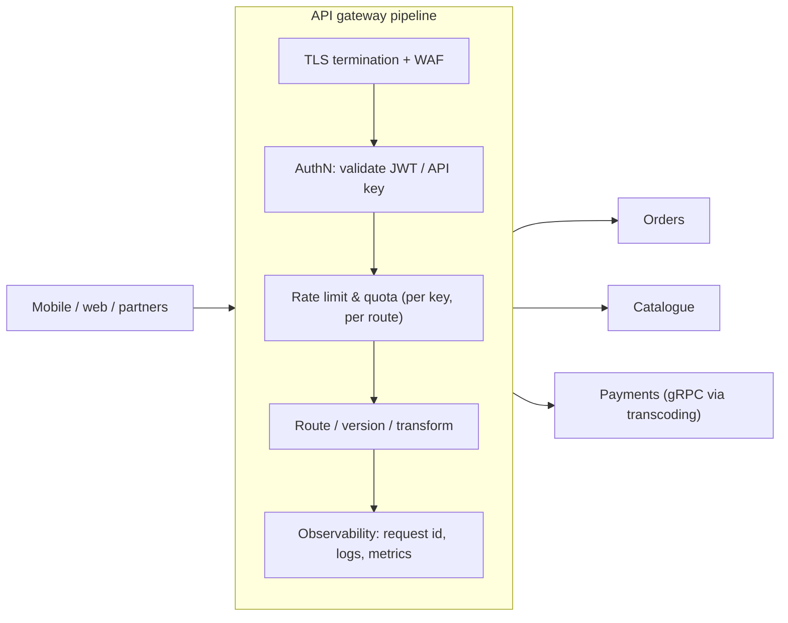

Products: AWS API Gateway, Kong, Apigee, Tyk, Spring Cloud Gateway, Envoy Gateway, NGINX, Traefik, Azure APIM.

#### Example
A fintech exposes partner APIs through Kong: OAuth2 client credentials plus mTLS for partners, 100 req/s per partner with 1M/day quotas, request and response logging (masked PANs) for audit, routing `/v1/payouts` to the payouts service and `/v1/accounts` to accounts, and canary routing 5% of `/v2/payouts` traffic to a new version. Services trust the gateway-injected `X-Partner-Id` (over mTLS within the mesh).

#### Trade-offs
Centralised security and governance with a simple client surface, but a critical path component (must be HA and fast), and a risk of becoming a bottleneck or a business-logic dumping ground.

#### Problems & fixes
| Symptom | Cause | Fix |
|---|---|---|
| Gateway outage = full outage | single cluster/region | HA across AZs/regions, autoscaling |
| Gateway changes block teams | centralised ownership of routes | declarative per-team config (GitOps), self-service |
| Business logic creeping in | convenience | keep gateway policy-only, logic in services/BFF |
| Services reachable around gateway | open network paths | private services, mTLS, verify gateway identity |

#### Cheat sheet
- Front door: TLS, auth, rate limits, routing, transforms, observability.
- Thin and highly available. Self-service config per team.
- Services must not be bypassable around it.

#### Interview questions
<details><summary>What belongs in an API gateway and what doesn't?</summary>

It belongs there if it's cross-cutting and generic: TLS termination, authentication (token validation), coarse authorisation (scopes), rate limiting and quotas, routing and versioning, request size limits, CORS, logging and metrics, and protocol translation. It doesn't belong there if it's business logic, data aggregation tailored to one client (that's a BFF), or fine-grained authorisation needing domain data (that belongs in the services).
</details>

<details><summary>How do you avoid the gateway becoming a single point of failure?</summary>

Run multiple stateless instances across AZs behind a load balancer (or use a managed, multi-AZ gateway), autoscale, keep shared state (rate-limit counters) in a resilient store with local fallbacks, deploy gateway config gradually (canary), and consider regional gateways with global routing for multi-region setups.
</details>

#### Interview angle
> "One thin, highly available gateway handles TLS, JWT validation, per-client rate limits and routing, with no business logic. Each team owns its routes declaratively."

### Backend for Frontend (BFF) — separate API layer per client type (iOS, Android, web, third-party)
A Backend for Frontend is an API layer **dedicated to one type of client** (mobile app, web app, partner API), owned by the team building that client. It aggregates and shapes data from many microservices into exactly what that client's screens need, without bloating a single general-purpose API.

#### How it works
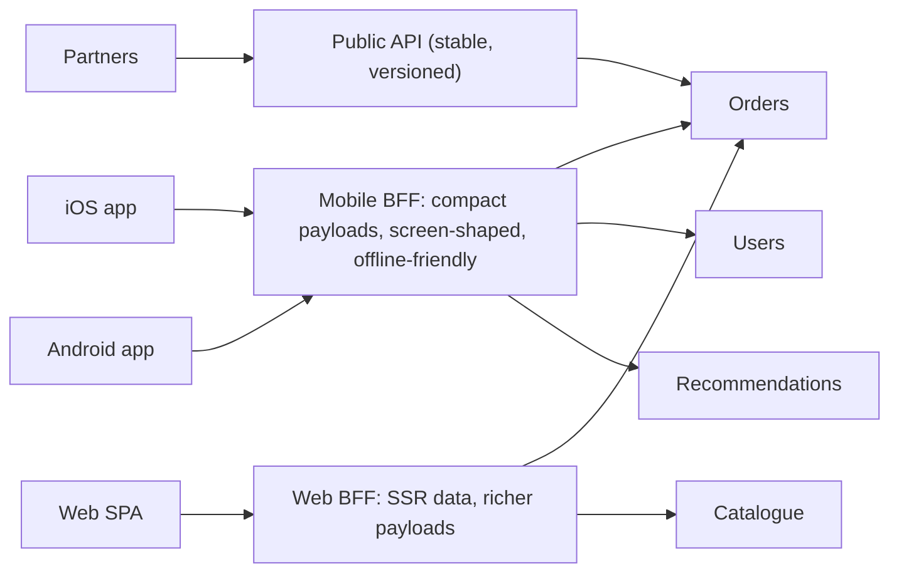

Responsibilities: aggregation (parallel calls), shaping and trimming payloads, client-specific auth flows (session cookies for web, tokens for mobile), caching per screen, feature flags and A/B variants, and handling backwards compatibility for old app versions.

#### Example
A food-delivery app's home screen needed data from 7 services (location, restaurants, offers, recommendations, user, cart, banners). The Mobile BFF exposes `GET /home?lat&lng`, calls the 7 services in parallel with timeouts and fallbacks, and returns one 15 KB response tailored to the app. The web team has its own BFF with different needs (SEO, SSR). Mobile releases no longer wait for backend teams to change general APIs.

#### Trade-offs
Optimal client experience and client-team autonomy, but more services to maintain, possible duplicated logic across BFFs, and BFFs can turn into mini-monoliths if business logic leaks in.

#### Problems & fixes
| Symptom | Cause | Fix |
|---|---|---|
| Business rules duplicated across BFFs | logic moved into BFFs | keep domain logic in services; BFF = composition/shaping |
| BFF latency high | sequential downstream calls | parallel calls, caching, timeouts/fallbacks |
| Too many BFFs | one per tiny client variant | one per client category (mobile vs web) |

#### Cheat sheet
- One API layer per client type, owned by that client's team.
- Aggregate, shape, cache. Parallel calls with fallbacks.
- No domain logic in BFFs.

#### Interview questions
<details><summary>Why have separate BFFs instead of one general API for all clients?</summary>

Clients need different data shapes, payload sizes, auth flows and release cadences: mobile wants compact, screen-shaped responses and support for old app versions, while web may need SSR and richer data. A single general API becomes either chatty (many calls per screen) or bloated (fields everyone pays for), and every change needs cross-team coordination. BFFs let each client team optimise independently.
</details>

<details><summary>BFF vs GraphQL: alternatives or complementary?</summary>

Both solve client-specific data needs. GraphQL gives clients a flexible query language over a unified schema (one server, clients choose fields), while BFFs give each client a hand-tailored REST or RPC layer. They combine well: a GraphQL server can act as the BFF, or BFFs can be built with GraphQL federation. Choose based on team structure and how varied the clients' needs are.
</details>

#### Interview angle
> "Each client type gets a BFF owned by its team, which aggregates services in parallel into screen-shaped responses with fallbacks, while domain logic stays in the services."

### API composition — gateway aggregates multiple downstream service calls into one response
API composition implements queries that need data from several services by having a **composer** (an API gateway, BFF or dedicated service) **call each service and merge the results** into one response. It's the simplest way to query across microservices without sharing databases.

#### How it works
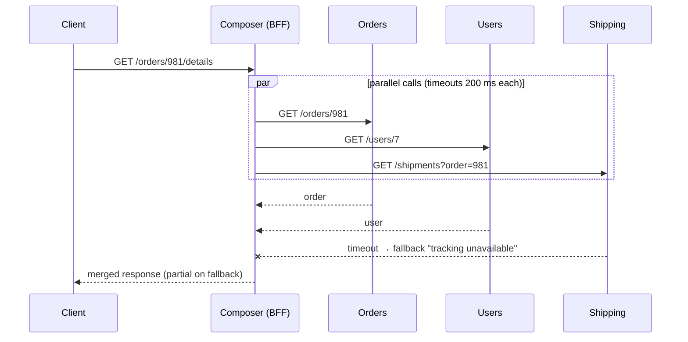

Guidelines: call independent services **in parallel**, apply **per-call timeouts and fallbacks** (partial responses), batch lookups (avoid N+1 across services), and cache rarely changing parts. For heavy or complex joins (filtering and sorting across services), use a **CQRS read model** instead.

#### Example
An order details page composes order, customer, payment and shipment data: four parallel calls give ≈ 60 ms (the slowest) instead of ≈ 200 ms sequentially. A list page ("my last 50 orders with shipment status") would need 50 shipment calls (N+1), so the BFF uses the shipping service's batch endpoint `GET /shipments?orderIds=…` instead, or a read model holding order plus shipment status.

#### Trade-offs
Simple, always fresh data, no extra data stores, but latency is bound by the slowest service, availability is the product of dependencies (unless partial responses are allowed), and it's inefficient for large joins, filters and sorts.

#### Problems & fixes
| Symptom | Cause | Fix |
|---|---|---|
| High latency | sequential calls / N+1 | parallelise, batch endpoints |
| Whole response fails when one service fails | no partial results | fallbacks, partial responses with flags |
| Can't filter/sort across services efficiently | data spread across services | CQRS read model / search index |

#### Cheat sheet
- Composer calls services in parallel and merges.
- Timeouts + fallbacks + batch endpoints.
- Heavy cross-service queries belong in read models.

#### Interview questions
<details><summary>When does API composition stop working well, and what's the alternative?</summary>

When queries need filtering, sorting or pagination across data owned by multiple services ("orders above ₹5,000 from Pune customers with delayed shipments"), or when they fan out to many calls per item (N+1). Then the composer must fetch huge datasets and join in memory. The alternative is a CQRS read model or search index fed by events, which holds the joined data ready for querying.
</details>

<details><summary>How do you keep a composed endpoint available when one dependency fails?</summary>

Call dependencies in parallel with strict timeouts and circuit breakers. Return partial responses with fallbacks for non-critical parts (shipment tracking "unavailable", cached ratings), flagging degraded sections so the client can render appropriately. Fail the whole request only when a critical part (e.g. the order itself) is unavailable.
</details>

#### Interview angle
> "For detail pages the BFF composes services in parallel with timeouts and partial fallbacks. Cross-service filtering or sorting goes to an event-fed read model instead."

### Pagination — offset-based (simple, inconsistent with concurrent mutations) vs cursor-based (consistent, scales)
Pagination splits large result sets into pages. **Offset pagination** (`?page=50&size=20` → `OFFSET 980 LIMIT 20`) is simple but gets slower with depth and skips or duplicates items when data changes. **Cursor (keyset) pagination** (`?after=<cursor>&limit=20` → `WHERE (created_at, id) < (…) LIMIT 20`) stays fast at any depth and is stable under inserts.

#### How it works
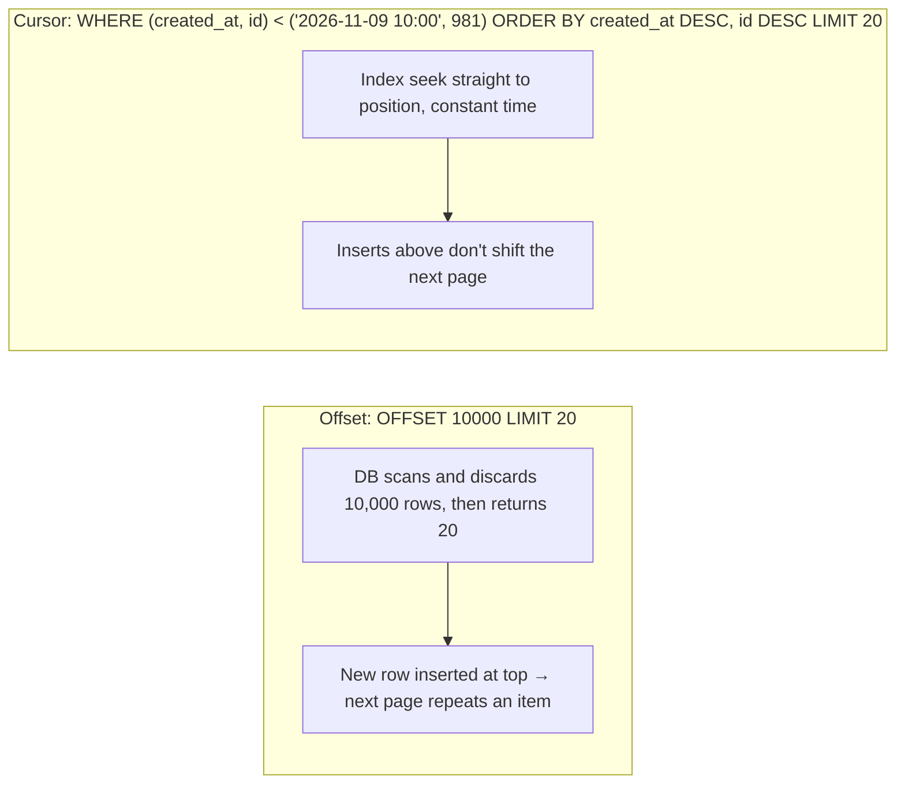

```sql
-- keyset pagination with a composite index (user_id, created_at DESC, id DESC)
SELECT id, created_at, total FROM orders
WHERE user_id = :uid AND (created_at, id) < (:lastCreatedAt, :lastId)
ORDER BY created_at DESC, id DESC
LIMIT 21;   -- fetch one extra to know if there's a next page
```
API response: `{ "items": [...], "nextCursor": "eyJjIjoiMjAyNi0xMS0wOVQxMDowMDowMFoiLCJpIjo5ODF9" }` (an opaque base64 of the last sort key, optionally signed).

#### Example
A transaction history API used offset pagination. Power users scrolling to page 500 caused 4-second queries (`OFFSET 10000`), and new transactions arriving while scrolling caused duplicates in the app. Switching to keyset pagination on `(created_at, id)` made every page ~5 ms and stable. The trade-off: no "jump to page 500" (the UI never needed it).

#### Trade-offs
| Offset | Cursor |
|---|---|
| jump to any page, total pages | only next/previous |
| slow deep pages, unstable with writes | constant speed, stable |
| simple | needs unique sortable key + index |

#### Problems & fixes
| Symptom | Cause | Fix |
|---|---|---|
| Deep pages slow | OFFSET scans | keyset pagination |
| Duplicates/missing items when scrolling | inserts/deletes shift offsets | cursor on stable sort key |
| Cursor ties produce skips | non-unique sort key | add unique tiebreaker (id) |
| `COUNT(*)` for total pages slow | counting huge tables | estimates, "has more" flag instead |

#### Cheat sheet
- Offset = simple, slow deep, unstable. Cursor = fast, stable, next/prev only.
- Cursor on (sort column, unique id) with a matching index. Opaque cursor tokens.
- Fetch limit+1 to know if there's a next page. Avoid exact total counts.

#### Interview questions
<details><summary>Why is OFFSET pagination slow for deep pages?</summary>

The database must produce and discard all rows before the offset (OFFSET 100000 means reading 100,020 rows via the index or a sort) just to return 20. Cost grows linearly with page depth. Keyset pagination seeks directly to the last seen key using an index and reads only the next 20 rows.
</details>

<details><summary>How do you design cursor pagination for a feed sorted by score, where scores aren't unique?</summary>

Sort by `(score DESC, id DESC)` with a composite index, and encode both the last score and id in the cursor. The next page uses `WHERE (score, id) < (:lastScore, :lastId)`. The unique id tiebreaker ensures stable, gap-free paging even with equal scores. Make the cursor opaque (base64, maybe signed) so clients don't depend on its structure.
</details>

#### Interview angle
> "List APIs use opaque keyset cursors on (sort key, id) with a matching index: constant-time pages that stay stable while new rows arrive. Offsets are only for small admin tables."

### Filtering, sorting, field selection (sparse fieldsets) in REST API design
Good list APIs let clients **narrow results (filter)**, **order them (sort)** and **choose which fields to receive (sparse fieldsets)** through consistent query parameters, while the server keeps queries safe and efficient (allow-listed fields, indexed combinations, limits).

#### How it works
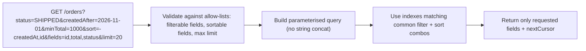

Conventions:
| Need | Style |
|---|---|
| Filter | `?status=SHIPPED&createdAfter=…` or `filter[status]=SHIPPED` (JSON:API), ranges `minTotal/maxTotal` |
| Multiple values | `?status=SHIPPED,DELIVERED` |
| Sort | `?sort=-createdAt,id` (minus = descending) |
| Fields | `?fields=id,total,status` (JSON:API `fields[orders]=…`) |
| Expand related | `?include=customer` / `?expand=items` |
| Search | `?q=iphone` (full-text, separate engine) |

#### Example
A seller dashboard API: `GET /v1/orders?status=PENDING&sort=-createdAt&fields=id,createdAt,total,buyerCity&limit=50`. The server allows filtering only on indexed columns (status, createdAt, buyerCity), sorting by createdAt or total, and caps limit at 100. Returning 4 fields instead of 40 cut payload size by 85% for the mobile seller app.

#### Trade-offs
Flexible APIs and fewer custom endpoints, but arbitrary combinations can hit unindexed queries (slow, DoS-prone), and complexity grows. Constrain the options to what you can serve efficiently.

#### Problems & fixes
| Symptom | Cause | Fix |
|---|---|---|
| Slow queries from unusual filter combos | arbitrary filters on unindexed columns | allow-list filters, composite indexes, search engine for ad-hoc |
| SQL injection via sort/filter params | building SQL from raw params | parameterised queries, map allowed names to columns |
| Huge responses | no field selection / limit | sparse fieldsets, max limit |
| Inconsistent conventions across services | no guidelines | API style guide, linting OpenAPI specs |

#### Cheat sheet
- Filters, `sort=-field`, `fields=`, `include=`, limit + cursor.
- Allow-list everything. Parameterise. Index common combinations.
- Ad-hoc search → Elasticsearch, not unbounded SQL filters.

#### Interview questions
<details><summary>How do you prevent flexible filtering and sorting from becoming a performance or security problem?</summary>

Allow-list filterable and sortable fields (mapping API names to columns, never passing raw strings into SQL), enforce maximum page sizes, require at least one selective filter for large tables, create composite indexes for supported combinations, rate-limit expensive queries, and route free-form search to a search engine designed for it.
</details>

<details><summary>What's the benefit of sparse fieldsets for mobile clients?</summary>

Smaller payloads (less bandwidth, faster parsing, lower battery use), less server serialisation work, and sometimes cheaper queries (fewer joins or columns). Clients take only what each screen needs, reducing the need for client-specific endpoints.
</details>

#### Interview angle
> "List endpoints support allow-listed filters, sort=-createdAt style ordering and sparse fieldsets, mapped to parameterised queries on indexed combinations, while free-form search goes to Elasticsearch."

### GraphQL federation — compose multiple subgraph schemas into unified API (Apollo Federation)
GraphQL federation lets **each team own a subgraph** (its part of the schema, served by its own service) while clients see **one unified supergraph** through a **router/gateway** that plans queries across subgraphs. Entities can be extended across subgraphs via keys, e.g. the reviews subgraph adds `Product.reviews`.

#### How it works
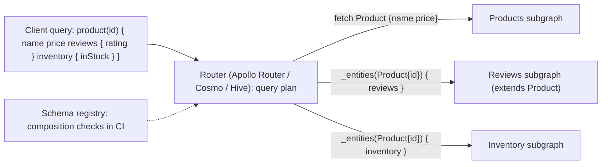

```graphql
# products subgraph
type Product @key(fields: "id") { id: ID!  name: String!  price: Int! }
# reviews subgraph
type Product @key(fields: "id") { id: ID!  reviews: [Review!]! }
type Review { rating: Int!  text: String }
```

#### Example
A marketplace with 8 domain teams: each team publishes its subgraph schema, and CI runs composition checks against the registry (catching breaking changes before deploy). Web and mobile query one endpoint. The product page query is planned into 3 parallel subgraph fetches by the router, with entity batching to avoid N+1.

#### Trade-offs
One unified API with distributed ownership and strong tooling, but router performance and query planning complexity, cross-subgraph N+1 risks, governance (naming, ownership of shared types), and operational overhead.

#### Problems & fixes
| Symptom | Cause | Fix |
|---|---|---|
| Composition breaks after a subgraph deploy | uncoordinated schema change | schema checks in CI against registry |
| Slow queries spanning many subgraphs | deep cross-subgraph dependencies | design entity boundaries, batching, caching, query cost limits |
| Shared types fought over | unclear ownership | ownership rules, `@shareable` sparingly |

#### Cheat sheet
- Subgraphs per team, composed into a supergraph, with a router planning queries.
- `@key` entities extended across subgraphs. Registry checks in CI.
- Watch N+1 across subgraphs. Cost limits and persisted queries.

#### Interview questions
<details><summary>Why use GraphQL federation instead of one monolithic GraphQL server?</summary>

A single GraphQL server owned by one team becomes a bottleneck: every domain change needs that team, and it accumulates logic from everywhere. Federation lets each domain team own and deploy its subgraph independently, while clients still get one schema. Composition checks keep the unified graph consistent.
</details>

<details><summary>How does the router resolve a field owned by another subgraph?</summary>

It builds a query plan: it fetches the base entity (e.g. Product id and name) from the owning subgraph, then calls other subgraphs' `_entities` resolver with entity representations (`{__typename: "Product", id: "42"}`, batched) to fetch extended fields (reviews, inventory), and merges the results.
</details>

#### Interview angle
> "With many domain teams I'd federate GraphQL: each team owns a subgraph, a router plans queries across them, and registry composition checks in CI stop breaking changes."

### Rate limiting at gateway — token bucket per API key/user, per endpoint; return 429 with Retry-After header
Rate limiting at the gateway protects services from overload and abuse, and enforces fair use and commercial quotas. Each client (API key, user, IP) gets a budget per time window, usually implemented as a **token bucket** in a shared store. Excess requests get **429 Too Many Requests** with `Retry-After` and rate-limit headers.

#### How it works
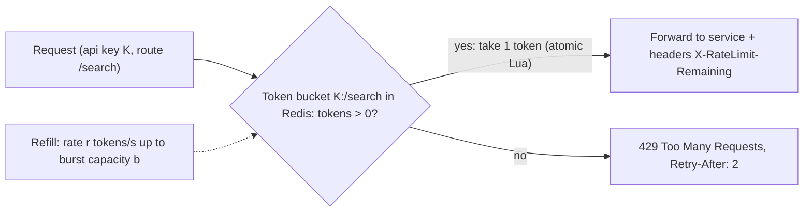

```lua
-- Redis token bucket (KEYS[1]=bucket, ARGV: rate, capacity, now_ms, cost)
local b = redis.call('HMGET', KEYS[1], 'tokens', 'ts')
local tokens = tonumber(b[1]) or tonumber(ARGV[2])
local ts = tonumber(b[2]) or tonumber(ARGV[3])
tokens = math.min(tonumber(ARGV[2]), tokens + (tonumber(ARGV[3]) - ts) * tonumber(ARGV[1]) / 1000)
local allowed = tokens >= tonumber(ARGV[4])
if allowed then tokens = tokens - tonumber(ARGV[4]) end
redis.call('HSET', KEYS[1], 'tokens', tokens, 'ts', ARGV[3])
redis.call('PEXPIRE', KEYS[1], 60000)
return allowed and 1 or 0
```

Algorithms: token bucket (allows bursts), leaky bucket (smooth output), fixed window (simple, has boundary bursts), sliding window log or counter (accurate). Layers: per IP at the edge (abuse), per API key or user (fairness and quotas), per endpoint (protect expensive routes like `/search`, `/otp`), global (protect backend capacity).

#### Example
A public API: free tier 10 req/s with a burst of 20, paid tier 200 req/s, `/otp/send` limited to 3 per 10 minutes per phone number (anti-abuse, SMS cost). Kong with its Redis rate-limiting plugin enforces this across 12 gateway nodes, and when Redis is unreachable it falls back to local per-node limits (fail open for normal APIs, fail closed for OTP).

#### Trade-offs
Protects capacity and enables tiers, but needs a shared counter store (latency, availability), precise distributed limits are costly (local approximations are cheaper), and badly tuned limits block legitimate bursts.

#### Problems & fixes
| Symptom | Cause | Fix |
|---|---|---|
| Limits inaccurate across gateway nodes | local counters only | shared Redis counters, or local with per-node share |
| Redis latency adds to every request | remote check per request | local token caches/leases, pipelining |
| Clients hammer after 429 | no Retry-After / bad clients | Retry-After + client backoff guidance |
| Abuse via many IPs | per-IP limits only | per account/key/device + bot detection |

#### Cheat sheet
- Token bucket per key/user/endpoint in Redis (atomic Lua).
- 429 + Retry-After + X-RateLimit-* headers.
- Layer limits (IP, key, endpoint, global). Decide fail-open vs fail-closed.

#### Interview questions
<details><summary>Token bucket vs sliding window: which for a public API?</summary>

Token bucket: it enforces an average rate while allowing short bursts up to the bucket size, which matches real client behaviour, and it's cheap (two numbers per key). Sliding window counters give smoother, more precise limits without boundary bursts, useful for strict quotas. Many gateways use token bucket for rate and windowed counters for daily or monthly quotas.
</details>

<details><summary>Should the rate limiter fail open or closed if Redis is down?</summary>

It depends on the endpoint. For general APIs, fail open (allow traffic, maybe with local per-node limits) so a limiter outage doesn't become a full outage. For abuse-sensitive or costly endpoints (OTP, login, payments), fail closed or use strict local limits, since unlimited access is riskier than temporary rejection.
</details>

#### Interview angle
> "The gateway enforces Redis token buckets per API key and endpoint, returns 429 with Retry-After, has tighter limits on expensive routes like OTP, and falls back to local limits if Redis is unavailable."

### OAuth 2.0 authorization code + PKCE — for SPA and mobile (prevents authorization code interception)
The **authorization code flow with PKCE** is the standard way for apps acting on behalf of a user (SPAs, mobile, server web apps) to get tokens: the user logs in at the authorization server, the app receives a short-lived **code**, and exchanges it for tokens. **PKCE** (Proof Key for Code Exchange) binds the code to the app instance with a one-time secret, so an intercepted code is useless.

#### How it works
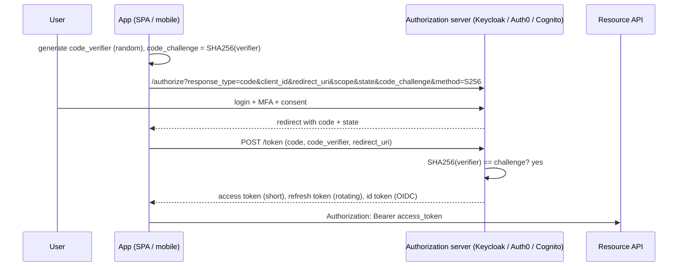

Best practices (OAuth 2.1): always PKCE (even for confidential clients), no implicit flow, exact redirect URI matching, a `state` parameter (CSRF) and `nonce` (OIDC replay), short-lived access tokens, rotating refresh tokens. For SPAs prefer the **BFF pattern** (tokens kept server-side, session cookie to the browser).

#### Example
A banking mobile app uses authorization code + PKCE via the system browser (ASWebAuthenticationSession / Custom Tabs, never an embedded WebView), with access tokens of 5 minutes and refresh tokens rotated on every use, bound to the device and stored in Keychain/Keystore. A malicious app registering the same custom URL scheme can't redeem an intercepted code without the verifier.

#### Trade-offs
Secure delegated access without sharing passwords, standard and interoperable. The flow, token storage and renewal are complex (use certified libraries).

#### Problems & fixes
| Symptom | Cause | Fix |
|---|---|---|
| Code interception on mobile | custom scheme hijacking | PKCE (S256), universal/app links |
| Tokens stolen from browser storage | SPA stores tokens in localStorage | BFF pattern with HttpOnly session cookie |
| Open redirect / token leakage | loose redirect URI matching | exact redirect URIs |
| Long-lived stolen tokens | long access token TTL | short access tokens, refresh rotation + reuse detection |

#### Cheat sheet
- Authorization code + PKCE (S256) for any user-facing app. Implicit flow is dead.
- state + nonce, exact redirect URIs, system browser on mobile.
- Short access tokens, rotating refresh tokens. SPA via BFF.

#### Interview questions
<details><summary>What attack does PKCE prevent?</summary>

Authorization code interception: on mobile (or in public clients), a malicious app or intermediary could capture the authorization code from the redirect and exchange it for tokens. With PKCE, the token request must include the original random code_verifier whose hash was sent in the authorize request. The attacker has only the code, not the verifier, so the exchange fails.
</details>

<details><summary>How should a single-page app handle OAuth tokens securely?</summary>

Preferably with a backend-for-frontend: the BFF performs the authorization code + PKCE flow server-side, keeps access and refresh tokens server-side, and gives the browser an HttpOnly, Secure, SameSite session cookie. That avoids exposing tokens to JavaScript (XSS). If tokens must live in the browser, keep them in memory only, short-lived, with refresh token rotation.
</details>

#### Interview angle
> "User-facing apps use authorization code with PKCE via the system browser, short access tokens and rotating refresh tokens. For SPAs I keep tokens in a BFF behind an HttpOnly cookie."

### OAuth 2.0 client credentials — for server-to-server, no user involved
The **client credentials grant** is for **machine-to-machine** access: a service authenticates as itself (client id + secret, private key JWT, or mTLS) to the authorization server and gets an access token with **scopes** for the APIs it may call. No user is involved.

#### How it works
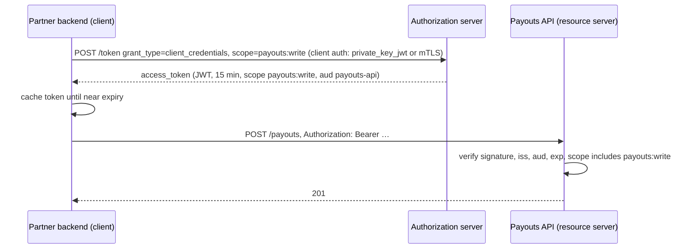

Client authentication options (strongest last): `client_secret_basic`/`post` → `private_key_jwt` (signed assertion, no shared secret) → **mTLS-bound tokens** (RFC 8705, the token is only usable with the client certificate).

#### Example
A fintech's partner integration: each partner gets a client registered with `private_key_jwt` authentication and scopes (`payouts:write`, `accounts:read`). Tokens last 15 minutes and are cached by the partner SDK. The gateway enforces scopes per route and rate limits per client id. Internally, service-to-service calls use mesh mTLS identity, and calls to third-party APIs use client credentials.

#### Trade-offs
A standard, scoped, revocable machine identity, but secret management (rotate secrets or prefer keys/mTLS) and token caching are needed (don't request a token per call).

#### Problems & fixes
| Symptom | Cause | Fix |
|---|---|---|
| Auth server overloaded | token requested per API call | cache tokens until near expiry |
| Leaked client secret | secrets in code/config repos | private_key_jwt or mTLS, secret manager, rotation |
| Over-privileged clients | broad scopes | least-privilege scopes per client, audience restriction |
| Stolen token reused elsewhere | bearer tokens | sender-constrained tokens (mTLS-bound, DPoP) |

#### Cheat sheet
- Machine-to-machine: client authenticates as itself and gets a scoped access token.
- Cache tokens. Least-privilege scopes. Audience-restricted.
- Prefer private_key_jwt / mTLS over shared secrets.

#### Interview questions
<details><summary>When would you use client credentials vs authorization code?</summary>

Client credentials when there's no user context: backend jobs, service-to-service calls, partner server integrations acting as the partner organisation. Authorization code (+ PKCE) when an application acts on behalf of a specific user who logs in and grants consent.
</details>

<details><summary>How do you make client credentials tokens harder to misuse if stolen?</summary>

Short lifetimes, narrow scopes and a specific audience, and sender-constrained tokens: mTLS certificate-bound tokens (the API checks the token's certificate thumbprint matches the client's TLS certificate) or DPoP proof-of-possession, so a stolen token alone can't be used. Plus IP allow-listing and monitoring for anomalous usage.
</details>

#### Interview angle
> "Partner backends use client credentials with private_key_jwt or mTLS-bound tokens, narrow scopes and short cached tokens. Internal service-to-service calls rely on mesh mTLS identities."

### OpenID Connect (OIDC) — authentication layer on top of OAuth 2.0: ID token (JWT) carries user identity
OAuth 2.0 is about **authorization** (granting access to APIs). **OpenID Connect** adds **authentication** on top: alongside access tokens, the authorization server (the OpenID Provider) issues an **ID token**, a signed JWT stating **who the user is** and how they authenticated, plus a standard `/userinfo` endpoint and discovery metadata.

#### How it works
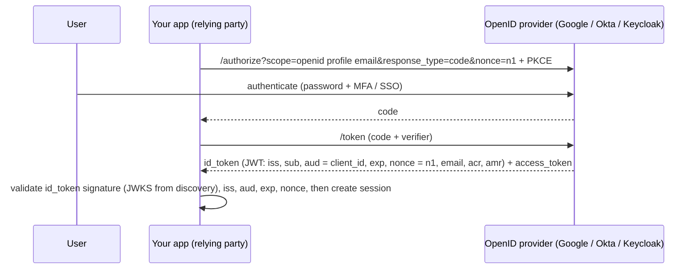

Key pieces: the `openid` scope, the ID token (for the client, **not** for calling APIs), the access token (for APIs), `/.well-known/openid-configuration` discovery, JWKS, standard claims (`sub`, `email`, `name`), `acr`/`amr` (authentication strength, e.g. MFA), and logout mechanisms.

#### Example
"Sign in with Google" for a consumer app, and Okta SSO for internal tools: both use OIDC. The app validates the ID token, maps `sub` to a local user, and creates its own session. For employee tools, `acr` must indicate MFA, and group claims drive role mapping. The access token (audience = internal API) is used for API calls, never the ID token.

#### Trade-offs
Standard SSO and federated identity with strong security properties, but token validation details matter (aud, nonce, alg), and claims can go stale (refresh profile data).

#### Problems & fixes
| Symptom | Cause | Fix |
|---|---|---|
| ID token used to call APIs | confusing ID vs access tokens | APIs accept access tokens with correct audience only |
| Replay of ID tokens | nonce not checked | validate nonce, short expiry |
| Accounts linked by email takeover | trusting unverified email | link on `sub` + issuer, require `email_verified` |
| Key rotation breaks login | cached JWKS without refresh | refresh JWKS on unknown `kid` |

#### Cheat sheet
- OIDC = OAuth 2.0 + ID token (who the user is) + discovery + userinfo.
- ID token for the client, access token for APIs.
- Validate iss, aud, exp, nonce and signature via JWKS. Identify users by (iss, sub).

#### Interview questions
<details><summary>What's the difference between an ID token and an access token?</summary>

The ID token (OIDC) is for the client application: a JWT asserting the user's identity and authentication details, with audience = the client id. The access token (OAuth) is for resource servers (APIs): it authorises access to specific scopes and audience, and its format may be opaque to the client. APIs must not accept ID tokens as authorisation.
</details>

<details><summary>How should you uniquely identify a user from an OIDC login?</summary>

By the pair (issuer `iss`, subject `sub`): `sub` is stable and unique only within an issuer. Email can change, be reassigned or be unverified, so using email as the key enables account takeover. Store email as an attribute, and require `email_verified=true` before trusting it for linking.
</details>

#### Interview angle
> "Login uses OIDC: the app validates the ID token (signature, iss, aud, nonce), keys users by (iss, sub) and creates its own session, while APIs accept only access tokens with the right audience."

### JWT structure — header (alg, typ) + payload (sub, iss, aud, exp, iat) + signature (HMAC-SHA256 or RS256)
A JSON Web Token has three base64url-encoded parts separated by dots: a **header** (algorithm, type, key id), a **payload** (claims) and a **signature** over the first two. The signature proves integrity and origin. The payload is **readable by anyone**: JWTs are signed, not encrypted (unless you use JWE). (Phase 5 covers stateless auth usage.)

#### How it works
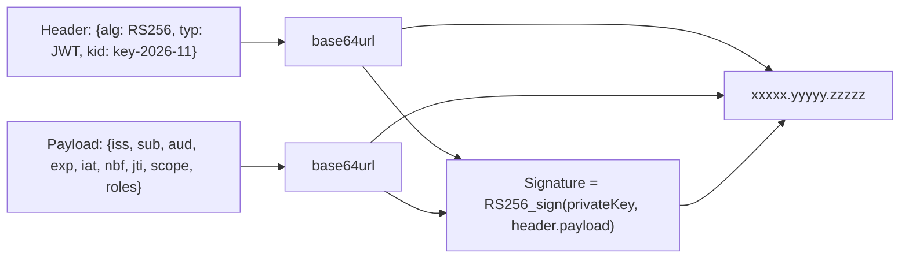

Registered claims:
| Claim | Meaning |
|---|---|
| `iss` | issuer (who created it) |
| `sub` | subject (user or client id) |
| `aud` | audience (intended recipient API) |
| `exp` / `nbf` / `iat` | expiry, not-before, issued-at (epoch seconds) |
| `jti` | unique token id (revocation, replay detection) |

Algorithms: **HS256** (HMAC with a shared secret: anyone who can verify can also sign), **RS256 / ES256 / EdDSA** (asymmetric: sign with a private key, verify with a public key from JWKS). Never accept `alg: none`.

#### Example
Decoded access token from a bank's auth server:
```json
{"alg":"ES256","typ":"JWT","kid":"2026-11-a"}
{"iss":"https://auth.bank.in","sub":"cust_88123","aud":"accounts-api","scope":"accounts:read",
 "exp":1762682100,"iat":1762681200,"jti":"5f1c…","acr":"mfa"}
```
Anyone can read it (so no PAN, Aadhaar or balances inside), but nobody can modify it without invalidating the ES256 signature.

#### Trade-offs
Self-contained and verifiable offline (no lookups), but larger than opaque tokens, readable by anyone, and hard to revoke before expiry.

#### Problems & fixes
| Symptom | Cause | Fix |
|---|---|---|
| PII exposure | sensitive data in payload | minimal claims, opaque ids; JWE if confidentiality needed |
| Forged tokens accepted | `alg:none` / algorithm confusion (RS→HS) | pin expected algorithms per key |
| Every service can mint tokens | HS256 shared secret everywhere | asymmetric algorithms, JWKS |
| Token too large (header limits) | many roles/claims | fewer claims, fetch permissions server-side |

#### Cheat sheet
- header.payload.signature (base64url). Signed, not encrypted.
- Claims: iss, sub, aud, exp, iat, nbf, jti (+ scope/roles).
- Prefer RS256/ES256 with kid + JWKS. Never alg none. No secrets in the payload.

#### Interview questions
<details><summary>Can a client read and modify a JWT's payload?</summary>

Read: yes, the payload is just base64url-encoded JSON, so anyone holding the token can decode it, and you shouldn't put secrets or sensitive personal data in it. Modify: they can change the bytes, but the signature will no longer verify, and a correctly implemented server rejects the token.
</details>

<details><summary>What is the "algorithm confusion" attack on JWTs?</summary>

If a server trusts the token's `alg` header, an attacker can switch an RS256 token to HS256 and sign it with the server's public key as an HMAC secret (public keys are public). A naive library then verifies the HMAC with that same public key and accepts a forged token. Prevent it by fixing the expected algorithm per key server-side and never accepting `none`.
</details>

#### Interview angle
> "JWTs are signed but readable, so claims stay minimal (iss, sub, aud, exp, scope, jti) with no PII, signed with ES256 or RS256, published via JWKS with a kid, and the algorithm pinned on the server."

### JWT validation — verify signature, check exp, iss, aud claims; short expiry + refresh token rotation
Validating a JWT correctly is security-critical: **verify the signature** with the right key and algorithm, then check **expiry and time claims**, **issuer**, **audience** and required **scopes**. Pair short-lived access tokens with **rotating refresh tokens** (and reuse detection) so stolen tokens have limited value.

#### How it works
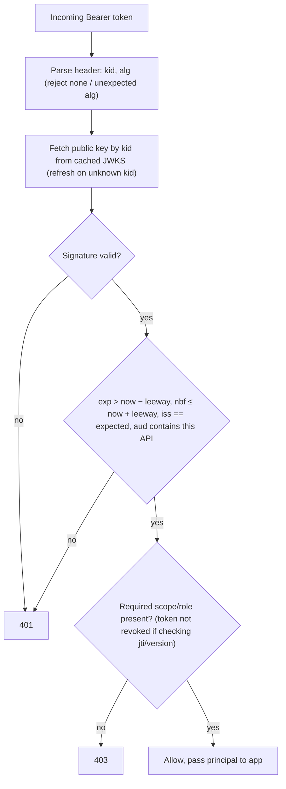

Refresh token rotation: each use of a refresh token returns a **new** refresh token and invalidates the old one. If an **old** refresh token is used again (reuse), it's likely stolen, so revoke the whole token family and force re-login.

Spring Security resource server:
```yaml
spring.security.oauth2.resourceserver.jwt:
  issuer-uri: https://auth.shop.com/realms/prod      # discovers JWKS, validates iss
  audiences: orders-api                              # Spring Boot 3.x audience validation
```

#### Example
A security review found the orders API validated signatures but not `aud`, so tokens issued for the low-privilege "analytics-api" were accepted by the orders API (same issuer and keys). Adding audience validation, scope checks per endpoint, 10-minute access tokens and refresh rotation with reuse detection closed the gap.

#### Trade-offs
Local validation is fast and stateless, but revocation is delayed until expiry (unless you add a denylist check for sensitive operations), and clock skew needs leeway.

#### Problems & fixes
| Symptom | Cause | Fix |
|---|---|---|
| Tokens for other APIs accepted | no audience check | validate `aud` per API |
| Random "token expired"/"not yet valid" | clock skew | small leeway (30–60 s), NTP |
| Logins break after key rotation | static keys / stale JWKS cache | JWKS with kid, refresh on unknown kid, key overlap |
| Stolen refresh token used indefinitely | non-rotating refresh tokens | rotation + reuse detection + device binding |

#### Cheat sheet
- Verify signature (pinned alg, kid → JWKS) → exp/nbf (leeway) → iss → aud → scopes.
- Access tokens 5–15 minutes. Refresh tokens rotate with reuse detection.
- Denylist (jti/version) only for high-risk paths.

#### Interview questions
<details><summary>List the checks an API must perform on an incoming JWT access token.</summary>

Verify the signature using the issuer's key (by kid from JWKS) and only allowed algorithms. Check `exp` (not expired) and `nbf`/`iat` with small leeway. `iss` equals the trusted issuer, `aud` includes this API, the token type is an access token (not an ID token), and the required scopes or roles for the endpoint are present. Optionally check revocation for sensitive operations.
</details>

<details><summary>What is refresh token reuse detection?</summary>

With rotation, every refresh returns a new refresh token and invalidates the previous one. If a previously used (invalidated) refresh token is presented again, either the legitimate client or an attacker has a copy, which signals theft. The server revokes the entire refresh token family (all descendants), forcing re-authentication, which limits how long a stolen refresh token stays useful.
</details>

#### Interview angle
> "APIs validate JWTs fully: pinned algorithm via JWKS, exp with leeway, issuer, audience and scopes. Access tokens live 10 minutes, and refresh tokens rotate with reuse detection."

### API contract testing — Pact (consumer-driven contracts): consumer defines expectations, provider verifies
Contract testing checks that a provider's API (or message format) still satisfies what its consumers actually use, **without full end-to-end environments**. In **consumer-driven contract testing** (Pact), each consumer records its expectations as a contract, and the provider's CI **verifies** it against those contracts before deploying.

#### How it works
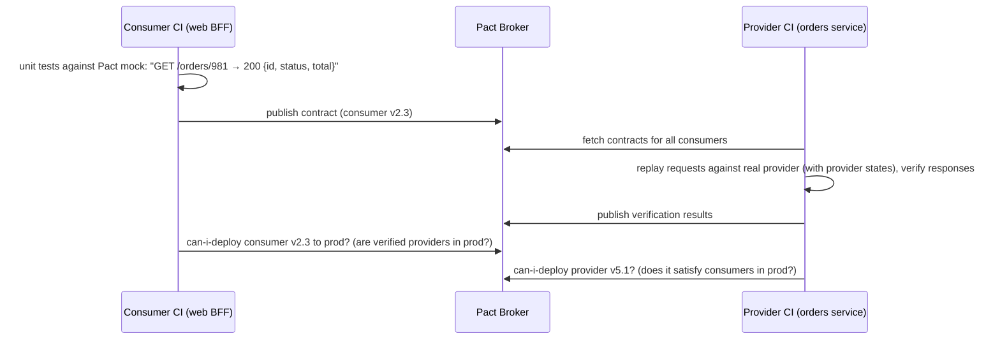

Key ideas: contracts contain **only what the consumer uses** (so providers can change everything else freely), **provider states** set up test data ("order 981 exists"), the **can-i-deploy** gate in pipelines, and support for message contracts (Kafka events) as well as HTTP.

Alternatives: provider-driven contracts (OpenAPI + schema validation, Spring Cloud Contract), schema registries for events.

#### Example
The orders team wanted to rename `total` to `totalAmount`. Their CI ran Pact verification and failed: the mobile BFF and the invoicing service both used `total`. The team added `totalAmount` alongside, consumers migrated and published new contracts, and then `total` could be removed safely. There was no production incident, and no 2-hour end-to-end test suite was needed.

#### Trade-offs
Fast, reliable feedback on integration breakages and independent deploys, but contracts need maintenance, the broker is extra infrastructure, and it doesn't test end-to-end business flows or performance.

#### Problems & fixes
| Symptom | Cause | Fix |
|---|---|---|
| Breaking API changes reach prod | only provider-side tests | consumer-driven contracts + can-i-deploy |
| Brittle contracts (exact values) | over-specified expectations | matchers (type/regex), only used fields |
| Slow, flaky E2E suites | relying on E2E for integration | contract tests for interfaces, few E2E smoke tests |

#### Cheat sheet
- The consumer records expectations, the provider verifies in CI, and the broker gates deploys.
- Contracts include only the fields used. Use matchers, not exact values.
- Works for HTTP and messages. Complements OpenAPI and schema registries.

#### Interview questions
<details><summary>How do contract tests let microservices deploy independently?</summary>

Each consumer publishes the exact interactions it relies on, and providers verify against all consumers' contracts in their own CI. A deployment gate (can-i-deploy) checks that the version being deployed is compatible with the versions currently in each environment. Breaking changes are caught before deploy without spinning up all services together.
</details>

<details><summary>Contract tests vs end-to-end tests: how should you balance them?</summary>

Use contract tests for every service interface (fast, deterministic, run on every change) and unit and component tests within services. Keep a small number of end-to-end smoke tests for critical user journeys (checkout, login) in a production-like environment. Relying mainly on E2E tests makes pipelines slow and flaky, and failures are hard to localise.
</details>

#### Interview angle
> "Interfaces between services are protected by Pact consumer-driven contracts with a can-i-deploy gate, so providers know before deploying exactly which consumer fields they'd break. End-to-end tests are just a thin smoke layer."

### OpenAPI / Swagger specification — machine-readable API contract, enables code generation
OpenAPI (formerly Swagger) is the standard **machine-readable description of HTTP APIs**: paths, methods, parameters, request and response schemas, auth schemes, errors and examples, in YAML or JSON. It powers documentation, client and server code generation, validation, mocking, linting and gateway configuration.

#### How it works
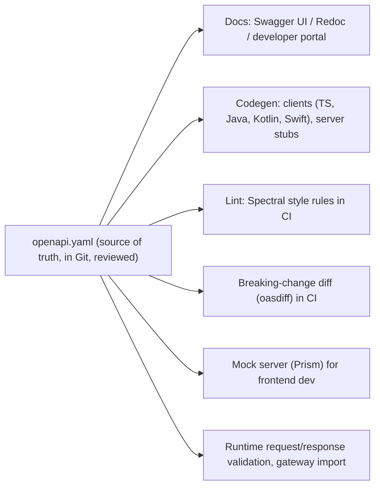

```yaml
openapi: 3.1.0
info: { title: Orders API, version: 1.4.0 }
paths:
  /v1/orders/{orderId}:
    get:
      operationId: getOrder
      parameters: [{ name: orderId, in: path, required: true, schema: { type: string } }]
      responses:
        "200": { description: OK, content: { application/json: { schema: { $ref: "#/components/schemas/Order" } } } }
        "404": { $ref: "#/components/responses/NotFound" }
      security: [{ oauth2: [orders:read] }]
components:
  schemas:
    Order:
      type: object
      required: [id, status, totalMinor, currency]
      properties:
        id: { type: string }
        status: { type: string, enum: [PENDING, PAID, SHIPPED, CANCELLED] }
        totalMinor: { type: integer, format: int64 }
        currency: { type: string, example: INR }
```

Approaches: **design-first** (write the spec, review it, generate code) vs **code-first** (annotations like springdoc generate the spec). Design-first catches API design issues before implementation and enables parallel frontend work.

#### Example
A payments company publishes its merchant API spec in a developer portal. SDKs for Java, Node, Python and PHP are generated from it, CI runs Spectral (naming, error format, pagination rules) and oasdiff (blocking breaking changes on v1), and frontend teams develop against a Prism mock server before the backend is ready.

#### Trade-offs
Single source of truth, automation and consistency, but specs drift from implementation unless enforced (tests or validation), generated code can be clunky, and large specs need modular organisation.

#### Problems & fixes
| Symptom | Cause | Fix |
|---|---|---|
| Docs don't match behaviour | spec drift | generate from code or validate responses in tests |
| Breaking changes shipped | no diff checks | oasdiff in CI against published version |
| Inconsistent APIs across teams | no style rules | Spectral ruleset (errors, naming, pagination) |

#### Cheat sheet
- Machine-readable HTTP contract: docs, codegen, mocks, validation, linting.
- Design-first for public APIs. Lint and diff in CI.
- Keep it in sync via tests or runtime validation.

#### Interview questions
<details><summary>Design-first vs code-first OpenAPI: which do you prefer and why?</summary>

For public or cross-team APIs, design-first: the contract is reviewed with consumers before coding, mocks enable parallel work, and style rules and breaking-change checks apply from the start. Code-first (springdoc annotations) is fine for internal services where speed matters, as long as the generated spec is published and checked in CI.
</details>

<details><summary>How do you detect breaking API changes automatically?</summary>

Compare the new OpenAPI spec with the last released version in CI using a diff tool (oasdiff, openapi-diff), which flags removed endpoints or fields, new required parameters, type changes and narrowed enums, and fail the build for non-additive changes on a stable version. Combine with consumer contract tests for real usage.
</details>

#### Interview angle
> "Public APIs are design-first OpenAPI specs: Spectral style rules and oasdiff breaking-change checks in CI, generated SDKs, and mock servers so frontend work starts before the backend."
