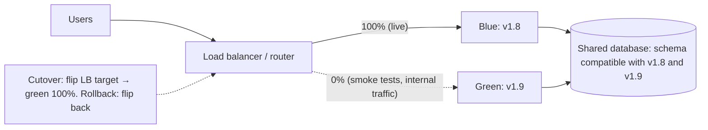
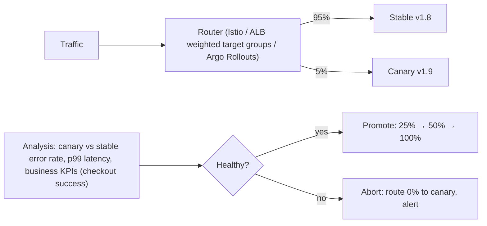
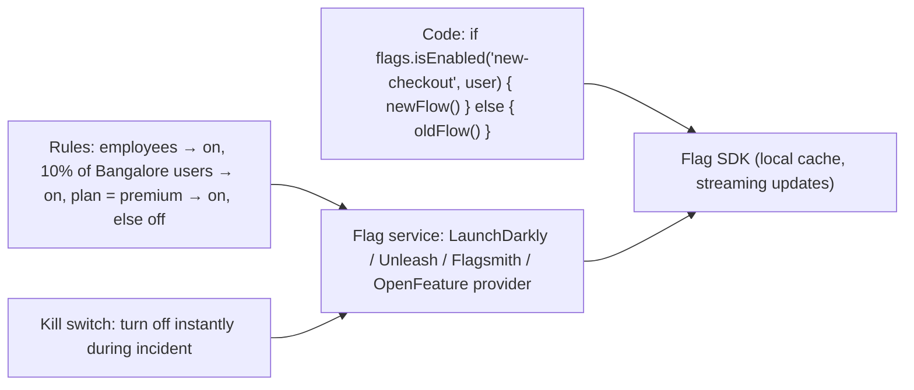
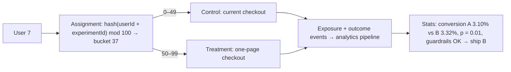
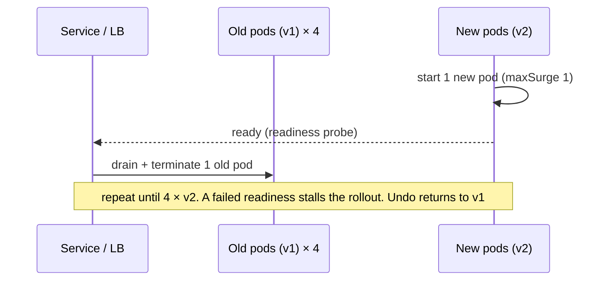
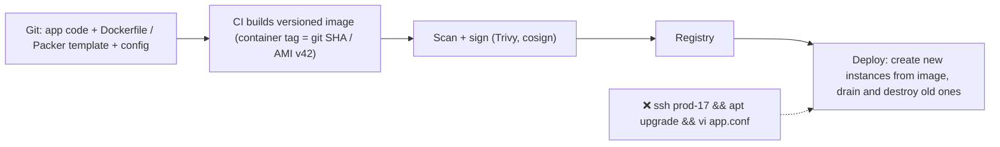
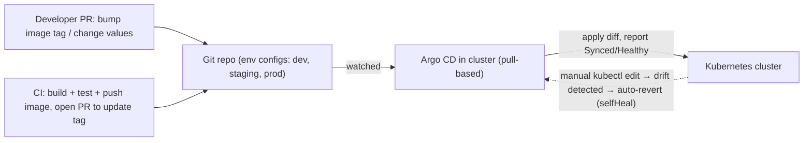
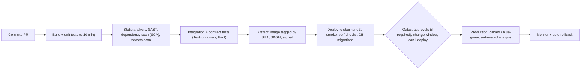
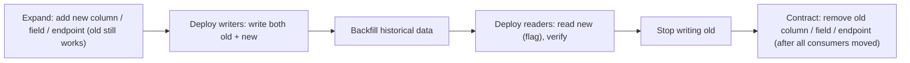
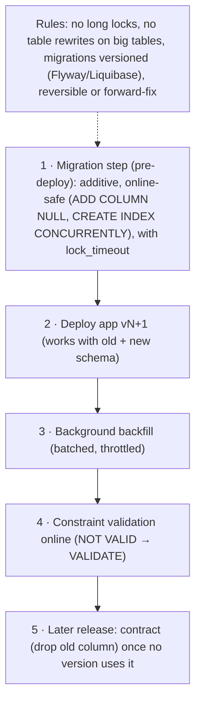

## Deployment & release patterns

### Blue-green deployment — two identical environments; instant cutover by switching load balancer target
Blue-green deployment keeps **two identical production environments**. "Blue" serves live traffic while "green" gets the new version. After testing green, you **switch traffic** at the load balancer or DNS in one step, and roll back instantly by switching back.

#### Intuition
A theatre with two identical stages. The show runs on one while the crew sets up the next show on the other. When it is ready, the spotlight swings across. If something is wrong, it swings straight back.

#### Must know
- Two identical production environments: **blue is live, green gets the new version**.
- Test and warm green, then **switch all traffic in one step** at the load balancer.
- **Rollback is the same switch in reverse**, and takes seconds.
- Both versions share the database, so schema changes must work with both (expand-contract).
- It costs double capacity during the release.

#### Common mistakes
- A destructive migration in the same release, which makes rollback impossible.
- Switching to a cold green environment with empty caches.
- No connection draining, so in-flight requests are dropped at the switch.

#### How it works


Steps: deploy to green, run smoke and integration tests against green (internal URL), warm caches, switch traffic (ALB listener or target group swap, Kubernetes Service selector change, DNS weight), monitor, keep blue idle for fast rollback, then reuse blue for the next release.

#### Example
A payments API uses blue-green on ECS with CodeDeploy: the new task set receives test traffic on a separate listener port, synthetic payment tests run against it, then CodeDeploy shifts the production listener all at once. A spike in 5xx within 10 minutes triggers automatic rollback to the previous task set, which takes seconds. The database schema is changed with expand-contract beforehand, so both versions work.

#### Trade-offs
| Pros | Cons |
|---|---|
| instant cutover and rollback | double capacity during release (cost) |
| test the exact production environment before traffic | big-bang switch: all users hit new version at once |
| simple mental model | shared DB/state must be compatible with both versions |

#### Problems & fixes
| Symptom | Cause | Fix |
|---|---|---|
| Rollback fails because DB changed | destructive migration in release | expand-contract migrations |
| Errors right after switch | cold caches/JIT on green | warm green before cutover |
| In-flight requests dropped at switch | no draining | connection draining on old environment |
| Long-lived connections stay on blue | WebSockets/HTTP2 pinned | graceful reconnect strategy |

#### Cheat sheet
- Two environments, flip traffic, flip back to roll back.
- Needs backward-compatible DB changes and warm-up.
- Costs double capacity briefly. All users switch at once (unlike canary).

#### Interview questions
<details><summary>What's the hardest part of blue-green deployments?</summary>

State: both environments usually share the database (and caches and queues), so the new version's schema and data changes must be compatible with the old version, otherwise rollback breaks. Use expand-contract migrations, avoid destructive changes in the same release, and make message formats backward compatible.
</details>

<details><summary>Blue-green vs canary: when would you choose each?</summary>

Blue-green when you want instant, simple rollback and can afford duplicate capacity, and the change is well tested (or needs an all-at-once switch, like some infrastructure changes). Canary when you want to limit blast radius by exposing a small percentage of users first and progressing based on metrics. It's slower but safer for risky changes. They combine well: green environment plus gradual traffic shift.
</details>

#### Interview angle
> "Blue-green gives instant rollback: deploy green, smoke-test it, warm it, flip the listener, and flip back on errors. Schema changes are always expand-contract so both versions work against the same database."

#### Sources
- [Blue green deployment](https://martinfowler.com/bliki/BlueGreenDeployment.html) — Martin Fowler
- [Blue/green deployments on AWS](https://docs.aws.amazon.com/whitepapers/latest/blue-green-deployments/welcome.html) — AWS whitepaper

### Canary release — route 1–5% of traffic to new version, monitor error rate, gradually increase
A canary release sends a **small percentage of real traffic** (1–5%) to the new version, compares its health metrics with the stable version, and **gradually increases** the share (5 → 25 → 50 → 100%) if it's healthy, or **aborts automatically** if not. Bad releases then affect only a small slice of users.

#### Intuition
Miners carried a canary underground because it reacted to bad air first. Here a small group of users gets the new version first. If they are fine, everyone follows. If not, only a few were affected.

#### Must know
- Send a **small share of real traffic** to the new version first.
- **Compare canary against stable** on error rate, latency and business metrics such as checkout success.
- Healthy: step up gradually. Unhealthy: **abort automatically** and route back.
- Keep each user on one version (sticky by user id).
- Both versions run together, so data and messages must be compatible.

#### Numbers to quote
- Typical steps: 1–5% → 25% → 50% → 100%, with 10–15 minutes of analysis at each step.

#### Common mistakes
- Judging health on infrastructure metrics only, with no business metric.
- Too little traffic or too short a wait to detect anything.
- Comparing against a fixed threshold and not the stable baseline.

#### How it works


```yaml
# Argo Rollouts canary strategy (excerpt)
strategy:
  canary:
    steps:
      - setWeight: 5
      - pause: { duration: 10m }
      - analysis: { templates: [{ templateName: error-rate-and-latency }] }
      - setWeight: 25
      - pause: { duration: 15m }
      - setWeight: 50
      - pause: { duration: 15m }
```

Good canary metrics: HTTP 5xx rate, latency percentiles, saturation, **business metrics** (orders per minute, payment success), and logs and exceptions. Compare against the baseline (stable), not fixed thresholds alone.

#### Example
A new pricing-service version had a bug affecting only users with a specific coupon type. At 5% canary, the analysis showed a 0.8% error rate vs 0.1% on stable and checkout conversion down 3% for canary traffic, so Argo Rollouts aborted automatically after 10 minutes. About 1,200 users saw errors, instead of every user in a big-bang release.

#### Trade-offs
Small blast radius and data-driven promotion, but slower releases, it needs good metrics and enough traffic for statistical significance, mixed versions run concurrently (compatibility required), and some bugs only appear at higher scale.

#### Problems & fixes
| Symptom | Cause | Fix |
|---|---|---|
| Bad release promoted | analysis only on infra metrics / too short | business KPIs, longer bake, baseline comparison |
| Canary too small to detect issues | low traffic | larger step, longer duration, synthetic traffic |
| Users flip between versions | per-request routing | sticky canary per user (header/cookie hashing) |
| Data written by canary breaks stable | incompatible formats | backward-compatible schemas/messages |

#### Cheat sheet
- 1–5% → analyse → step up → 100%, or auto-abort.
- Compare canary vs stable on errors, latency and business KPIs.
- Sticky users, compatible data, enough traffic and bake time.

#### Interview questions
<details><summary>How do you decide whether a canary is healthy?</summary>

Compare canary vs stable (baseline) over the same period on golden signals (error rate, latency p95/p99, saturation) and on business metrics (conversion, payment success, orders per minute), with statistical thresholds (e.g. Kayenta-style analysis). Require a minimum traffic volume and bake time, and fail fast on severe regressions such as crash loops or error spikes.
</details>

<details><summary>Why should canary traffic usually be sticky per user?</summary>

If each request is randomly routed, a user may bounce between versions, which causes inconsistent UI, broken multi-step flows (v2 creates state v1 doesn't understand) and confusing bug reports. Hashing a user id or cookie to decide version gives each user a consistent experience and makes per-user impact measurable.
</details>

#### Interview angle
> "Releases go out as canaries: 5% sticky by user, automated analysis against the stable baseline on errors, latency and checkout success, stepping up only when healthy and aborting automatically otherwise."

#### Sources
- [Canary release](https://martinfowler.com/bliki/CanaryRelease.html) — Danilo Sato, martinfowler.com
- [Canarying releases](https://sre.google/workbook/canarying-releases/) — Google SRE workbook
- [Canary deployment strategy](https://argo-rollouts.readthedocs.io/en/stable/features/canary/) — Argo Rollouts docs

### Feature flags — decouple code deploy from feature release; enable per user/segment
Feature flags (toggles) wrap new functionality in runtime conditions, so code can be **deployed dark** and **released separately**: to internal users, a percentage of customers, specific segments, or everyone, and turned off instantly without a redeploy. They enable trunk-based development, gradual rollouts, kill switches and experiments.

#### Intuition
A light switch wired in before the room is finished. The wiring ships with the building, but the light comes on only when someone flips the switch, and it can be turned off again at once.

#### Must know
- New code is wrapped in a runtime condition, so **deploying and releasing become separate steps**.
- Release by rule: employees first, then a percentage, then everyone.
- A **kill switch** turns a feature off in seconds with no deploy.
- Evaluate flags **locally from cached rules**, with a safe default if the flag service is down.
- Release flags are temporary. Give each an owner and an expiry, then delete it.

#### Common mistakes
- Never removing old flags, so dead code paths pile up.
- A network call to the flag service on every check.
- No safe default, so a flag service outage becomes your outage.

#### How it works


Flag types: **release** flags (short-lived, remove after rollout), **ops** flags and kill switches (long-lived, disable expensive features under load), **experiment** flags (A/B), and **permission** flags (entitlements per plan).

Practices: evaluate locally from cached rules (no network call per check), default to safe values if the flag service is unreachable, give every flag an owner and an expiry, delete stale flags (flag debt), and use OpenFeature for vendor-neutral SDKs.

#### Example
A new UPI payment flow is merged to main behind `upi-intent-v2` and deployed to production while off. It's enabled for employees, then for 1% of Android users in one city, with dashboards comparing success rates, then ramped to 100% over two weeks. During a bank partner incident, ops flipped the kill switch to fall back to the old flow in seconds, with no deploy. Two sprints later the flag and old code were removed.

#### Trade-offs
Safer, faster releases and instant rollback per feature, but code complexity (branches), combinatorial testing, flag debt, and dependency on the flag service (needs local caching and safe defaults).

#### Problems & fixes
| Symptom | Cause | Fix |
|---|---|---|
| Codebase littered with dead flags | no cleanup | owners + expiry dates, lint for stale flags, cleanup tickets |
| Latency from flag checks | remote evaluation per call | local SDK evaluation with streamed updates |
| Incident when flag service down | no defaults | cached rules + safe defaults |
| Untested flag combinations break | many interacting flags | limit concurrent flags per area, test key combinations |

#### Cheat sheet
- Deploy dark, release by rules (users, percentage, segment), kill switch.
- Local evaluation, safe defaults, owners and expiry.
- Release flags are temporary, so delete them after rollout.

#### Interview questions
<details><summary>How do feature flags enable trunk-based development?</summary>

Unfinished features are merged to main continuously but stay hidden behind flags that are off in production, so there are no long-lived feature branches and no painful merges. Code ships with every deploy, and the feature is released by flipping the flag when ready (gradually), independent of the deploy schedule.
</details>

<details><summary>What risks do feature flags introduce and how do you manage them?</summary>

Technical debt (stale flags and dead code paths), testing complexity (combinations), inconsistent behaviour if evaluation differs across services, outages if the flag service fails, and security issues if permission flags are misused. Manage them with flag lifecycles (owner, expiry, cleanup), local evaluation with defaults, consistent evaluation context (user id) across services, and audit logs for flag changes.
</details>

#### Interview angle
> "New features ship dark behind flags, roll out employees then 1% then 100% with metrics, keep kill switches for risky dependencies, and every release flag has an owner and an expiry so it gets deleted."

#### Sources
- [Feature toggles (aka feature flags)](https://martinfowler.com/articles/feature-toggles.html) — Pete Hodgson, martinfowler.com
- [Introduction to OpenFeature](https://openfeature.dev/docs/reference/intro) — OpenFeature docs

### A/B testing — route users to variants statistically, measure conversion/engagement
A/B testing randomly assigns users to **variants** (A = control, B = treatment), keeps assignment **stable per user**, and measures a predefined **success metric** (conversion, engagement, revenue) to decide statistically whether B is better. It's how product changes are validated with real behaviour rather than opinions.

#### Intuition
A shop tries two window displays on alternate customers and counts who walks in. The numbers decide which display stays, not the manager's opinion.

#### Must know
- Users are **randomly assigned** to control (A) or treatment (B), and stay in the same group.
- Assignment is deterministic: `hash(userId + experimentId) mod 100`.
- Decide the **primary metric, guardrail metrics and sample size before starting**.
- **Do not stop early** because the result looks good. Run full weekly cycles.
- Check for **sample ratio mismatch**: a split that differs from the plan means a bug.

#### Common mistakes
- Peeking at results and stopping at the first significant reading.
- Assignment that is not sticky, so users see both variants.
- Calling a gradual rollout an experiment when there is no random control group.

#### How it works


Essentials: define the **primary metric** and **guardrail metrics** (errors, latency, refunds) up front, compute the **sample size** for the minimum detectable effect, use **consistent hashing** for stable assignment, log **exposure** events, avoid peeking early (or use sequential testing methods), and watch for **sample ratio mismatch** (traffic split differing from plan, which signals a bug).

#### Example
An e-commerce team tests "show delivery date on product page". With 5% baseline conversion, a minimum detectable relative lift of 3% and 80% power, they need ~400k users per variant, so it runs for 2 weeks to cover weekly cycles. Result: +2.1% conversion with p < 0.05, guardrails (page latency, returns) unchanged, so it ships. A sample ratio mismatch alert caught an earlier bug where bots were excluded only from variant B.

#### Trade-offs
Evidence-based decisions, but it needs traffic and time, statistical rigour (easy to fool yourself), infrastructure (assignment, events, analysis), and some ideas can't be A/B tested (network effects, pricing ethics).

#### Problems & fixes
| Symptom | Cause | Fix |
|---|---|---|
| "Winning" variant regresses later | peeking / stopping early, novelty effect | fixed horizon or sequential tests, run full cycles |
| Split not 50/50 | assignment or logging bug (sample ratio mismatch) | SRM checks, fix before analysing |
| Users see both variants | non-sticky assignment | deterministic hashing on stable id |
| Conflicting experiments | overlapping tests on same surface | experiment layers / mutual exclusion |

#### Cheat sheet
- Random, stable assignment (hash) → measure the predefined metric → statistical decision.
- Sample size up front, no peeking, SRM checks, guardrail metrics.
- A feature flag platform plus an analytics pipeline is the infrastructure.

#### Interview questions
<details><summary>Feature flags vs A/B tests: what's the difference?</summary>

A feature flag is the mechanism to turn behaviour on or off for targeted users (rollouts, kill switches). An A/B test is an experiment that uses random, stable assignment plus measurement and statistics to decide which variant performs better. A/B testing platforms are often built on flags, but a gradual rollout isn't an experiment unless assignment is randomised and outcomes are analysed against a control.
</details>

<details><summary>What is sample ratio mismatch and why does it matter?</summary>

When the observed split of users between variants differs significantly from the intended split (e.g. 50/50 planned, 52/48 observed with millions of users). It indicates a bug (assignment, logging, redirects, bots, crashes in one variant), which biases results, so don't trust the experiment until it's fixed.
</details>

#### Interview angle
> "Experiments use deterministic hash assignment, a primary metric plus guardrails defined up front, pre-computed sample sizes and SRM checks. No peeking: we ship only on significant results over full weekly cycles."

#### Sources
- [A/B testing](https://en.wikipedia.org/wiki/A/B_testing) — Wikipedia
- [Diagnosing sample ratio mismatch in A/B testing](https://www.microsoft.com/en-us/research/group/experimentation-platform-exp/articles/diagnosing-sample-ratio-mismatch-in-a-b-testing/) — Microsoft Research
- [Trustworthy online controlled experiments](https://experimentguide.com/) — Kohavi, Tang and Xu

### Rolling deployment — incrementally replace pods/instances with new version (Kubernetes default)
A rolling deployment replaces instances of the old version with the new one **a few at a time**, keeping the service available throughout. It's the default strategy for Kubernetes Deployments and most autoscaling groups: no extra environment is needed, but old and new versions run side by side during the rollout. (Phase 5 covers Kubernetes specifics.)

#### Intuition
Changing the tyres on a moving lorry convoy one vehicle at a time. The convoy never stops, but for a while some lorries have old tyres and some have new ones.

#### Must know
- Old instances are replaced by new ones **a few at a time**, so the service stays up.
- It is the **Kubernetes default** and needs no second environment.
- `maxSurge` and `maxUnavailable` set the pace. **Readiness probes** gate each step.
- **Old and new versions run side by side**, so changes must be backward compatible.
- Rollback is another rolling update, which is slower than a blue-green switch.

#### Common mistakes
- A weak readiness probe that lets a broken version roll out fully.
- No graceful shutdown, so requests are dropped as pods terminate.
- `maxUnavailable` above zero at peak traffic, which cuts capacity.

#### How it works


Controls: `maxSurge` and `maxUnavailable`, readiness probes, `minReadySeconds`, `progressDeadlineSeconds`, graceful shutdown and draining, and automated rollback (pipeline or Argo Rollouts on failed analysis).

#### Example
A 20-pod API with `maxSurge: 25%`, `maxUnavailable: 0`: Kubernetes adds 5 v2 pods, waits for readiness, removes 5 v1 pods, and repeats. The rollout takes ~4 minutes with full capacity throughout. When v2 failed readiness (a missing env var), the rollout stalled at 5 new pods (which were never ready, so they got no traffic), and the pipeline ran `kubectl rollout undo`.

#### Trade-offs
Zero downtime and no extra environment, but mixed versions during rollout (compatibility needed), no traffic-percentage control or metric analysis by default (a canary adds that), and rollback is another rolling update (slower than blue-green).

#### Problems & fixes
| Symptom | Cause | Fix |
|---|---|---|
| Bad version fully rolled out | weak readiness checks | meaningful readiness, minReadySeconds, automated analysis |
| Errors during rollout | v1/v2 incompatibility (schema/messages) | backward-compatible changes |
| Dropped requests on termination | no graceful shutdown | preStop + graceful shutdown |
| Capacity dip | maxUnavailable > 0 at peak | maxUnavailable 0 + surge |

#### Cheat sheet
- Replace instances incrementally (maxSurge/maxUnavailable), gated by readiness.
- Old and new versions coexist, so stay backward compatible.
- Add canary analysis for metric-driven safety.

#### Interview questions
<details><summary>Rolling vs blue-green vs canary: compare them.</summary>

Rolling: replaces instances gradually in place with no extra environment. Rollback is another rollout, and the share of new version grows with replaced instances, without metric gating by default. Blue-green: full parallel environment with instant switch and rollback, at double capacity briefly, and everyone switches at once. Canary: precise small traffic percentages with metric analysis before increasing, which is the safest for risky changes but needs routing and analysis tooling.
</details>

<details><summary>What settings make a Kubernetes rolling update safe?</summary>

Accurate readiness probes (traffic only when truly ready), `maxUnavailable: 0` with a sensible `maxSurge`, `minReadySeconds` to catch crash-after-start, `progressDeadlineSeconds` to detect stalls, graceful shutdown with a preStop hook, PodDisruptionBudgets, and a pipeline that rolls back automatically on failure.
</details>

#### Interview angle
> "Day-to-day deploys are rolling updates with maxUnavailable 0, real readiness probes and graceful shutdown. Risky changes use Argo Rollouts canaries on top for metric-gated promotion."

#### Sources
- [Deployments](https://kubernetes.io/docs/concepts/workloads/controllers/deployment/) — Kubernetes docs
- [Performing a rolling update](https://kubernetes.io/docs/tutorials/kubernetes-basics/update/update-intro/) — Kubernetes docs

### Immutable infrastructure — never patch running instances; replace with new image from scratch
Immutable infrastructure means servers and containers are **never modified after deployment**: no SSH patching, no in-place config edits. To change anything (code, OS patches, config), you **build a new image** and **replace** the running instances. Every instance is a known, reproducible artifact.

#### Intuition
Disposable coffee cups against one mug you keep patching with glue. You never repair a cup. You take a fresh identical one, so every cup is known to be the same.

#### Must know
- Running servers and containers are **never modified**. No SSH patching, no in-place config edits.
- Any change means **build a new image and replace the instances**.
- It removes configuration drift: every instance is identical and reproducible.
- **Rollback is redeploying the previous image.**
- State must live outside the instance, in a database or object storage.

#### Common mistakes
- A "quick fix" over SSH that the next deploy silently removes.
- Data kept on the instance's own disk.
- A slow build pipeline, which makes urgent patches slow.

#### How it works


Benefits: no configuration drift ("snowflake servers"), reproducible environments, easy rollback (redeploy the previous image), consistent dev, staging and prod, and smaller attack surface (read-only filesystems, no shell access needed).

#### Example
After a critical OpenSSL CVE, the team bumped the base image, CI rebuilt all service images, and rolling deploys replaced every pod within 2 hours, with audit evidence (image digest per service) for the security team. On the old mutable VM fleet, the same patch took a week of SSH sessions and still missed three servers that had drifted.

#### Trade-offs
Reliability, security and auditability, but you need fast build and deploy pipelines, state must live outside instances (databases, object storage), and debugging needs good observability rather than SSH.

#### Problems & fixes
| Symptom | Cause | Fix |
|---|---|---|
| "Works on this server only" | manual changes/drift | rebuild from images only, disable SSH changes |
| Slow patching | rebuild/deploy pipeline slow | automated base image updates (Renovate), fast CI |
| Data lost on replace | state on instance disk | external state (DB, S3, volumes) |
| Debugging without SSH | locked-down hosts | logs/metrics/traces, ephemeral debug containers |

#### Cheat sheet
- Never change running instances. Build a new image and replace.
- Versioned, scanned, signed images. External state.
- Rollback = redeploy the previous image.

#### Interview questions
<details><summary>How do you patch an OS vulnerability in an immutable-infrastructure setup?</summary>

Update the base image (container base or AMI via Packer), rebuild application images in CI, scan and sign them, and roll them out through the normal deployment strategy (rolling or canary), which replaces all instances. Track coverage by image digest per service. Never SSH in to patch.
</details>

<details><summary>Why is configuration drift dangerous?</summary>

Servers modified by hand diverge from each other and from what's in code, so behaviour differs between instances, failures are hard to reproduce, rebuilds after a crash produce a different system, and security patches get missed. Immutable images plus infrastructure as code make every instance identical and reproducible.
</details>

#### Interview angle
> "Everything is immutable: CI builds a versioned, scanned, signed image per commit, and changes or patches go out as replacements. Rollback means redeploying the previous image, and nobody SSHes in to fix things."

#### Sources
- [Immutable server](https://martinfowler.com/bliki/ImmutableServer.html) — Kief Morris, martinfowler.com
- [Phoenix server](https://martinfowler.com/bliki/PhoenixServer.html) — Martin Fowler

### GitOps — Git as source of truth for desired state; ArgoCD/Flux reconciles cluster to match
GitOps makes a **Git repository the single source of truth** for the desired state of infrastructure and applications (Kubernetes manifests, Helm values). An in-cluster agent (**Argo CD**, **Flux**) continuously **pulls** that state and **reconciles** the cluster to match it, so every change is a reviewed commit and drift is corrected automatically.

#### Intuition
A thermostat. You write the temperature you want, and it keeps checking the room and correcting it. Open a window and it brings the room back. Git holds the wanted setting, and an agent keeps the cluster matching it.

#### Must know
- A **Git repository is the single source of truth** for what should be running.
- An agent in the cluster (Argo CD, Flux) **pulls** that state and **reconciles continuously**.
- Deploy = merge a pull request. Rollback = `git revert`. Audit trail = Git history.
- Manual changes to the cluster are detected as drift and reverted.
- CI never holds cluster credentials. Secrets need separate handling.

#### Common mistakes
- Plain-text secrets committed to the repository.
- An emergency `kubectl` change that the agent quietly reverts.
- Sync with no drift alerts, so nobody notices a failing reconcile.

#### How it works


Principles: declarative desired state, versioned and immutable in Git, pulled automatically by agents, continuously reconciled. Promotion between environments is a PR, rollback is `git revert`, and the audit trail is Git history.

#### Example
A platform team manages 30 services across 3 clusters with Argo CD ApplicationSets: one Git repo with per-environment overlays. Deploying to production means merging a PR that bumps the image tag in `prod/values.yaml` (with required approvals). An engineer's emergency `kubectl scale` during an incident was reverted by Argo CD's self-heal 3 minutes later, which taught the team to make emergency changes through Git (or pause sync deliberately).

#### Trade-offs
Auditability, consistency, easy rollback and no cluster credentials in CI (pull model), but secrets need special handling (Sealed Secrets, External Secrets, SOPS), emergency changes must go through Git, and repo structure needs design for many environments.

#### Problems & fixes
| Symptom | Cause | Fix |
|---|---|---|
| Manual hotfix reverted | self-heal reconciling | change via Git, or pause sync with a note |
| Secrets committed in plain text | GitOps for everything | External Secrets / Sealed Secrets / SOPS |
| Slow promotions | manual PR edits per env | automated image updater, ApplicationSets |
| Drift unnoticed | sync without self-heal/alerts | selfHeal + OutOfSync alerts |

#### Cheat sheet
- Git = desired state. Argo CD/Flux pull and reconcile continuously.
- Deploy = PR merge, rollback = git revert, audit = git log.
- Handle secrets separately. Emergency changes through Git too.

#### Interview questions
<details><summary>Push-based CI/CD vs pull-based GitOps: what's the security advantage of GitOps?</summary>

In push-based CD, the CI system needs credentials to modify production clusters, so a compromised CI pipeline can change production. In pull-based GitOps, the agent inside the cluster pulls from Git using read access, and CI only needs to push images and open PRs. Production changes require reviewed commits, and cluster credentials never leave the cluster.
</details>

<details><summary>How do you roll back a bad release in a GitOps setup?</summary>

Revert the commit that changed the desired state (e.g. the image tag bump) in Git, or use Argo CD's rollback to a previous synced revision (and then reconcile Git to match). The agent applies the previous manifests, and the rollback itself is audited in Git history.
</details>

#### Interview angle
> "Clusters are reconciled by Argo CD from Git: a deploy is a reviewed PR, rollback is git revert, self-heal removes drift, and secrets come from External Secrets instead of being committed."

#### Sources
- [OpenGitOps principles](https://opengitops.dev/) — OpenGitOps (CNCF)
- [Argo CD: overview](https://argo-cd.readthedocs.io/en/stable/) — Argo CD docs
- [Flux core concepts](https://fluxcd.io/flux/concepts/) — Flux docs

### CI/CD pipeline — source → build → unit test → integration test → security scan → artifact → staging → production
A CI/CD pipeline automates the path from commit to production: **continuous integration** (build, test and scan every change) and **continuous delivery/deployment** (promote the same artifact through environments with automated checks, gates and progressive rollout). Fast, reliable pipelines are what make frequent, safe releases possible.

#### Intuition
A car assembly line with inspection stations. Every car passes the same checks in the same order, a fault stops it at that station, and the car that passed inspection is the exact car that is delivered.

#### Must know
- **CI**: every change is built, tested and scanned automatically.
- **CD**: the resulting artifact is promoted through environments with automated checks.
- **Build once, promote the same artifact** (same image digest) everywhere.
- Keep pull-request feedback fast, and work on trunk with short-lived branches.
- Measure with the **DORA metrics**: deploy frequency, lead time, change failure rate, time to restore.

#### Numbers to quote
- Aim for pull-request checks under about 10 minutes.

#### Common mistakes
- Rebuilding the artifact for each environment, so production runs something untested.
- Flaky tests that everyone learns to rerun and ignore.
- So many manual gates that the pipeline is slower than the old process.

#### How it works


Principles: **build once, promote everywhere** (the same image digest), **shift-left** testing and security, **trunk-based development** with short-lived branches, a **fast feedback** loop (keep PR checks under ~10 minutes), **pipeline as code**, and **DORA metrics** (deploy frequency, lead time, change failure rate, MTTR).

#### Example
A fintech's pipeline (GitHub Actions + Argo CD):
- PR: build, unit tests, Testcontainers integration tests with Postgres and Kafka, Pact verification, SonarQube, Snyk dependency scan, and gitleaks secret scan, in about 8 minutes.
- On merge: build the image, generate an SBOM, sign it with cosign, and push to ECR. Argo CD deploys to staging, Flyway migrations run, and smoke tests pass.
- Production: a PR bumping the image tag requires 1 approval (SOX compliance), and an Argo Rollouts canary with analysis runs.

Lead time is about 2 hours, with 15 deploys a day and a change failure rate around 4%.

#### Trade-offs
Speed and safety at scale, but pipeline maintenance, flaky tests eroding trust, and the cost of compute and environments. Too many gates make it slow, too few make it unsafe.

#### Problems & fixes
| Symptom | Cause | Fix |
|---|---|---|
| Pipelines take an hour | serial, unoptimised tests | parallelise, caching, test pyramid, split suites |
| Flaky tests ignored | non-deterministic tests | quarantine + fix, Testcontainers, no shared state |
| "Works in staging, fails in prod" | different artifacts/config | build once, promote same digest, env parity |
| Vulnerable dependencies shipped | no scanning | SCA in CI, block critical CVEs, auto-update PRs |

#### Cheat sheet
- Build → test → scan → artifact (signed, SBOM) → staging → gated, progressive prod.
- Build once, promote the same digest. Fast PR feedback. Trunk-based.
- Track DORA metrics. Fix flaky tests fast.

#### Interview questions
<details><summary>What does "build once, deploy many" mean and why does it matter?</summary>

Build the artifact (container image) once per commit and promote that exact artifact (same digest) through dev, staging and production, changing only environment configuration. It guarantees production runs exactly what was tested, avoids "rebuilt differently" bugs, and enables traceability from production back to a commit.
</details>

<details><summary>How would you add security to a CI/CD pipeline without slowing developers too much?</summary>

Run fast checks on every PR (secrets scanning, dependency or SCA scanning with severity thresholds, SAST incremental scans, IaC scanning), heavier scans asynchronously or nightly (DAST, full SAST), sign images and generate SBOMs on build, enforce admission policies (only signed images from trusted registries) in clusters, and automate dependency updates. Block merges only on high-severity findings.
</details>

#### Interview angle
> "Pipelines build once per commit, run tests, contracts and security scans in under ten minutes, produce a signed image with an SBOM, and promote that same digest through staging into a canaried production deploy. We track DORA metrics."

#### Sources
- [Continuous integration](https://martinfowler.com/articles/continuousIntegration.html) — Martin Fowler
- [Deployment pipeline](https://martinfowler.com/bliki/DeploymentPipeline.html) — Martin Fowler
- [DORA's software delivery metrics: the four keys](https://dora.dev/guides/dora-metrics/) — DORA

### Expand-contract (parallel change) — add new field, backfill, then remove old field across two deploys
Expand-contract (parallel change) makes **breaking changes in non-breaking steps**: first **expand** (add the new thing alongside the old), then **migrate** (move readers and writers over, backfill data), then **contract** (remove the old thing). It applies to database schemas, APIs, events and configs, so each deploy stays compatible with the version running next to it. (Phase 2 covers the database details.)

#### Intuition
Building a new bridge beside the old one. Traffic keeps using the old bridge until the new one is open and everyone has moved over. Only then is the old bridge taken down.

#### Must know
- A breaking change done as **three non-breaking steps**.
- **Expand**: add the new column, field or endpoint beside the old one.
- **Migrate**: write to both, backfill old data, then switch readers.
- **Contract**: remove the old one once nothing uses it.
- **Start dual-writing before the backfill**, or rows changed in between are missed.

#### Common mistakes
- Renaming or dropping a column in a single release.
- Never doing the contract step, so the old field stays forever.
- Backfilling first and dual-writing second.

#### How it works


| Domain | Expand | Contract |
|---|---|---|
| DB column rename | add new column, dual write, backfill | drop old column |
| REST field rename | add new field in responses | remove old after deprecation period |
| Event schema | add optional field with default | stop populating old field (FULL compat) |
| Endpoint move | new endpoint + old proxies to it | remove old endpoint (Sunset header) |

#### Example
Splitting `users.full_name` into `first_name` and `last_name` across a service and three consumers took four releases over two weeks: add the columns and dual-write, backfill in batches, switch reads (behind a flag) and expose new API fields alongside `fullName`, then (after consumers migrated, tracked via API logs) stop writing and drop `full_name`. No downtime and no coordinated deploys.

#### Trade-offs
Safe, reversible evolution with independent deploys, but multiple releases, temporary duplicate data and code, and discipline to actually finish the contract step.

#### Problems & fixes
| Symptom | Cause | Fix |
|---|---|---|
| Breaking change in one release | rename/remove in place | expand-contract sequence |
| Old field never removed | contract step forgotten | tickets with deadlines, deprecation tracking |
| Data inconsistency between old/new | backfill before dual-write | dual-write first, then backfill, verify |

#### Cheat sheet
- Expand (additive) → migrate (dual-write, backfill, switch reads) → contract (remove).
- Each step is backward compatible with the version next to it.
- Track consumers. Finish the contract step.

#### Interview questions
<details><summary>Apply expand-contract to renaming a JSON field in a public API.</summary>

Expand: return both `amount` and `amountMinor` (and accept both on input), document `amount` as deprecated with a `Deprecation` header. Migrate: monitor which clients still read or send the old field (logs, API keys) and contact them. Contract: after the announced sunset date and near-zero usage, stop sending and accepting `amount` (or only in a new major version for strict compatibility promises).
</details>

<details><summary>Why must dual-write start before the backfill?</summary>

If you backfill first, rows modified between the backfill and the start of dual-writing will have stale or missing values in the new column. Starting dual-write first ensures all new changes populate both columns, so the backfill only needs to cover existing data, after which the new column is complete.
</details>

#### Interview angle
> "Any breaking change ships as expand, migrate, contract: additive first, dual-write and backfill, switch reads behind a flag, then remove the old shape only once consumers have moved."

#### Sources
- [Parallel change](https://martinfowler.com/bliki/ParallelChange.html) — Danilo Sato, martinfowler.com
- [Evolutionary database design](https://martinfowler.com/articles/evodb.html) — Pramod Sadalage and Martin Fowler

### Database migration strategy in zero-downtime deploy — never use ALTER that locks table on production
Zero-downtime deploys require database migrations that **never block traffic** and stay **compatible with both the old and new application versions**. That means: avoid long table locks, run migrations **separately from (and before) code that depends on them**, apply expand-contract, and use online tools for heavy changes.

#### Intuition
Roadworks on a busy road done one lane at a time, at night, with a time limit. The road never closes, and if the work overruns, the crew packs up and tries again.

#### Must know
- A migration must **never hold a long lock** on a busy table.
- Every schema state must work with **both the old and the new application version**.
- Run migrations as a **separate step before the deploy**, not on application startup.
- Use online-safe DDL: `CREATE INDEX CONCURRENTLY`, `NOT VALID` then `VALIDATE CONSTRAINT`, batched backfills.
- Set a **`lock_timeout`** so a blocked migration fails fast and does not queue traffic behind it.

#### Numbers to quote
- PostgreSQL 11+: adding a column with a constant default is instant. A type change usually rewrites the whole table.

#### Common mistakes
- A plain `CREATE INDEX` or a column type change on a large production table.
- Every pod running migrations at startup and racing each other.
- One huge backfill `UPDATE`, which causes long locks and replica lag.

#### How it works


Safe vs dangerous (PostgreSQL):
| Operation | Risk | Safe approach |
|---|---|---|
| `ADD COLUMN` nullable / constant default | instant (PG 11+) | fine, set `lock_timeout` |
| `ADD COLUMN … DEFAULT now()` volatile / type change | table rewrite + lock | add nullable, backfill, then set default |
| `CREATE INDEX` | blocks writes | `CREATE INDEX CONCURRENTLY` |
| `ADD FOREIGN KEY` / `NOT NULL` | full scan under lock | `NOT VALID` then `VALIDATE CONSTRAINT` |
| `RENAME COLUMN` / `DROP COLUMN` used by running code | breaks old version | expand-contract |
| Big `UPDATE` backfill | long transactions, replica lag | batches + throttling |

Tooling: Flyway/Liquibase for versioned migrations (run as a separate pipeline step or Kubernetes Job, not on every pod start), gh-ost/pt-osc for MySQL, pg_repack, and linting (squawk for Postgres migrations).

#### Example
A team's migration `ALTER TABLE payments ALTER COLUMN amount TYPE numeric(20,2)` on a 300M-row table rewrote the table under an ACCESS EXCLUSIVE lock, and payments were down for 40 minutes. Their new policy: migrations linted by squawk in CI, `SET lock_timeout = '5s'` in every migration, type changes done via new column + backfill + switch, and migrations run as a pre-deploy Job with automatic abort on lock timeout.

#### Trade-offs
Safe, always-available deploys, but more steps per change, migrations must be planned across releases, and backfills take time.

#### Problems & fixes
| Symptom | Cause | Fix |
|---|---|---|
| Outage during deploy | blocking DDL / table rewrite | online-safe patterns, lock_timeout, online tools |
| Old pods crash after migration | incompatible schema change | expand-contract, schema compatible with N and N+1 |
| Concurrent migration runs from many pods | migrations on app startup | single migration Job/step with locking |
| Replica lag spikes | huge backfill transaction | batched, throttled backfills |

#### Cheat sheet
- Migrations run before the deploy, are additive, use online-safe DDL, and set lock_timeout.
- CONCURRENTLY indexes, NOT VALID → VALIDATE, batched backfills.
- Lint migrations in CI. Run them as a dedicated step. Destructive changes come last (contract).

#### Interview questions
<details><summary>How do you add a NOT NULL constraint with a foreign key to a large Postgres table without downtime?</summary>

Add the column nullable (instant), deploy code that writes it, and backfill existing rows in batches. Add the FK as `NOT VALID` (no full scan, only checks new rows), then `VALIDATE CONSTRAINT` (scans without blocking writes). For NOT NULL, add `CHECK (col IS NOT NULL) NOT VALID`, validate it, then `SET NOT NULL` (PG 12+ uses the validated check to skip the scan). Set lock_timeout on each step.
</details>

<details><summary>Why shouldn't application pods run database migrations on startup?</summary>

Many pods starting simultaneously race to migrate (needing locks, risking partial runs). A long migration delays pod readiness and can fail health checks and crash loops. It couples deploy rollout to schema changes. And you lose control over ordering (migrate first, then roll out code). Run migrations as a single controlled pipeline step or Kubernetes Job before the deployment.
</details>

#### Interview angle
> "Migrations are linted in CI and run as a pre-deploy job with lock_timeout, using only online-safe DDL (concurrent indexes, NOT VALID then VALIDATE, batched backfills), so every schema state works with the old and new app version."

#### Sources
- [ALTER TABLE](https://www.postgresql.org/docs/current/sql-altertable.html) — PostgreSQL docs
- [CREATE INDEX: building indexes concurrently](https://www.postgresql.org/docs/current/sql-createindex.html#SQL-CREATEINDEX-CONCURRENTLY) — PostgreSQL docs
- [gh-ost: GitHub's online schema migration for MySQL](https://github.com/github/gh-ost) — GitHub

