## Cloud services (AWS-focused)

### EC2 — VMs, instance types (compute/memory/storage-optimized), placement groups, AMI
Amazon EC2 provides **virtual machines** (instances) in many **types and sizes**, launched from **AMIs** (machine images) into VPC subnets. You choose the instance family for the workload, the purchase model for cost, and placement for performance or resilience.

#### How it works
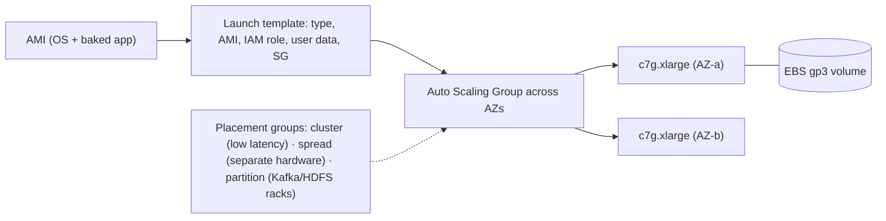

| Family | Optimised for | Examples |
|---|---|---|
| General (M, T) | balanced | web/app servers (T = burstable credits) |
| Compute (C) | CPU | API servers, batch, encoding |
| Memory (R, X) | RAM | caches, in-memory DBs, JVM heaps |
| Storage (I, D) | local NVMe / HDD | Cassandra, Elasticsearch, Kafka |
| Accelerated (P, G, Inf, Trn) | GPU/ML chips | training, inference |
| Graviton (…g) | ARM, ~20–40% better price-performance | most Linux workloads |

Purchase models: On-Demand, Savings Plans / Reserved (1–3 year commitment, up to ~70% off), Spot (up to 90% off, interruptible).

#### Example
A Kafka cluster runs on `i4i` instances (local NVMe for log segments) in a **partition placement group** mapped to Kafka rack awareness across 3 AZs. The stateless API fleet runs on Graviton `c7g` in an ASG with 60% Savings Plans coverage and 40% Spot, cutting compute cost ~45% versus on-demand x86.

#### Trade-offs
Full control (OS, kernel, agents) and broad choice, but you manage patching, scaling and AMIs, and it's slower to scale than containers or serverless.

#### Problems & fixes
| Symptom | Cause | Fix |
|---|---|---|
| T-instance suddenly slow | CPU credits exhausted | unlimited mode or move to M/C family |
| High cost | over-provisioned on-demand | right-size (Compute Optimizer), Graviton, Savings Plans, Spot |
| Correlated failures | instances on same hardware | spread placement groups, multi-AZ |
| Config drift | manual changes on instances | immutable AMIs (Packer), replace not patch |

#### Cheat sheet
- Pick the family for the bottleneck (C/M/R/I/G). Graviton for price-performance.
- On-Demand + Savings Plans + Spot mix. ASGs across AZs.
- Placement groups: cluster (latency), spread (isolation), partition (rack-aware big data).

#### Interview questions

Which EC2 family would you choose for Elasticsearch data nodes and why?

Storage-optimised (i4i/i3en) or memory-optimised (r-family with fast gp3/io2 EBS), depending on dataset size and query patterns: Elasticsearch benefits from fast local NVMe for indices and plenty of RAM for the OS page cache and heap. Spread nodes across AZs with shard allocation awareness, and consider Graviton variants for cost.

How do you cut EC2 costs by 50% without hurting reliability?

Right-size instances from utilisation data, move to Graviton, cover the steady baseline with Savings Plans, run stateless and batch work on diversified Spot with an On-Demand base, autoscale aggressively (and schedule down non-prod at night), and use gp3 instead of over-provisioned io1 volumes.

#### Interview angle
> "EC2 fleets run from immutable AMIs in multi-AZ Auto Scaling Groups on Graviton, with the baseline on Savings Plans, burst capacity on diversified Spot, and placement groups only where latency or rack awareness matters."

### Lambda — serverless functions, event-driven, 15-min max, 10GB max memory, pay per GB-second
AWS Lambda runs your code **in response to events** (HTTP via API Gateway or function URLs, S3, SQS, Kinesis, EventBridge, DynamoDB Streams, schedules) without managing servers. It scales per request, runs up to **15 minutes** per invocation with up to **10 GB memory** (CPU scales with memory), and bills per request plus GB-second of execution.

#### How it works
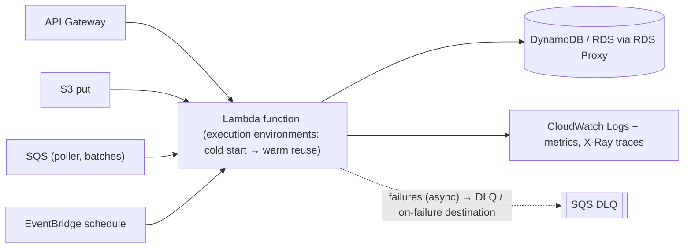

Invocation models: **synchronous** (API Gateway, waits for response), **asynchronous** (S3, SNS, EventBridge, with 2 automatic retries and then DLQ/destinations), **poll-based** (SQS, Kinesis, DynamoDB Streams via event source mappings, batch processing with partial failures).

Cost model example: 1 GB × 200 ms × 10M invocations/month ≈ 2M GB-s ≈ $33 + $2 requests (roughly), and you pay nothing when idle.

#### Example
An invoice service: an `OrderPaid` event on EventBridge invokes a Lambda that renders a PDF (2 GB memory, ~3 s) and stores it in S3. Volume varies from 50/hour at night to 20k/hour during sales, with zero capacity planning. Failed renders go to an SQS DLQ with an alarm, and reserved concurrency of 200 protects the downstream template service.

#### Trade-offs
No servers, automatic scaling and fine-grained billing, but cold starts, a 15-minute limit, stateless execution, downstream overload risk at high concurrency, and cost at sustained high throughput can exceed containers.

#### Problems & fixes
| Symptom | Cause | Fix |
|---|---|---|
| Latency spikes | cold starts | provisioned concurrency, SnapStart (Java), smaller packages |
| DB connection exhaustion | high concurrency | RDS Proxy, reserved concurrency |
| Lost async events | no DLQ/destinations | on-failure destinations, DLQ, alarms |
| Whole SQS batch retried for one bad message | no partial batch response | ReportBatchItemFailures |

#### Cheat sheet
- Event-driven functions: 15 min, 10 GB, pay per GB-s.
- Sync / async (retries + DLQ) / poll-based (SQS, Kinesis).
- Cold starts, concurrency limits, RDS Proxy, idempotent handlers.

#### Interview questions

When is Lambda a good fit, and when would you choose containers instead?

Lambda fits spiky or event-driven workloads (file processing, webhooks, scheduled jobs, glue between services, low-to-moderate APIs) where scale-to-zero and no ops matter. Choose containers (ECS/EKS) for steady high-throughput services (cheaper at sustained load), latency-critical paths sensitive to cold starts, long-running work beyond 15 minutes, or workloads needing persistent connections and custom runtimes.

How does error handling differ between synchronous, asynchronous and SQS-triggered Lambdas?

Synchronous: the caller gets the error and decides on retries. Asynchronous: Lambda retries twice with delays, then sends the event to an on-failure destination or DLQ. SQS: failed messages become visible again after the visibility timeout and are retried until maxReceiveCount, then go to the queue's DLQ, and partial batch responses avoid retrying successful messages.

#### Interview angle
> "Spiky event-driven work like PDF rendering runs on Lambda with reserved concurrency to protect downstreams, DLQs or on-failure destinations, and idempotent handlers. Steady high-QPS APIs go on containers."

### ECS — Docker container orchestration, Fargate (serverless) vs EC2 launch type
Amazon ECS is AWS's native container orchestrator: you define **task definitions** (containers, CPU and memory, IAM role, ports) and run them as **services** (long-running, load-balanced, autoscaled) or **tasks** (batch). Tasks run on **Fargate** (serverless, no instances to manage) or the **EC2 launch type** (your instances, more control and possibly cheaper).

#### How it works
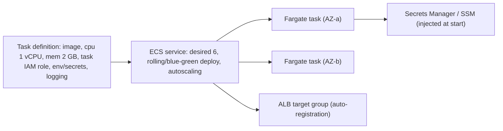

| | Fargate | EC2 launch type |
|---|---|---|
| Ops | no hosts to patch/scale | manage instances (capacity providers) |
| Cost | per task vCPU/GB (pay more per unit) | cheaper at high utilisation, Spot/RI |
| Control | no daemon/host access, limited GPU | custom AMIs, GPUs, daemons |
| Scaling | per task | tasks + instance capacity |

#### Example
A 25-service platform runs on ECS Fargate: no Kubernetes to operate, IAM roles per task, secrets injected from Secrets Manager, ALB path routing, CodeDeploy blue-green for payment services, and Service Connect for service-to-service discovery. Batch jobs use Fargate Spot (70% cheaper) with retries.

#### Trade-offs
Simpler than Kubernetes and deeply integrated with AWS (IAM, ALB, CloudWatch), but AWS-specific, with a smaller ecosystem than Kubernetes (no Helm charts or operators), and Fargate costs more per unit at high steady utilisation.

#### Problems & fixes
| Symptom | Cause | Fix |
|---|---|---|
| Tasks fail to start pulling images | no NAT / VPC endpoints for ECR | VPC endpoints (ECR, S3, logs) |
| Deploys drop requests | no draining / health grace | deregistration delay, health check grace, graceful shutdown |
| Over-broad permissions | shared instance role | task IAM roles per service |
| Fargate bill high | over-sized task CPU/memory | right-size, Fargate Spot for tolerant workloads, Graviton |

#### Cheat sheet
- Task definition → service (ALB, autoscaling) → Fargate or EC2.
- Task IAM roles, secrets injection, Service Connect, CodeDeploy blue-green.
- Simpler than EKS. AWS-only.

#### Interview questions

ECS vs EKS: how would you choose?

ECS when you're all-in on AWS, want the simplest managed container platform with tight AWS integration and a small platform team. EKS when you need Kubernetes portability, its ecosystem (Helm, operators, service meshes, GitOps tooling), multi-cloud or hybrid consistency, or advanced scheduling, and have the expertise to run it.

When would you choose Fargate over the EC2 launch type?

Fargate when you want zero host management, per-task isolation and simple scaling, especially for variable or small workloads and teams without ops capacity. The EC2 launch type when you need GPUs, special instance types, host-level agents, very high steady utilisation (better cost with Reserved/Spot instances and bin-packing), or custom AMIs.

#### Interview angle
> "For an AWS-only team I'd run services on ECS Fargate: task IAM roles, injected secrets, ALB target groups and CodeDeploy blue-green, moving to EKS only if we need the Kubernetes ecosystem."

### EKS — managed Kubernetes, control plane managed by AWS
Amazon EKS runs the **Kubernetes control plane** (API servers, etcd) for you across multiple AZs, while worker capacity comes from **managed node groups**, **Karpenter**-provisioned nodes or **Fargate profiles**. You get upstream Kubernetes with AWS integrations: IAM via **IRSA / Pod Identity**, VPC CNI networking, the ALB controller and EBS/EFS CSI drivers.

#### How it works
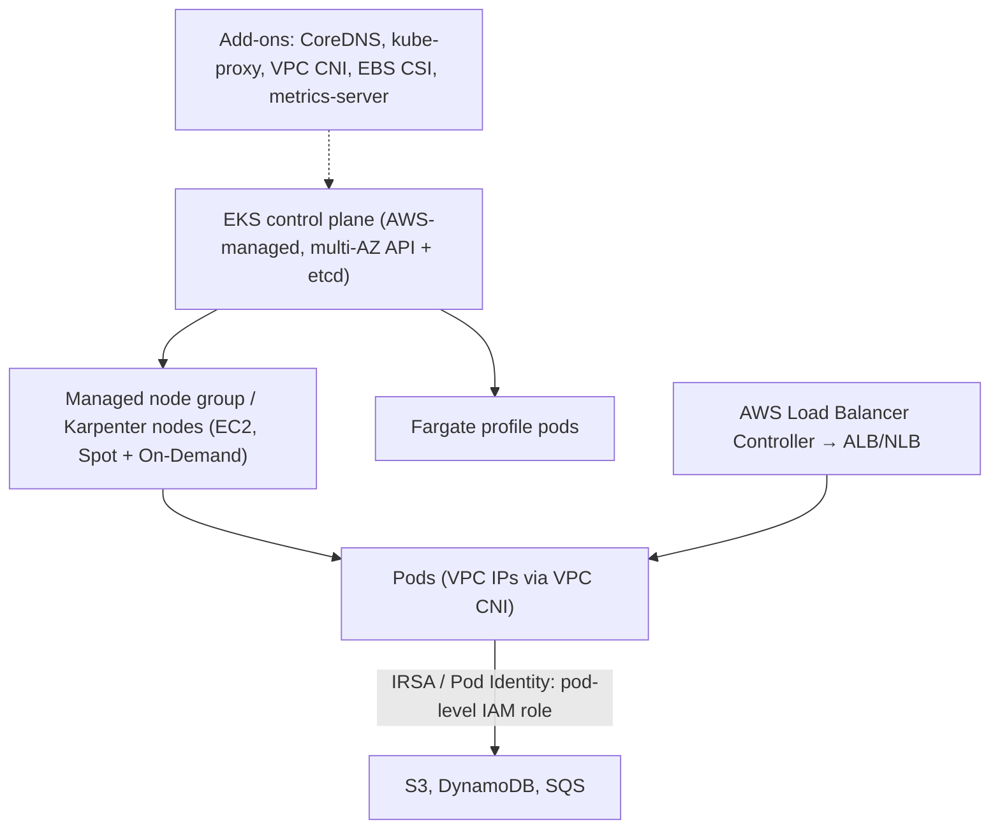

#### Example
A platform team runs 3 EKS clusters (dev, staging, prod) via Terraform: Karpenter provisions right-sized Spot and On-Demand nodes in seconds, workloads use Pod Identity for least-privilege AWS access, the AWS Load Balancer Controller creates ALBs from Ingress resources, and Argo CD deploys apps via GitOps. Cluster upgrades follow the Kubernetes release cadence (about every 4 months, done regularly).

#### Trade-offs
Standard Kubernetes with a managed control plane and AWS integration, but you still operate nodes, add-ons, upgrades, networking (IP planning) and the Kubernetes ecosystem complexity. It costs more operational effort than ECS.

#### Problems & fixes
| Symptom | Cause | Fix |
|---|---|---|
| Pods stuck: no IPs available | VPC CNI subnet exhaustion | larger subnets, prefix delegation, custom networking |
| Pods use node's broad IAM role | no IRSA/Pod Identity | pod-level IAM roles |
| Painful upgrades | falling many versions behind | regular upgrades, test add-ons, blue/green clusters |
| Slow scaling | Cluster Autoscaler + large node groups | Karpenter, smaller images |

#### Cheat sheet
- AWS-managed control plane. Nodes via managed groups, Karpenter or Fargate.
- IRSA/Pod Identity for IAM, VPC CNI (plan IPs), ALB controller, CSI drivers.
- Upgrade regularly. Karpenter for fast, efficient scaling.

#### Interview questions

How do pods in EKS access AWS services securely?

With IAM Roles for Service Accounts (IRSA) or EKS Pod Identity: a Kubernetes service account is mapped to an IAM role, and pods using it get temporary credentials for exactly that role. That avoids shared node instance roles or static access keys, and gives least privilege per workload with CloudTrail attribution.

What is Karpenter and why is it popular on EKS?

An open-source node provisioner that watches unschedulable pods and launches right-sized EC2 instances directly (choosing from many instance types, Spot or On-Demand) in seconds, then consolidates underused nodes. Compared with Cluster Autoscaler and fixed node groups, it scales faster, bin-packs better and lowers cost.

#### Interview angle
> "On EKS I'd use Karpenter for fast mixed Spot and On-Demand nodes, Pod Identity for per-workload IAM, the ALB controller for ingress, Argo CD for deploys, and a regular upgrade cadence."

### S3 — object storage: bucket + key model, 5TB max object, strong consistency since 2021
Amazon S3 stores **objects** (bytes plus metadata) in **buckets** under **keys**, with 11 nines of durability (data stored redundantly across ≥ 3 AZs) and effectively unlimited capacity. Objects can be up to **5 TB** (multipart uploads above 100 MB recommended), and since December 2020 S3 provides **strong read-after-write consistency** for all operations.

#### How it works
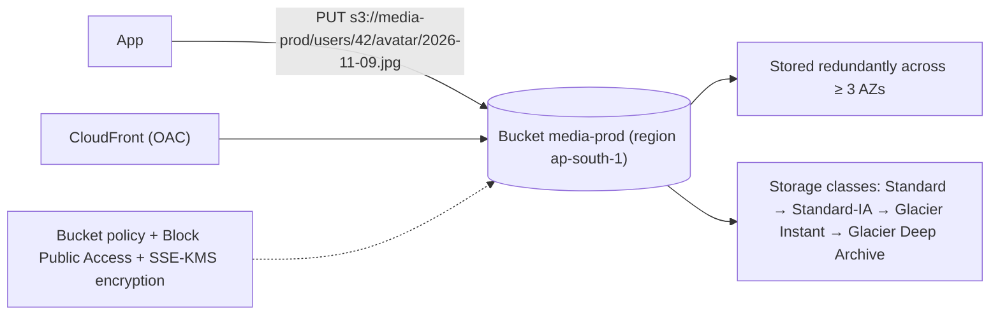

Key facts:
- Flat namespace. "Folders" are just key prefixes.
- Request performance: ~3,500 PUT and 5,500 GET per second **per prefix** (it scales automatically, so spread across prefixes for extreme rates).
- Storage classes trade price vs retrieval latency and cost. Intelligent-Tiering automates tiering.
- Security: Block Public Access on, bucket policies, IAM, SSE-S3/SSE-KMS encryption, access via VPC endpoints.

#### Example
A media app stores user uploads in S3 (`uploads/{userId}/{uuid}.jpg`), serves them via CloudFront with Origin Access Control (the bucket isn't public), uses lifecycle rules to move originals older than 90 days to Glacier Instant Retrieval, and processes new uploads via S3 event notifications → SQS → resize workers.

#### Trade-offs
Durable, cheap, infinitely scalable and integrated everywhere, but it's not a filesystem (no in-place edits or appends, higher latency than block storage), per-request costs matter at high request volumes, and misconfigured permissions cause data leaks.

#### Problems & fixes
| Symptom | Cause | Fix |
|---|---|---|
| Data leak | public bucket/ACLs | Block Public Access, bucket policies, CloudFront OAC |
| 503 SlowDown errors | very high request rate on one prefix | spread keys across prefixes, retries with backoff |
| Huge bill from requests/egress | many small objects, serving directly | CloudFront, batch small objects, lifecycle |
| Accidental deletes | no protection | versioning, MFA delete, Object Lock |

#### Cheat sheet
- Buckets + keys, 5 TB objects, 11 nines durability, strong consistency.
- Block Public Access, SSE-KMS, CloudFront OAC, VPC endpoints.
- Lifecycle tiers, versioning, prefix-aware high request rates.

#### Interview questions

Why store user-uploaded images in S3 rather than in the database?

S3 is far cheaper per GB, scales without limits, is built for large binary objects with 11 nines of durability, integrates with CDNs for delivery, and keeps the database small and fast (backups, replication and queries aren't burdened by blobs). Store only metadata and the S3 key in the database.

What changed when S3 became strongly consistent?

Previously, overwrites and deletes were eventually consistent (a read right after an update might return the old object, and listings might miss new objects), which forced workarounds like external consistency layers. Now every PUT, DELETE and LIST is strongly read-after-write consistent, so data lakes and pipelines can rely on immediate visibility.

#### Interview angle
> "Files go to S3 with Block Public Access, SSE-KMS and CloudFront OAC in front. Only keys and metadata live in the database, and lifecycle rules plus versioning control cost and accidental deletes."

### S3 features — versioning, lifecycle policies, presigned URLs (time-limited access), multipart upload, replication, S3 Select
Beyond basic object storage, S3 provides features you use constantly in system design: **versioning** (keep every version), **lifecycle policies** (transition and expire automatically), **presigned URLs** (temporary access without credentials), **multipart upload** (large parallel resumable uploads), **replication** (cross-region or same-region) and querying in place (**S3 Select**, Athena).

#### How it works
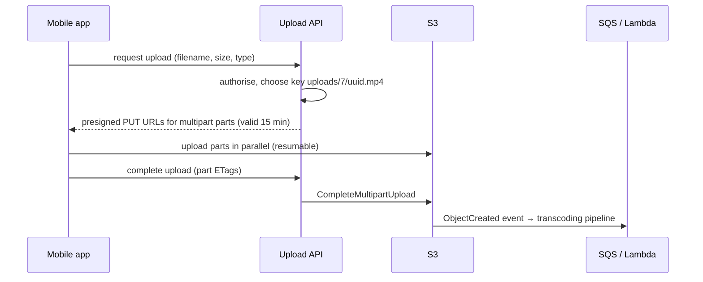

| Feature | Use |
|---|---|
| Versioning | recover from overwrites/deletes, required for replication |
| Lifecycle | Standard → IA (30 d) → Glacier (90 d) → expire (7 y); abort incomplete multipart uploads |
| Presigned URLs | direct client upload/download with expiry, no app bandwidth |
| Multipart upload | parallel parts (5 MB–5 GB each), resume failed parts, required > 5 GB |
| Replication (CRR/SRR) | DR copies, compliance, latency (with RTC for 15-min SLA) |
| Object Lock | WORM retention for compliance (financial records) |
| Event notifications | trigger Lambda/SQS/EventBridge on object changes |
| Athena / S3 Select | query CSV/JSON/Parquet in place |

#### Example
A fintech stores statements and audit evidence in S3 with versioning plus Object Lock in compliance mode (7-year retention, which even root can't delete), lifecycle moves objects to Glacier Deep Archive after 1 year, and cross-region replication to a DR region. Customers download statements via 5-minute presigned GET URLs generated after authorisation checks.

#### Trade-offs
Powerful building blocks, but versioning increases storage cost (lifecycle old versions), presigned URLs are bearer links (keep expiry short and scope narrow), and replication is asynchronous (minutes without RTC).

#### Problems & fixes
| Symptom | Cause | Fix |
|---|---|---|
| Storage bill grows silently | old versions + incomplete multipart uploads | lifecycle: expire noncurrent versions, abort incomplete MPU |
| Presigned links shared/abused | long expiry | short expiry, per-user keys, CloudFront signed URLs/cookies |
| Large uploads fail on mobile | single PUT | multipart with resumable parts |
| DR copy missing recent objects | async replication | RTC, monitor replication metrics |

#### Cheat sheet
- Versioning + Object Lock (protection), lifecycle (cost), presigned URLs (direct access).
- Multipart for big or resumable uploads. Replication for DR and compliance.
- Events trigger pipelines. Athena queries in place.

#### Interview questions

Design large video uploads from mobile clients without routing bytes through your servers.

The API authorises the user and creates a multipart upload, returning presigned URLs per part (short expiry). The client uploads parts in parallel directly to S3, retrying failed parts (resumable), then calls the API to complete the upload with part ETags. An S3 event triggers transcoding. A lifecycle rule aborts incomplete uploads after a day. The API never carries video bytes.

How do you make financial documents in S3 tamper-proof for 7 years?

Enable versioning plus S3 Object Lock in compliance mode with a 7-year retention period (objects can't be overwritten or deleted, even by root, until retention ends), restrict access via IAM and bucket policies, encrypt with KMS, log access with CloudTrail data events, and replicate to another region for DR.

#### Interview angle
> "Uploads go direct to S3 via presigned multipart URLs. Lifecycle rules tier data and clean up old versions and incomplete uploads, and compliance data gets versioning, Object Lock and cross-region replication."

### EBS — block storage attached to EC2, like a hard drive; one AZ, snapshot to S3
Amazon EBS provides **network-attached block volumes** for EC2: persistent disks that survive instance stops, with selectable performance (gp3, io2, st1, sc1). A volume lives in **one AZ** and attaches to instances there. **Snapshots** (incremental, stored in S3) provide backups and allow copying volumes across AZs and regions.

#### How it works
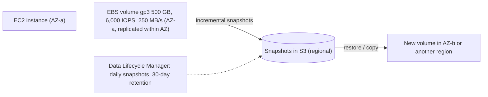

| Type | Use | Notes |
|---|---|---|
| gp3 | default SSD | baseline 3,000 IOPS / 125 MB/s, independently tunable |
| io2 Block Express | databases needing high IOPS and durability | up to 256k IOPS, 99.999% durability |
| st1 | throughput HDD (logs, big data) | cheap sequential throughput |
| sc1 | cold HDD | cheapest |

Instance store (NVMe directly on host) is faster but **ephemeral** (lost on stop or termination), so use it for caches and replicated data stores (Cassandra, Kafka with replication).

#### Example
A self-managed Postgres on EC2 uses an io2 volume with 20k IOPS for data and a separate gp3 volume for WAL, daily snapshots via DLM with cross-region copy for DR, and EBS encryption with KMS. When the instance's AZ had problems, they restored the latest snapshot into another AZ, which took ~20 minutes plus WAL replay. That's why a managed Multi-AZ RDS replaced it later.

#### Trade-offs
Persistent, tunable performance and easy snapshots, but tied to one AZ, network latency higher than local NVMe, and IOPS/throughput limits per volume and per instance.

#### Problems & fixes
| Symptom | Cause | Fix |
|---|---|---|
| Disk latency spikes | IOPS/throughput limit hit (volume or instance) | gp3 tuning, io2, larger instance EBS bandwidth |
| Can't attach volume to instance in another AZ | EBS is AZ-scoped | snapshot → restore in target AZ, app-level replication |
| Paying for gp2 over-provisioning | old gp2 volumes | migrate to gp3 (cheaper, decoupled IOPS) |
| Data loss on instance store | ephemeral storage | replicate at app level, EBS for durable data |

#### Cheat sheet
- Block volume for one instance in one AZ. Snapshots (incremental, S3) for backup and moves.
- gp3 default, io2 for heavy DBs, st1/sc1 HDD. Instance store = fast but ephemeral.
- Watch volume and instance IOPS/throughput limits.

#### Interview questions

Why can't an EBS volume protect you from an AZ outage?

An EBS volume is replicated only within its AZ and can attach only to instances in that AZ. If the AZ fails, the volume is unreachable. Cross-AZ protection needs application-level replication (database replicas in other AZs, RDS Multi-AZ), EFS (regional), or restoring from snapshots in another AZ, which is slower and loses data since the last snapshot.

gp3 vs io2: when do you pay for io2?

io2 (Block Express) when you need very high sustained IOPS (tens to hundreds of thousands), consistent sub-millisecond latency, and higher durability (99.999%) for critical databases. gp3 covers most workloads cheaply with tunable IOPS up to 16k and 1,000 MB/s per volume.

#### Interview angle
> "EBS volumes are single-AZ, so durability across zones comes from application replication or managed Multi-AZ databases. I default to gp3, use io2 only for IOPS-hungry databases, and automate encrypted snapshots."

### EFS — managed NFS, shared file system across multiple EC2 instances in same region
Amazon EFS is a fully managed, elastic **NFS file system** that many instances, containers (ECS, EKS) and Lambda functions can mount **simultaneously** across AZs in a region. It grows and shrinks automatically, and you pay for storage used (with IA tiers) and optionally provisioned throughput.

#### How it works
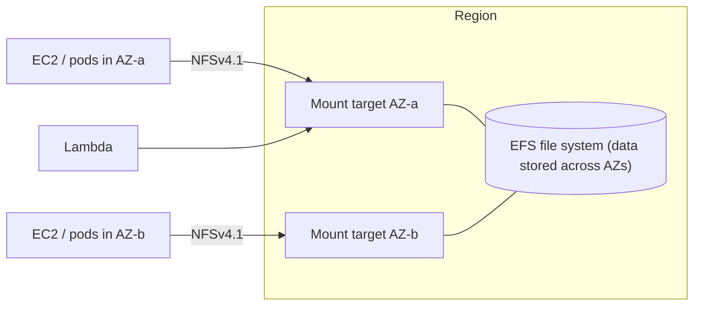

Modes: General Purpose vs Max I/O performance, Elastic / Bursting / Provisioned throughput, Standard vs One Zone storage, lifecycle to Infrequent Access and Archive.

#### Example
A legacy CMS needs a shared `uploads/` directory across 6 web servers (it writes files locally and expects them visible to all servers). Mounting EFS on all instances made it horizontally scalable without rewriting storage code, a stepping stone before migrating uploads to S3. Similarly, ML training jobs on EKS share datasets and checkpoints via EFS with the CSI driver.

#### Trade-offs
Shared POSIX filesystem, no capacity planning, multi-AZ, but higher latency than EBS (network filesystem, many small-file operations are slow), more expensive per GB than S3, and throughput limits depend on mode.

#### Problems & fixes
| Symptom | Cause | Fix |
|---|---|---|
| App slow with many small files | NFS metadata latency | caching, fewer small files, S3 for objects |
| Throughput throttled | bursting credits exhausted | Elastic or Provisioned throughput |
| High cost | rarely accessed files in Standard | lifecycle to IA/Archive |

#### Cheat sheet
- Managed NFS, mounted by many instances, containers and Lambda across AZs.
- Use for shared POSIX needs (legacy apps, ML datasets, CMS uploads).
- Prefer S3 for new object storage. Watch latency and throughput modes.

#### Interview questions

EBS vs EFS vs S3: when do you use each?

EBS: block storage for a single instance (database volumes, boot disks), low latency, one AZ. EFS: a shared POSIX filesystem across many instances and containers, regional (legacy shared directories, ML datasets, CMS content). S3: object storage accessed via API for scalable, cheap and durable storage of files and data lakes, the default for new applications storing files.

Why is putting a database on EFS usually a bad idea?

Databases do many small random synchronous I/Os and rely on low-latency fsync and file locking semantics. EFS's network filesystem latency (milliseconds per operation) and throughput model make them slow, and some locking behaviours can risk corruption. Use EBS (or managed RDS) for databases.

#### Interview angle
> "I use EFS only when software needs a shared POSIX filesystem, like legacy uploads directories or ML datasets. New code stores objects in S3, and databases live on EBS or RDS."

### RDS — managed relational DB: PostgreSQL, MySQL, Oracle, SQL Server; Multi-AZ for HA
Amazon RDS runs relational databases (PostgreSQL, MySQL, MariaDB, Oracle, SQL Server) as a managed service: provisioning, patching, automated backups and point-in-time recovery, monitoring, read replicas, and **Multi-AZ** high availability with automatic failover.

#### How it works
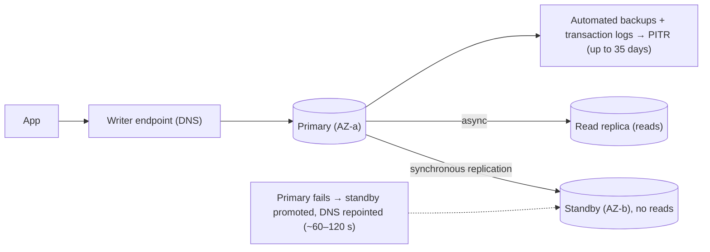

- **Multi-AZ instance**: a synchronous standby for HA (not readable).
- **Multi-AZ DB cluster** (Postgres/MySQL): two readable standbys, faster failover (~35 s).
- **Read replicas**: async, readable, cross-region possible, promotable.
- **RDS Proxy**: connection pooling, faster failover handling, IAM auth.

#### Example
An orders database on RDS PostgreSQL Multi-AZ (db.r6g.2xlarge), with 2 read replicas for reporting and search indexing, RDS Proxy for Lambda and ECS connection pooling, PITR backups for 14 days, Performance Insights to find slow queries, and blue/green deployments for major version upgrades with minimal downtime.

#### Trade-offs
Removes most DBA toil, gives HA and backups out of the box, but limited superuser and OS access (some extensions or features unavailable), failover still takes tens of seconds, and vertical write scaling only (no native sharding).

#### Problems & fixes
| Symptom | Cause | Fix |
|---|---|---|
| App errors for 1–2 min during failover | DNS caching, stale connections | RDS Proxy, short DNS TTL, driver retry logic |
| Connection exhaustion | many app instances / Lambdas | RDS Proxy / PgBouncer |
| Replica lag for reports | heavy writes | larger replica, Aurora, schedule reports |
| Risky major upgrades | in-place upgrade downtime | RDS Blue/Green Deployments |

#### Cheat sheet
- Managed RDBMS: backups, PITR, patching, Multi-AZ failover, read replicas.
- RDS Proxy for pooling and failover. Blue/Green for upgrades.
- Writes scale vertically. Shard or switch engines beyond that.

#### Interview questions

Multi-AZ standby vs read replica in RDS: what's the difference?

The Multi-AZ standby is a synchronous copy in another AZ used only for automatic failover (not readable in the classic instance mode), so it gives HA with no data loss. A read replica is an asynchronous, readable copy used to scale reads (possibly cross-region), which may lag and has to be promoted manually or by automation. Many setups use both.

How do you minimise application impact during an RDS failover?

Use RDS Proxy (which keeps client connections and reconnects to the new primary quickly), configure drivers with short connection timeouts and retry logic for idempotent operations, avoid long DNS caching in the JVM, use connection validation in pools, and test failover regularly (reboot with failover).

#### Interview angle
> "Relational data runs on RDS or Aurora Multi-AZ with PITR, read replicas for reporting, RDS Proxy for pooling and fast failover, and Blue/Green deployments for major upgrades."

### Aurora — MySQL/Postgres-compatible, 6-way storage replication across 3 AZs, auto-scaling storage
Amazon Aurora is AWS's cloud-native relational database, compatible with MySQL and PostgreSQL, with a **distributed storage layer**: 6 copies across 3 AZs, quorum writes, automatic growth up to 128 TB. It offers fast failover (~30 s), up to 15 low-lag read replicas, Global Database for cross-region DR, and Serverless v2 autoscaling. (Phase 3 covers the storage internals.)

#### How it works
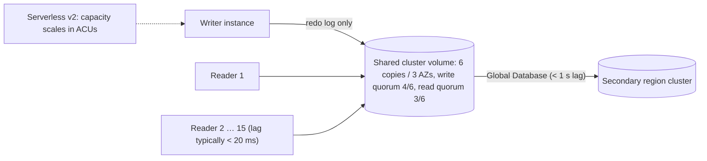

#### Example
A SaaS migrated from RDS MySQL to Aurora MySQL: reporting moved to 3 readers behind the reader endpoint (lag ~10 ms instead of seconds), failovers dropped from ~2 minutes to ~30 s, and Aurora Global Database to a second region gives an RPO around 1 s and an RTO of minutes for regional disasters. Dev and test clusters use Serverless v2 and scale near zero overnight.

#### Trade-offs
High availability and read scaling with managed storage, but still a single writer, I/O-based pricing (or the I/O-Optimized tier), AWS lock-in, and higher base cost than plain RDS for small workloads.

#### Problems & fixes
| Symptom | Cause | Fix |
|---|---|---|
| Unexpected I/O bill | I/O-heavy workload on standard config | Aurora I/O-Optimized, query/index tuning |
| Write throughput ceiling | single writer | bigger instance, sharding, distributed SQL |
| Reads hitting writer | app uses cluster endpoint for all | reader endpoint for read-only traffic |

#### Cheat sheet
- 6-way quorum storage across 3 AZs, ~30 s failover, 15 low-lag readers.
- Global Database for DR, Serverless v2 for variable load, fast clones.
- Single writer. Watch I/O pricing.

#### Interview questions

When would you choose Aurora over standard RDS PostgreSQL?

When you need faster failover, more read replicas with very low lag, storage that grows automatically with 6-way replication, cross-region DR via Global Database, fast cloning for test environments, or Serverless v2 autoscaling. For small or cost-sensitive steady workloads, standard RDS may be cheaper.

What does Aurora Global Database give you for disaster recovery?

Storage-level replication to up to 5 secondary regions with typical lag under 1 second (RPO ≈ 1 s), read-only clusters in those regions for local reads, and managed failover to promote a secondary region in minutes (RTO of minutes) during a regional outage.

#### Interview angle
> "Aurora gives us quorum storage across three AZs, readers with tiny lag and roughly 30-second failover, plus Global Database for regional DR. I'd still plan around its single writer."

### DynamoDB — fully managed NoSQL, single-digit ms latency, automatic sharding
DynamoDB is AWS's serverless **key-value and document** database: single-digit-millisecond latency at any scale, automatic partitioning, multi-AZ replication, on-demand or provisioned capacity, plus Streams, TTL, transactions and Global Tables. Data modelling is access-pattern-first. (Phase 3 covers keys, GSIs and hot partitions in depth.)

#### How it works
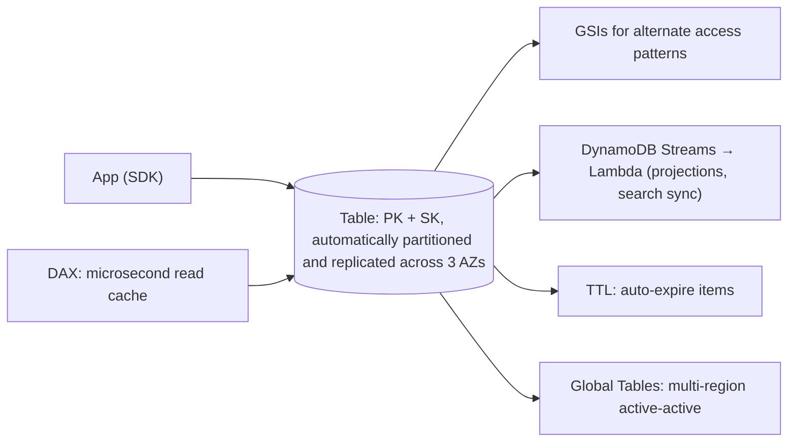

#### Example
A session and cart service for 50M users: `PK = USER#id`, `SK = SESSION#…` / `CART#…`, TTL expiring abandoned carts after 30 days, on-demand capacity absorbing sale spikes, Streams feeding analytics, and Global Tables in Mumbai and Singapore for low-latency access and regional resilience (last-writer-wins conflicts, acceptable for carts with item-level merges).

#### Trade-offs
Zero operations, predictable latency, massive scale, but rigid access patterns, limited querying (no joins or ad-hoc aggregations), item size 400 KB, and costs can surprise with scans or heavy GSIs.

#### Problems & fixes
| Symptom | Cause | Fix |
|---|---|---|
| Throttling on hot key | low-cardinality partition key | write sharding, better keys |
| Expensive scans | missing access patterns | GSIs, redesign, export to analytics |
| Lost concurrent updates | blind writes | conditional writes, versions |

#### Cheat sheet
- Serverless key-value: PK/SK, GSIs, Streams, TTL, transactions, Global Tables, DAX.
- Model access patterns first. Avoid scans. Watch hot partitions.
- On-demand for spiky workloads, provisioned + autoscaling for steady ones.

#### Interview questions

When would DynamoDB be a poor choice?

When access patterns are unknown or ad hoc, when you need complex queries, joins, aggregations or reporting, strong relational integrity across many entities, or large items. Also for workloads dominated by scans. Relational databases or analytics stores fit those better (DynamoDB data can be exported to S3 for analytics).

How would you implement automatic expiry of user sessions in DynamoDB?

Store an epoch-seconds `expiresAt` attribute and enable TTL on it. DynamoDB deletes expired items in the background (typically within days, not exact), and queries should still filter out items past their expiry. TTL deletions appear in Streams if downstream cleanup is needed.

#### Interview angle
> "High-scale key-value paths like sessions and carts go to DynamoDB, modelled from access patterns, with TTL for expiry, Streams for projections and on-demand capacity for spikes."

### ElastiCache — managed Redis or Memcached in VPC
Amazon ElastiCache runs **Redis/Valkey** or **Memcached** as a managed in-memory service inside your VPC: provisioning, patching, failover (Multi-AZ with automatic failover for Redis/Valkey), backups, cluster mode sharding, and monitoring. ElastiCache Serverless removes capacity planning entirely.

#### How it works
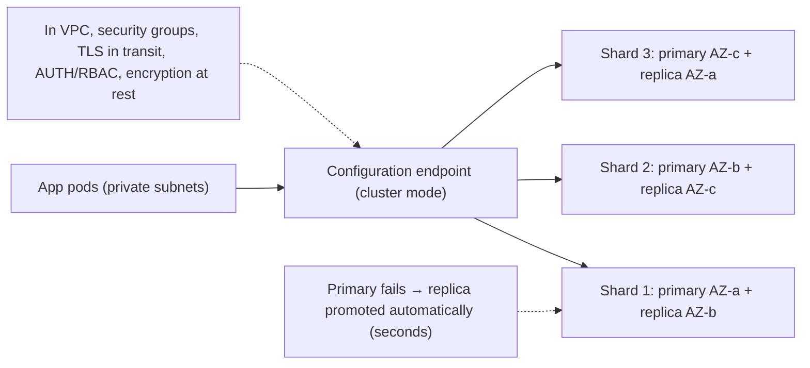

Related: **MemoryDB** (Redis-compatible with a durable multi-AZ transaction log, usable as a primary database), and **ElastiCache Serverless** (auto-scaling, pay per usage).

#### Example
A ride-hailing backend uses ElastiCache for Valkey in cluster mode (6 shards × 1 replica, Multi-AZ) for driver locations (GEO commands), surge multipliers and rate limiting. Failover of a shard primary completes in ~10–20 s, and clients (Lettuce with topology refresh) reconnect automatically. Snapshots are daily, though the data is rebuildable.

#### Trade-offs
Managed HA Redis with no ops burden, but VPC-only access, limited configuration (some commands restricted), cost versus self-managed, and still in-memory (size and cost limits).

#### Problems & fixes
| Symptom | Cause | Fix |
|---|---|---|
| Errors during failover | clients not refreshing topology | cluster-aware clients with topology refresh |
| Evictions / memory pressure | under-sized nodes | scale shards/nodes, eviction policy, smaller values |
| Insecure access | no TLS/AUTH | in-transit encryption + AUTH/RBAC, tight SGs |
| Need durability for primary data | ElastiCache is a cache | MemoryDB or a database |

#### Cheat sheet
- Managed Redis/Valkey/Memcached in VPC. Multi-AZ failover, cluster mode sharding.
- Cluster-aware clients, TLS + AUTH, monitor evictions and memory.
- MemoryDB for durable Redis. Serverless for variable load.

#### Interview questions

ElastiCache vs MemoryDB: what's the difference?

ElastiCache is primarily a cache: replication to replicas is asynchronous, so a failover may lose recent writes, which is fine for rebuildable data. MemoryDB persists every write to a Multi-AZ durable transaction log before acknowledging, so it can serve as a primary Redis-compatible database, with somewhat higher write latency and cost.

What must the application do to survive an ElastiCache failover gracefully?

Use the cluster or primary endpoint (not node IPs), with a client that detects failover and refreshes topology (Lettuce/Jedis cluster topology refresh, redis-py cluster), plus timeouts and retries with backoff, and fallback behaviour (serve from the DB or degrade) during the few seconds of unavailability.

#### Interview angle
> "Caching and fast shared state run on ElastiCache Valkey in cluster mode across AZs, with TLS, AUTH and topology-aware clients. If Redis must be a durable primary store, MemoryDB."

### SQS / SNS / Kinesis / MSK — managed messaging; MSK = managed Kafka
AWS offers several managed messaging services: **SQS** (queues), **SNS** (pub/sub push fan-out), **Kinesis Data Streams** (sharded streaming log), **MSK** (managed Apache Kafka) and **EventBridge** (event bus with rules). Picking correctly is mostly about **delivery model, ordering, replay and throughput**. (Phase 7 covers SQS, SNS and Kinesis in depth.)

#### How it works
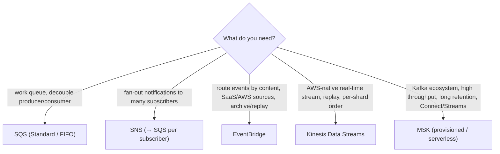

| | SQS | SNS | Kinesis | MSK | EventBridge |
|---|---|---|---|---|---|
| Model | queue | pub/sub push | sharded log | partitioned log | rules-based bus |
| Replay | no | no | yes (≤ 365 d) | yes (retention/tiered) | archive + replay |
| Ordering | FIFO groups | FIFO topics | per shard | per partition | no |
| Ops | none | none | low | medium (brokers) | none |

#### Example
An e-commerce platform on AWS: **MSK** as the event backbone (orders and payments topics, Debezium CDC via MSK Connect), **SQS** for background jobs (emails, PDFs), **SNS → SQS** for fan-out notifications to legacy consumers, and **EventBridge** for AWS service events (S3, Step Functions) and SaaS integrations (Stripe/Zendesk webhooks into rules).

#### Trade-offs
Fully managed options reduce ops but differ in semantics and limits. MSK gives Kafka power at the cost of more tuning. Mixing services adds integration complexity.

#### Problems & fixes
| Symptom | Cause | Fix |
|---|---|---|
| Need replay but used SQS/SNS | wrong primitive | Kinesis/MSK/EventBridge archive |
| Kafka ops burden | self-managed Kafka on EC2 | MSK / MSK Serverless |
| Ordering issues | Standard SQS | FIFO groups, Kinesis/MSK keys |

#### Cheat sheet
- SQS = jobs. SNS = fan-out. EventBridge = routing + SaaS + archive. Kinesis = AWS stream. MSK = Kafka.
- Decide by replay, ordering, throughput and consumers.
- Common combo: MSK backbone + SQS jobs + EventBridge integrations.

#### Interview questions

Kinesis vs MSK: how do you choose?

Kinesis for an AWS-native, low-ops stream with tight integrations (Lambda, Firehose, Flink) and moderate scale, or when you prefer shard-based capacity. MSK when you want the Kafka ecosystem (Connect, Streams, Schema Registry, existing Kafka skills and clients), higher per-partition throughput, long retention with tiered storage, or portability beyond AWS.

When would EventBridge be better than SNS?

When you need content-based routing rules on event fields, many AWS service and SaaS event sources, schema discovery, archive and replay, cross-account event buses, or direct targets like Step Functions and API destinations. SNS is better for very high-throughput simple fan-out with lower latency.

#### Interview angle
> "On AWS: MSK as the replayable event backbone, SQS for jobs, SNS to SQS for fan-out, and EventBridge for routing AWS and SaaS events, each picked by replay, ordering and throughput needs."

### VPC — isolated virtual network; public subnets (internet-facing), private subnets (internal)
A VPC is your **private, isolated network** in AWS: you choose the IP range (CIDR), split it into **subnets** per AZ, and control routing (route tables, internet and NAT gateways), filtering (security groups, NACLs) and private connectivity (VPC endpoints, peering, Transit Gateway, PrivateLink). (Phase 1 covers subnetting and NAT.)

#### How it works
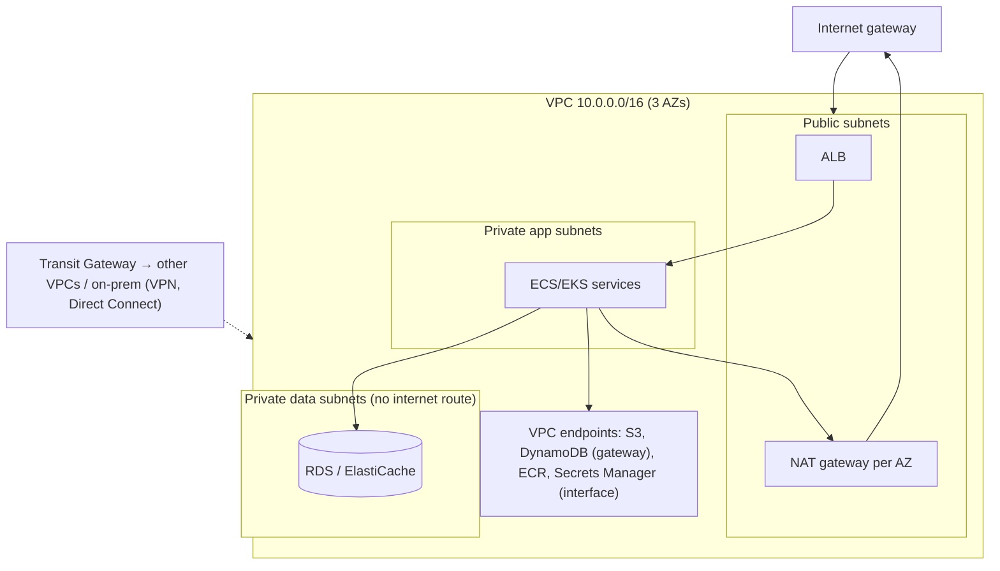

#### Example
A regulated fintech: one VPC per environment per account, `/16` each with non-overlapping CIDRs from a central IPAM plan. Three tiers of subnets across 3 AZs, NAT gateways per AZ (no cross-AZ dependency), VPC endpoints so S3, ECR and Secrets Manager traffic never leaves AWS's network, VPC Flow Logs to S3 for audit, and Transit Gateway connecting to shared services and the on-prem core banking system over Direct Connect.

#### Trade-offs
Strong isolation and control, but IP planning mistakes are hard to fix, NAT and data-processing costs add up, and multi-VPC connectivity needs design.

#### Problems & fixes
| Symptom | Cause | Fix |
|---|---|---|
| Can't peer VPCs | overlapping CIDRs | central IPAM planning |
| Large NAT bills | S3/ECR traffic via NAT | gateway/interface VPC endpoints |
| AZ failure breaks egress everywhere | single NAT gateway | NAT per AZ |
| No forensic visibility | flow logs off | VPC Flow Logs, traffic mirroring when needed |

#### Cheat sheet
- CIDR plan → subnets per AZ (public, app, data) → route tables, IGW, NAT per AZ.
- SGs + NACLs. VPC endpoints for AWS services. Flow logs.
- Transit Gateway / PrivateLink for multi-VPC and on-prem.

#### Interview questions

Lay out a production VPC for a 3-tier web application.

A /16 VPC across 3 AZs: public subnets for the ALB and NAT gateways (one per AZ), private app subnets for compute (ECS/EKS) routing outbound via the same-AZ NAT, and private data subnets for RDS and ElastiCache with no internet route. Security groups chain ALB → app → DB on specific ports, VPC endpoints serve S3, ECR, Secrets Manager and CloudWatch, and flow logs are enabled.

How do you connect many VPCs and on-prem networks at scale?

AWS Transit Gateway as a hub (with route tables for segmentation between environments), Direct Connect or VPN attachments for on-prem, PrivateLink for exposing specific services across accounts without full network connectivity, and non-overlapping CIDRs managed via IPAM. Avoid full-mesh VPC peering at scale.

#### Interview angle
> "Each environment's VPC spans three AZs with public, app and data subnets, a NAT per AZ, endpoints for AWS services and flow logs, connected through Transit Gateway with non-overlapping CIDRs."

### Security Groups — stateful firewall at instance level; NACLs — stateless at subnet level
**Security groups** are stateful virtual firewalls attached to ENIs (instances, tasks, pods, load balancers, databases): you allow inbound and outbound rules, and return traffic is automatically allowed. **Network ACLs** are stateless filters at the subnet level with ordered allow and deny rules, where return traffic must be explicitly allowed.

#### How it works
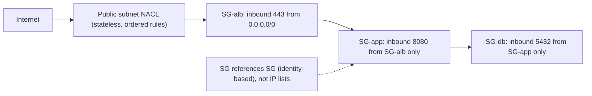

| | Security group | NACL |
|---|---|---|
| Level | ENI (resource) | subnet |
| State | stateful | stateless (allow ephemeral ports for replies) |
| Rules | allow only | allow and deny, numbered order |
| Typical use | primary micro-segmentation | coarse guardrails, explicit denies (block IP ranges) |

#### Example
Database security: `sg-postgres` allows 5432 only from `sg-orders-service` and `sg-migrations`. When orders tasks scale from 4 to 40, no rule changes are needed, because membership in the SG, not IP addresses, grants access. A NACL on the data subnets additionally denies all traffic from the public subnets' CIDR, a belt-and-braces guardrail. EKS Security Groups for Pods give per-pod SGs.

#### Trade-offs
SGs are simple, stateful and identity-based (great). NACLs add defence in depth but are easy to misconfigure (forgetting ephemeral return ports breaks connections).

#### Problems & fixes
| Symptom | Cause | Fix |
|---|---|---|
| Connections time out intermittently | NACL missing ephemeral port range for return traffic | allow 1024–65535 return rules or keep NACLs default-allow |
| Database exposed broadly | SG allows 0.0.0.0/0 or VPC CIDR | reference app SG only |
| Rules sprawl, unclear ownership | manual console edits | IaC (Terraform), naming, periodic audits (AWS Config) |

#### Cheat sheet
- SG: stateful, per resource, allow-only, reference other SGs.
- NACL: stateless, per subnet, ordered allow/deny, remember ephemeral ports.
- Least privilege by SG chaining. Manage as code.

#### Interview questions

Why reference security groups instead of IP ranges in rules?

Instances, tasks and pods scale and change IPs constantly. Referencing a source security group grants access based on identity (membership), so new instances automatically get the right access without rule updates, and access is limited to exactly that tier, not to any IP in a subnet.

Why can a NACL break connections that security groups allow?

NACLs are stateless: they evaluate inbound and outbound packets independently. If an outbound rule doesn't allow the ephemeral port range used by return traffic (or an inbound rule doesn't allow replies to outbound connections), responses are dropped even though security groups (stateful) allowed the original request.

#### Interview angle
> "Security groups do the micro-segmentation, chained ALB to app to DB by SG reference, while NACLs are only coarse subnet guardrails. All rules live in Terraform."

### Route53 — DNS with health checks, routing policies: simple, weighted, latency, failover, geolocation
Amazon Route 53 is AWS's highly available DNS service: domain registration, hosted zones (public and private), **health checks** and **routing policies** that make DNS a traffic-management tool: weighted canaries, latency-based multi-region routing, failover, geolocation and geoproximity, and multivalue answers. (Phase 1 covers DNS fundamentals.)

#### How it works
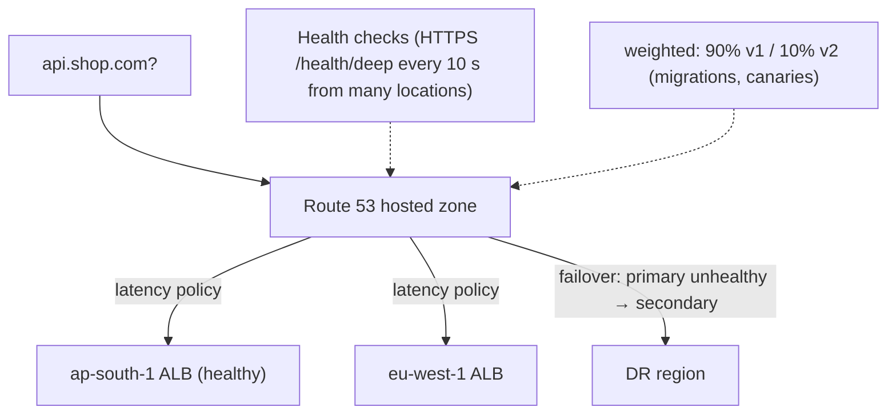

| Policy | Use |
|---|---|
| Simple | single resource |
| Weighted | gradual migrations, canary by DNS |
| Latency | route to lowest-latency region |
| Failover | active-passive DR |
| Geolocation | country/continent rules (compliance, localisation) |
| Geoproximity | bias traffic by distance |
| Multivalue | multiple healthy IPs (client-side choice) |

Alias records point the zone apex at AWS resources (ALB, CloudFront, S3) with no charge for queries to aliases.

#### Example
A payments API: latency-based records for Mumbai and Singapore ALBs, each with health checks on `/health/deep`, so Indian users get Mumbai, and if Mumbai fails health checks Route 53 answers with Singapore (TTL 60 s). Geolocation for `merchant.shop.com` keeps EU merchants in the EU region for GDPR. A private hosted zone gives internal names (`db.internal.shop.com`) inside the VPCs.

#### Trade-offs
Highly available and flexible traffic control, but DNS caching bounds failover speed (TTL plus clients), and health checks need careful design (deep vs shallow).

#### Problems & fixes
| Symptom | Cause | Fix |
|---|---|---|
| Slow failover | long TTLs / client caching | 30–60 s TTLs, or Global Accelerator for fast failover |
| Flapping between regions | sensitive health checks | thresholds, multiple checkers, calculated health checks |
| Apex CNAME not allowed | DNS rules | alias records |

#### Cheat sheet
- Hosted zones, alias records, health checks.
- Routing: weighted, latency, failover, geolocation, geoproximity, multivalue.
- Failover bounded by TTL. Use Global Accelerator for second-level failover.

#### Interview questions

How would you use Route 53 to migrate traffic from an old stack to a new one safely?

Create weighted records for the old and new endpoints (e.g. 99/1) with health checks and a low TTL. Increase the new weight gradually while monitoring errors and latency, roll back by setting the new weight to 0, and complete at 0/100, then remove the old stack after traffic drains (clients ignoring TTL).

Latency-based vs geolocation routing: what's the difference?

Latency-based routes each user to the region with the lowest measured network latency from their resolver, which is optimised for performance. Geolocation routes by the user's country or continent regardless of latency, which suits compliance (data residency), localised content or licensing restrictions.

#### Interview angle
> "Route 53 does latency routing with deep health checks for multi-region, weighted records for migrations, geolocation for residency and private zones internally. Anything needing second-level failover sits behind Global Accelerator."

### CloudFront — CDN, Lambda@Edge for edge compute, TLS termination, WAF integration
Amazon CloudFront is AWS's global CDN: 600+ edge locations cache content close to users, terminate TLS, absorb DDoS (Shield Standard included) and integrate with **AWS WAF**. Edge compute runs as **CloudFront Functions** (lightweight JS, sub-millisecond) or **Lambda@Edge** (heavier logic). It fronts S3 buckets (via Origin Access Control), ALBs, API Gateway or any HTTP origin. (Phase 1 covers CDN fundamentals.)

#### How it works
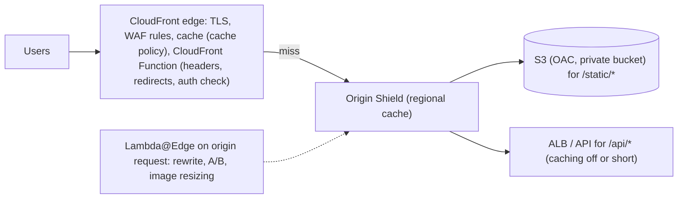

Key configuration: **behaviours** per path pattern (`/static/*`, `/api/*`), **cache policies** (TTL, cache key) and **origin request policies** (headers and cookies forwarded), signed URLs or cookies for private content, field-level encryption, real-time logs.

#### Example
A video-learning platform: CloudFront serves HLS segments from S3 (OAC) with signed cookies for paying users, `/api/*` goes to an ALB with caching disabled but TLS and keep-alive at the edge, AWS WAF blocks bots and rate-limits login, and a CloudFront Function adds security headers (HSTS, CSP) to every response. Origin Shield in Mumbai cuts S3 GETs by ~70%.

#### Trade-offs
Global performance, security and cost savings, but configuration complexity (behaviours, cache keys), invalidations cost money at high volume, and edge function limits.

#### Problems & fixes
| Symptom | Cause | Fix |
|---|---|---|
| Low cache hit ratio | forwarding all headers/cookies/query strings | tight cache policies, normalise keys |
| Private bucket publicly accessible | legacy OAI/public bucket | OAC + Block Public Access |
| Users get stale assets | non-versioned filenames | content-hashed assets, short HTML TTL |
| Bot traffic overwhelms origin | no WAF rules | WAF managed rules, rate-based rules, Bot Control |

#### Cheat sheet
- Edge cache + TLS + Shield + WAF. Behaviours per path. Cache vs origin request policies.
- S3 via OAC. Signed URLs or cookies for private media.
- CloudFront Functions (light) vs Lambda@Edge (heavy). Origin Shield.

#### Interview questions

How do you serve private videos to paying users via CloudFront?

Keep the S3 bucket private and accessible only via CloudFront Origin Access Control. After authenticating the user, the app issues CloudFront signed cookies (or signed URLs) scoped to the course's path with a short expiry. CloudFront validates the signature at the edge before serving cached segments, so the origin never sees unauthorised requests.

CloudFront Functions vs Lambda@Edge?

CloudFront Functions are tiny JavaScript handlers running at every edge location on viewer request/response events with sub-millisecond startup and very low cost, suited to header manipulation, redirects, URL rewrites and simple token checks. Lambda@Edge runs Node or Python in regional edge caches with network access and more memory and time, suited to origin request/response logic, image transformation and calls to external services.

#### Interview angle
> "CloudFront fronts everything: S3 via OAC for static and media with signed cookies, the API with edge TLS, WAF and Shield, CloudFront Functions for headers and redirects, and Origin Shield to protect origins."

### IAM — identity and access management: users, groups, roles, policies, least privilege
AWS IAM controls **who** (principals: users, roles, services, federated identities) can do **what** (actions) on **which resources**, under **which conditions**, through JSON **policies**. Modern best practice: no long-lived access keys, humans sign in via SSO (IAM Identity Center), and workloads use **roles** with temporary credentials, scoped by **least privilege**.

#### How it works
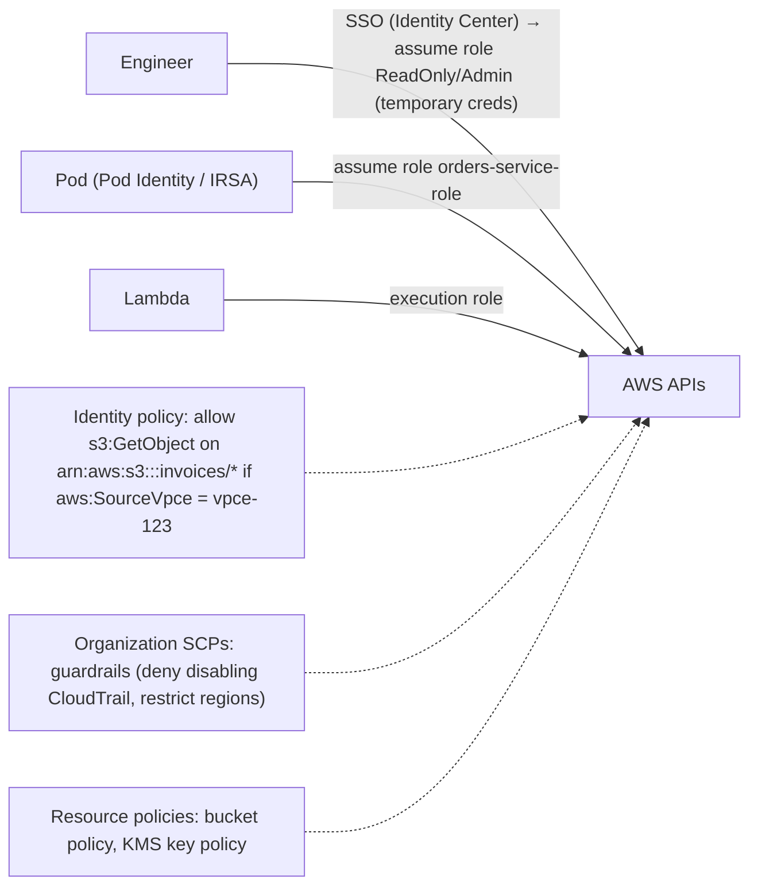

Evaluation logic: an explicit **Deny** wins, then an Allow is needed from the applicable policies (identity, resource, permission boundaries, session policies, SCPs), and the default is deny.

#### Example
A least-privilege setup for the invoices service: its role can `s3:PutObject`/`GetObject` only on `arn:aws:s3:::invoices-prod/*`, `kms:Encrypt`/`Decrypt` only with the invoices key, and only via the VPC endpoint (condition `aws:SourceVpce`). SCPs in the AWS Organization deny leaving approved regions and deleting CloudTrail. IAM Access Analyzer flags unused permissions, which are pruned quarterly.

#### Trade-offs
Fine-grained, auditable control, but policy complexity (debugging denies), the risk of over-broad wildcards for convenience, and continuous effort to keep permissions minimal.

#### Problems & fixes
| Symptom | Cause | Fix |
|---|---|---|
| Leaked access keys | long-lived IAM user keys | SSO + roles, no static keys, key scanning |
| Over-privileged services (`*:*`) | convenience policies | least privilege, Access Analyzer policy generation |
| Hard-to-debug AccessDenied | layered policies/SCPs | IAM policy simulator, CloudTrail error details |
| Cross-account confusion (confused deputy) | missing external id/conditions | `aws:SourceArn`/`ExternalId` conditions |

#### Cheat sheet
- Principals + actions + resources + conditions. Explicit deny wins. Default deny.
- SSO for humans, roles for workloads (IRSA/Pod Identity/Lambda roles). No static keys.
- Least privilege, SCP guardrails, Access Analyzer, CloudTrail.

#### Interview questions

How should an application running on AWS get credentials to call S3?

Through an IAM role attached to its compute (EC2 instance profile, ECS task role, Lambda execution role, EKS Pod Identity/IRSA), which provides automatically rotated temporary credentials via the SDK. Never embed access keys in code, config or images. Scope the role's policy to the specific bucket and prefix and the actions needed, ideally with conditions (VPC endpoint, encryption).

What are Service Control Policies and how do they differ from IAM policies?

SCPs are AWS Organizations guardrails applied to accounts or OUs that define the maximum permissions available in those accounts. They don't grant anything, only limit. Even an admin in an account can't exceed them (e.g. "deny all actions outside ap-south-1", "deny disabling GuardDuty"). IAM policies grant permissions within those limits.

#### Interview angle
> "Humans use SSO with temporary roles and workloads use their own roles, with no static keys. Policies are least-privilege with conditions, SCPs are org-wide guardrails, and Access Analyzer keeps permissions pruned."

### KMS — key management service: envelope encryption, key rotation, CloudTrail audit
AWS KMS manages cryptographic keys: you create **KMS keys** (backed by HSMs), control who can use them via **key policies** and IAM, and every use is **logged in CloudTrail**. Services encrypt data with **envelope encryption**: a per-object **data key** encrypts the data, and the KMS key encrypts the data key, so bulk data never goes to KMS.

#### How it works
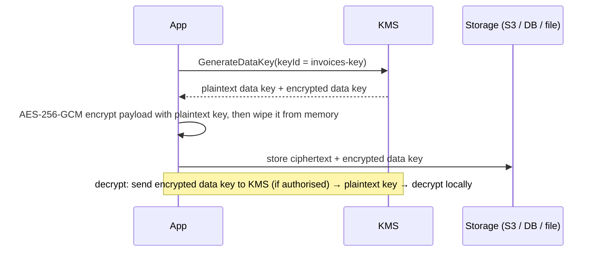

Features: automatic annual rotation for symmetric keys (old versions kept for decryption), key policies plus grants, multi-region keys, imported key material or CloudHSM-backed custom key stores, asymmetric keys for signing, and encryption contexts (AAD) for binding and audit.

#### Example
A lending platform encrypts PAN and Aadhaar fields at application level: each record's sensitive fields are encrypted with a data key from a dedicated KMS key (the AWS Encryption SDK caches data keys briefly to limit KMS calls), with an encryption context `{tenant, recordType}`. Only the KYC service role can `kms:Decrypt` (key policy). CloudTrail shows every decrypt for audits. Deleting a tenant's key makes their data unrecoverable (crypto-shredding).

#### Trade-offs
Centralised, audited and HSM-backed key control with simple service integration, but KMS request quotas and latency (use data-key caching), per-request and per-key costs, and key policy mistakes can lock you out or overexpose data.

#### Problems & fixes
| Symptom | Cause | Fix |
|---|---|---|
| KMS throttling | encrypt/decrypt per small object at high rate | envelope encryption with data key caching |
| Anyone with S3 access can read data | SSE-S3 only, no key separation | SSE-KMS with restrictive key policy |
| Locked out of key | key policy without admin/root access | review key policies, break-glass role |
| Can't prove deletion of personal data | data copies everywhere | crypto-shredding with per-tenant/user keys |

#### Cheat sheet
- KMS keys in HSMs, key policies, CloudTrail audit, rotation.
- Envelope encryption: a data key encrypts data, KMS encrypts the data key.
- Cache data keys. Separate keys per data class or tenant. Encryption context.

#### Interview questions

Why does envelope encryption exist instead of sending all data to KMS?

KMS limits request size (4 KB for direct encryption) and rate, and sending gigabytes to an HSM service would be slow and costly. With envelope encryption, data is encrypted locally with fast symmetric data keys, and only the small data keys are encrypted or decrypted by KMS. Compromise of stored data doesn't expose keys, and access to plaintext still requires authorised KMS calls.

How can KMS help with GDPR's right to erasure?

Crypto-shredding: encrypt each user's (or tenant's) personal data with a dedicated key (or data keys wrapped by a per-user key). To erase, schedule deletion of that key, and all copies (backups, logs, replicas) become unreadable ciphertext, even where physically deleting every copy is impractical.

#### Interview angle
> "Sensitive data uses envelope encryption with dedicated KMS keys per data class or tenant, restrictive key policies, encryption context, data-key caching and CloudTrail audit, and per-tenant keys enable crypto-shredding."

### CloudWatch — metrics, logs, alarms, dashboards; X-Ray for distributed tracing
Amazon CloudWatch is AWS's native observability suite: **metrics** (built-in for AWS services plus custom metrics), **logs** (log groups, Logs Insights queries), **alarms** (thresholds, anomaly detection, composite alarms → SNS, autoscaling, actions), **dashboards** and **synthetics**. **X-Ray** (and the CloudWatch Application Signals / OpenTelemetry integration) adds distributed tracing.

#### How it works
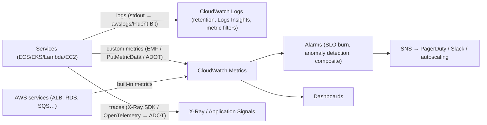

Tips: use the Embedded Metric Format (EMF) to emit metrics via structured logs cheaply, set log retention (default is never expire), watch high-cardinality custom metric costs, and use composite alarms to reduce noise.

#### Example
An order service on ECS: structured JSON logs with trace ids in CloudWatch Logs (30-day retention, then export to S3), EMF metrics for `OrdersPlaced` and `PaymentLatency`, alarms on ALB 5xx rate, SQS `ApproximateAgeOfOldestMessage` and p99 latency (composite into one "orders degraded" page), and X-Ray traces via the ADOT collector to find that 80% of checkout latency was a slow fraud API.

#### Trade-offs
Native, zero-setup integration with AWS services, but costs grow quickly (logs ingestion, custom metrics, high cardinality), querying is less powerful than dedicated platforms, and multi-cloud visibility is limited. Many teams combine it with Prometheus, Grafana or Datadog.

#### Problems & fixes
| Symptom | Cause | Fix |
|---|---|---|
| Huge CloudWatch bill | verbose logs, never-expiring retention, high-cardinality metrics | log levels, retention policies, sampling, EMF dimensions care |
| Alert fatigue | many threshold alarms | SLO-based burn alarms, composite alarms |
| Can't correlate logs and traces | no trace ids in logs | inject trace/span ids into structured logs |

#### Cheat sheet
- Metrics + logs (Logs Insights) + alarms + dashboards. X-Ray/OTel for traces.
- EMF for cheap custom metrics. Set retention. Composite and SLO alarms.
- Watch cost and cardinality. Correlate with trace ids.

#### Interview questions

What would you alarm on for an SQS-driven worker service?

`ApproximateAgeOfOldestMessage` (processing falling behind against the SLA), `ApproximateNumberOfMessagesVisible` trend, DLQ depth > 0, worker error rate and processing latency (custom metrics), consumer instance health and scaling limits. Combine into a composite alarm to avoid alert floods.

How do you control CloudWatch Logs costs?

Log at appropriate levels (no debug in prod by default), use structured logs and avoid logging large payloads, set retention per log group (e.g. 14–30 days) and archive to S3 for long-term needs, sample high-volume logs, use subscription filters to ship only needed logs elsewhere, and use EMF metrics instead of parsing logs for metrics.

#### Interview angle
> "Services emit structured logs with trace ids, EMF metrics and OpenTelemetry traces into CloudWatch and X-Ray, with retention policies, SLO burn-rate and composite alarms, and a close eye on cardinality cost."
