## Serverless & infrastructure as code

### Lambda cold starts — JVM/Python faster than Java; reduce with provisioned concurrency, SnapStart
A **cold start** happens when Lambda must create a new execution environment: download your code, start the runtime, and run your initialisation code before handling the request. It adds latency, typically ~100–500 ms for Node/Python/Go and **1–6 s for Java/.NET** without optimisation. Warm environments are reused for subsequent requests.

#### How it works
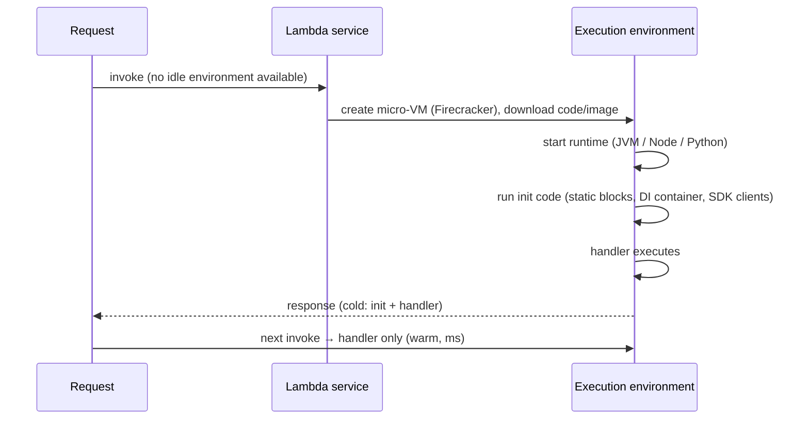

Cold start factors: runtime choice, package or image size, init work (frameworks like Spring scanning classpaths), VPC configuration (much improved since Hyperplane ENIs), and memory setting (more memory means more CPU, so faster init).

Mitigations:
| Technique | Effect |
|---|---|
| **Provisioned concurrency** | pre-initialised environments, no cold start (costs per hour) |
| **SnapStart** (Java, Python, .NET) | snapshot after init, restore from snapshot (~10× faster) |
| Lighter runtimes/frameworks | Node/Python/Go, Quarkus/Micronaut, GraalVM native |
| Smaller packages, lazy init | less to load and initialise |
| More memory | faster CPU during init |

#### Example
A Java Spring Boot Lambda behind API Gateway had 4.5 s cold starts, and p99 latency for users was terrible after quiet periods. Enabling SnapStart (with priming of SDK clients in a `beforeCheckpoint` hook) cut cold starts to ~400 ms. For the checkout path, provisioned concurrency of 20 during business hours (auto-scaled by schedule) removed cold starts entirely.

#### Trade-offs
Provisioned concurrency removes cold starts but costs money continuously. SnapStart is cheap but needs care with uniqueness (random seeds, connections restored from a snapshot). Runtime changes may require rewrites.

#### Problems & fixes
| Symptom | Cause | Fix |
|---|---|---|
| Multi-second first-request latency | Java + heavy framework cold start | SnapStart, provisioned concurrency, lighter framework |
| Duplicate "random" values across instances after SnapStart | state captured in snapshot | re-seed on restore (runtime hooks), avoid caching unique values at init |
| Cold starts after deploys | new versions start cold | provisioned concurrency on alias, pre-warming |

#### Cheat sheet
- Cold start = create environment + runtime start + init. Java is the slowest without help.
- Provisioned concurrency (no cold starts, paid), SnapStart (snapshot restore), lighter runtimes.
- More memory speeds up init. Keep packages small.

#### Interview questions
<details><summary>How do you eliminate cold starts for a latency-critical Lambda API?</summary>

Configure provisioned concurrency on the alias serving production (sized to the expected concurrent requests, auto-scaled on schedule or utilisation), reduce init work and package size, and for Java enable SnapStart. If latency is critical and traffic is steady, consider containers (ECS/EKS), which have no per-request cold starts.
</details>

<details><summary>What subtle bug can SnapStart introduce?</summary>

Anything initialised before the snapshot is cloned into every restored environment: random number generators with the same seed, cached UUIDs or tokens, timestamps, or network connections that are stale after restore. Use runtime hooks to re-initialise uniqueness-sensitive state after restore, and avoid generating unique ids during init.
</details>

#### Interview angle
> "For Java Lambdas I enable SnapStart with re-seeding hooks and add scheduled provisioned concurrency on latency-critical paths. If traffic is steady and latency-critical, I'd move to containers instead."

### Lambda concurrency — reserved concurrency (cap), provisioned concurrency (pre-warmed)
Lambda concurrency is the number of **requests being processed at the same moment** (≈ requests/s × duration). It's bounded by the **account regional limit** (default 1,000, raisable) shared by all functions. **Reserved concurrency** guarantees and caps a function's share. **Provisioned concurrency** keeps a number of environments **pre-initialised** to avoid cold starts.

#### How it works
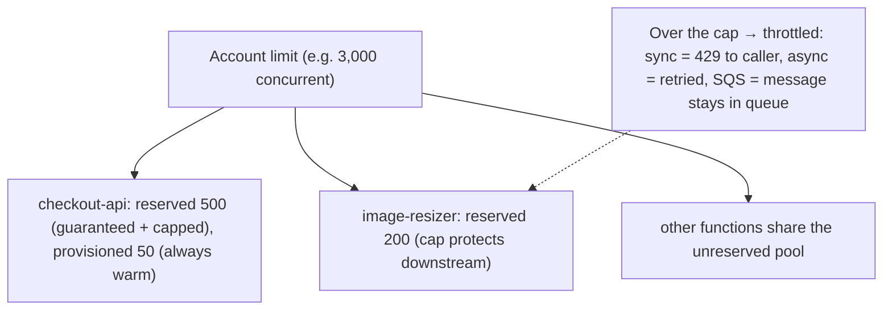

- **Reserved concurrency**: a hard cap and guarantee per function. Set it to 0 to disable (an emergency kill switch).
- **Provisioned concurrency**: warm environments on a version or alias, billed hourly, can autoscale via Application Auto Scaling.
- Burst scaling: functions scale quickly but at a bounded rate (now up to 1,000 new concurrent executions per 10 s per function).

#### Example
A Black Friday incident: a marketing Lambda processing clickstream from Kinesis scaled up and consumed most of the account's concurrency, so the checkout Lambda got throttled. Fix: reserve 800 for checkout (guaranteed), cap clickstream at 300, and add an alarm on `ConcurrentExecutions` approaching the account limit, plus a limit increase request before the event.

#### Trade-offs
Reserved concurrency protects critical functions and downstreams but can throttle bursts. Provisioned concurrency removes cold starts at a fixed cost.

#### Problems & fixes
| Symptom | Cause | Fix |
|---|---|---|
| Critical function throttled | other functions exhausted account pool | reserved concurrency for critical functions |
| Downstream DB overwhelmed | unbounded concurrency | reserved concurrency cap, RDS Proxy |
| Paying for idle provisioned concurrency | static over-provisioning | scheduled/target-tracking autoscaling |

#### Cheat sheet
- Concurrency ≈ RPS × duration. The account limit is shared.
- Reserved = guarantee + cap (0 = disable). Provisioned = pre-warmed (paid).
- Alarm on concurrency and throttles. Raise limits before events.

#### Interview questions
<details><summary>A Lambda handles 500 req/s with an average duration of 300 ms. How much concurrency does it need?</summary>

By Little's law: 500 × 0.3 s = 150 concurrent executions on average. Add headroom for bursts and latency spikes (e.g. 250–300), and make sure the account limit and any reserved concurrency accommodate it. If the duration doubles (a slow dependency), concurrency doubles too.
</details>

<details><summary>How can reserved concurrency act as a safety mechanism?</summary>

It caps how many instances a function can run, which limits the load it can put on downstream systems (databases, third-party APIs) and its cost. Setting it to 0 immediately stops all invocations, a quick kill switch during incidents (e.g. a runaway recursive trigger).
</details>

#### Interview angle
> "Concurrency is RPS times duration. Critical Lambdas get reserved concurrency so batch functions can't starve them, downstream-heavy functions are capped, and provisioned concurrency is scheduled for latency-sensitive paths."

### Lambda + SQS — reserved concurrency = backpressure; SQS retains messages, Lambda scales
Combining SQS with Lambda gives a robust, serverless **buffered processing** pipeline: SQS absorbs bursts and retains messages, Lambda's event source mapping polls and invokes functions in batches, and **concurrency limits act as backpressure** (messages simply wait in the queue). Failures retry automatically, and poison messages go to a DLQ.

#### How it works
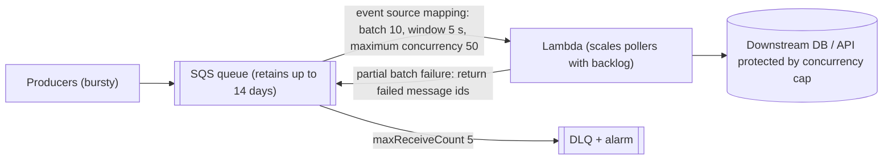

Settings that matter:
- **Batch size and batching window** (throughput vs latency).
- **Maximum concurrency** on the event source mapping (preferred over reserved concurrency to cap SQS consumers without throttling noise).
- **Visibility timeout** ≥ 6 × function timeout.
- **ReportBatchItemFailures** so only failed messages retry.
- **DLQ** on the queue with `maxReceiveCount`.

#### Example
A partner-webhook ingestion system receives up to 30k events/minute in bursts. The API enqueues to SQS and returns 202, and Lambda processes with maximum concurrency 40 (the downstream ledger API's safe limit). During a burst the queue backs up to 200k messages and drains in ~10 minutes, and the ledger never sees more than 40 concurrent calls. Poison payloads (schema errors) land in the DLQ after 5 attempts and are inspected and redriven after fixes.

#### Trade-offs
Simple, elastic and resilient, with no servers, but at-least-once delivery (idempotency required), ordering only with FIFO queues (message group ids), and latency from polling and batching.

#### Problems & fixes
| Symptom | Cause | Fix |
|---|---|---|
| Messages processed twice | visibility timeout < processing time, retries | timeout ≥ 6× function timeout, idempotency |
| Whole batch retried for one failure | no partial batch response | ReportBatchItemFailures |
| Downstream overloaded | unbounded scaling | event source mapping maximum concurrency |
| Throttling errors with reserved concurrency | pollers exceed reserved concurrency | use maximum concurrency setting instead |

#### Cheat sheet
- SQS buffers, Lambda scales, and concurrency caps give backpressure.
- Batch size/window, max concurrency, visibility timeout ≥ 6× function timeout.
- Partial batch failures + DLQ + idempotent handlers.

#### Interview questions
<details><summary>How do you protect a fragile downstream API when processing an SQS queue with Lambda?</summary>

Set the event source mapping's maximum concurrency (or reserved concurrency) to the downstream's safe parallelism, so excess messages wait in SQS rather than hammering the API. Use backoff on retries (visibility timeout), a circuit breaker or kill switch (disable the mapping), idempotent processing, and a DLQ for persistent failures.
</details>

<details><summary>Why should the SQS visibility timeout be much longer than the Lambda timeout?</summary>

If a message becomes visible again while the original invocation is still running (or before retries finish), another invocation processes it concurrently, causing duplicates. AWS recommends a visibility timeout of at least 6 × the function timeout (plus batching window) to cover retries and throttling within the event source mapping.
</details>

#### Interview angle
> "Bursty async work goes through SQS into Lambda: maximum concurrency matched to the downstream's capacity, visibility timeout at six times the function timeout, partial batch failures, a DLQ and idempotent handlers."

### Step Functions — stateful serverless workflows: sequential, parallel, wait, retry, catch
AWS Step Functions orchestrates multi-step workflows as **state machines** (Amazon States Language): task steps (Lambda, ECS, 200+ AWS SDK integrations), **choice**, **parallel**, **map** (fan-out over items), **wait** (up to a year), and built-in **retry and catch** with backoff. State and execution history are durable and visible, which makes it ideal for sagas and long-running processes.

#### How it works
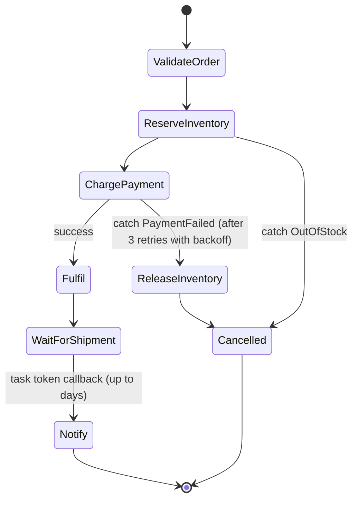

Workflow types: **Standard** (durable, exactly-once steps, up to 1 year, audit history, priced per state transition) vs **Express** (high-volume, short (≤ 5 min), at-least-once, priced per duration). Patterns: `.waitForTaskToken` callbacks (human approval, external systems), Distributed Map (process millions of S3 objects), and direct SDK integrations (DynamoDB PutItem without a Lambda).

#### Example
A loan-disbursement saga: KYC check (Lambda) → credit score (HTTP API via SDK integration) → a human approval step (task token sent to an ops dashboard, waiting up to 48 h) → disbursement (ECS task) → ledger posting (DynamoDB) → notification (SNS). Failures trigger compensations (reverse the disbursement, cancel the agreement). Ops sees every application's execution graph and history.

#### Trade-offs
Durable, visual, retry-rich orchestration with no orchestrator servers, but Standard workflows cost per transition (expensive for very chatty flows), ASL JSON or YAML can get verbose, and it's AWS-specific (Temporal is the portable alternative).

#### Problems & fixes
| Symptom | Cause | Fix |
|---|---|---|
| High cost | Standard workflow with many tiny transitions at high volume | Express workflows, combine steps, Distributed Map batching |
| Payload too large | 256 KB state limit | store payloads in S3, pass references |
| Duplicate side effects in Express | at-least-once execution | idempotent tasks |
| Hard-to-read definitions | huge JSON | Workflow Studio, CDK/SDK definitions, modular sub-workflows |

#### Cheat sheet
- State machine: task, choice, parallel, map, wait. Retry/catch built in.
- Standard (durable, ≤ 1 year, per transition) vs Express (high volume, ≤ 5 min).
- Task tokens for callbacks. SDK integrations without Lambda. Pass S3 refs for big data.

#### Interview questions
<details><summary>How would you implement a saga with Step Functions?</summary>

Model each step as a task state (calling a service via Lambda, an SDK integration or HTTP) with retry policies, and attach catch clauses that route to compensating states (release inventory, refund payment) in reverse order, ending in a failure or cancelled state. Standard workflows give durable state and audit history, and idempotency keys (execution name or id) make tasks safe to retry.
</details>

<details><summary>Standard vs Express workflows: how do you choose?</summary>

Standard for long-running, auditable business processes needing exactly-once step execution, waits and human approvals (orders, loans, onboarding). Express for high-volume, short-lived event processing (IoT ingestion, streaming transforms, API orchestration under 5 minutes) where at-least-once is acceptable and cost per execution matters.
</details>

#### Interview angle
> "Long-running sagas like loan disbursement run on Step Functions Standard: retries, catches into compensations, task-token waits for human approval and full execution history. High-volume short flows use Express."

### EventBridge — serverless event bus: route events from AWS services and SaaS to Lambda/SQS
Amazon EventBridge is a serverless **event bus** that routes events from your apps, **AWS services** (S3, EC2, CodePipeline…) and **SaaS partners** (Stripe, Zendesk, Datadog…) to targets (Lambda, SQS, Step Functions, API destinations, other buses) using **content-based rules**. It also offers schema registry, **archive and replay**, cross-account buses, Pipes (point-to-point with filtering and enrichment) and Scheduler.

#### How it works
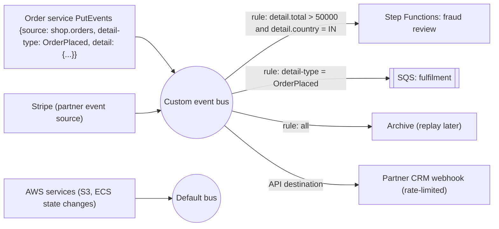

Rule patterns support prefix, numeric ranges, exists, anything-but and so on. Targets get retries (24 h) and DLQs.

#### Example
An e-commerce company uses a custom bus for domain events: `OrderPlaced` routes to fulfilment (SQS), high-value Indian orders route to a fraud-review Step Function, and all events are archived for 90 days. When a new loyalty service launched, they replayed the last 30 days of `OrderPlaced` from the archive to backfill points. Stripe payment events arrive via the partner integration with no webhook endpoint to maintain.

#### Trade-offs
Low-ops routing, rich filtering, SaaS integrations and replay, but higher latency (tens to hundreds of ms) and lower per-bus throughput than Kafka or Kinesis, no ordering guarantees, and 256 KB events.

#### Problems & fixes
| Symptom | Cause | Fix |
|---|---|---|
| Events silently not delivered | rule pattern mismatch / target failures | test patterns, target DLQs, metrics on FailedInvocations |
| Ordering issues | EventBridge doesn't guarantee order | design order-independent consumers, or use Kinesis/MSK |
| Webhook partner overwhelmed | unthrottled API destination | API destination rate limits |

#### Cheat sheet
- Serverless bus: content rules route events to targets. AWS and SaaS sources.
- Archive + replay, schema registry, cross-account, Pipes, Scheduler.
- No ordering. Moderate throughput. DLQs on targets.

#### Interview questions
<details><summary>EventBridge vs Kafka for a microservices event backbone?</summary>

EventBridge suits AWS-centric, moderate-volume event routing with minimal operations: content-based rules, AWS and SaaS integrations, archive and replay. Kafka suits high-throughput, ordered (per partition) streams, long retention, stream processing, and many consumers reading at their own pace, at the cost of operating or paying for a cluster (MSK).
</details>

<details><summary>How can EventBridge archive and replay help when launching a new service?</summary>

If domain events were archived, the new consumer's rule can receive replayed historical events from a chosen time window, letting it backfill its state (e.g. loyalty points from past orders) without asking producers to resend. Consumers must be idempotent, since replays and live events can overlap.
</details>

#### Interview angle
> "For AWS-centric event routing, EventBridge gives content-based rules, SaaS sources, DLQs and archive-and-replay to backfill new services. High-throughput ordered streams go on Kafka."

### Terraform — declarative IaC: resources, providers, state file (lock with S3 + DynamoDB)
Terraform (and its open fork OpenTofu) is a **declarative infrastructure-as-code** tool: you describe desired resources in HCL, **providers** translate them into API calls (AWS, GCP, Kubernetes, Datadog…), and a **state file** records what exists so Terraform can compute diffs. Remote state with **locking** makes team use safe.

#### How it works
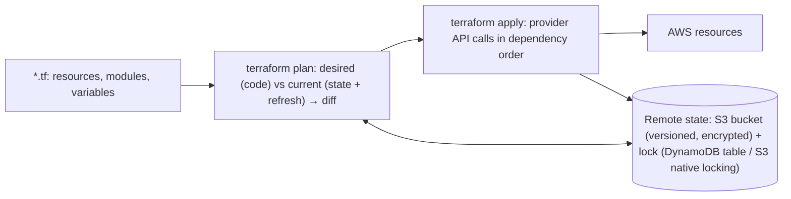

```hcl
terraform {
  backend "s3" {
    bucket         = "acme-tfstate-prod"
    key            = "network/vpc.tfstate"
    region         = "ap-south-1"
    dynamodb_table = "tf-locks"          # state locking (newer versions also support use_lockfile)
    encrypt        = true
  }
}
module "vpc" {
  source  = "terraform-aws-modules/vpc/aws"
  version = "5.8.1"
  name    = "prod"
  cidr    = "10.20.0.0/16"
  azs     = ["ap-south-1a", "ap-south-1b", "ap-south-1c"]
}
```

Practices: separate state per environment and component (blast radius), reusable versioned **modules**, `plan` in PRs and `apply` in CI only, policy as code (OPA/Sentinel/Checkov), drift detection, and no secrets in state (state contains sensitive values, so encrypt it and restrict access).

#### Example
A platform team manages 4 AWS accounts with Terraform: separate state files for network, data and services per environment, PRs run `terraform plan` and post the diff as a comment, merges trigger `apply` via CI using an OIDC-assumed role (no static keys), Checkov blocks public S3 buckets, and a nightly plan detects drift (someone changed a security group in the console, so it's reverted).

#### Trade-offs
Reproducible, reviewable infrastructure across many providers, but state management is critical (corruption or locking issues), refactoring resources needs `moved` blocks or imports, and plans can surprise (replacements, which you must read carefully).

#### Problems & fixes
| Symptom | Cause | Fix |
|---|---|---|
| Concurrent applies corrupt state | no locking | remote backend with locking |
| One mistake affects everything | single giant state | split state by env/component |
| Secrets leaked via state | sensitive outputs in plain state | encrypted backend, restricted access, external secret managers |
| Console changes drift | manual edits | drift detection, deny console writes for managed resources |

#### Cheat sheet
- Declarative HCL + providers + state (remote, locked, encrypted).
- Modules, split states, plan in PR, apply from CI with OIDC.
- Policy as code. Drift detection. Careful with replacements.

#### Interview questions
<details><summary>Why is the Terraform state file important, and how do you manage it in a team?</summary>

State maps configuration to real resource ids and stores attributes Terraform needs to compute changes. Without it Terraform can't know what exists. In teams: store it remotely (S3 with versioning and encryption, Terraform Cloud), enable locking to prevent concurrent applies, restrict access (it can contain secrets), and split state per environment and component to limit blast radius.
</details>

<details><summary>How do you rename or move a resource in Terraform without destroying it?</summary>

Use a `moved` block (`moved { from = aws_s3_bucket.old to = aws_s3_bucket.new }`) or `terraform state mv`, so Terraform updates state addresses instead of planning destroy-and-create. Always read the plan for unexpected "must be replaced" actions before applying.
</details>

#### Interview angle
> "Infrastructure is Terraform: versioned modules, split remote state with locking and encryption, plans posted on PRs, applies from CI via OIDC roles, policy checks and nightly drift detection."

### Terraform plan/apply workflow — preview changes before applying; destroy with care
Terraform's core workflow is **`init` → `plan` → `apply`**: `plan` computes and shows exactly what will be created, updated in place, **replaced** or destroyed, and `apply` executes that plan. Reviewing plans (especially replacements and destroys) is the main safety mechanism. `destroy` removes everything a configuration manages.

#### How it works
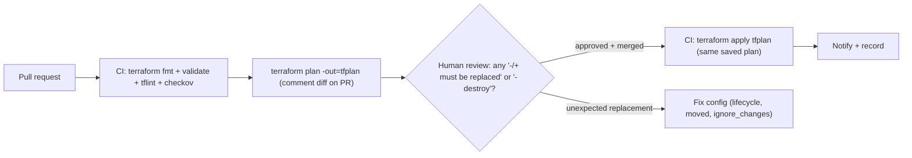

Plan symbols: `+` create, `~` update in place, `-/+` destroy and recreate (replacement!), `-` destroy, `<=` read data source.

Safety tools:
- `lifecycle { prevent_destroy = true }` on critical resources (databases, state buckets).
- `create_before_destroy` for zero-downtime replacements.
- `ignore_changes` for attributes managed elsewhere.
- Saved plan files (`-out`) so you apply exactly what was reviewed.
- `-target` only for emergencies.
- Deletion protection on RDS and other services.

#### Example
A PR changing an RDS parameter accidentally altered `engine_version` format, and the plan showed `-/+ aws_db_instance.orders must be replaced`, which would destroy the production database. Review caught it. The team added `prevent_destroy` and `deletion_protection = true` to all databases and a CI rule failing any plan that contains a destroy or replace of tagged critical resources without an explicit override label.

#### Trade-offs
Plans make changes predictable, but only if humans actually read them (plan fatigue). Large plans are hard to review, so keep changes small and states split.

#### Problems & fixes
| Symptom | Cause | Fix |
|---|---|---|
| Accidental resource replacement | immutable attribute changed | read plans, prevent_destroy, CI checks for replacements |
| Applied something different from reviewed | re-planning at apply time | apply saved plan file |
| Huge unreadable plans | monolithic state | smaller states, smaller PRs |
| `terraform destroy` run in wrong workspace | human error | protected prod, separate accounts, prevent_destroy |

#### Cheat sheet
- init → plan (review) → apply the saved plan.
- Watch `-/+` replacements and `-` destroys. Use prevent_destroy and deletion protection.
- create_before_destroy, ignore_changes, small states and PRs.

#### Interview questions
<details><summary>A plan shows your production database "must be replaced". What do you do?</summary>

Stop: don't apply. Identify the attribute forcing replacement (the plan marks it), revert or adjust the change (use an in-place-updatable attribute, `ignore_changes` if it's managed elsewhere, or a planned migration path such as a snapshot restore or blue/green). Add `prevent_destroy` and RDS deletion protection to guard against this in future.
</details>

<details><summary>Why apply a saved plan file in CI instead of running apply directly?</summary>

Between review and apply, state or code could change (another merge, drift), producing a different plan than the one approved. Applying the saved plan executes exactly the reviewed changes (and fails if state changed), keeping the review meaningful and auditable.
</details>

#### Interview angle
> "Every change gets a plan posted on the PR, a human reviews any replace or destroy, and CI applies exactly that saved plan, with prevent_destroy and deletion protection on stateful resources."

### CloudFormation — AWS-native IaC: stacks, change sets, drift detection
AWS CloudFormation is AWS's native IaC service: you declare resources in YAML/JSON templates (or generate them with **CDK**), deploy them as **stacks**, preview changes with **change sets**, and detect manual changes with **drift detection**. AWS manages the state and rollback for you.

#### How it works
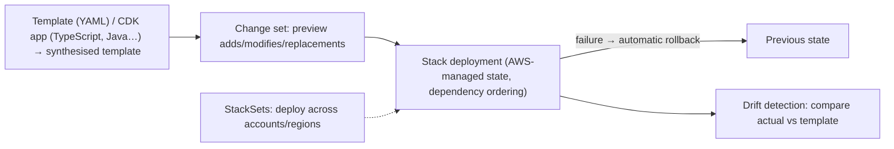

Features: nested stacks and modules, StackSets (multi-account and multi-region), stack policies (prevent updates to critical resources), DeletionPolicy/UpdateReplacePolicy (Retain/Snapshot), custom resources (Lambda-backed), and hooks (policy checks before provisioning).

#### Example
A company standardises account baselines (CloudTrail, GuardDuty, Config rules, IAM roles) with CloudFormation StackSets deployed to 60 accounts via AWS Organizations, so new accounts get the baseline automatically. Application teams use **CDK** in TypeScript to define services (ECS + ALB + RDS), with change sets reviewed in pipelines and `DeletionPolicy: Snapshot` on databases.

#### Trade-offs
| CloudFormation / CDK | Terraform |
|---|---|
| AWS-managed state, automatic rollback | you manage state backend |
| day-0 support for many AWS features (sometimes lagging) | multi-cloud + SaaS providers |
| AWS-only | portable across providers |
| CDK: real programming languages | HCL (+ CDKTF) |

#### Problems & fixes
| Symptom | Cause | Fix |
|---|---|---|
| Stack stuck in UPDATE_ROLLBACK_FAILED | resource changed outside/failed rollback | continue-update-rollback with skips, avoid manual changes |
| Accidental data loss on replacement | missing deletion/replace policies | DeletionPolicy/UpdateReplacePolicy: Snapshot/Retain, stack policies |
| Manual drift | console edits | drift detection + guardrails |

#### Cheat sheet
- Templates/CDK → stacks. Change sets preview. Auto rollback. Drift detection.
- StackSets for multi-account baselines. Deletion/replace policies for data.
- AWS-only. Terraform for multi-provider.

#### Interview questions
<details><summary>CloudFormation vs Terraform: when would you pick CloudFormation/CDK?</summary>

When the organisation is AWS-only and wants AWS-managed state with automatic rollback, tight integration with AWS services (StackSets with Organizations, Service Catalog, Control Tower), and CDK's ability to use TypeScript or Java with higher-level constructs. Terraform is preferable for multi-cloud or many SaaS providers, or when teams already standardise on it.
</details>

<details><summary>How do you protect a production database defined in CloudFormation from accidental deletion?</summary>

Set `DeletionPolicy: Snapshot` (or Retain) and `UpdateReplacePolicy: Snapshot` on the resource, enable the database's own deletion protection, apply a stack policy denying `Update:Replace`/`Delete` on that logical resource, enable stack termination protection, and always review change sets for replacements.
</details>

#### Interview angle
> "In AWS-only shops I'd use CDK synthesised to CloudFormation: change sets reviewed in pipelines, Snapshot deletion and replace policies on data, StackSets for account baselines and drift detection to catch console edits."

### Ansible — configuration management: agentless, idempotent YAML playbooks
Ansible automates **configuration management and orchestration** over SSH (or WinRM) with **no agents**: YAML **playbooks** describe desired state using idempotent **modules** (install packages, template configs, manage services, users and files). Running a playbook twice produces the same result. Roles and inventories organise it at scale.

#### How it works
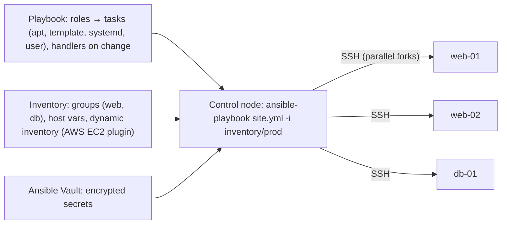

```yaml
- hosts: web
  become: true
  roles: [common]
  tasks:
    - name: Install nginx
      ansible.builtin.apt: { name: nginx, state: present, update_cache: true }
    - name: Deploy nginx config
      ansible.builtin.template: { src: nginx.conf.j2, dest: /etc/nginx/nginx.conf, mode: "0644" }
      notify: reload nginx
  handlers:
    - name: reload nginx
      ansible.builtin.service: { name: nginx, state: reloaded }
```

Where it fits today: configuring VMs and bare metal (OS hardening, agents), **baking images** with Packer + Ansible (immutable), network device automation, and orchestration tasks (rolling restarts). Terraform provisions resources and Ansible configures what runs on them (for non-container workloads).

#### Example
A bank with on-prem servers plus AWS EC2 uses Ansible roles to apply CIS hardening, install monitoring agents and configure application servers, using a dynamic AWS inventory and Ansible Vault for secrets. For new services they moved to Packer + Ansible to bake AMIs (immutable), rather than running Ansible against live servers, to avoid drift.

#### Trade-offs
Simple (YAML, SSH, no agents) and broad module coverage, but slower at large scale (SSH per host), procedural ordering can hide state complexity, and live configuration of mutable servers encourages drift (prefer immutable images and containers).

#### Problems & fixes
| Symptom | Cause | Fix |
|---|---|---|
| Playbook changes something every run | non-idempotent tasks (shell/command) | proper modules, `creates`/`changed_when` |
| Slow runs on thousands of hosts | SSH overhead | forks, pipelining, mitogen, pull mode, image baking |
| Secrets in plain YAML | no vault | Ansible Vault / external secret lookups |
| Drift on live servers | mutable infra | bake images, replace instances |

#### Cheat sheet
- Agentless (SSH), YAML playbooks, idempotent modules, roles, inventories.
- Configure VMs, harden OS, bake images (Packer + Ansible), network automation.
- Terraform provisions, Ansible configures. Prefer immutable images.

#### Interview questions
<details><summary>Terraform vs Ansible: how do they differ and how do they fit together?</summary>

Terraform is declarative provisioning of infrastructure resources via cloud APIs (VPCs, instances, databases) with a state file and dependency graph. Ansible is configuration management and orchestration of what runs on machines (packages, configs, services) via SSH, procedural playbooks with idempotent modules. Typical combination: Terraform creates instances, and Ansible (often through Packer at image build time) configures them.
</details>

<details><summary>What does idempotency mean in Ansible and why does it matter?</summary>

Running a task repeatedly yields the same end state, and it only reports "changed" when something actually changed (e.g. `apt: state=present` installs only if missing). That makes playbooks safe to re-run for convergence and drift correction, and avoids unintended restarts. Raw `shell` or `command` tasks break idempotency unless guarded.
</details>

#### Interview angle
> "Terraform provisions and Ansible configures. For new workloads, Ansible runs inside Packer to bake immutable AMIs rather than mutating live servers, with Vault-encrypted secrets and idempotent modules."

### Container registry — ECR (AWS), Docker Hub, GCR, Harbor (self-hosted)
A container registry **stores and distributes container images** (and other OCI artifacts like Helm charts and SBOMs). Production registries add **access control**, **vulnerability scanning**, **immutability**, **replication**, **lifecycle policies** and **signature verification**. Options: Amazon ECR, Google Artifact Registry, Azure ACR, GitHub Container Registry, Docker Hub, and self-hosted Harbor.

#### How it works
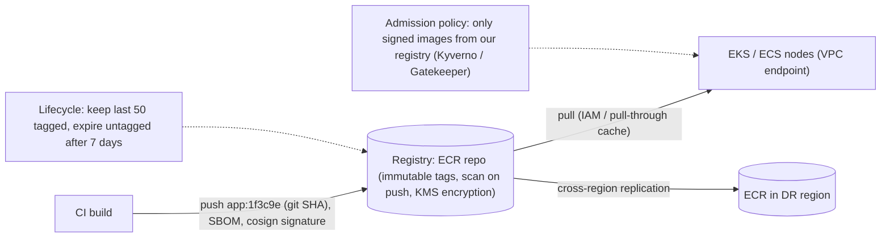

Practices: tag images by **commit SHA** (and deploy by digest), enable **immutable tags**, scan on push (ECR enhanced scanning / Inspector, Trivy), sign with **cosign** and verify at admission, use pull-through caches for public images (avoiding Docker Hub rate limits and supply-chain risk), and private access via VPC endpoints.

#### Example
After Docker Hub rate limits broke CI builds, a team mirrored base images through an ECR pull-through cache. All app images are pushed to ECR with immutable SHA tags, scanned on push (critical CVEs block promotion), signed with cosign in CI, and Kyverno in EKS rejects unsigned images or images from other registries. Lifecycle policies cut registry storage by 80%.

#### Trade-offs
Managed registries are low-ops and integrated with cloud IAM, while self-hosted Harbor gives control (on-prem, air-gapped) but needs operations. Supply-chain security adds pipeline steps.

#### Problems & fixes
| Symptom | Cause | Fix |
|---|---|---|
| "latest" changed under running pods | mutable tags | immutable tags, deploy by digest |
| CI broken by Docker Hub limits | anonymous pulls | pull-through cache / mirror |
| Vulnerable images deployed | no scanning gates | scan on push + block criticals + admission policies |
| Storage costs grow | no lifecycle | lifecycle rules for old/untagged images |

#### Cheat sheet
- Store and distribute OCI artifacts: images, Helm charts, SBOMs, signatures.
- SHA tags + immutability + digest deploys. Scan on push. Sign and verify.
- Pull-through caches, VPC endpoints, lifecycle policies, replication.

#### Interview questions
<details><summary>Why deploy images by digest rather than by tag?</summary>

A tag is a mutable pointer: someone can push a different image under the same tag (including `latest`), so nodes could pull different code for the "same" version, and rollbacks become ambiguous. A digest (sha256) identifies exact image content, so deployments are reproducible and tamper-evident.
</details>

<details><summary>How do you secure the container supply chain from build to cluster?</summary>

Minimal pinned base images (pulled via a trusted mirror), dependency and image scanning in CI with gates, SBOM generation, image signing (cosign/Sigstore) and provenance attestations (SLSA), immutable tags in a private registry with restricted push rights, and admission control in clusters allowing only signed images from approved registries.
</details>

#### Interview angle
> "Images go to ECR with immutable SHA tags, are scanned on push, signed with cosign and pulled over VPC endpoints. Clusters admit only signed images, deployed by digest."

### GitOps with ArgoCD — desired state in Git, ArgoCD reconciles cluster continuously
Argo CD is the most widely used GitOps controller for Kubernetes: it watches Git repositories (plain manifests, Helm, Kustomize), compares them with live cluster state, shows diffs and health, and **syncs** automatically or on approval, with **self-heal** to revert drift. (Phase 8 covers GitOps principles.)

#### How it works
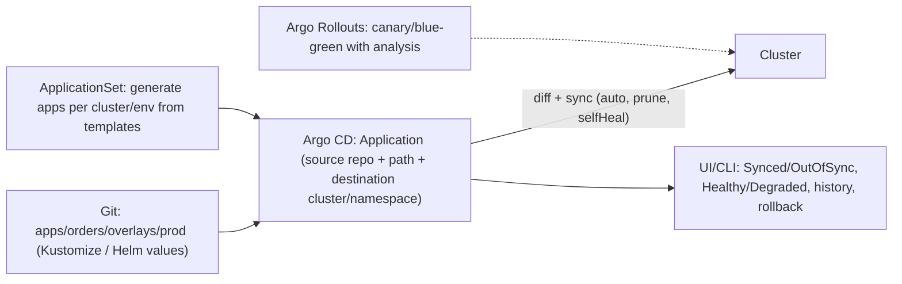

```yaml
apiVersion: argoproj.io/v1alpha1
kind: Application
metadata: { name: orders-prod, namespace: argocd }
spec:
  project: payments-team
  source: { repoURL: https://github.com/acme/deploy, targetRevision: main, path: apps/orders/overlays/prod }
  destination: { server: https://kubernetes.default.svc, namespace: orders }
  syncPolicy:
    automated: { prune: true, selfHeal: true }
    syncOptions: [CreateNamespace=true]
```

Features: sync waves and hooks (ordering, e.g. migrations first), AppProjects (RBAC and allowed destinations per team), SSO, multi-cluster management, notifications, and Image Updater.

#### Example
50 microservices across dev, staging and prod clusters are managed by ApplicationSets generated from a directory structure. Teams own their app directories (CODEOWNERS), and AppProjects restrict each team to its namespaces. Production syncs are automated, but PRs to `prod/` need approval. A sync wave runs the Flyway migration Job before the Deployment. Rollback is reverting the commit, or using Argo's history in an emergency.

#### Trade-offs
Clear desired state, auditability, drift correction and multi-cluster visibility, but Argo CD itself needs HA and security (it has cluster-admin powers), secrets need external tooling, and large monorepos can slow reconciliation.

#### Problems & fixes
| Symptom | Cause | Fix |
|---|---|---|
| App flaps OutOfSync | fields mutated by controllers (HPA replicas, webhooks) | ignoreDifferences, don't set replicas when HPA owns them |
| Deletions not applied | prune disabled | enable prune (carefully), finalizers |
| Over-privileged Argo | single admin project | AppProjects, RBAC, SSO |
| Migrations run after app starts | no ordering | sync waves/hooks |

#### Cheat sheet
- Application = repo path → cluster namespace. Auto-sync + prune + selfHeal.
- ApplicationSets, AppProjects (RBAC), sync waves/hooks, Rollouts for progressive delivery.
- ignoreDifferences for controller-managed fields. Secure Argo itself.

#### Interview questions
<details><summary>How does Argo CD handle drift?</summary>

It continuously compares the live state of managed resources with the rendered manifests from Git and marks the application OutOfSync on differences. With `selfHeal: true` it re-applies the Git state automatically, reverting manual changes. Without it, it reports the drift for a human to sync or update Git.
</details>

<details><summary>Why might an HPA-managed Deployment show as constantly OutOfSync in Argo CD, and how do you fix it?</summary>

The Deployment manifest in Git sets `replicas`, while the HPA changes the live replica count, so the live and desired states differ continuously (and self-heal fights the HPA). Remove `replicas` from the manifest (let the HPA own it) or configure `ignoreDifferences` for `/spec/replicas`.
</details>

#### Interview angle
> "Argo CD ApplicationSets deploy every service from Git with auto-sync, prune and self-heal, AppProjects scoping each team, and sync waves running migrations before the rollout."

### CI/CD stages — build → unit test → integration test → security scan → artifact publish → deploy to staging → smoke test → promote to production
A mature CI/CD pipeline moves every change through a predictable sequence of **quality and security gates** to production, building the artifact once and promoting it. Each stage should fail fast and give clear feedback, and later stages add confidence with more realistic environments. (Phase 8 covers pipeline principles.)

#### How it works
```mermaid
flowchart LR
  S1["1 Build (compile, cache deps)"] --> S2["2 Unit tests + coverage"]
  S2 --> S3["3 Integration tests (Testcontainers), contract tests"]
  S3 --> S4["4 Security: SAST, SCA, secrets, IaC, image scan"]
  S4 --> S5["5 Publish artifact: image@sha256, SBOM, signature"]
  S5 --> S6["6 Deploy to staging (GitOps PR / Argo)"]
  S6 --> S7["7 Smoke + e2e critical journeys, perf sanity"]
  S7 --> S8["8 Promote to production: approval (if required), canary + automated analysis"]
  S8 --> S9["9 Post-deploy verification + auto rollback"]
```

| Stage | Typical tools | Fail on |
|---|---|---|
| Build | Maven/Gradle, Docker Buildx (cache) | compile errors |
| Unit | JUnit, Jest | test failures, coverage drop |
| Integration/contract | Testcontainers, Pact | broken integrations |
| Security | Semgrep/Sonar, Snyk/Dependabot, gitleaks, Checkov, Trivy | high/critical findings |
| Publish | ECR + cosign + Syft SBOM | signing/scanning failure |
| Staging | Argo CD, Helm | deploy/health failure |
| Smoke | Playwright/k6 smoke, synthetic checks | journey failures |
| Prod | Argo Rollouts, CodeDeploy | analysis regression |

#### Example
For a payments service, a merge to main produces an image in about 12 minutes and auto-deploys to staging. Smoke tests run a synthetic payment end to end in sandbox mode. Promotion to production requires one approver (compliance), and an Argo Rollouts canary (5% → 25% → 100%) checks error rate, p99 latency and payment success. A failed analysis rolls back automatically and posts to Slack with links to the dashboards and the offending commit.

#### Trade-offs
Each gate adds confidence but also time, so balance them by risk (strict for payments, lighter for internal tools). Flaky gates erode trust.

#### Problems & fixes
| Symptom | Cause | Fix |
|---|---|---|
| Pipeline too slow | everything serial | parallel stages, caching, split test suites |
| Staging passes, prod fails | env differences | IaC parity, same artifact, production-like data |
| Security gate ignored | too many low-value findings | severity thresholds, triage, baseline suppression |
| No fast rollback | manual deploys | progressive delivery with auto rollback |

#### Cheat sheet
- Build → unit → integration/contract → security → publish (signed, SBOM) → staging → smoke → canary prod → verify.
- Build once, promote the digest. Gate by risk. Automate rollback.
- Keep PR feedback fast. Kill flaky tests quickly.

#### Interview questions
<details><summary>Where in the pipeline do you run database migrations?</summary>

As an explicit step before the new application version receives traffic: in staging first (validating the migration), then in production as a pre-deploy job or sync wave, using backward-compatible (expand) migrations so the old version keeps working. Destructive (contract) migrations run in a later release once no deployed version needs the old schema.
</details>

<details><summary>How do you decide which checks block a merge vs run later?</summary>

Block on fast, high-signal checks: compile, unit tests, critical-severity security findings, secrets, contract tests and linting, keeping PR feedback under ~10 minutes. Run slower or noisier checks (full e2e, DAST, load tests, full SAST) post-merge or nightly, with alerts and tickets, and gate production promotion on them where risk demands.
</details>

#### Interview angle
> "Every change flows build, unit, integration and contract, security scans, a signed image with an SBOM, staging plus smoke tests, then a canaried production rollout with automatic rollback, with gates matched to risk."
