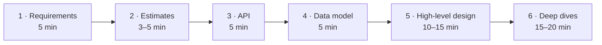
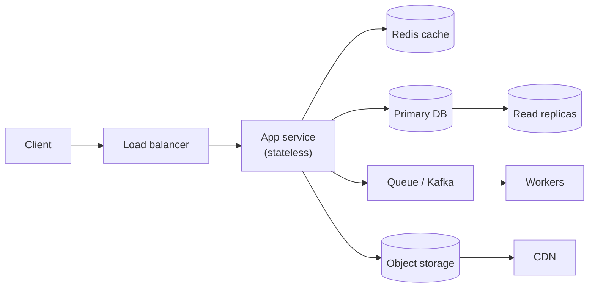

## TL;DR

- A system design round is a **conversation about trade-offs**, not a quiz with one right answer.
- At **SDE-2** you're expected to **drive** the discussion. That means asking the right questions, proposing a working design, and then going deep on 2–3 parts without being pushed.
- Use the same **6 steps** every time: **Requirements → Estimates → API → Data model → High-level design → Deep dives**.
- Say your reasoning out loud. "I'm choosing X **because** Y, and the cost is Z" is the sentence that earns marks.

## What interviewers are actually scoring

Most product companies and banks use a rubric close to this one. Learn it, because every step of the framework maps to a line on it.

| Signal | What "strong" looks like at SDE-2 |
|---|---|
| **Problem navigation** | You clarify scope before drawing anything, and you pick the 3–5 features that matter. |
| **Solution design** | Your boxes-and-arrows design actually works end to end for the core use cases. |
| **Technical depth** | You can go deep on at least 2 components (DB schema, caching, queues, consistency), not just name them. |
| **Trade-offs** | For every choice you name the alternative and why you didn't pick it. |
| **Communication** | Structured, collaborative, and you check in with the interviewer. |
| **Scale & reliability** | You find bottlenecks and single points of failure yourself. |

> **SDE-1 vs SDE-2 vs SDE-3.** SDE-1 is mostly expected to produce a working design with hints. **SDE-2 is expected to drive the whole thing and go deep on a couple of areas without hints.** SDE-3 also has to anticipate operational issues, cost, and org-level trade-offs. You're aiming for "solid SDE-2 with sparks of SDE-3".

## The 6-step framework (for a 45–60 minute round)



### Step 1 — Requirements (≈5 min)

Split them into two lists and **write them on the board**.

**Functional (what the system does).** Ask: "Who are the users and what are the top 3 things they do?" Then cut the list down hard.
*Example (URL shortener):* create a short URL, redirect, (optional) custom alias, expiry. **Out of scope:** analytics dashboard, user accounts.

**Non-functional (how well it does it).** This list drives your architecture, so always cover:
- **Scale:** daily active users, reads vs writes ratio.
- **Latency:** e.g. redirect p99 < 100 ms.
- **Availability vs consistency:** "Is it OK if a new post takes 5 seconds to appear for followers?" (Usually yes, so eventual consistency is fine.) "Can two people book the same seat?" (Never, so you need strong consistency.)
- **Durability:** can we ever lose data? (Payments: never.)

> **Tip:** The single most valuable question is *"What matters more here — consistency or availability?"* The answer decides your database, cache and replication choices.

### Step 2 — Back-of-the-envelope estimates (≈3–5 min)

Only calculate what changes the design: **QPS** (read and write), **storage per year**, and sometimes **bandwidth**. Round aggressively (1 day ≈ 10⁵ seconds). Day 2 teaches this properly. Then *say what the numbers mean*: "20K reads/sec is too much for one Postgres box without a cache, so I'll add Redis."

### Step 3 — API design (≈5 min)

List 3–5 endpoints with request/response shapes.

```http
POST /v1/urls            { longUrl, customAlias?, expiresAt? }  → 201 { shortUrl }
GET  /{code}             → 302 Location: <longUrl>
```

Mention auth (API key or JWT), pagination (cursor), and idempotency for writes that must not double-apply.

### Step 4 — Data model (≈5 min)

List the main entities, their key fields, and **how they're accessed**. The access pattern decides the database:
- Need joins and transactions? → **Relational (PostgreSQL/MySQL)**.
- Huge write volume, simple key lookups? → **Wide-column / key-value (Cassandra, DynamoDB)**.
- Then name the **partition/shard key**.

### Step 5 — High-level design (≈10–15 min)

Draw the request path for each core use case: **client → load balancer → service(s) → cache → database**, plus async parts (**queue → workers**) and **blob storage + CDN** for media. Walk through one request end to end to prove it works.



### Step 6 — Deep dives (≈15–20 min)

This is where SDE-2 is won or lost. Pick 2–3 of these, or let the interviewer pick:
- **Scaling the hot path:** caching strategy, read replicas, sharding key, hot keys.
- **Consistency:** what happens with concurrent writes? Locks? Idempotency?
- **Failure handling:** what if a service, a DB node, or a whole region dies? Retries, queues, DLQ.
- **Bottlenecks:** "The single Redis is a SPOF, so I'd run Redis Cluster with replicas."

Finish with a **30-second wrap-up**: what you built, the key trade-offs, and what you'd do next with more time (monitoring, multi-region, rate limiting).

## Phrases that score points

- "Let me confirm the scope before designing…"
- "There are two options here: A and B. A gives us X but costs Y. Given our requirement of Z, I'll go with A."
- "The bottleneck at this scale will be ___, so…"
- "This is a single point of failure. To fix it, I'd…"
- "Should I go deeper on the storage layer or on the real-time delivery path?"

## Common mistakes

1. **Jumping straight to boxes** without requirements. That's an instant "poor problem navigation" mark.
2. **Buzzword soup:** "We'll use Kafka, Kubernetes and Cassandra" without saying *why*.
3. **Going silent** for minutes while thinking. Think out loud instead.
4. **Over-engineering:** microservices for 100 users. Match the design to the numbers you estimated.
5. **Ignoring the interviewer's hints.** If they ask "what if this node dies?", that's a cue to dive there.
6. **Never finishing.** Spending 25 minutes on requirements leaves no time for depth.

## Self-check

<details>
<summary>What are the 6 steps of the framework, and roughly how long does each take?</summary>

Requirements (5) → Estimates (3–5) → API (5) → Data model (5) → High-level design (10–15) → Deep dives (15–20). Close with a 30-second summary.
</details>

<details>
<summary>What separates an SDE-2 performance from an SDE-1 performance?</summary>

SDE-2 **drives** the conversation without prompts, produces a working end-to-end design, and goes **deep** on 2–3 components with explicit trade-offs. SDE-1 can get there with hints.
</details>

<details>
<summary>Which single requirements question most changes the architecture?</summary>

Consistency vs availability. For example: "Is it acceptable if users see slightly stale data?" It decides the database, replication mode, caching, and whether you need locks or transactions.
</details>

<details>
<summary>Why do estimates matter if the numbers are rough?</summary>

They justify design decisions. For example, 50K QPS means you need caching or sharding, 10 TB/year rules out a single node, and a 100:1 read:write ratio says optimise reads. The order of magnitude is what matters, not precision.
</details>
---
id: estimation
title: Back-of-the-envelope estimation & numbers to know
module: playbook
day: 2
minutes: 35
tags: star, estimation, numbers, capacity
summary: The handful of numbers and shortcuts that let you compute QPS, storage and bandwidth in under 3 minutes, plus what each result tells you to build.
videos: ByteByteGo back of the envelope estimation | Gaurav Sen capacity estimation system design | Jordan has no life capacity estimates
read: Latency numbers every programmer should know => https://github.com/donnemartin/system-design-primer#latency-numbers-every-programmer-should-know | Powers of two table (Primer) => https://github.com/donnemartin/system-design-primer#powers-of-two-table
---

## TL;DR

- Memorise **~10 numbers** (below). Everything else is multiplication.
- **1 day ≈ 100,000 seconds** (really 86,400). Rounding makes the maths instant.
- Formula: **QPS = DAU × actions per user per day ÷ 10⁵**. **Peak ≈ 2–3× average.**
- Storage: **items per day × size × 365 × years × replication factor (3)**.
- Always end with **"…so this means we need X"**.

## The numbers to memorise

### Powers of ten and data sizes

| Value | Name | Bytes |
|---|---|---|
| 10³ | Thousand | 1 KB |
| 10⁶ | Million | 1 MB |
| 10⁹ | Billion | 1 GB |
| 10¹² | Trillion | 1 TB |
| 10¹⁵ | Quadrillion | 1 PB |

### Typical object sizes

| Thing | Rough size |
|---|---|
| A char (ASCII) / UUID / int64 | 1 B / 16 B / 8 B |
| A tweet / chat message (with metadata) | ~0.5–1 KB |
| A user profile row | ~1 KB |
| A compressed photo | ~200 KB – 2 MB |
| 1 minute of 720p video | ~50 MB raw upload, ~10–20 MB per encoded rendition |

### Latency numbers (orders of magnitude)

| Operation | Time |
|---|---|
| L1 cache / main-memory reference | ~1 ns / ~100 ns |
| Read 1 MB sequentially from memory | ~10 µs |
| Redis GET over the network (same DC) | ~0.2–1 ms |
| SSD random read | ~100 µs |
| Round trip within a datacenter | ~0.5 ms |
| Simple indexed DB query | ~1–10 ms |
| Read 1 MB sequentially from SSD / HDD | ~1 ms / ~20 ms |
| Round trip Bangalore → US East | ~200–250 ms |

> **The lesson in this table:** memory is about 100× faster than SSD, and a cross-continent round trip is about 1000× slower than one inside a datacenter. That's why we **cache** (keep data in memory) and use **CDNs / multi-region** (put data near users).

### Throughput rules of thumb (single node, simple workload)

| Component | Handles roughly |
|---|---|
| Stateless app server (Java/Go/Node) | 1K–10K req/s |
| PostgreSQL/MySQL on a good box | ~5K–20K simple queries/s; writes are lower |
| Redis (single node) | ~100K ops/s |
| Kafka (per broker) | ~100s of MB/s, i.e. ~100K–1M small msgs/s |
| One WebSocket server | ~50K–1M idle connections (tuned) |

These are for sanity checks, not exact. Say "roughly" when you use them.

### Availability "nines"

| Availability | Downtime / year | Downtime / month |
|---|---|---|
| 99% | 3.65 days | 7.3 hours |
| 99.9% | 8.8 hours | 43 min |
| 99.99% | 53 min | 4.4 min |
| 99.999% | 5.3 min | 26 s |

## The 3 calculations you'll do

### 1. Traffic (QPS)

```
Write QPS = DAU × writes per user per day / 100,000
Read QPS  = Write QPS × read:write ratio
Peak      = average × 2 (or ×3 for spiky apps, ×10+ for flash sales)
```

### 2. Storage

```
Storage/day  = new items per day × bytes per item
Storage/5yrs = Storage/day × 365 × 5   (× 3 if you count replicas)
```

### 3. Bandwidth

```
Ingress = write QPS × request size
Egress  = read QPS × response size   ← usually the big one (media!)
```

## Worked example — a Twitter-like feed

**Assume:** 200M DAU, each user posts 1 tweet/day and reads 100 tweets/day. Tweet ≈ 300 bytes text + metadata ≈ **1 KB**. 10% of tweets have a 500 KB image.

- **Write QPS** = 200M × 1 / 10⁵ = **2,000/s** (peak ~5K/s)
- **Read QPS** = 200M × 100 / 10⁵ = **200,000/s**, so read-heavy at 100:1
- **Text storage/day** = 200M × 1 KB = **200 GB/day** → ×365 ≈ **73 TB/year**
- **Image storage/day** = 20M × 500 KB = **10 TB/day** → that belongs in **object storage + CDN**, not a database
- **Egress:** if 10% of the 200K reads/s load an image → 20K × 500 KB = **10 GB/s**, so it **must** be served by a CDN

**What the numbers tell us:**
1. 200K reads/s → **heavy caching** (precomputed timelines in Redis) and **read replicas**.
2. 73 TB/year of tweets → **sharded** storage (Cassandra or sharded MySQL).
3. 10 GB/s of images → **CDN** is mandatory.

That last step, turning numbers into decisions, is the whole point.

## Worked example — UPI-style payments (fintech flavour)

**Assume:** 500M transactions/day (UPI in India is in this range).
- Average TPS = 500M / 10⁵ = **5,000 TPS**. Peaks (salary day, festival sales) can be 3–4× → **~20K TPS**.
- Each transaction record ~1 KB → 500 GB/day → ~180 TB/year, and it **must be kept for years** for regulators.
- **Implications:** strong consistency for balances, an append-only ledger, partitioning by account ID, and cold storage/archival for old records.

## Common mistakes

- Doing exact arithmetic (86,400…). **Round.** Interviewers care about the order of magnitude.
- Calculating things that don't change the design (e.g. exact metadata bytes).
- **Forgetting peak traffic.** Systems must survive peaks, not averages.
- Forgetting **replication** (×3) when sizing storage.
- Not saying the conclusion. Numbers without "so we need…" earn nothing.

## Self-check

<details>
<summary>10M DAU, each user does 20 reads and 2 writes a day. What are the read and write QPS?</summary>

Writes: 10M × 2 / 10⁵ = **200/s**. Reads: 10M × 20 / 10⁵ = **2,000/s**. Peak ≈ 2–3× that. One DB with a cache handles it comfortably, so no sharding is needed yet.
</details>

<details>
<summary>Roughly how much slower is an SSD random read than a memory read, and why does it matter?</summary>

About 100 µs vs 100 ns, so roughly **1000×**. That's why hot data goes in an in-memory cache like Redis.
</details>

<details>
<summary>How much downtime per year does 99.99% availability allow?</summary>

About **53 minutes a year** (≈4.4 minutes a month).
</details>

<details>
<summary>1M photos uploaded per day at 1 MB each. How much storage over 5 years, with 3× replication?</summary>

1 TB/day × 365 × 5 ≈ 1.8 PB, ×3 ≈ **5.5 PB**. That's object storage (S3) territory, with lifecycle rules moving old photos to cheaper tiers.
</details>
---
id: mocks-revision
title: Mock interviews, revision system & the final week
module: playbook
day: 62
minutes: 30
tags: star, mock, revision, interview
summary: How to turn 61 days of reading into interview performance. A mock routine, a one-page revision sheet, and a checklist for the week before the interview.
videos: Exponent mock system design interview | Hello Interview mock interview | Jordan has no life system design mock
read: Hello Interview — practice problems => https://www.hellointerview.com/learn/system-design/in-a-hurry/introduction | Pramp (free peer mocks) => https://www.pramp.com
---

## TL;DR

- Reading builds knowledge. **Mocks build performance.** You need both.
- Do **at least 6 timed mocks**: 3 HLD, 2 LLD, 1 fintech-flavoured (payments or booking).
- Keep **one revision page** of your own notes. The "My notes" boxes on each lesson are where it starts.
- In the final week, stop learning new topics and **rehearse**.

## The solo mock routine (do this even without a partner)

1. Pick a case from the [case studies page](#/cases) **without reading it**.
2. Set a **45-minute timer**. Use paper or [excalidraw.com](https://excalidraw.com).
3. Talk **out loud** through all 6 steps, as if someone is listening. Record yourself on your phone.
4. Then open the case study page and compare. Write down **what you missed**: a requirement? a bottleneck? a trade-off?
5. Watch 10 minutes of your recording. Look for long silences, rambling, and unexplained choices.

## Peer and paid mocks

- **Free:** Pramp, friends in your team, the Discord/Telegram groups of the YouTube channels in [Resources](#/page/resources).
- **Paid:** Exponent, Hello Interview, interviewing.io, Topmate (many Bangalore engineers from target companies offer ₹500–₹2,000 sessions). One or two paid mocks with someone from your **target company** are worth the money.

## Your revision sheet (one A4 page)

Fill this in from memory, then check it against the lessons:

| Area | What to have ready to say |
|---|---|
| Numbers | 1 day ≈ 10⁵ s, latency table, Redis ~100K ops/s, nines table |
| Databases | When SQL vs NoSQL, isolation levels, index types, sharding key rules |
| Caching | Cache-aside flow, eviction, stampede/penetration/avalanche fixes |
| Consistency | CAP/PACELC, quorum R+W>N, read-your-writes |
| Messaging | Kafka partitions/consumer groups/ordering, at-least-once + idempotency |
| Resilience | Timeouts, retries with jitter, circuit breaker, bulkhead, rate limiting |
| Money | Idempotency keys, double-entry ledger, reconciliation, saga/outbox |
| LLD | SOLID, 8 key patterns, thread-safe singleton, your parking-lot classes |

## The week before

- **Day −7 to −3:** one mock a day. Re-read your notes plus ⭐ lessons only.
- **Day −2:** flashcards, filtered to "Cards I haven't nailed".
- **Day −1:** light review of the [cheat sheet](#/page/cheatsheet). Sleep. Seriously.
- **Interview day:** have pen and paper ready, test your mic and screen share, and keep water nearby. Drawing tools: Excalidraw is most common in Bangalore interviews.

## During the interview, if you get stuck

- **Say it out loud:** "I'm deciding between X and Y. Let me think about the trade-off for a moment."
- **Go back to requirements:** "Given we said consistency matters most here…"
- **Ask for a hint gracefully:** "Would you like me to focus on the storage layer or on the delivery path?"
- **Simplify first:** "Let me first make it work for one server, then scale it."

## Self-check

<details>
<summary>What's the most useful thing to do after a solo mock?</summary>

Compare your design with a reference and write down the specific things you **missed** (requirements, bottlenecks, trade-offs). Then watch part of your recording for long silences and unexplained choices.
</details>

<details>
<summary>What should you NOT do in the final 2–3 days before an interview?</summary>

Start new, deep topics. Rehearse instead: mocks, flashcards on weak cards, your revision sheet, and sleep.
</details>
