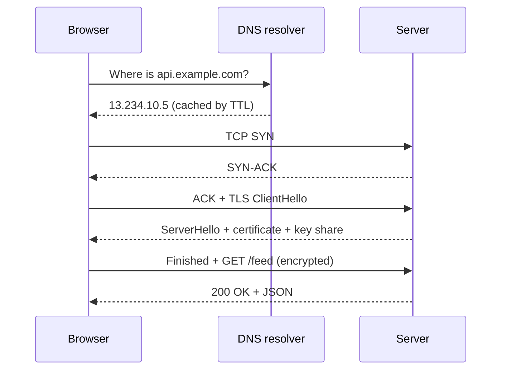
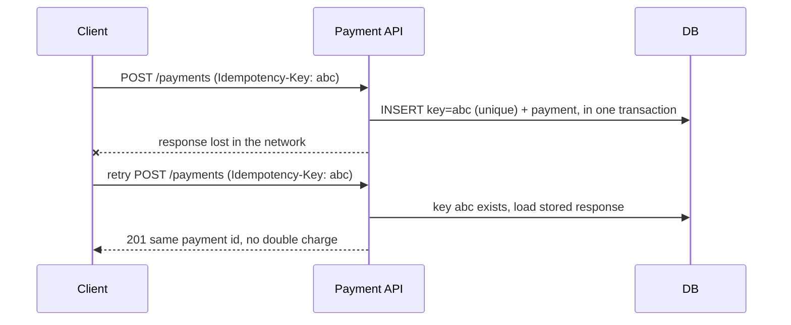
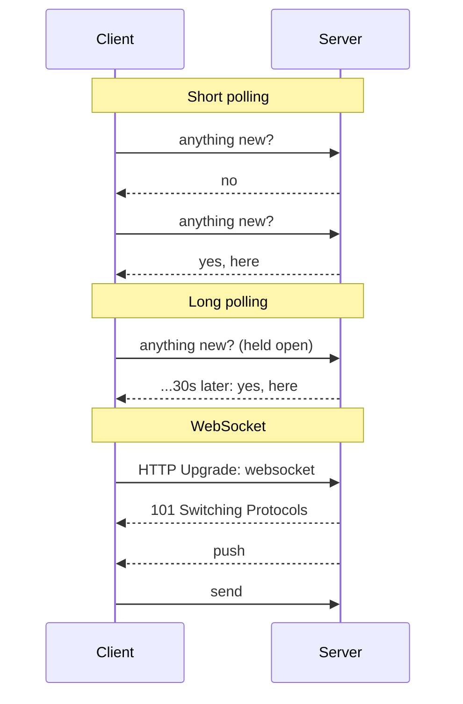
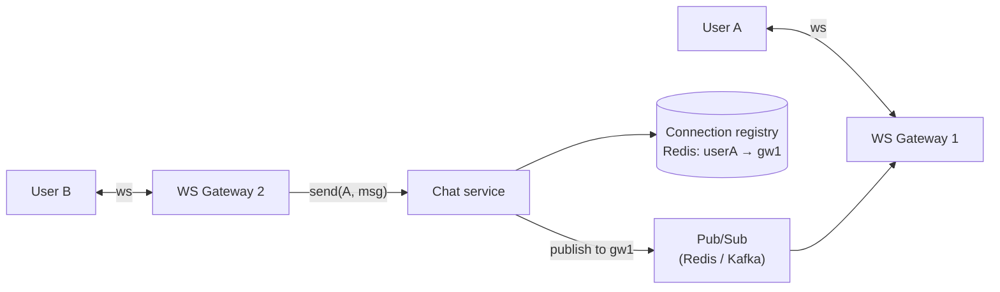
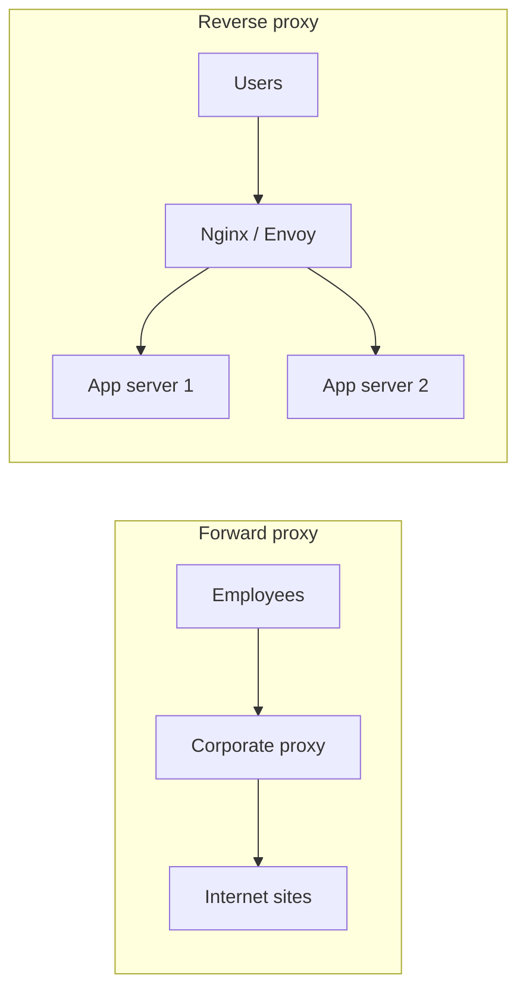

## TL;DR

- One HTTPS request to a new server costs about: **DNS lookup** (0–100 ms) + **TCP handshake** (1 RTT) + **TLS handshake** (1 RTT with TLS 1.3) + **request/response** (1 RTT).
- That's why we reuse connections (**keep-alive, connection pools**) and put servers near users (**CDN, multi-region**).
- **TCP** is reliable and ordered (web, DB, payments). **UDP** is fast with no guarantees (video calls, DNS, gaming). **HTTP/3** runs on **QUIC over UDP**.
- **HTTP/2** multiplexes many requests over one connection. **HTTP/3** also fixes TCP's head-of-line blocking.

## The journey, step by step



### 1. DNS — turning a name into an IP

- The browser checks its own cache, then the OS cache, then asks a **recursive resolver** (your ISP's, or 8.8.8.8).
- On a cache miss the resolver walks the hierarchy: **root → .com TLD → the domain's authoritative nameserver**.
- Answers are cached for their **TTL**. A low TTL (60 s) lets you fail over quickly but causes more lookups. A high TTL (1 day) is cheaper, but changes propagate slowly.
- Record types you should know: **A** (IPv4), **AAAA** (IPv6), **CNAME** (alias to another name), **MX** (mail), **TXT** (verification), **NS** (nameserver).
- **System design use:** *GeoDNS* returns different IPs by user location (send Indian users to Mumbai). *DNS-based failover* points the name to a healthy region.

### 2. TCP — a reliable pipe

- **3-way handshake:** SYN → SYN-ACK → ACK. That's **1 round trip** before any data moves.
- It guarantees **ordered, reliable** delivery using sequence numbers, ACKs and retransmission.
- **Flow control** (a receiver window) stops a fast sender from flooding a slow receiver. **Congestion control** (slow start, back-off) stops senders from flooding the network.
- **Head-of-line (HoL) blocking:** if one packet is lost, everything after it waits, even data that belongs to a different request.

### 3. TLS — encryption and identity

- The server proves its identity with a **certificate** signed by a trusted Certificate Authority (CA). The chain runs root CA → intermediate → your cert.
- Client and server agree on a **symmetric session key** (via Diffie-Hellman), which then encrypts everything.
- **TLS 1.3** needs **1 RTT** (TLS 1.2 needed 2), and it supports **0-RTT resumption** for returning clients.
- **mTLS (mutual TLS):** the client presents a certificate too. It's used **between internal microservices** and in **banking/partner APIs**, which matters if you're aiming for Visa, JPM or MS.
- **TLS termination:** the load balancer decrypts traffic so app servers don't have to. Inside a zero-trust network you re-encrypt to the backends.

### 4. HTTP — the request itself

| Version | Key idea | Problem it solved / left |
|---|---|---|
| **HTTP/1.1** | Keep-alive: reuse one TCP connection for many requests | Still one request at a time per connection, so browsers open ~6 connections per host |
| **HTTP/2** | **Multiplexing:** many parallel streams on one connection; binary framing; header compression (HPACK) | TCP-level HoL blocking remains: one lost packet stalls all streams |
| **HTTP/3** | Runs on **QUIC (UDP)**; each stream recovers losses independently; TLS 1.3 built in; survives network changes (Wi-Fi → 4G) | Some corporate networks block UDP, so clients fall back to HTTP/2 |

### TCP vs UDP — when to use which

| | TCP | UDP |
|---|---|---|
| Delivery | Reliable, ordered | Best effort, may drop or reorder |
| Setup | Handshake | None |
| Use for | Web/APIs, DB connections, payments, file transfer | Live video/voice (WebRTC), online games, DNS, QUIC |
| Why | Correctness matters | Freshness matters more than completeness (a late video frame is useless) |

## Where this shows up in designs

- **Connection pooling** (HikariCP in Spring Boot, PgBouncer) avoids paying TCP+TLS on every DB call.
- **Keep-alive + HTTP/2 between services** cuts latency in microservice chains.
- **CDNs and edge locations** shorten the physical distance, so every RTT gets cheaper.
- **Status codes** your APIs should use correctly: 200 OK, 201 Created, 204 No Content, 301/302 redirects, 304 Not Modified, 400 Bad Request, 401 Unauthenticated, 403 Forbidden, 404, 409 Conflict, 429 Too Many Requests, 500, 502 Bad Gateway, 503 Unavailable, 504 Gateway Timeout.

## Common mistakes

- Saying "HTTPS is HTTP with encryption" and stopping there. Mention **certificates (identity)** and the **handshake cost**.
- Confusing **401** (who are you? not logged in) with **403** (I know who you are, but no).
- Proposing UDP for anything that must not lose data (chat messages, payments).

## Self-check

<details>
<summary>How many round trips before the first byte of response on a fresh HTTPS (TLS 1.3) connection, ignoring DNS?</summary>

About **3**: 1 for the TCP handshake, 1 for the TLS handshake, and 1 for the HTTP request/response. That's why connection reuse and CDNs matter.
</details>

<details>
<summary>What problem does HTTP/2 solve, and what problem does HTTP/3 solve that HTTP/2 doesn't?</summary>

HTTP/2 multiplexes many requests over one TCP connection (no more 6-connection limit, no app-level HoL blocking). HTTP/3 moves to QUIC/UDP so **a lost packet stalls only its own stream**, which removes TCP-level head-of-line blocking. It also handles network switches better.
</details>

<details>
<summary>Why would a bank use mTLS between services or with partners?</summary>

With mTLS **both sides prove their identity with certificates**, so only trusted clients can call the API, even inside the network (zero trust). It's common for payment-network and partner integrations.
</details>

<details>
<summary>Trade-off of a low DNS TTL?</summary>

Pro: fast failover and migrations, because clients pick up new IPs quickly. Con: more DNS queries, slightly higher latency, and more dependence on the DNS provider's availability.
</details>
---
id: api-design
title: API design — REST, gRPC, GraphQL, pagination & idempotency
module: network
day: 4
minutes: 40
tags: star, rest, grpc, graphql, pagination, idempotency, versioning
summary: How to design clean APIs in an interview. REST conventions, when to choose gRPC or GraphQL, cursor pagination, versioning, and idempotency keys for safe retries.
videos: ByteByteGo REST vs GraphQL vs gRPC | Hussein Nasser gRPC crash course | ByteByteGo idempotency | Arpit Bhayani idempotency
read: Stripe — Designing robust APIs with idempotency => https://stripe.com/blog/idempotency | Microsoft REST API guidelines => https://github.com/microsoft/api-guidelines
---

## TL;DR

- **REST** for public and client-facing APIs. **gRPC** for internal service-to-service calls (fast, typed, streaming). **GraphQL** when many clients need different shapes of the same data.
- Use **nouns for resources and HTTP verbs for actions**: `POST /orders`, `GET /orders/{id}`.
- **Cursor pagination** beats offset pagination at scale.
- **Idempotency keys** make retries safe. This is mandatory for payments and anything that moves money or inventory.

## REST in 2 minutes

| Verb | Meaning | Idempotent? | Example |
|---|---|---|---|
| GET | Read | ✅ | `GET /users/42` |
| POST | Create / non-idempotent action | ❌ | `POST /payments` |
| PUT | Replace whole resource | ✅ | `PUT /users/42` |
| PATCH | Partial update | ⚠️ depends | `PATCH /users/42 {email}` |
| DELETE | Remove | ✅ | `DELETE /users/42` |

**Idempotent** means doing it twice has the same effect as doing it once. That matters because **networks fail and clients retry**.

Good conventions:
- Plural nouns, nested only one level deep: `/users/42/orders`.
- Filtering and sorting via the query string: `/orders?status=PAID&sort=-createdAt`.
- Return the right status codes: `201` + `Location` on create, `409` on conflict, `429` when rate-limited.
- **Versioning:** in the path (`/v1/…`) is simplest and most common. A header (`Accept: application/vnd.api.v2+json`) is cleaner but harder to test.

## gRPC — for internal calls

- Uses **Protocol Buffers**: a typed schema (`.proto`) and compact binary encoding, roughly **5–10× smaller** than JSON.
- Runs on **HTTP/2**, so you get multiplexing and **streaming** (server, client, or bidirectional).
- Generates client and server code in Java, Go and other languages, so the contract can't drift.
- **Downsides:** browsers can't call it natively (you need gRPC-Web), and it's harder to debug with curl.

```protobuf
service PaymentService {
  rpc Authorize (AuthorizeRequest) returns (AuthorizeResponse);
  rpc StreamTransactions (AccountId) returns (stream Transaction);
}
```

## GraphQL — when clients need flexibility

- One endpoint. The client asks for exactly the fields it needs, which avoids over- and under-fetching.
- Great for **mobile + web + partner** clients that each need different shapes.
- **Pitfalls:**
  - The **N+1 problem**: resolving 100 posts' authors with 100 queries. The fix is **DataLoader batching**.
  - HTTP caching is harder (everything is a POST).
  - Expensive queries need **depth/complexity limits**.

| | REST | gRPC | GraphQL |
|---|---|---|---|
| Best for | Public APIs, CRUD | Internal microservices, low latency | Aggregating data for varied clients |
| Format | JSON text | Protobuf binary | JSON |
| Caching | Easy (HTTP) | Manual | Hard |
| Streaming | No (use SSE/WS) | Yes | Subscriptions |

## Pagination

**Offset:** `GET /posts?offset=10000&limit=20`
- Simple, and lets users jump to page N.
- ❌ The DB still scans and skips 10,000 rows, so it gets **slow** on deep pages. Rows inserted meanwhile cause **duplicates or skips**.

**Cursor (keyset):** `GET /posts?after=eyJpZCI6MTIzfQ&limit=20`
- The cursor encodes the last seen sort key (e.g. `created_at, id`). The query is `WHERE (created_at, id) < (?, ?) ORDER BY created_at DESC, id DESC LIMIT 20`.
- ✅ Constant speed (uses the index) and stable under inserts. This is what Twitter, Facebook and Slack do for feeds.
- ❌ No "jump to page 57".

> **Interview default:** "I'll use cursor-based pagination since the feed is large and constantly changing."

## Idempotency keys — the fintech favourite

**Problem:** a client sends `POST /payments`, the server charges the card, and the response is lost in a network blip. The client retries, and the customer is **charged twice**.

**Solution:**
1. The client generates a unique `Idempotency-Key` (UUID) per logical operation and sends it as a header.
2. The server stores `key → (status, response)` in a table with a **unique constraint**, ideally in the **same transaction** as the business write.
3. On a retry with the same key, it returns the **stored response** without re-executing.
4. If the first request is still in progress, it returns `409` or waits.
5. Keys expire after some time (Stripe keeps them about 24 hours).



## Other API concerns worth mentioning in one line each

- **Auth:** OAuth2 / JWT bearer tokens for users, API keys or mTLS for partners.
- **Rate limiting:** return `429` with a `Retry-After` header.
- **Webhooks** for async results (payment succeeded). Sign them with an **HMAC**, and the receiver must be idempotent because webhooks get retried.
- **Backward compatibility:** add fields, never remove or rename them within a version.

## Self-check

<details>
<summary>Why is offset pagination slow on deep pages, and what's the alternative?</summary>

The database must read and discard all skipped rows (`OFFSET 100000`), and inserts shift results. **Cursor/keyset pagination** seeks directly via the index using the last seen key, so it's fast and stable.
</details>

<details>
<summary>Walk through how an idempotency key prevents double charging.</summary>

The client sends a unique key with the request. The server stores it with a unique constraint alongside the result, atomically with the payment. A retry with the same key finds the stored record and returns the original response instead of charging again.
</details>

<details>
<summary>When would you pick gRPC over REST?</summary>

Internal service-to-service calls where you want low latency, compact binary payloads, strict typed contracts, generated clients, or streaming. Public and browser APIs usually stay REST.
</details>

<details>
<summary>What is GraphQL's N+1 problem and how do you fix it?</summary>

Resolving a list then fetching a related object per item causes 1 + N queries. **DataLoader** collects the IDs in one tick and fetches them in a single batched query.
</details>
---
id: realtime
title: Real-time communication — polling, SSE, WebSockets
module: network
day: 5
minutes: 30
tags: websocket, sse, long polling, realtime, push
summary: How servers push data to clients. Short polling vs long polling vs Server-Sent Events vs WebSockets, and how to scale millions of persistent connections.
videos: Hussein Nasser WebSockets | ByteByteGo long polling websockets server sent events | Hello Interview real-time updates
read: Hello Interview — Real-time updates pattern => https://www.hellointerview.com/learn/system-design/patterns/realtime-updates | web.dev — WebSockets basics => https://web.dev/articles/websockets-basics
---

## TL;DR

- **Short polling:** the client asks every N seconds. Simple and wasteful.
- **Long polling:** the client asks, and the server **holds the request open** until there's data. A decent fallback.
- **SSE (Server-Sent Events):** one-way **server → client** stream over plain HTTP, with auto-reconnect. Great for live scores, notifications and stock tickers.
- **WebSockets:** **two-way**, persistent, low-latency. The choice for chat, multiplayer and collaborative editing.
- Scaling persistent connections needs a **connection gateway layer** plus **pub/sub** (Redis/Kafka) to route messages to whichever server holds the user's socket.

## The four options



| | Short poll | Long poll | SSE | WebSocket |
|---|---|---|---|---|
| Direction | client pulls | client pulls | **server → client** | **both ways** |
| Latency | up to poll interval | low | low | lowest |
| Overhead | high (empty responses) | medium | low | lowest |
| Works through proxies | ✅ | ✅ | ✅ (plain HTTP) | ⚠️ mostly |
| Auto-reconnect | n/a | manual | ✅ built in | manual |
| Use for | dashboards refreshed every minute | legacy fallback | notifications, live scores, LLM token streaming | chat, games, live collaboration, trading UIs |

> **Interview rule of thumb:** if only the server pushes, say **SSE**. It's simpler, plain HTTP, and reconnects automatically. If both sides talk frequently, say **WebSocket**.

## Scaling WebSockets to millions of users

A WebSocket is **stateful**: user A is connected to *server 7*. So when user B sends A a message, how does it reach server 7?



1. **Gateway servers** only hold connections, with no business logic. Each holds roughly 100K+ sockets.
2. A **connection registry** (Redis) maps `userId → gatewayId`, refreshed by heartbeats.
3. Business services publish to the gateway's channel via **pub/sub**, and the gateway pushes down the socket.
4. **Heartbeats** (ping/pong every ~30 s) detect dead connections, because mobile networks drop silently.
5. **Reconnect with backoff + resume:** the client sends its last received message ID and the server replays what was missed.
6. **Load balancer:** must support long-lived connections (L4, or L7 with WebSocket upgrade). Deploys must **drain** connections gradually, or every client reconnects at once (a thundering herd).

## Common mistakes

- Choosing WebSockets for a notification bell (SSE or even polling is enough).
- Forgetting that a socket server holds **state**, so you need a registry and pub/sub to route messages.
- No plan for **offline users**: store messages durably and deliver on reconnect (or send a push notification via FCM/APNs).

## Self-check

<details>
<summary>SSE or WebSocket for a live cricket score page? Why?</summary>

**SSE.** Data only flows server → client, it runs over plain HTTP (CDN- and proxy-friendly), and it reconnects automatically.
</details>

<details>
<summary>How does a message reach a user whose WebSocket is on a different server?</summary>

Look up the user's gateway in a connection registry (e.g. Redis `userId → gatewayId`), then publish the message to that gateway via pub/sub. The gateway pushes it down the socket.
</details>

<details>
<summary>What is long polling and when is it still useful?</summary>

The client sends a request, and the server holds it open until there's data or a timeout, then the client immediately re-requests. It's useful as a fallback where WebSockets/SSE are blocked, or for simple low-frequency updates.
</details>
---
id: proxies-cdn
title: Proxies, API gateways & CDNs
module: network
day: 6
minutes: 30
tags: proxy, reverse proxy, api gateway, cdn, edge
summary: Forward vs reverse proxy, what an API gateway does, and how CDNs cache content at the edge. Includes cache invalidation and push vs pull CDNs.
videos: ByteByteGo forward proxy vs reverse proxy | ByteByteGo what is a CDN | Hussein Nasser API gateway | Gaurav Sen content delivery network
read: Nginx — What is a reverse proxy => https://www.nginx.com/resources/glossary/reverse-proxy-server/ | MDN — HTTP caching => https://developer.mozilla.org/en-US/docs/Web/HTTP/Caching
---

## TL;DR

- **Forward proxy** sits in front of **clients** and hides them (corporate proxy, VPN).
- **Reverse proxy** sits in front of **servers** and hides them (Nginx, Envoy). It does TLS termination, load balancing, compression and caching.
- **API gateway** is a smart reverse proxy for APIs: **auth, rate limiting, routing, request aggregation**.
- **CDN** is a global network of caches near users for **static assets and media**. Its job is to cut latency and offload the origin.

## Forward vs reverse proxy



## API gateway — what it does

One entry point in front of many microservices:
- **Routing:** `/payments/*` goes to the payment service, `/users/*` to the user service.
- **AuthN/AuthZ:** validate the JWT/OAuth token once, at the edge.
- **Rate limiting & quotas** per user or API key.
- **Request aggregation / BFF:** one mobile call fans out to 3 services.
- **Protocol translation:** REST outside, gRPC inside.
- **Observability:** access logs, metrics, tracing headers.

Examples: Kong, AWS API Gateway, Apigee (popular in banks), Spring Cloud Gateway, Envoy.

> **Watch out:** the gateway can become a **single point of failure and a bottleneck**. Run multiple instances behind a load balancer and keep business logic **out** of it.

## CDN — Content Delivery Network

The CDN has **Points of Presence (PoPs)** in many cities. A user in Chennai gets images from a Chennai/Mumbai PoP instead of a US origin, so the round trip drops from ~250 ms to ~20 ms.

**Pull CDN (most common):** on a cache miss the edge fetches from the origin, caches the object for its TTL, and serves it. Easy to set up, but the first request is slow.
**Push CDN:** you upload content to the CDN ahead of time. Good for big files you know will be popular (a new movie release).

### Cache control & invalidation

- The origin sets `Cache-Control: public, max-age=31536000, immutable` on **versioned** files (`app.3f9a2c.js`). They never change, so they're cached forever.
- HTML and API responses get short TTLs or `no-cache` (revalidate with `ETag` → `304 Not Modified`).
- **Invalidation:** prefer **versioned URLs** (a new URL is a new object, with instant effect). Explicit **purge** APIs exist but are slower and can be rate-limited.

### What goes on a CDN

| Good fit | Not a fit |
|---|---|
| Images, video segments, JS/CSS, fonts, downloads | Personalised or private data (unless using signed URLs + edge logic) |
| Public API responses that are the same for everyone (product catalogue) | Highly dynamic, per-user responses |

CDNs also give you **DDoS protection**, a **WAF**, and **edge compute** (Cloudflare Workers, Lambda@Edge) for things like auth checks or A/B routing near the user.

## Self-check

<details>
<summary>Difference between a reverse proxy and an API gateway?</summary>

An API gateway **is** a reverse proxy with API-specific features on top: authentication, rate limiting, routing by path/version, request aggregation, protocol translation and API analytics.
</details>

<details>
<summary>How do you deploy a new JS bundle so users never get a stale cached version?</summary>

Use **content-hashed filenames** (`app.<hash>.js`) with long `max-age` and `immutable`, and serve `index.html` with a short TTL / no-cache so it picks up the new filename right away.
</details>

<details>
<summary>Push vs pull CDN?</summary>

**Pull:** the edge fetches from the origin on the first miss and caches it (easy, lazy). **Push:** you pre-upload to the CDN (good for large, predictable content, at the cost of more management).
</details>
