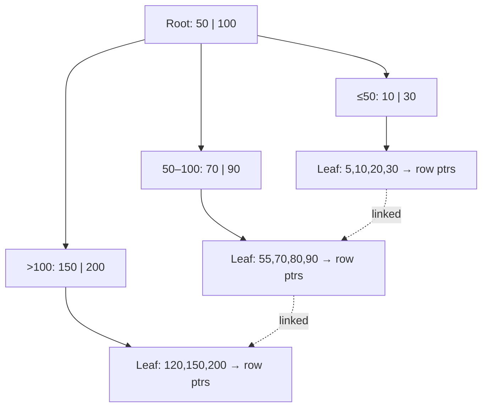
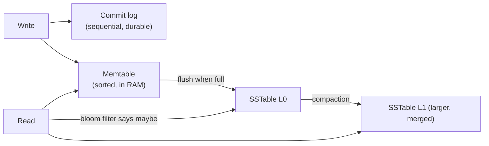
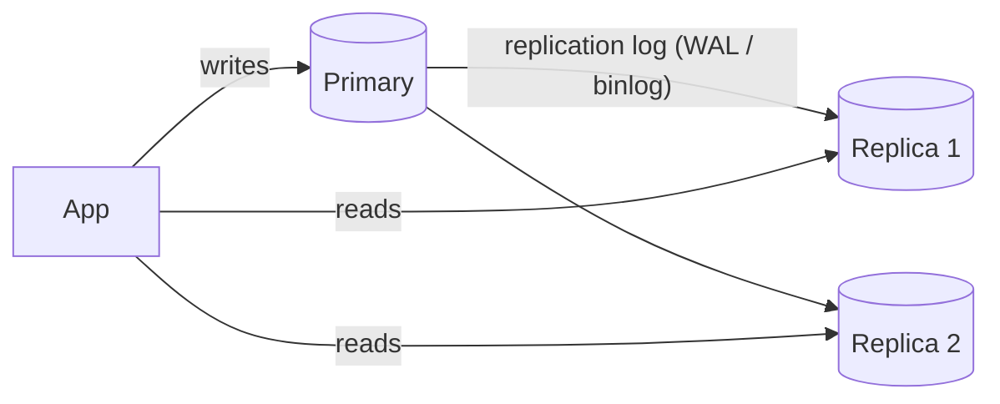
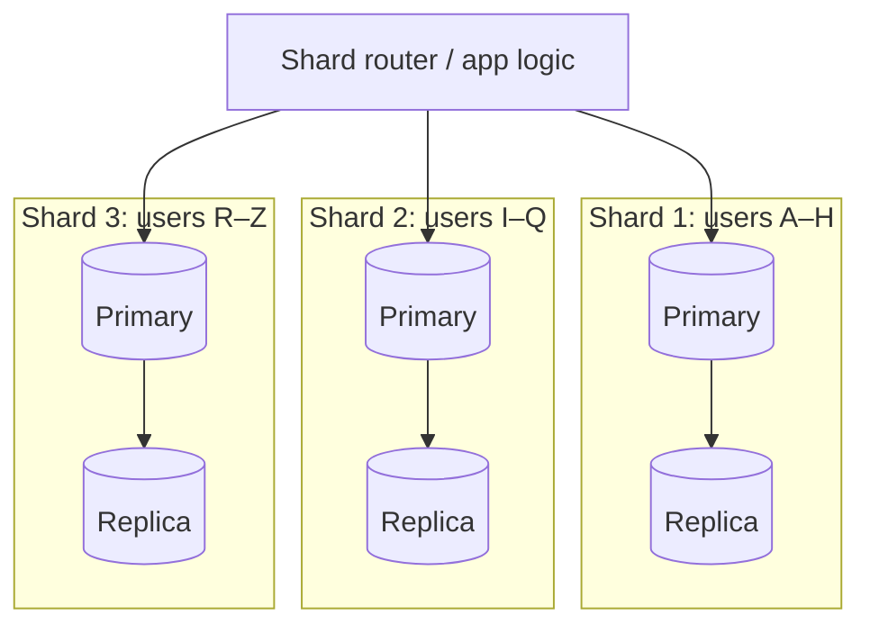
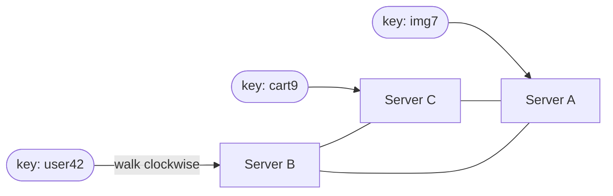

## TL;DR

- **ACID** = **A**tomic (all or nothing), **C**onsistent (constraints hold), **I**solated (concurrent transactions don't trip over each other), **D**urable (committed means it survives a crash, thanks to the write-ahead log).
- Isolation levels trade **correctness for concurrency**: Read Uncommitted < **Read Committed** (Postgres default) < **Repeatable Read** (MySQL InnoDB default) < **Serializable**.
- **MVCC** lets readers see a snapshot without blocking writers.
- To stop two users grabbing the same seat or money: **pessimistic lock** (`SELECT … FOR UPDATE`), **optimistic lock** (a version column), or a **unique constraint / atomic conditional update**.

## ACID in plain words

Think of a bank transfer of ₹500 from A to B:

```sql
BEGIN;
UPDATE accounts SET balance = balance - 500 WHERE id = 'A';
UPDATE accounts SET balance = balance + 500 WHERE id = 'B';
COMMIT;
```

- **Atomicity:** if the server crashes after the first UPDATE, it's rolled back. Money never vanishes.
- **Consistency:** a `CHECK (balance >= 0)` constraint can never be violated by a committed transaction.
- **Isolation:** someone summing all balances mid-transfer doesn't see ₹500 "in flight".
- **Durability:** once `COMMIT` returns, the change is in the **WAL (write-ahead log)** on disk and survives power loss.

## Concurrency anomalies (know these names)

| Anomaly | What happens | Example |
|---|---|---|
| **Dirty read** | You read another transaction's **uncommitted** change, which then rolls back | You see a balance that never existed |
| **Non-repeatable read** | You read the same row twice and get different values | Price changes between two reads in your checkout |
| **Phantom read** | The same range query returns **new rows** the second time | "Count bookings for 7pm" changes mid-transaction |
| **Lost update** | Two read-modify-write cycles; one overwrites the other | Two people add +1 to a counter; it ends up +1 instead of +2 |
| **Write skew** | Two transactions read the same condition and both write, breaking a rule together | Two doctors both go off-call because each saw "another doctor is on call" |

## Isolation levels

| Level | Prevents | Allows | Notes |
|---|---|---|---|
| Read Uncommitted | — | everything | Almost never used |
| **Read Committed** | dirty reads | non-repeatable, phantoms, lost updates | **Postgres & Oracle default** |
| **Repeatable Read** | + non-repeatable reads | phantoms (in theory), write skew | **MySQL InnoDB default** (its gap locks also block most phantoms). Postgres RR = snapshot isolation |
| **Serializable** | all anomalies | — | Slowest. Postgres uses SSI and aborts conflicting transactions, so **you must retry** |

> **Interview line:** "Default Read Committed is fine for most reads. For money movement or inventory I'd either use explicit row locks or Serializable with retry logic."

## MVCC — how modern DBs avoid readers blocking writers

Instead of overwriting a row, the DB keeps **multiple versions** tagged with transaction IDs. Each transaction reads from a **snapshot** taken at its start (Repeatable Read) or at each statement (Read Committed). Readers never wait for writers, and writers never wait for readers. Old versions get cleaned up later (Postgres `VACUUM`, InnoDB purge).

## Locking: pessimistic vs optimistic

### Pessimistic: "lock first, then work"

```sql
BEGIN;
SELECT * FROM seats WHERE show_id = 9 AND seat_no = 'F12' FOR UPDATE;  -- row lock
-- if status = 'AVAILABLE':
UPDATE seats SET status = 'BOOKED', user_id = 42 WHERE show_id = 9 AND seat_no = 'F12';
COMMIT;
```

- The second transaction **waits** until the first commits, then sees `BOOKED`.
- ✅ Simple and correct under **high contention**. ❌ Locks hold up throughput, and deadlocks are possible.
- `FOR UPDATE SKIP LOCKED` is a great pattern for **job queues in Postgres**: each worker grabs different rows.

### Optimistic: "work, then check nobody changed it"

```sql
SELECT status, version FROM seats WHERE id = 77;          -- version = 5
UPDATE seats SET status = 'BOOKED', version = 6
 WHERE id = 77 AND version = 5;                            -- 0 rows updated → someone beat you → retry or fail
```

- ✅ No locks held, so it's great when conflicts are **rare**. ❌ Lots of retries under heavy contention.
- JPA/Hibernate has this built in with `@Version`. That's worth mentioning for Java-heavy banks.

### Atomic conditional update (often the simplest)

```sql
UPDATE seats SET status='BOOKED', user_id=42
 WHERE id=77 AND status='AVAILABLE';    -- check rows-affected = 1
```

Or use a **UNIQUE constraint** (e.g. `UNIQUE(show_id, seat_no)` on a bookings table), so the DB itself rejects the second insert.

| Approach | Best when | Watch out for |
|---|---|---|
| Pessimistic `FOR UPDATE` | High contention (flash sale, last seat), short transactions | Deadlocks, lock waits |
| Optimistic version | Low contention (editing a profile) | Retry storms |
| Conditional update / unique constraint | Single-row state change | Needs the check to fit in one statement |

## Deadlocks

T1 locks row A and wants B; T2 locks B and wants A. The DB detects the cycle and **aborts one transaction**.
**Prevention:** always lock rows in a **consistent order** (e.g. sort account IDs before locking both sides of a transfer), keep transactions short, and use lock timeouts.

## The classic interview question

> **"Two users click 'Book' on the last seat at the same millisecond. How do you prevent double booking?"**

Good answer structure:
1. Use a **DB transaction** with either `SELECT … FOR UPDATE` on the seat row, or an atomic `UPDATE … WHERE status='AVAILABLE'` and check rows affected.
2. Back it with a **unique constraint** as the final safety net.
3. For a better UX at scale, add a **temporary hold** (status `HELD` with `held_until = now()+10min`, or a Redis key with TTL) while the user pays. Release it on expiry.
4. Make payment confirmation **idempotent**.

## Self-check

<details>
<summary>Explain lost update and two ways to prevent it.</summary>

Two transactions read the same value, both modify it, and the second write overwrites the first. Prevent it with `SELECT … FOR UPDATE` (pessimistic), a version column (optimistic), or an atomic in-DB update like `SET count = count + 1`.
</details>

<details>
<summary>What is write skew and which isolation level prevents it?</summary>

Two transactions read an overlapping condition, then write *different* rows so that together they break an invariant (both on-call doctors leave). Only **Serializable** prevents it, or you can explicitly lock the rows you read (`FOR UPDATE`).
</details>

<details>
<summary>When would you choose optimistic over pessimistic locking?</summary>

When conflicts are rare and you want high throughput without holding locks (profile edits, most CRUD). Choose pessimistic when contention is high (popular seat, inventory in a flash sale).
</details>

<details>
<summary>How does MVCC let readers avoid blocking writers?</summary>

Writers create new row versions instead of overwriting in place. Readers see a consistent snapshot of older versions based on transaction IDs, so neither has to wait for the other.
</details>

<details>
<summary>How do you avoid deadlocks in a money-transfer service?</summary>

Always lock accounts in a deterministic order (e.g. by account ID ascending), keep transactions short, and retry on deadlock errors.
</details>
---
id: indexing
title: Indexes, B+ trees, LSM trees & query performance
module: data
day: 9
minutes: 35
tags: star, index, b-tree, lsm, composite index, explain
summary: How indexes make queries fast, the leftmost-prefix rule for composite indexes, covering indexes, the B+ tree vs LSM tree trade-off, and reading EXPLAIN.
videos: Hussein Nasser database indexing | ByteByteGo B-tree vs LSM tree | Arpit Bhayani how indexes work | Hello Interview database indexing
read: Use The Index, Luke (free) => https://use-the-index-luke.com/ | Hello Interview — DB indexing => https://www.hellointerview.com/learn/system-design/core-concepts/db-indexing
---

## TL;DR

- An index is a **sorted lookup structure** that turns a full table scan (O(N)) into a seek (O(log N)).
- **B+ tree** (Postgres, MySQL): balanced, sorted, great for **reads and range queries**.
- **LSM tree** (Cassandra, RocksDB, ScyllaDB): buffers writes in memory and flushes sorted files. Great for **write-heavy** workloads.
- **Composite index (a, b, c)** works for queries on `a`, `a,b` and `a,b,c`, **not** `b` alone. This is the **leftmost-prefix rule**.
- Every index **speeds reads and slows writes** and costs storage. Index for your actual query patterns.

## B+ tree in one picture



- Each node is a disk page (~8–16 KB) holding hundreds of keys, so even **a billion rows need only ~3–4 levels**, i.e. 3–4 page reads.
- Leaves are **linked**, so a range scan (`WHERE created_at BETWEEN …`) walks sideways.
- **Clustered index** (InnoDB primary key): the leaf *is* the row, stored in PK order. Secondary indexes store the PK, which means **a second lookup**. That's why a random UUID primary key in MySQL causes page splits; prefer sequential IDs (or UUIDv7).

## Index types you should name

| Type | Use |
|---|---|
| **B+ tree** (default) | Equality and range, ORDER BY |
| **Hash** | Equality only (in-memory stores, some engines) |
| **Composite** `(user_id, created_at)` | "Latest orders for a user": filter by user, sort by time |
| **Covering** (`INCLUDE` columns) | Query answered from the index alone (index-only scan, no table lookup) |
| **Partial** `WHERE status='PENDING'` | Small, hot subset |
| **Unique** | Enforces business rules (email, idempotency key) |
| **GIN / inverted** | Full-text search, JSONB, arrays (Postgres) |
| **Geospatial** (R-tree / GiST, geohash) | "Restaurants near me" |

### Composite index — the leftmost-prefix rule

Index on `(country, city, created_at)`:
- ✅ `WHERE country='IN'`
- ✅ `WHERE country='IN' AND city='BLR'`
- ✅ `WHERE country='IN' AND city='BLR' ORDER BY created_at DESC` (no sort needed!)
- ❌ `WHERE city='BLR'` (can't skip the first column)

**Rule of thumb for column order:** equality filters first, then range/sort columns.

## LSM tree — built for writes



- Writes are **sequential appends**, which makes them extremely fast.
- Reads may have to check the memtable plus several SSTables. **Bloom filters** skip files that definitely don't have the key.
- **Compaction** merges files in the background, at the cost of **write amplification** and CPU/disk spikes.

| | B+ tree | LSM tree |
|---|---|---|
| Writes | Slower (random page updates) | **Fast** (sequential) |
| Reads | **Fast**, predictable | Can be slower (many files), helped by bloom filters |
| Range scans | Excellent | Good |
| Used by | Postgres, MySQL, Oracle | Cassandra, RocksDB, HBase, ScyllaDB, Kafka-like logs |
| Pick when | Read-heavy, transactional | Write-heavy: logs, metrics, chat messages, IoT |

## Reading EXPLAIN (what to look for)

- `Seq Scan` on a big table with a selective WHERE means you're **missing an index**.
- `Index Scan` / `Index Only Scan` is good.
- `Sort` with high cost: an index could provide the order.
- `Nested Loop` over big row counts: check the join indexes.
- Always `EXPLAIN ANALYZE` to compare **estimated vs actual rows**. Big gaps mean stale statistics (run `ANALYZE`).

## Why not index everything?

Each index must be updated on every INSERT/UPDATE/DELETE (slower writes), it uses disk and RAM, and the optimiser may pick a bad one. **Low-cardinality** columns (gender, boolean) rarely benefit, except as part of a composite or partial index.

## Self-check

<details>
<summary>Index on (user_id, status, created_at). Which of these use it fully: (a) user_id=?, (b) status=?, (c) user_id=? AND status=? ORDER BY created_at?</summary>

(a) yes (prefix). (b) no, because it skips the leading column. (c) yes, fully: filters on both prefix columns and the index already provides the ORDER BY.
</details>

<details>
<summary>Why are LSM trees faster for writes than B+ trees?</summary>

LSM trees turn random writes into **sequential appends** (log + in-memory memtable flushed as sorted files). B+ trees update pages in place at random disk locations.
</details>

<details>
<summary>What's a covering index?</summary>

An index containing every column a query needs, so the DB answers from the index alone without touching the table (an index-only scan).
</details>

<details>
<summary>Why can a random UUID primary key hurt MySQL InnoDB performance?</summary>

InnoDB clusters rows by primary key. Random UUIDs insert all over the B+ tree, causing page splits, fragmentation and poor cache locality. Sequential or time-ordered IDs (auto-increment, Snowflake, UUIDv7) append at the end.
</details>
---
id: choosing-db
title: Choosing a database — SQL vs NoSQL and the 6 families
module: data
day: 10
minutes: 35
tags: star, nosql, sql, cassandra, dynamodb, mongodb, redis, decision
summary: A practical decision guide. The six database families, what each is good and bad at, and a cheat-table mapping common interview data (users, chats, feeds, payments, logs) to a database choice.
videos: ByteByteGo how to choose the right database | Gaurav Sen SQL vs NoSQL | Hussein Nasser Cassandra | Arpit Bhayani how to choose a database
read: AWS — Purpose-built databases => https://aws.amazon.com/products/databases/ | Cassandra architecture (Dynamo) => https://cassandra.apache.org/doc/latest/cassandra/architecture/dynamo.html
---

## TL;DR

- **Default to PostgreSQL/MySQL** unless you have a clear reason not to. Relational DBs scale further than people think (read replicas + caching + eventually sharding).
- Choose **NoSQL** for a specific need: massive write throughput, flexible schema, simple key access at huge scale, graph traversal, full-text search, or time-series.
- Decide by **access patterns**: how you read and write the data matters more than what the data looks like.
- **Money, inventory and anything needing transactions** goes in relational (or NewSQL).

## The six families

| Family | Examples | Data model | Great at | Weak at |
|---|---|---|---|---|
| **Relational** | PostgreSQL, MySQL, Oracle | Tables, joins, schema | Transactions, complex queries, integrity | Horizontal write scaling (needs sharding) |
| **Key-value** | Redis, DynamoDB, Memcached | key → value | Ultra-fast lookups, caching, sessions, counters | Queries by anything other than the key |
| **Document** | MongoDB, Couchbase, Firestore | JSON documents | Flexible schema, nested objects, catalogues, CMS | Multi-document joins/transactions (possible but costly) |
| **Wide-column** | Cassandra, ScyllaDB, HBase, Bigtable | Partition key → sorted rows | **Huge write volume**, time-ordered data, multi-DC | Ad-hoc queries, joins, strong consistency by default |
| **Graph** | Neo4j, Neptune | Nodes + edges | Relationship traversal (friends-of-friends, fraud rings) | Bulk analytics, simple CRUD at huge scale |
| **Search / time-series / analytics** | Elasticsearch, InfluxDB, TimescaleDB, ClickHouse, BigQuery | Inverted index / columnar | Full-text search, metrics, aggregations over billions of rows | Being a source of truth for transactions |

### Cassandra in 60 seconds (it comes up a lot)

- Data is spread by **partition key** (consistent hashing). Within a partition, rows are **sorted by clustering key**.
- **Query-first modelling:** one table per query. For example, `messages_by_chat (chat_id, message_ts DESC)`.
- **Tunable consistency:** `ONE`, `QUORUM`, `ALL` per query. `QUORUM` reads plus `QUORUM` writes gives you read-your-writes.
- Leaderless and multi-datacenter, so it's very available. Writes are fast (LSM tree).
- Pitfalls: **wide partitions** (a celebrity's partition grows too big; bucket by time), and **tombstones** from heavy deletes.

### DynamoDB in 60 seconds

- Fully managed key-value/document store. Each item has a **partition key** (+ optional **sort key**).
- **GSIs** let you query by other attributes (eventually consistent).
- **Single-table design** precomputes access patterns. Pay per request or provisioned.
- Hot partitions are the main failure mode, so choose a high-cardinality key.

## Decision cheat-table (memorise the reasoning)

| Data in the interview | Pick | Why |
|---|---|---|
| Users, accounts, orders, bookings | **PostgreSQL / MySQL** | Relations, constraints, transactions |
| Payments, ledger, wallet balances | **PostgreSQL / Oracle** (or Spanner/CockroachDB for global) | ACID is non-negotiable |
| Chat messages, activity logs, feeds | **Cassandra / ScyllaDB / DynamoDB** | Massive append-heavy writes, partition by chat/user, sorted by time |
| Sessions, rate-limit counters, leaderboards | **Redis** | In-memory speed, TTLs, sorted sets |
| Product catalogue with varied attributes | **MongoDB** (or Postgres JSONB) | Flexible schema |
| Search box, autocomplete, log search | **Elasticsearch / OpenSearch** | Inverted index, relevance ranking |
| Metrics, IoT readings | **Prometheus / InfluxDB / TimescaleDB** | Time-bucketed writes, downsampling |
| Social graph, fraud rings | **Neo4j** (or adjacency lists in SQL/Cassandra at huge scale) | Multi-hop traversals |
| Analytics, reports | **ClickHouse / BigQuery / Snowflake / Redshift** | Columnar scans and aggregations |
| Images, videos, files | **Object storage (S3)** + metadata in a DB | Cheap, durable, CDN-friendly |

> **Polyglot persistence:** real systems use several of these together. For example, Postgres (orders) + Redis (cache) + Elasticsearch (search) + S3 (images) + Kafka (events between them). Saying this in an interview signals experience.

## SQL vs NoSQL: the honest trade-offs

| | SQL | NoSQL (typical) |
|---|---|---|
| Schema | Fixed, migrations | Flexible |
| Consistency | Strong (ACID) | Often eventual, tunable |
| Scaling writes | Vertical, then sharding (hard) | Horizontal built in |
| Queries | Arbitrary SQL, joins | Designed around known access patterns |
| When requirements change | Easy to add new queries | May need new tables or denormalised copies |

"NoSQL scales, SQL doesn't" is outdated: Postgres with replicas and sharding (Citus, Vitess for MySQL) runs at huge scale, and **NewSQL** (Spanner, CockroachDB, YugabyteDB, TiDB) gives SQL + ACID + horizontal scale.

## Self-check

<details>
<summary>Which DB would you choose for WhatsApp messages and why?</summary>

A wide-column store like **Cassandra/ScyllaDB** (Discord famously moved to ScyllaDB). The workload is append-heavy with enormous write volume, it's accessed by `chat_id` sorted by time, it scales horizontally, and it's highly available. Partition key `(chat_id, time_bucket)`, clustering by `message_id DESC`.
</details>

<details>
<summary>Why would you NOT store wallet balances in Cassandra?</summary>

Balance updates need atomic read-modify-write and multi-row transactions (debit + credit). Cassandra is eventually consistent by default with only limited lightweight transactions. Use an ACID relational DB (or NewSQL).
</details>

<details>
<summary>What does "query-first data modelling" mean in Cassandra?</summary>

You design one table per query pattern, choosing the partition key and clustering order so each query hits exactly one partition, already sorted. You duplicate data across tables instead of joining.
</details>

<details>
<summary>What is polyglot persistence? Give an example.</summary>

Using different databases for different needs in one system. For example, e-commerce with Postgres for orders, Redis for carts/sessions, Elasticsearch for product search and S3 for images, synced via Kafka/CDC.
</details>
---
id: replication
title: Replication — leaders, followers, lag & quorums
module: data
day: 11
minutes: 35
tags: replication, read replica, replication lag, quorum, multi-leader, leaderless
summary: Why we copy data across machines, sync vs async replication, the replication-lag problems (read-your-writes, monotonic reads), multi-leader conflicts, and leaderless quorums (R + W > N).
videos: ByteByteGo database replication | Martin Kleppmann replication lecture | Gaurav Sen database replication | Jordan has no life replication
read: DDIA chapter 5 (Replication) => https://dataintensive.net | Dynamo paper (Amazon, 2007) => https://www.allthingsdistributed.com/files/amazon-dynamo-sosp2007.pdf
---

## TL;DR

- Replication = **copies of the same data** on several nodes, for **high availability, read scaling and lower latency** (replicas near users).
- **Single-leader:** all writes go to one primary, and followers copy them. It's the most common setup (Postgres, MySQL, MongoDB).
- **Async** replication is fast, but followers **lag**, so a user might not see their own write. **Sync** is safe but slower, and blocks if a replica is down.
- **Leaderless** (Cassandra, Dynamo): write to W nodes, read from R nodes. **R + W > N** gives overlap, so a read sees the latest write.

## Single-leader replication



**Sync vs async:**

| | Synchronous | Asynchronous | Semi-sync |
|---|---|---|---|
| Write confirmed when | replica(s) have it | primary has it | at least 1 replica has it |
| Latency | higher | lowest | medium |
| Data loss if primary dies | none | recent writes may be lost | minimal |
| Availability | a slow replica blocks writes | best | good |

Most production setups use **async or semi-sync** with a few replicas.

### Failover

When the primary dies, a replica is **promoted**, and clients and DNS are pointed at it. Dangers:
- **Lost writes:** async writes that hadn't reached the replica are gone.
- **Split brain:** two nodes both believe they're the primary. This is prevented by consensus (etcd/ZooKeeper, Raft) and **fencing** (Day 23).

## Replication lag problems and fixes

| Problem | Scenario | Fix |
|---|---|---|
| **Read-your-writes** | You update your profile, refresh, and see the old one (the read hit a lagging replica) | Read **your own** data from the primary for a short window after writing; or track the write's log position and wait for the replica to catch up |
| **Monotonic reads** | Refresh 1 shows a new comment, refresh 2 (a different replica) doesn't | Pin each user to one replica (hash of user ID) |
| **Consistent prefix** | You see the answer before the question | Keep causally related writes in the same partition |

> **Interview line:** "Reads go to replicas, but for read-after-write on a user's own data I'll route to the primary for a few seconds after the write."

## Multi-leader replication

Writes are accepted in **several datacenters**, each with its own leader, and replicate asynchronously between them.
- ✅ Low write latency per region, survives a region outage.
- ❌ **Write conflicts:** two regions edit the same record. Resolve with **last-write-wins** (simple, loses data), **merge logic**, or **CRDTs** (counters, sets that merge automatically). Google Docs-style collaboration uses CRDTs or OT.
- Use it only when you truly need multi-region writes.

## Leaderless replication (Dynamo style)

- Any replica accepts writes. The client (or a coordinator) sends each write to all **N** replicas and waits for **W** acks. Reads query **R** replicas and take the newest version.
- **R + W > N** means the read and write sets overlap, so the read includes at least one up-to-date node. A common choice is N=3, W=2, R=2 (QUORUM).
- Repair mechanisms:
  - **Read repair:** fix stale replicas noticed during reads.
  - **Hinted handoff:** another node keeps writes for a down node and replays them later.
  - **Anti-entropy with Merkle trees:** a background sync that compares hash trees to find differing ranges quickly.

| Setting (N=3) | Behaviour |
|---|---|
| W=3, R=1 | Fast reads, slow and fragile writes |
| W=1, R=3 | Fast writes, slow reads |
| **W=2, R=2** | Balanced, tolerates 1 node down for both |
| W=1, R=1 | Fastest, **eventually consistent** (may read stale) |

## Self-check

<details>
<summary>User updates their name, and the next page load shows the old name. Why, and how do you fix it?</summary>

The read went to an async replica that hasn't caught up (replication lag). Fix it with read-your-writes: route that user's reads of their own data to the primary for a short time after a write, or wait until the replica has replayed past the write's log position.
</details>

<details>
<summary>With N=5 replicas, what's a valid quorum configuration?</summary>

Any R and W with R + W > 5, e.g. **W=3, R=3**. That tolerates 2 nodes down for both reads and writes.
</details>

<details>
<summary>What is split brain and why is it dangerous?</summary>

Two nodes both act as primary after a network partition or a bad failover, and both accept writes. The data diverges and writes get lost or conflict. Prevent it with consensus-based leader election plus fencing tokens.
</details>

<details>
<summary>When is multi-leader replication worth its complexity?</summary>

When you need low-latency writes in multiple regions, or must keep accepting writes during a region outage (or offline-first clients). You must then handle write conflicts with LWW, merges or CRDTs.
</details>
---
id: sharding
title: Sharding (partitioning) — strategies, shard keys & hot spots
module: data
day: 12
minutes: 35
tags: star, sharding, partitioning, shard key, hot spot, resharding
summary: How to split data across many machines. Range vs hash vs directory sharding, choosing a shard key, celebrity hot spots, cross-shard queries, and resharding.
videos: ByteByteGo database sharding | Hussein Nasser database sharding | Gaurav Sen database sharding | Hello Interview sharding
read: Hello Interview — Sharding => https://www.hellointerview.com/learn/system-design/core-concepts/sharding | DDIA chapter 6 (Partitioning) => https://dataintensive.net
---

## TL;DR

- **Shard when one machine can't hold the data or handle the write load.** Try first: indexes → caching → read replicas → vertical scaling.
- **Range sharding** (by ID or date ranges): easy range queries, but **hot spots** (all new writes hit the last shard).
- **Hash sharding** (`hash(key) % N`, or better, consistent hashing): even spread, but range queries must hit every shard.
- **Directory sharding:** a lookup table maps key → shard. Flexible, but the lookup service must be highly available.
- A **good shard key** has high cardinality, spreads load evenly, and matches the main query, so most queries hit **one** shard.

## Replication vs sharding



**Sharding splits the data, and replication copies each piece.** Real systems do both.

## Strategies compared

| Strategy | How | ✅ | ❌ |
|---|---|---|---|
| **Range** | `user_id 1–1M → shard 1` or by month | Range scans, simple | Hot spots (latest range), uneven sizes |
| **Hash** | `hash(user_id) % N` | Even distribution | Range queries hit all shards. **Changing N moves almost every key** |
| **Consistent hashing** | Hash ring with virtual nodes (Day 13) | Adding a node moves only ~1/N of keys | More complex |
| **Directory / lookup** | Table: `tenant_42 → shard 7` | Move any tenant anytime; great for multi-tenant SaaS | Lookup is an extra hop and a critical dependency |
| **Geo** | `region = IN → Mumbai shard` | Data residency (RBI rules require Indian payment data to stay in India), latency | Uneven regions |

## Choosing a shard key — examples

| System | Good shard key | Why | Bad choice |
|---|---|---|---|
| Chat app | `chat_id` | All messages of one chat on one shard, sorted by time | `message_id` (one chat scattered everywhere) |
| E-commerce orders | `user_id` | "My orders" hits one shard | `order_date` (today's shard is a hot spot) |
| Multi-tenant SaaS | `tenant_id` | Isolation, easy moves | — |
| Payments ledger | `account_id` | Balance + entries together | `txn_id` alone (balance queries scatter) |
| URL shortener | `short_code` (hash) | Even reads | — |

## Hot spots (celebrity problem)

A single key gets enormous traffic: a celebrity's posts, a viral product, Virat Kohli's profile.
- **Key salting / suffixing:** split `product_123` into `product_123#0…#9` across shards, write to a random one, read all 10 and merge. Good for counters.
- **Cache the hot key** heavily (in-process + Redis).
- **Split by time bucket:** `(user_id, month)` so one partition doesn't grow forever.
- **Dedicated handling** for the known top-N keys.

## Cross-shard problems

- **Queries that don't include the shard key** (e.g. "find order by order_id" when sharded by user) need a **scatter-gather** to all shards, which is slow. Fixes: embed the shard ID in the ID (e.g. Snowflake-style IDs carrying the shard number), or keep a **global secondary index** (a lookup table `order_id → user_id`).
- **Cross-shard transactions:** avoid them. Use a **saga** (Day 25), or co-locate related data on the same shard.
- **Joins across shards:** denormalise, or do them in the application.
- **Global unique IDs:** auto-increment breaks, so use Snowflake/UUIDs (Day 24).

## Resharding without downtime

1. Use **many logical shards** (e.g. 1,024) mapped onto a few physical DBs. Then you "reshard" by **moving whole logical shards**, never by re-hashing rows.
2. To migrate: **double-write** to old and new locations → **backfill** historical data → verify → switch reads → stop the old writes.
3. Tools: **Vitess** (YouTube's MySQL sharding), **Citus** (Postgres), and MongoDB/Cassandra/DynamoDB do it automatically.

## Self-check

<details>
<summary>Why is hash(key) % N a problem when you add a node?</summary>

Changing N changes the result for almost every key, so ~all data must move. Consistent hashing (or fixed logical shards) moves only ~1/N of the keys.
</details>

<details>
<summary>Orders are sharded by user_id. How do you look up an order by order_id quickly?</summary>

Encode the shard (or user) in the order ID, or maintain a global lookup index `order_id → user_id/shard` (a separate table or KV store), avoiding scatter-gather.
</details>

<details>
<summary>How do you handle a celebrity's like-counter that gets 100K writes/s?</summary>

Shard the counter: N sub-counters (`likes:post:#0..#N`), increment a random one, and sum on read (cache the sum). Or buffer increments in memory/Kafka and flush in aggregated batches.
</details>

<details>
<summary>What makes a good shard key?</summary>

High cardinality, even distribution of reads and writes, appears in most queries (so they hit one shard), and doesn't create time-based hot spots.
</details>
---
id: consistent-hashing
title: Consistent hashing — the ring, virtual nodes & where it's used
module: data
day: 13
minutes: 25
tags: consistent hashing, virtual nodes, ring, distributed cache
summary: The algorithm behind Cassandra, DynamoDB, Redis-style clusters and many load balancers. Why modulo hashing breaks, how the ring works, and why virtual nodes matter.
videos: Gaurav Sen consistent hashing | ByteByteGo consistent hashing | Hello Interview consistent hashing
read: Hello Interview — Consistent hashing => https://www.hellointerview.com/learn/system-design/core-concepts/consistent-hashing | Wikipedia — Consistent hashing => https://en.wikipedia.org/wiki/Consistent_hashing
---

## TL;DR

- Put **servers and keys on the same hash ring** (0 … 2³²). A key belongs to the **first server clockwise** from it.
- Adding or removing a server moves only the keys in **one arc**, about **1/N of all keys** instead of nearly all of them.
- **Virtual nodes** (each server placed at 100–200 points on the ring) smooth out uneven load and spread a dead server's keys across many others.
- Used in **Cassandra, DynamoDB, Riak, Memcached clients, Discord, CDNs, and load balancers** (sticky routing).

## The problem with modulo

`server = hash(key) % 4`. Add a 5th server and `% 5` changes the answer for **~80% of keys**, so the cache is suddenly cold everywhere and every request hits the DB. That's a **cache avalanche**.

## The ring



1. Hash each server's ID to a position on the ring.
2. Hash each key to a position, then walk **clockwise** to the first server. That server owns the key.
3. **Add server D** between A and B: only keys in the arc from A to D move (from B to D). Everyone else is untouched.
4. **Remove server B:** only B's keys move to the next server clockwise.

## Virtual nodes

With only 3 points on the ring, arcs are uneven, so one server can get 50% of the keys. And when a server dies, **all** its load lands on a single neighbour.

**Fix:** place each physical server at many positions (`A#1, A#2, … A#150`).
- Load evens out statistically.
- A dead server's keys spread across **many** servers.
- **Heterogeneous hardware:** a bigger machine gets more virtual nodes.

## Replication on the ring

In Cassandra/Dynamo, a key is stored on the owner **plus the next N−1 distinct servers clockwise**. That's the replica set used for quorum reads and writes.

## Implementation sketch (Java)

```java
class ConsistentHash<T> {
  private final TreeMap<Long, T> ring = new TreeMap<>();
  private final int vnodes;
  ConsistentHash(int vnodes) { this.vnodes = vnodes; }

  void add(T node)    { for (int i = 0; i < vnodes; i++) ring.put(hash(node + "#" + i), node); }
  void remove(T node) { for (int i = 0; i < vnodes; i++) ring.remove(hash(node + "#" + i)); }

  T get(String key) {
    Map.Entry<Long, T> e = ring.ceilingEntry(hash(key));   // first node clockwise
    return (e != null ? e : ring.firstEntry()).getValue(); // wrap around
  }
  private long hash(String s) { /* murmur3 / MD5 → long */ return s.hashCode() & 0xffffffffL; }
}
```

`TreeMap.ceilingEntry` gives an O(log N) lookup. That's a nice detail to mention in LLD rounds too.

## Alternatives worth a sentence

- **Rendezvous (highest random weight) hashing:** for each key, pick the server with the highest `hash(key, server)`. Simple, with no ring.
- **Fixed hash slots** (Redis Cluster): 16,384 slots, each node owns a set of slots, and moving slots rebalances. Same idea, with explicit control.

## Self-check

<details>
<summary>When a node is added to a consistent-hash ring with N nodes, roughly what fraction of keys move?</summary>

About **1/N** (only the keys in the new node's arc), compared with nearly all keys under modulo hashing.
</details>

<details>
<summary>Give two benefits of virtual nodes.</summary>

(1) Even load distribution despite random placement. (2) When a node fails, its load spreads across many nodes instead of one neighbour. (Bonus: you can give stronger machines more vnodes.)
</details>

<details>
<summary>How does Redis Cluster's approach differ from a classic ring?</summary>

It uses **16,384 fixed hash slots** (`CRC16(key) % 16384`) assigned to nodes. Rebalancing moves slots between nodes explicitly, rather than placing nodes at hashed ring positions.
</details>
