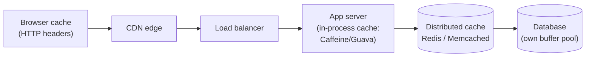
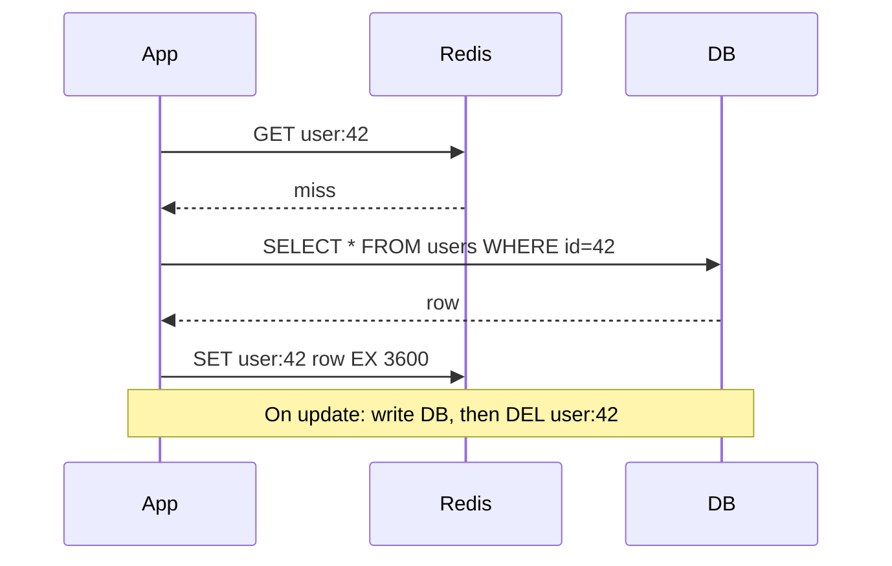
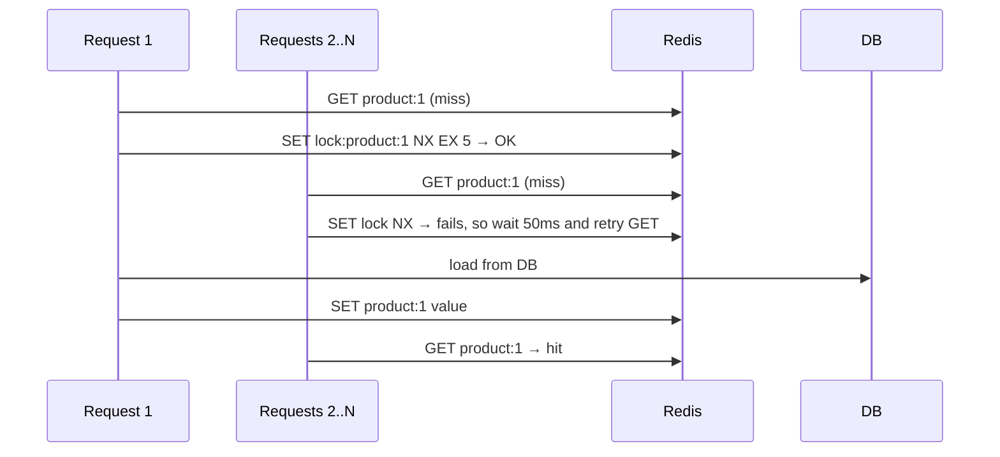

## TL;DR

- Cache = **a fast copy of data that's slow or expensive to get**. Memory is ~100–1000× faster than disk or a network DB call.
- **Default pattern: cache-aside (lazy loading).** Read the cache; on a miss, read the DB and populate the cache. On write, update the DB and **delete** the cache key.
- **Eviction:** LRU is the default. **TTL** on every key is your safety net against stale data.
- The hard part isn't adding a cache. It's **invalidation and failure modes** (Day 16).

## Where caches live (layers)



| Layer | Example | Good for | Caveat |
|---|---|---|---|
| Client/browser | `Cache-Control`, service worker | Static assets | Can't invalidate easily |
| CDN | CloudFront, Akamai, Cloudflare | Media, public pages | Per-user data is tricky |
| In-process | Caffeine (Java), Guava, a local map | Ultra-hot, tiny, rarely changing config | Each server has its own copy, so they can drift |
| Distributed | **Redis**, Memcached | Shared across servers: sessions, objects, counters | A network hop (~0.5 ms), and it's another system to run |
| DB internal | Buffer pool, query cache | Automatic | Limited by DB RAM |

## The five patterns

### 1. Cache-aside (lazy loading) ⭐ default



- ✅ Only caches what's actually read. If the cache is down, the app still works (slower).
- ❌ The first read is a miss. Possible staleness if invalidation fails, which TTL covers.
- **Why delete instead of update on write?** Two concurrent writers updating the cache can leave it in the wrong order. A delete simply makes the next read reload the truth.

### 2. Read-through
Like cache-aside, but **the cache library loads from the DB itself** on a miss (e.g. a Caffeine `LoadingCache`, or DAX for DynamoDB). Cleaner app code, same behaviour.

### 3. Write-through
Write to the cache **and** the DB synchronously, in the write path.
- ✅ The cache is always fresh. ❌ Slower writes, and it caches data that may never be read.

### 4. Write-back (write-behind)
Write to the cache only, and **flush to the DB asynchronously** in batches.
- ✅ Very fast writes, absorbs bursts (view counters, likes).
- ❌ **Data loss** if the cache dies before flushing. Never use it for money.

### 5. Write-around
Write straight to the DB and let reads populate the cache. Good for write-once, rarely-read data (logs, uploads).

| Pattern | Read speed | Write speed | Consistency | Risk |
|---|---|---|---|---|
| Cache-aside | fast after 1st | normal | eventual (TTL) | stale on failed invalidation |
| Write-through | fast | slower | strong-ish | wasted cache space |
| Write-back | fast | **fastest** | eventual | **data loss** |
| Write-around | miss after write | normal | fine | first read slow |

## Eviction policies

When memory fills up, something has to go:
- **LRU (Least Recently Used):** evict what hasn't been touched longest. The default for most workloads. (Implementing it is a classic LLD question: see the LRU LLD on Day 54.)
- **LFU (Least Frequently Used):** keeps long-term popular items, and resists one-off scans.
- **FIFO / random:** simple, rarely the best.
- **TTL expiry:** time-based, independent of memory pressure.
- Redis lets you configure `maxmemory-policy`: `allkeys-lru`, `allkeys-lfu`, `volatile-ttl`, and others.

## TTL guidelines

| Data | TTL idea |
|---|---|
| User profile | 5–60 min + delete on update |
| Product price / stock shown on listing | Short (30 s–5 min), but **always re-check from the DB at checkout** |
| Config / feature flags | 30–60 s |
| Session | Matches the session lifetime (e.g. 30 min sliding) |
| Computed feed / timeline | Minutes, or rebuilt on events |

Add **random jitter** to TTLs (e.g. 3600 ± 300 s) so keys don't all expire together.

## What NOT to cache (or be careful with)

- Data that must be **exactly current** for a decision: an account balance before a debit, seat availability at booking time. Read from the source of truth inside the transaction.
- Highly personalised data with a low hit rate.
- Huge objects. Cache the parts you actually need.

## Self-check

<details>
<summary>In cache-aside, why delete the key on update instead of writing the new value into the cache?</summary>

Concurrent updates can write cache values out of order (an older value lands last), leaving stale data indefinitely. Deleting forces the next read to load the current DB value.
</details>

<details>
<summary>When is write-back caching appropriate and when is it dangerous?</summary>

Appropriate for high-volume, loss-tolerant writes like view counts or analytics. Dangerous for anything that can't be lost (payments, orders), because a cache crash before the flush loses the data.
</details>

<details>
<summary>Why add jitter to TTLs?</summary>

To stop many keys that were cached at the same time from expiring together and hitting the DB at once (cache avalanche).
</details>

<details>
<summary>Should you check a cached stock count before confirming an order?</summary>

You can show it from the cache, but the **decision** must use the source of truth inside a transaction (conditional decrement or row lock), because the cache may be stale.
</details>
---
id: caching-problems
title: Cache failure modes & Redis deep dive
module: cache
day: 16
minutes: 35
tags: star, cache stampede, thundering herd, penetration, avalanche, hot key, redis, distributed lock
summary: The three classic cache disasters (stampede, penetration, avalanche) and their fixes, plus what you must know about Redis — data structures, persistence, clustering and common uses.
videos: ByteByteGo cache stampede penetration avalanche | Hussein Nasser Redis | ByteByteGo Redis use cases | Hello Interview Redis deep dive
read: Hello Interview — Redis deep dive => https://www.hellointerview.com/learn/system-design/deep-dives/redis | Redis docs — data types => https://redis.io/docs/latest/develop/data-types/
---

## TL;DR

| Problem | What happens | Fix |
|---|---|---|
| **Stampede / thundering herd** | A hot key expires, and 10K requests hit the DB at once | **Single-flight lock** (one request rebuilds, others wait), early probabilistic refresh, never-expire + background refresh |
| **Penetration** | Requests for keys that **don't exist** always miss and hit the DB (often an attack) | **Cache the null** (short TTL), **bloom filter** in front, input validation |
| **Avalanche** | **Many** keys expire together, or the cache node dies | **TTL jitter**, cache cluster with replicas, circuit breaker / rate limit to the DB, warm-up |
| **Hot key** | One key gets a huge share of traffic (viral post) | Local in-process cache, key replication (`key#1..#N`), read from replicas |
| **Big key** | A 10 MB value or a million-member set blocks Redis | Split the value, paginate, use compression |

## Stampede in detail



Other fixes:
- **Stale-while-revalidate:** keep serving the old value while one background job refreshes it.
- **Probabilistic early expiration:** each read near expiry has a small chance to refresh early, which spreads the refreshes out.

## Redis — what you must know

### Why Redis is fast
In-memory, a **single-threaded** command loop (no lock contention, I/O is multiplexed), and efficient data structures. Roughly **100K+ ops/sec per node** at sub-millisecond latency.

### Data structures and their system-design uses

| Structure | Commands | Use it for |
|---|---|---|
| **String** | `GET/SET/INCR/SETNX/EX` | Cache objects, counters, rate limits, locks |
| **Hash** | `HSET/HGET` | Object fields (user profile) |
| **List** | `LPUSH/RPOP/LRANGE` | Simple queues, recent-items lists |
| **Set** | `SADD/SISMEMBER/SINTER` | Unique visitors, tags, mutual friends |
| **Sorted set (ZSET)** | `ZADD/ZRANGE/ZREVRANK` | **Leaderboards**, timelines by timestamp, priority queues, sliding-window rate limiting |
| **Bitmap** | `SETBIT/BITCOUNT` | Daily active flags for millions of users in a few MB |
| **HyperLogLog** | `PFADD/PFCOUNT` | Approximate unique counts (12 KB for billions, ~0.8% error) |
| **Geo** | `GEOADD/GEOSEARCH` | Nearby drivers/restaurants |
| **Stream** | `XADD/XREADGROUP` | Lightweight Kafka-like log with consumer groups |
| **Pub/Sub** | `PUBLISH/SUBSCRIBE` | Fan-out to WebSocket servers (fire-and-forget) |

### Persistence
- **RDB:** periodic snapshots. Compact and fast to restart, but you can lose minutes of data.
- **AOF:** logs every write (`fsync` every second is typical), so you lose at most ~1 s. Bigger files.
- Production often uses **both**. Even so, treat Redis as a **cache, not the source of truth** for critical data, unless you've designed for it.

### High availability and scaling
- **Replication:** a primary plus replicas (async).
- **Sentinel:** monitors and auto-fails over (for a non-sharded setup).
- **Redis Cluster:** **16,384 hash slots** spread across primaries, each with replicas. Multi-key operations only work when the keys share a slot, which you force with **hash tags** `{user42}:cart`.
- Managed: AWS ElastiCache/MemoryDB, Redis Cloud.

### Distributed lock with Redis

```
SET lock:order:123 <random-token> NX PX 10000    # acquire if not exists, 10 s expiry
... do work ...
# release only if we still own it (Lua script, atomic):
if redis.call("GET", KEYS[1]) == ARGV[1] then return redis.call("DEL", KEYS[1]) end
```

- **Always set an expiry** (otherwise a crashed holder locks forever) and **check the token on release** (otherwise you might delete someone else's lock).
- **Caveat:** if a GC pause outlasts the TTL, two holders can exist at once. For correctness-critical cases, use **fencing tokens** or a consensus store (ZooKeeper/etcd), or rely on DB constraints. Martin Kleppmann's essay (Read below) is a well-known critique of Redlock.

## Memcached vs Redis (one-liner)

Memcached: simple, multi-threaded, strings only, no persistence. Redis: rich data structures, persistence, replication, pub/sub, Lua. **Redis is the default choice today.**

## Self-check

<details>
<summary>A popular product page's cache key expires during a sale and the DB falls over. What happened and how do you fix it?</summary>

A cache stampede: many concurrent misses all hit the DB. Fixes: a single-flight lock so only one request rebuilds (`SET NX`), stale-while-revalidate / background refresh, early probabilistic expiration, and TTL jitter.
</details>

<details>
<summary>Attackers request random non-existent user IDs to bypass your cache. Fix?</summary>

Cache negative results (null with a short TTL), put a bloom filter of valid IDs in front of the DB, validate the input format, and rate-limit by IP or client.
</details>

<details>
<summary>Which Redis structure would you use for a real-time game leaderboard and why?</summary>

A **sorted set**: `ZADD` / `ZINCRBY` to update scores, `ZREVRANGE` for the top-N and `ZREVRANK` for a user's rank, all O(log N).
</details>

<details>
<summary>Two safety rules for a Redis-based lock?</summary>

(1) Always set an expiry (PX) so a crashed holder doesn't block forever. (2) Store a unique token and only release if the token matches (an atomic Lua script). For strict correctness, add fencing tokens.
</details>

<details>
<summary>RDB vs AOF?</summary>

RDB = periodic point-in-time snapshots (compact, fast restarts, can lose minutes). AOF = an append-only log of every write (lose ≤ ~1 s with everysec fsync, larger files). They're often combined.
</details>
