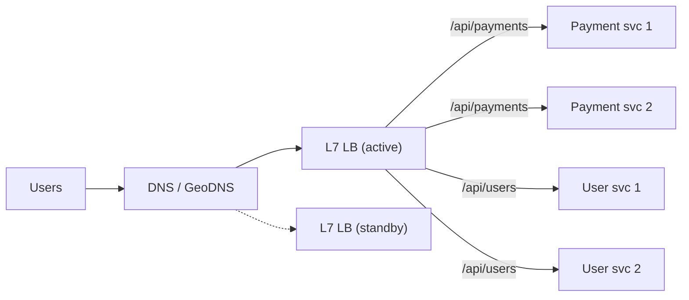
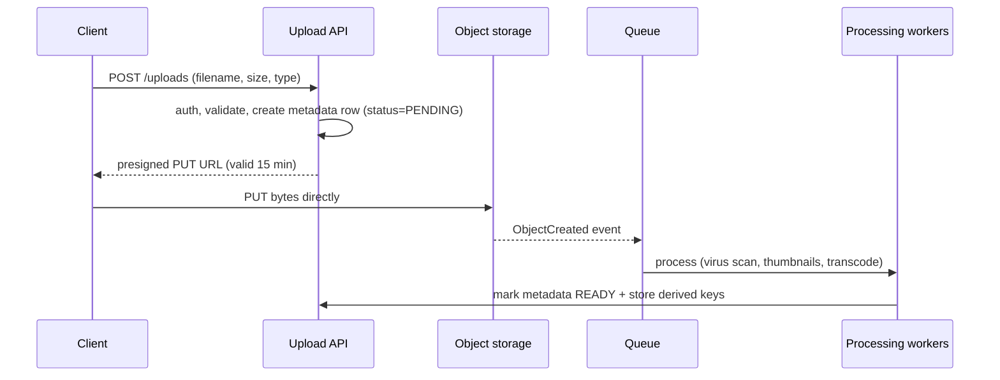
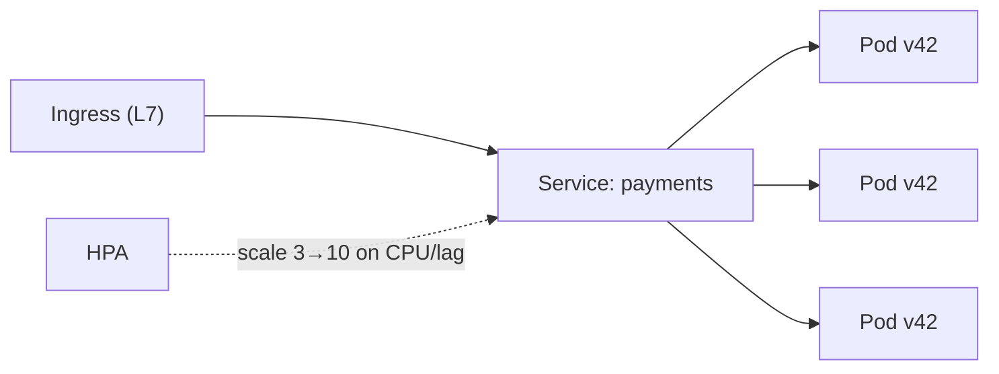

## TL;DR

- **Vertical scaling** = a bigger machine (simple, has a ceiling, still a SPOF). **Horizontal** = more machines (practically unlimited, but needs a load balancer and stateless services).
- **Stateless services:** keep no user state in server memory. Put sessions in Redis or JWTs and files in S3, so any server can handle any request.
- **L4 LB:** routes by IP/port (TCP). Very fast, can't see HTTP.
- **L7 LB:** routes by URL, headers or cookies. Can terminate TLS, do path-based routing and canary releases.
- Algorithms: **round robin**, **least connections**, **weighted**, **consistent hashing** (for stickiness or cache locality).

## Vertical vs horizontal

| | Vertical (scale up) | Horizontal (scale out) |
|---|---|---|
| How | More CPU/RAM | More nodes |
| Limit | Biggest machine available | Very high |
| Fault tolerance | Single box = SPOF | Survives node loss |
| Complexity | Low | Needs LB, stateless design, distributed data |
| Good for | Databases (initially), quick wins | Stateless app tiers, caches, queues |

## Making a service stateless

Move all state out of the app server:
- **Sessions** → Redis, or signed JWTs.
- **Uploaded files** → S3/object storage.
- **Caches** → Redis (or accept per-node local caches).
- **Scheduled jobs** → a distributed scheduler with locking (otherwise every replica runs the cron job!).

Then you can **add or remove servers freely** and autoscale.

## Load balancers



| | L4 (transport) | L7 (application) |
|---|---|---|
| Sees | IP, port, TCP/UDP | HTTP method, path, headers, cookies |
| Can do | Fast forwarding, huge throughput | Path routing, TLS termination, auth, compression, canary splits, retries |
| Examples | AWS NLB, HAProxy (TCP mode), LVS | AWS ALB, Nginx, Envoy, HAProxy (HTTP), Traefik |
| Use when | Non-HTTP protocols, extreme throughput, WebSocket passthrough | Microservices routing, most web apps |

### Algorithms

| Algorithm | How | Best for |
|---|---|---|
| Round robin | Next server in turn | Identical servers, similar requests |
| Weighted round robin | Bigger servers get more | Mixed hardware, canary (5% to the new version) |
| **Least connections** | Server with the fewest active connections | Long or variable requests (WebSockets, uploads) |
| Least response time | Fastest recent responders | Latency-sensitive |
| IP hash / consistent hash | Same client or key → same server | Sticky sessions, cache locality |
| Power of two choices | Pick 2 at random, send to the less loaded | Simple and surprisingly good at scale |

### Health checks and failure
- **Active:** the LB pings `/health` every few seconds and removes failing servers.
- **Passive:** the LB notices errors or timeouts on real traffic.
- Have **liveness** (is the process alive?) and **readiness** (can it serve? e.g. DB connected) checks. That's Kubernetes terminology.
- The LB itself must be redundant: **active-passive pairs** with a floating IP, or managed (ALB is redundant across availability zones).

### Sticky sessions: why to avoid them
Pinning a user to one server (cookie or IP hash) makes **uneven load**, and failover loses their session. Prefer stateless servers with a shared session store. They're acceptable for WebSocket connections, which are inherently sticky.

## Autoscaling

- Scale on **CPU, request rate, queue depth or custom metrics** (e.g. Kafka consumer lag).
- **Scale out fast, scale in slowly** (cool-down periods) to avoid flapping.
- **Predictive / scheduled scaling** for known peaks (IPL final, Big Billion Days, salary day).
- New instances need a **warm-up time**, so keep headroom (target ~60–70% CPU, not 95%).

## Self-check

<details>
<summary>Why must app servers be stateless to scale horizontally?</summary>

So any request can go to any server. Then the LB can distribute freely, servers can be added or removed (autoscaling), and a crash doesn't lose user state. State lives in shared stores (Redis, DB, S3).
</details>

<details>
<summary>When would you pick least-connections over round robin?</summary>

When request durations vary a lot or connections are long-lived (WebSockets, file uploads, streaming). Round robin would pile work onto servers that are still busy.
</details>

<details>
<summary>Give 3 things an L7 load balancer can do that an L4 one can't.</summary>

Route by URL path or header (`/api/payments` → payment service), terminate TLS and inspect HTTP, and do cookie-based stickiness, canary/weighted splits by header, and HTTP retries/rewrites.
</details>

<details>
<summary>What metric would you autoscale a Kafka consumer service on?</summary>

**Consumer lag** (messages waiting), not just CPU. Lag directly measures whether you're keeping up. (Max useful consumers = number of partitions.)
</details>
---
id: blob-storage
title: Blob/object storage, file uploads & media delivery
module: infra
day: 18
minutes: 30
tags: s3, object storage, presigned url, multipart upload, media, cdn
summary: Block vs file vs object storage, how S3-style storage works, direct-to-S3 uploads with presigned URLs, multipart uploads, and serving media through a CDN. Needed for YouTube, Instagram and Dropbox designs.
videos: ByteByteGo how does S3 work | Hello Interview handling large blobs | ByteByteGo presigned url upload
read: AWS — S3 presigned URLs => https://docs.aws.amazon.com/AmazonS3/latest/userguide/using-presigned-url.html | AWS — Multipart upload => https://docs.aws.amazon.com/AmazonS3/latest/userguide/mpuoverview.html
---

## TL;DR

- **Never store big files in your database.** Put them in **object storage** (S3, GCS, Azure Blob, MinIO) and store only **metadata + the object key** in the DB.
- **Upload directly from the client to S3** with a **presigned URL**, so your app servers never carry the bytes.
- Big files use **multipart upload** (parallel chunks, resumable).
- **Serve through a CDN**, with signed URLs or cookies for private content.

## Block vs file vs object

| | Block | File | Object |
|---|---|---|---|
| Example | AWS EBS, a disk | NFS, AWS EFS | **S3**, GCS |
| Access | Raw blocks, mounted by one server | Shared file system paths | HTTP API: `PUT/GET bucket/key` |
| Scale | One volume | Moderate | **Practically infinite** |
| Use | DB data files, OS disks | Shared config, legacy apps | Images, videos, backups, logs, data lakes |
| Durability | Replicated within a zone | Replicated | **11 nines** (S3), across zones |

## The upload flow (presigned URL)



Why it's great: the app tier stays thin, uploads scale with S3, and you **pay for no idle bandwidth** on your servers.

## Large files: multipart and resumable

- Split the file into chunks (e.g. 5–100 MB), upload them **in parallel**, retry only failed chunks, then **complete** the upload.
- **Resumable:** the client tracks which chunks succeeded and continues after a network drop. That matters on mobile networks.
- **Dropbox-style dedup:** hash each chunk (SHA-256), and skip uploading chunks the server already has (see the Dropbox case study).

## Serving media

- **Private content:** a CDN with **signed URLs / signed cookies** that expire (e.g. 1 hour).
- **Images:** generate thumbnails / multiple sizes at upload time, or resize on the fly at the edge.
- **Video:** transcode to multiple bitrates and chunk into **HLS/DASH** segments for adaptive streaming (see the YouTube case).
- **Lifecycle policies:** move old objects to cheaper tiers automatically (S3 Standard → Infrequent Access → Glacier).

## Metadata table example

```sql
CREATE TABLE media (
  id           BIGINT PRIMARY KEY,       -- Snowflake ID
  owner_id     BIGINT NOT NULL,
  object_key   TEXT NOT NULL,            -- e.g. u/42/2026/11/abc123.jpg
  content_type TEXT, size_bytes BIGINT, sha256 CHAR(64),
  status       TEXT CHECK (status IN ('PENDING','READY','FAILED')),
  created_at   TIMESTAMPTZ DEFAULT now()
);
```

## Self-check

<details>
<summary>Why upload directly to S3 via a presigned URL instead of through your API servers?</summary>

The API servers don't carry gigabytes of traffic, so they stay small and cheap. S3 handles the scale and throughput, uploads are faster, and access is still controlled by the short-lived signed URL your API issues after auth.
</details>

<details>
<summary>How do you make a 2 GB upload resilient to network drops?</summary>

Multipart/chunked upload: split into chunks, upload in parallel, retry failed chunks, track completed parts so the upload can resume, then call complete.
</details>

<details>
<summary>How do you serve private photos through a CDN?</summary>

Use CDN signed URLs or cookies with a short expiry, issued by your backend after checking permissions. The origin bucket stays private (only the CDN can read it).
</details>
---
id: containers-cloud
title: Containers, Kubernetes & the cloud services map
module: infra
day: 19
minutes: 30
tags: docker, kubernetes, aws, cloud, serverless, iac
summary: Just enough Docker/Kubernetes and AWS vocabulary to speak confidently. Pods, deployments, services, autoscaling, serverless trade-offs, and a cloud-services cheat sheet.
videos: ByteByteGo Kubernetes explained | TechWorld with Nana Kubernetes crash course | ByteByteGo AWS services explained | Fireship Docker in 100 seconds
read: Kubernetes — Overview => https://kubernetes.io/docs/concepts/overview/ | AWS Architecture Center => https://aws.amazon.com/architecture/
---

## TL;DR

- **Docker:** package an app with its dependencies into an **image**, and run it anywhere as a **container**.
- **Kubernetes (K8s):** runs containers across a cluster. It does scheduling, self-healing, scaling, rolling deploys and service discovery.
- In interviews you don't design K8s itself. You say "services run as stateless containers on Kubernetes with a Horizontal Pod Autoscaler", and move on.
- **Serverless (Lambda):** no servers to manage, pay per use, scales to zero. Has cold starts, time limits and a vendor lock-in risk.

## Kubernetes vocabulary in one table

| Term | Meaning |
|---|---|
| **Pod** | Smallest unit: one or more containers sharing a network/IP |
| **Deployment** | Desired state: "run 5 replicas of payment-service:v42". It handles rolling updates |
| **Service** | Stable virtual IP/DNS name load-balancing across pods |
| **Ingress** | L7 routing from outside into services |
| **HPA** | Horizontal Pod Autoscaler: scales pods on CPU or custom metrics |
| **ConfigMap / Secret** | Configuration and credentials injected into pods |
| **StatefulSet** | Pods with stable identity and storage (Kafka, DBs). Harder to run |
| **Liveness / readiness probe** | Restart if dead / route traffic only when ready |
| **Namespace** | Logical isolation within a cluster |



## AWS services cheat sheet (with GCP/Azure equivalents)

| Need | AWS | GCP | Azure |
|---|---|---|---|
| VMs | EC2 | Compute Engine | VMs |
| Containers | EKS / ECS / Fargate | GKE / Cloud Run | AKS |
| Serverless functions | Lambda | Cloud Functions | Functions |
| Object storage | S3 | GCS | Blob Storage |
| Relational DB | RDS / Aurora | Cloud SQL / AlloyDB / Spanner | Azure SQL |
| Key-value / NoSQL | DynamoDB | Bigtable / Firestore | Cosmos DB |
| Cache | ElastiCache / MemoryDB | Memorystore | Azure Cache for Redis |
| Queue | SQS | Pub/Sub | Service Bus |
| Pub/Sub / streaming | SNS / Kinesis / MSK (Kafka) | Pub/Sub | Event Hubs |
| CDN | CloudFront | Cloud CDN | Front Door |
| DNS | Route 53 | Cloud DNS | Azure DNS |
| Load balancer | ALB / NLB | Cloud LB | App Gateway / LB |
| Search | OpenSearch | — (Elastic Cloud) | Cognitive Search |
| Data warehouse | Redshift | BigQuery | Synapse |
| Secrets | Secrets Manager / KMS | Secret Manager / KMS | Key Vault |

> Many banks run **hybrid** setups (on-prem data centres + private/public cloud, often with OpenShift). It's fine to say "a managed Kafka, or self-hosted on-prem for regulatory reasons".

## Serverless — when yes, when no

| ✅ Good fit | ❌ Poor fit |
|---|---|
| Spiky, event-driven work (S3 upload → thumbnail) | Steady high-throughput APIs (cheaper on containers) |
| Glue code, cron jobs, webhooks | Latency-critical paths (cold starts of 100 ms–seconds) |
| Prototypes, low-traffic internal tools | Long-running jobs (Lambda max 15 min), persistent connections |

## Infrastructure as Code (one paragraph)

Define infrastructure in code (**Terraform**, CloudFormation, Pulumi) so environments are reproducible, reviewed in PRs and versioned. Pair it with CI/CD (GitHub Actions, Jenkins — very common in banks — or GitLab CI) and GitOps (Argo CD) for Kubernetes.

## Self-check

<details>
<summary>What's the difference between a Kubernetes Deployment and a Service?</summary>

A Deployment manages **pods** (how many replicas, which image version, rolling updates). A Service gives those pods a **stable network identity** and load-balances traffic across them.
</details>

<details>
<summary>Why are stateful systems like Kafka or databases harder on Kubernetes?</summary>

They need stable identities, persistent volumes that follow the pod, ordered startup/shutdown and careful failover. StatefulSets and operators help, but many teams prefer managed services.
</details>

<details>
<summary>Give one reason to avoid Lambda for a payment authorisation API.</summary>

Cold-start latency spikes on a latency-critical path, and steady high traffic is cheaper on always-on containers. Connection pooling to the DB is also harder.
</details>
