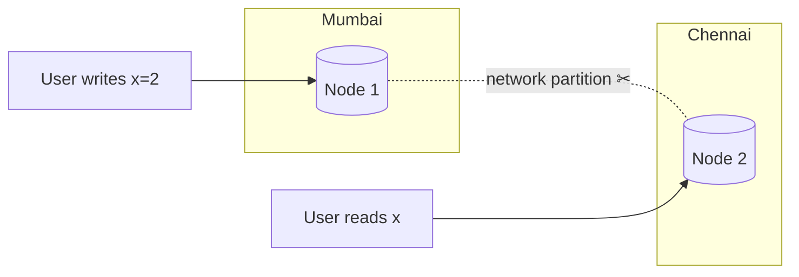
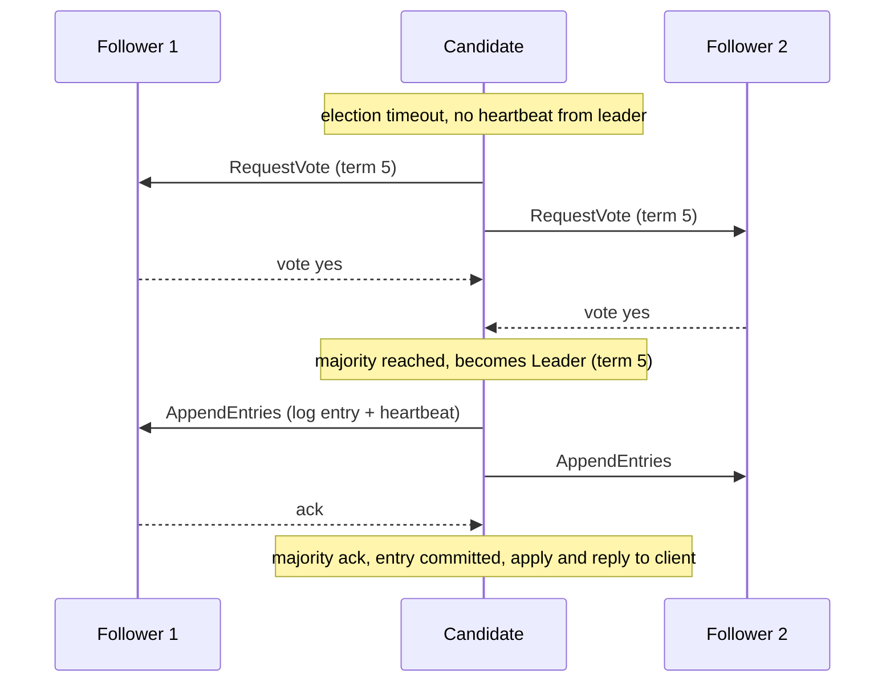
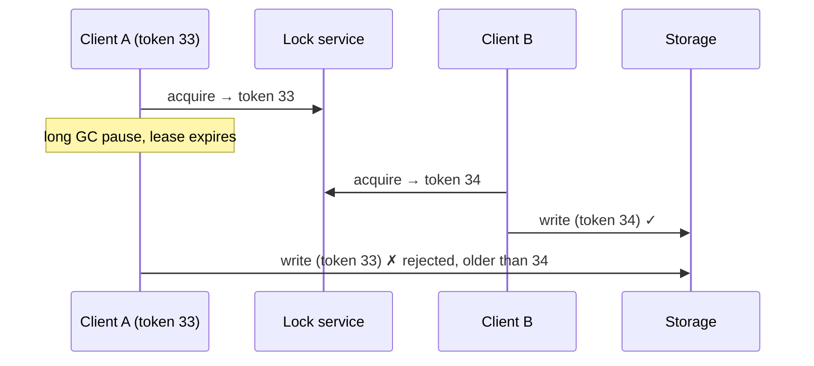
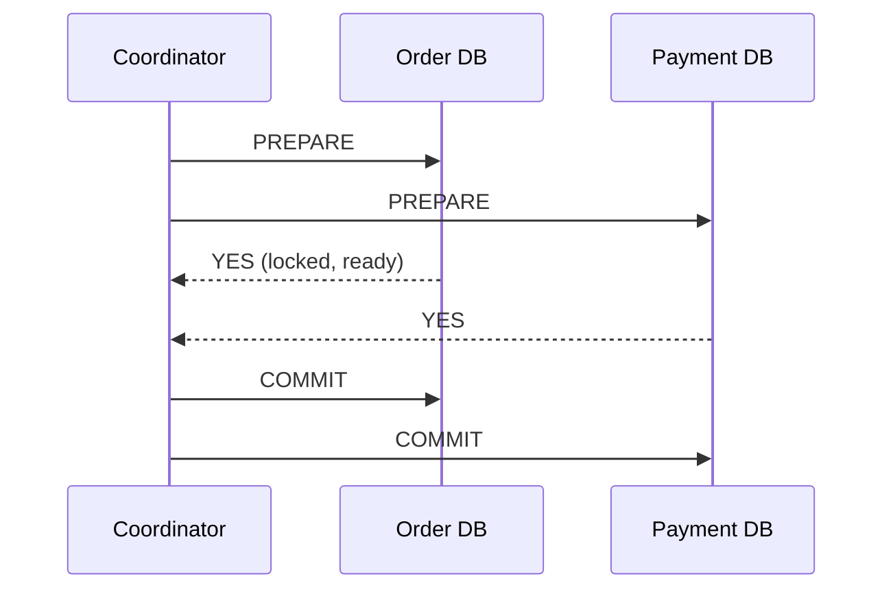
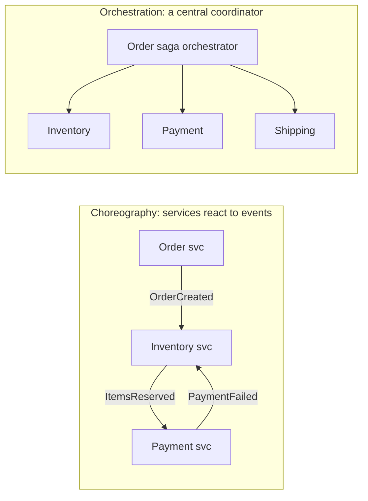
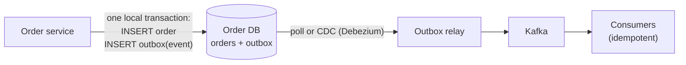

## TL;DR

- **CAP:** when a **network partition** happens, a distributed system must choose **Consistency** (refuse or stall some requests) or **Availability** (answer, possibly with stale data). Partitions *will* happen, so it's really **CP vs AP**.
- **PACELC:** even **without** a partition, there's a trade-off between **Latency and Consistency**. This is the one you feel every day.
- Choose **per feature, not per company**. Payments: CP. Like counts: AP.
- Consistency spectrum: **linearizable (strong)** → sequential → **causal** → **read-your-writes** → **eventual**.

## CAP, properly



During the partition, Node 2 can't hear about `x=2`. It can:
- **Refuse to answer** (or error, or wait) → **CP**. Correct, but unavailable for that request.
- **Answer with the old x=1** → **AP**. Available, but stale.

There's no "CA" distributed system, because you can't opt out of partitions.

| CP examples | AP examples |
|---|---|
| ZooKeeper, etcd, HBase, Spanner, MongoDB (majority writes), relational primaries | Cassandra, DynamoDB (default), Riak, CouchDB, DNS, CDN caches |

> Many databases are **tunable**: Cassandra with `QUORUM/QUORUM` behaves much more consistently, and DynamoDB has "strongly consistent reads".

## PACELC — the useful extension

**If Partition: choose A or C. Else: choose Latency or Consistency.**

| System | P → | E → |
|---|---|---|
| DynamoDB / Cassandra | A | L (fast, eventually consistent by default) |
| Spanner / CockroachDB | C | C (pays latency for global consistency) |
| MongoDB (default config) | C | L-ish |

Strong consistency across regions means **waiting for cross-region acknowledgements** (~100+ ms). That's the "E/C" cost.

## Consistency models (from strongest to weakest)

| Model | Guarantee in plain words | Example need |
|---|---|---|
| **Linearizable (strong)** | Once a write completes, **every** reader sees it, as if there's one copy | Bank balance, seat booking, leader election, unique usernames |
| **Sequential** | Everyone sees operations in the same order (not necessarily real-time) | Replicated logs |
| **Causal** | Cause comes before effect everywhere (reply after question) | Comments, chat |
| **Read-your-writes** | **You** always see your own updates | Profile edits, posting |
| **Monotonic reads** | You never see time go backwards | Feeds, timelines |
| **Eventual** | If writes stop, replicas converge… eventually | Like counts, view counts, recommendations, DNS |

## Choosing per feature (interview gold)

For an e-commerce site:
- **Inventory decrement & payment:** strong (CP), via a DB transaction.
- **Product catalogue & reviews:** eventual is fine, and heavily cached.
- **Cart:** available (AP). Amazon's Dynamo paper famously chose to keep the cart writable during failures and merge carts later.
- **Order history:** read-your-writes (users must see the order they just placed).

> **Interview line:** "For the booking itself I need strong consistency, so I'll use a single-leader relational DB with transactions. For the 'seats remaining' counter on the listing page, eventual consistency with a short-TTL cache is fine."

## Self-check

<details>
<summary>Why is "CA" not a real option for a distributed system?</summary>

Network partitions are unavoidable in distributed systems. When one happens you must give up either consistency or availability. CA only describes a single-node system.
</details>

<details>
<summary>What does PACELC add to CAP?</summary>

Even with no partition (Else), there's a trade-off between **Latency** and **Consistency**. Stronger consistency requires coordination and waiting, which adds latency.
</details>

<details>
<summary>Pick a consistency model for: (a) wallet balance, (b) Instagram like count, (c) your own edited bio.</summary>

(a) Strong/linearizable. (b) Eventual. (c) Read-your-writes.
</details>
---
id: consensus-locks
title: Consensus, leader election & distributed locks
module: dist
day: 23
minutes: 35
tags: raft, paxos, zookeeper, etcd, leader election, quorum, fencing, split brain, distributed lock
summary: Why distributed nodes need to agree, Raft in plain English, what ZooKeeper/etcd do for you, split brain and fencing tokens, and safe distributed locking.
videos: The Secret Lives of Data Raft visualization | Martin Kleppmann Raft lecture | Gaurav Sen leader election | ByteByteGo distributed lock
read: Raft — interactive visualization => https://thesecretlivesofdata.com/raft/ | Kleppmann — How to do distributed locking => https://martin.kleppmann.com/2016/02/08/how-to-do-distributed-locking.html
---

## TL;DR

- **Consensus** = getting several nodes to **agree on a value** (who's leader, what's the next log entry) even when some fail.
- **Raft** (etcd, Consul, CockroachDB, Kafka's KRaft) and **Paxos** (Spanner, Chubby) do this with a **majority quorum**: 3 nodes tolerate 1 failure, 5 tolerate 2.
- You rarely implement it. You **use** ZooKeeper / etcd / Consul for leader election, config, service discovery and locks.
- A lock or lease holder can be paused (GC, network) past its expiry, so use **fencing tokens** to stop a "zombie" from corrupting data.

## Why majority quorums?

With 5 nodes, any two majorities (3 + 3) **overlap in at least one node**. So two different leaders can never both win an election, and a committed entry is always known to the next leader.
**Odd cluster sizes:** 4 nodes tolerate only 1 failure, the same as 3, so use 3, 5 or 7.

## Raft in 5 steps



1. Every node starts as a **follower**. The leader sends regular **heartbeats**.
2. No heartbeat within a **random timeout** → the node becomes a **candidate**, increments the **term**, and asks for votes.
3. A **majority** of votes makes it **leader** for that term. Randomised timeouts avoid split votes.
4. The leader appends client commands to its **log** and replicates them. Once a **majority** has them, the entry is **committed**.
5. A node with a stale term steps down. The term number acts like an epoch that rejects old leaders.

## ZooKeeper / etcd — what you use them for

| Use | How |
|---|---|
| **Leader election** | Everyone tries to create an ephemeral key/node; the winner is leader; if its session dies, the key vanishes and a new election happens |
| **Service discovery** | Services register themselves with an ephemeral node or lease |
| **Config** | A strongly consistent key-value store with watches |
| **Distributed locks** | Sequential ephemeral nodes (ZooKeeper) or leases (etcd) |
| **Cluster membership** | Kafka (pre-KRaft), HBase, Hadoop used ZooKeeper; Kubernetes stores all state in etcd |

## Split brain and fencing tokens

**Scenario:** the old leader (or lock holder) hits a 30-second GC pause. Its lease expires, a new leader is elected, and then the old one wakes up and **still thinks it's leader**, so it writes to storage. Corruption.

**Fencing token:** each time a lock or leadership is granted, a **monotonically increasing number** comes with it (e.g. the Raft term or ZooKeeper zxid). The storage layer **rejects writes carrying a token lower than one it has already seen**.



## Distributed locks — decision guide

| Option | Safety | Use when |
|---|---|---|
| **DB row lock / unique constraint** | Strong (inside one DB) | The data lives in that DB anyway. Often the best answer |
| **Redis `SET NX PX` + token** | Good for efficiency, weak for correctness | Avoid duplicate work (cron runs once); occasional double execution is tolerable |
| **Redlock (multiple Redis)** | Debated | Rarely worth it |
| **ZooKeeper / etcd lease + fencing** | Strong | Correctness-critical coordination across services |

> **Interview line:** "If the lock protects data in Postgres, I'd rather use the DB's own row lock or a conditional update than a separate lock service, because that's one less thing to get wrong."

## Self-check

<details>
<summary>Why does a 5-node Raft cluster tolerate 2 failures but not 3?</summary>

It needs a majority (3 of 5) to elect a leader and commit entries. With 3 down, only 2 remain, which isn't a majority.
</details>

<details>
<summary>What problem do fencing tokens solve?</summary>

A paused or partitioned old lock holder ("zombie") that thinks it still holds the lock. The storage rejects its writes because their token is older than the latest one seen.
</details>

<details>
<summary>How is leader election done with ZooKeeper or etcd?</summary>

Candidates try to create the same ephemeral node / key with a lease, and the one that succeeds is leader. Others watch it. When the leader's session or lease expires, the key disappears and they retry.
</details>

<details>
<summary>Why prefer odd-sized consensus clusters?</summary>

An even number adds no extra fault tolerance (4 tolerates 1 failure, the same as 3) but adds cost and latency.
</details>
---
id: ids-clocks
title: Unique IDs at scale & time in distributed systems
module: dist
day: 24
minutes: 30
tags: snowflake, uuid, uuidv7, ulid, id generation, clocks, lamport, vector clock
summary: How to generate unique, sortable IDs without a single database (UUID, UUIDv7, Snowflake, ticket servers), and why you can't trust wall clocks — Lamport and vector clocks in brief.
videos: ByteByteGo unique id generator | Hussein Nasser UUID vs auto increment | Martin Kleppmann logical time lecture | Gaurav Sen distributed unique id
read: Twitter Snowflake (archived repo) => https://github.com/twitter-archive/snowflake | DDIA chapter 8 (clocks) => https://dataintensive.net
---

## TL;DR

- Auto-increment breaks once you shard (each shard would hand out ID 1). You need **globally unique IDs**.
- **UUIDv4:** random, needs no coordination, but **not sortable** and 128-bit (it fragments B-tree indexes).
- **UUIDv7 / ULID:** a timestamp prefix + randomness. **Sortable** and needs no coordination. A good modern default.
- **Snowflake (64-bit):** `timestamp | machine id | sequence`. Sortable, compact, about 4M IDs/s per machine. Twitter, Discord and Instagram use variants.
- **Wall clocks drift and jump.** Never rely on them to order events across machines. Use **logical clocks** or a single sequencer when order matters.

## Snowflake layout (64 bits)

```
| 1 bit | 41 bits timestamp (ms since custom epoch) | 10 bits machine/worker | 12 bits sequence |
|   0   |   ~69 years of milliseconds                |   1,024 workers        | 4,096 per ms     |
```

- **Sortable by time**, which suits feeds and pagination.
- Generated **locally** on each node, so there's no network call.
- Worker IDs come from config, or are leased from ZooKeeper/etcd.
- **Clock going backwards** (an NTP adjustment) could cause duplicates, so detect it and wait, or refuse to issue IDs until the clock catches up.

## Options compared

| Approach | Sortable | Size | Coordination | Notes |
|---|---|---|---|---|
| DB auto-increment | ✅ | 64-bit | single DB | Breaks with sharding; reveals counts |
| **UUIDv4** | ❌ | 128-bit | none | Simple; bad index locality |
| **UUIDv7 / ULID** | ✅ | 128-bit | none | Great modern default |
| **Snowflake** | ✅ | **64-bit** | worker ID assignment | Compact, fast; clock-sensitive |
| Ticket server (Flickr) | ✅ | 64-bit | central DB(s) | Two DBs with odd/even IDs for HA |
| Range allocation | ~ | 64-bit | central allocator | Each server leases a block of 10K IDs |
| Short codes (URL shortener) | n/a | 6–8 chars | counter or hash | Base62 of a counter/Snowflake |

## Clocks and ordering

- **Physical clocks drift** (NTP keeps them within ms, but they can jump). Two machines' timestamps **can't reliably order** events that are milliseconds apart. That's why **last-write-wins can silently lose data**.
- **Lamport clock:** each node keeps a counter. Increment it on each event; on receiving a message, set `counter = max(local, received) + 1`. This gives an ordering consistent with causality, but can't detect concurrency.
- **Vector clock:** one counter per node. It can tell whether two versions are **concurrent** (a conflict) or one happened before the other. Dynamo-style stores use these.
- **Google Spanner's TrueTime:** GPS + atomic clocks give a bounded uncertainty, and Spanner **waits out** the uncertainty for external consistency. Name-drop it; don't go deep.
- **Practical answer for ordering:** put all events that need ordering through **one sequencer/partition** (e.g. one Kafka partition per chat or per account) and use its offset or sequence number.

## Self-check

<details>
<summary>What are the parts of a Snowflake ID and why is it sortable?</summary>

Sign bit + 41-bit millisecond timestamp + 10-bit worker ID + 12-bit per-ms sequence. Because the timestamp is in the high bits, numeric order ≈ time order.
</details>

<details>
<summary>Why is a random UUIDv4 a poor primary key for a B-tree index, and what's better?</summary>

Random values insert all over the index, causing page splits and poor cache locality. Time-ordered IDs (UUIDv7, ULID, Snowflake) append near the end of the index.
</details>

<details>
<summary>How do you guarantee messages in one chat are displayed in order?</summary>

Route all messages of a chat through one ordered sequencer, e.g. a single Kafka partition keyed by `chat_id` or a per-chat sequence number from the DB, and sort by that sequence rather than by client timestamps.
</details>
---
id: distributed-transactions
title: Distributed transactions — 2PC, Saga & the Outbox pattern
module: dist
day: 25
minutes: 40
tags: star, saga, 2pc, outbox, idempotency, choreography, orchestration, microservices
summary: How to keep data consistent across services without one big database transaction. 2PC and its problems, Sagas (choreography vs orchestration) with compensations, the transactional outbox, and idempotent consumers.
videos: ByteByteGo saga pattern | Arpit Bhayani two phase commit | Hussein Nasser transactional outbox | Chris Richardson saga pattern
read: microservices.io — Saga => https://microservices.io/patterns/data/saga.html | microservices.io — Transactional outbox => https://microservices.io/patterns/data/transactional-outbox.html
---

## TL;DR

- With microservices, each service owns **its own DB**, so you can't wrap "create order + charge payment + reserve stock" in one ACID transaction.
- **2PC (two-phase commit):** a coordinator asks everyone to *prepare*, then *commit*. It's atomic, but **blocking**, slow, and the coordinator is a weak point. Rare in microservices.
- **Saga:** a sequence of local transactions, where each step has a **compensating action** to undo it on failure. You get **eventual consistency**.
- **Transactional outbox:** write the business change **and** an "event to publish" row in the **same local transaction**. A relay then publishes it to Kafka. This avoids the "DB updated but event lost" bug.
- Consumers must be **idempotent** because messages arrive at least once.

## Two-phase commit (2PC)



- If any participant says NO, everyone aborts.
- ❌ **Blocking:** if the coordinator crashes after PREPARE, participants hold locks **indefinitely**.
- ❌ Latency, plus it requires every participant to support XA transactions.
- **Where you'll still see it:** inside a single distributed database (Spanner, CockroachDB do it internally, with consensus), and in legacy XA setups in banks.

## Saga pattern

Break the business transaction into steps T1…Tn. If step Tk fails, run **compensations** Ck-1…C1.

**Example: order placement**

| Step | Action | Compensation |
|---|---|---|
| 1 | Order service: create order (PENDING) | Cancel order |
| 2 | Inventory: reserve items | Release items |
| 3 | Payment: charge card | Refund |
| 4 | Order: mark CONFIRMED | — |

If payment fails → release inventory → cancel the order.

### Choreography vs orchestration



| | Choreography | Orchestration |
|---|---|---|
| How | Each service listens and emits events | An orchestrator tells each service what to do (state machine) |
| ✅ | Loose coupling, simple for 2–3 steps | The flow is visible in one place, easier to debug and change, handles timeouts |
| ❌ | Hard to follow ("event spaghetti"), cyclic dependencies | The orchestrator is extra code and a central component |
| Tools | Kafka events | **Temporal**, Camunda, AWS Step Functions, Netflix Conductor |

> **Interview default:** orchestration for anything with more than 3 steps or involving money, because auditability matters.

**Saga caveats:** there's no isolation, so other requests can see intermediate states (an order PENDING while payment runs). Handle that with **semantic locks** (status fields) and design the UI around it. Compensations must be **idempotent and retryable**. Some actions can't be undone (an email that was sent), so put those **last**.

## The dual-write problem and the transactional outbox

**Bug:** `save(order); kafka.send(OrderCreated)`. If the app crashes between the two, the DB has the order but no event is ever sent. Reverse the order and you get an event for an order that doesn't exist.

**Fix: the outbox.**



1. In the **same DB transaction**, insert the business row and an `outbox` row (event payload).
2. A **relay** reads new outbox rows (polling, or **CDC** with Debezium tailing the WAL/binlog) and publishes them to Kafka, then marks them sent.
3. It can publish **more than once** (a crash after publishing but before marking), so consumers must dedupe.

## Idempotent consumers (inbox pattern)

- Each event carries a unique `event_id`.
- The consumer records processed IDs in a `processed_events` table (unique key) **in the same transaction** as its side effect, and skips duplicates.
- Or make the operation naturally idempotent: `UPDATE … SET status='PAID' WHERE id=? AND status='PENDING'`.

## Self-check

<details>
<summary>Why is 2PC rarely used across microservices?</summary>

It's blocking: participants hold locks while waiting for the coordinator, and a coordinator crash can leave them stuck. It adds latency, couples availability across services, and needs XA support from every participant.
</details>

<details>
<summary>Design the saga for a flight + hotel booking. What happens if the hotel booking fails?</summary>

Steps: book flight → book hotel → charge payment → confirm. If the hotel fails, run the compensation for the completed step: cancel/refund the flight booking, then mark the trip FAILED. Compensations must be idempotent and retried until they succeed.
</details>

<details>
<summary>What is the dual-write problem and how does the outbox solve it?</summary>

Writing to the DB and publishing to a broker as two separate operations can't be atomic, so a crash leaves them inconsistent. The outbox writes the event into the same DB transaction as the business change, and a relay or CDC publishes it reliably (at least once).
</details>

<details>
<summary>Choreography vs orchestration: which for a 6-step payment flow and why?</summary>

Orchestration. A central state machine (e.g. Temporal) makes a long, money-related flow visible, auditable and easier to handle timeouts and compensations in. Choreography becomes hard to trace with many steps.
</details>
