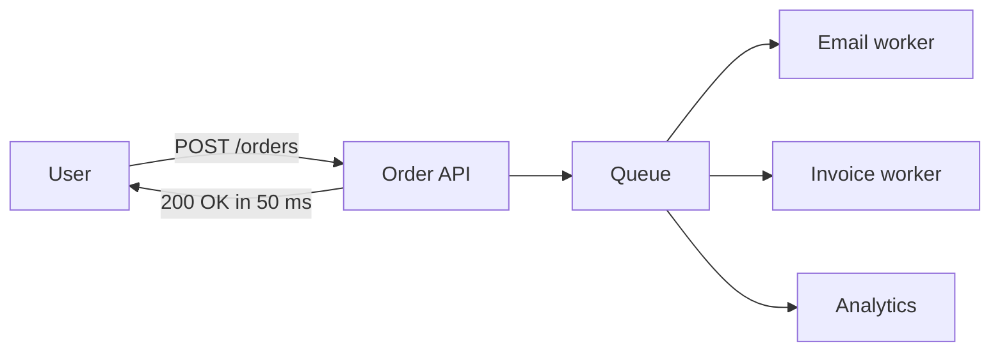
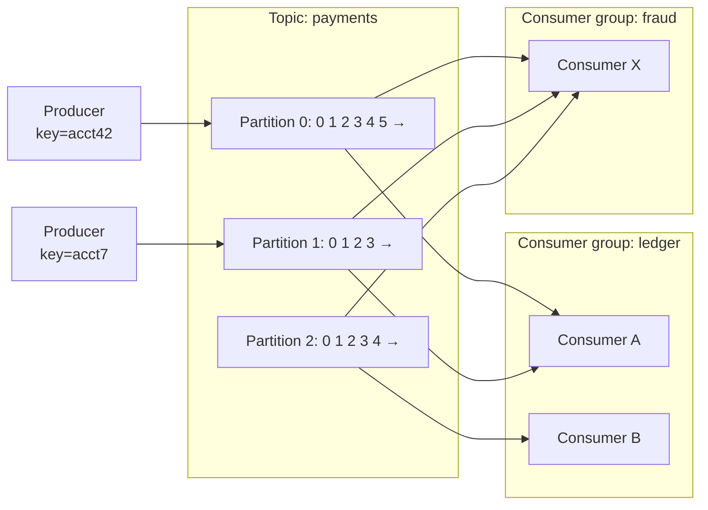
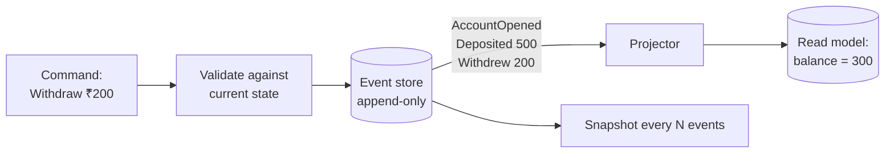
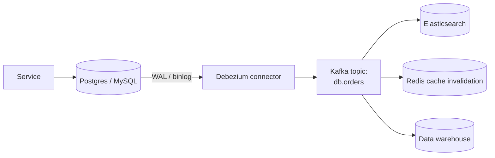

## TL;DR

- Queues **decouple** producers from consumers, **absorb spikes**, and let slow work happen in the background (emails, video encoding, payouts).
- **Queue (point-to-point):** each message goes to **one** consumer (a work queue). **Pub/sub:** each message goes to **every** subscriber group.
- **At-least-once + idempotent consumers** is the practical standard. "Exactly-once" only exists in narrow scopes.
- Failed messages are retried with backoff, then moved to a **dead-letter queue (DLQ)** for inspection.

## Why go async?

- **Faster responses:** only do the critical part synchronously.
- **Load levelling:** a 10× traffic spike fills the queue instead of crashing the workers.
- **Resilience:** if the email service is down, messages wait. Nothing is lost.
- **Fan-out:** one event, many independent consumers.

## Queue vs pub/sub

| | Queue (work queue) | Pub/Sub (topic) |
|---|---|---|
| Delivery | One consumer per message | Every subscription gets a copy |
| Use | Distribute jobs among workers | Broadcast events to many services |
| Examples | SQS, RabbitMQ queue, Celery | SNS, Kafka topics (per consumer group), Google Pub/Sub, RabbitMQ fanout exchange |

Kafka gives you **both**: within one consumer group it acts like a queue (partitions are split among consumers), and across groups it acts like pub/sub.

## Delivery semantics

| Guarantee | How | Risk | Use |
|---|---|---|---|
| **At-most-once** | Ack before processing | Lost messages | Metrics, logs where loss is OK |
| **At-least-once** ⭐ | Ack **after** processing; redeliver on timeout | **Duplicates** | Almost everything, combined with idempotency |
| **Exactly-once** | Idempotent producer + transactions (Kafka), or dedupe | Complexity; only within the broker's boundary | Stream processing (Kafka → Kafka); end to end you still dedupe |

> **Interview line:** "The broker gives at-least-once delivery, so consumers are idempotent. Each message has an ID and we record processed IDs, or the operation itself is idempotent. That gives us effectively-once processing."

## Retries, DLQ and poison messages

1. A consumer fails → the message becomes visible again (SQS visibility timeout) or is nacked.
2. Retry with **exponential backoff** (1 s, 2 s, 4 s…) so you don't hammer a struggling dependency.
3. After N attempts, move it to the **DLQ**, alert, and inspect it. Fix the bug and **redrive** the messages.
4. A **poison message** (bad data that always fails) must not block the queue, and the DLQ handles exactly that.

## Backpressure

When producers are faster than consumers:
- The queue grows. Monitor **queue depth / consumer lag** and alert.
- **Scale consumers** (up to the partition count for Kafka).
- **Shed or throttle** at the edge (return 429), drop low-priority work, and batch.
- Use bounded queues in memory, because unbounded ones end in OOM.

## Ordering

- Plain queues (SQS standard) don't guarantee order. **SQS FIFO** and **Kafka partitions** order messages **per key / message group**.
- **Global ordering doesn't scale.** Order per entity instead (per account, per chat, per order ID) by using it as the partition key.

## RabbitMQ vs SQS vs Kafka

| | RabbitMQ | AWS SQS | Kafka |
|---|---|---|---|
| Model | Broker with exchanges/queues, smart routing | Managed queue | **Distributed append-only log** |
| Messages after consumption | Deleted | Deleted | **Retained** (days or forever), so consumers can **replay** |
| Throughput | 10Ks/s per node | Practically unlimited (managed) | **Millions/s** across a cluster |
| Ordering | Per queue | FIFO queues (per group) | Per partition |
| Best for | Task queues, complex routing, RPC-style | Simple, serverless-friendly job queues | Event streaming, event sourcing, CDC, analytics, many consumers |

## Self-check

Why is at-least-once delivery the practical default, and what must consumers do?

It never loses messages: they're acked only after successful processing, at the cost of possible duplicates. Consumers must be **idempotent**, via a dedupe table of message IDs or naturally idempotent operations.

What is a dead-letter queue for?

It holds messages that failed after N retries, so they don't block the queue or retry forever. Engineers can inspect them, fix the issue and redrive them.

How do you keep all events for one bank account in order while still scaling?

Partition by `account_id`, as in a Kafka partition key or SQS FIFO message group. Ordering is guaranteed per account, and different accounts are processed in parallel across partitions.

---
id: kafka
title: Apache Kafka deep dive
module: msg
day: 27
minutes: 40
tags: star, kafka, partitions, consumer groups, offsets, isr, acks, exactly-once, retention, compaction
summary: Kafka's mental model (a partitioned, replicated log), producers and partition keys, consumer groups and offsets, replication and acks, ordering, exactly-once, retention and log compaction.
videos: ByteByteGo why is Kafka fast | Hello Interview Kafka deep dive | Confluent Apache Kafka 101 | Gaurav Sen Kafka
read: Hello Interview — Kafka deep dive => https://www.hellointerview.com/learn/system-design/deep-dives/kafka | Kafka — Introduction => https://kafka.apache.org/intro
---

## TL;DR

- Kafka is a **distributed, replicated, append-only log**. Messages are **kept** after being read (by retention time or size), so many consumers can read independently and **replay**.
- **Topic → partitions.** Each partition is an ordered log. **Ordering is only guaranteed within a partition.**
- The producer picks the partition by **key hash**: same key, same partition, so events for that key stay ordered.
- **Consumer group:** each partition is read by **exactly one** consumer in the group. Max parallelism = number of partitions.
- Durability: replication factor 3, `acks=all`, `min.insync.replicas=2`.

## The mental model

- Each message in a partition has an **offset** (0, 1, 2…).
- Each consumer group tracks **its own committed offset** per partition, so the `ledger` and `fraud` groups read the same data independently.
- Adding a consumer group adds **no** load on producers. That's the pub/sub superpower.

## Why Kafka is fast

1. **Sequential disk writes** (append-only), which are as fast as memory on modern disks.
2. **OS page cache:** recent data is served from memory.
3. **Zero-copy** (`sendfile`): data goes from disk to network without passing through the app.
4. **Batching + compression** of messages.
5. **Partitioning** spreads load horizontally across brokers.

## Producers

- **Key → partition:** `hash(key) % numPartitions`. No key means round-robin or sticky batching.
- `acks=0` (fire and forget), `acks=1` (leader wrote it), **`acks=all`** (all in-sync replicas wrote it, the safest option).
- **Idempotent producer** (`enable.idempotence=true`, the default in recent versions): the broker dedupes retries using a producer ID + sequence number, so a retry doesn't create a duplicate.
- **Changing the partition count changes key → partition mapping** and breaks per-key ordering for a while. Choose the count with headroom (e.g. 2–3× today's consumer needs).

## Consumers and consumer groups

- Partitions are spread among the group's consumers. With 6 partitions and 3 consumers, each consumer gets 2. A 7th consumer would sit **idle**.
- **Rebalance** happens when consumers join or leave. Partitions get reassigned and processing pauses briefly (newer cooperative rebalancing reduces this).
- **Offset commit:** commit **after** processing for at-least-once. Commit before processing gives at-most-once.
- **Consumer lag** = latest offset − committed offset. It's the #1 health metric.

## Replication and durability

- Each partition has a **leader** and **followers** on other brokers (replication factor, RF=3 typical).
- **ISR (in-sync replicas):** followers that are caught up. With `acks=all`, a write succeeds once all ISR members have it.
- `min.insync.replicas=2` with RF=3 means a write needs ≥2 copies, so it **tolerates 1 broker loss without losing data**.
- Leader election for partitions is done by the controller. Modern Kafka uses **KRaft** (Raft-based) instead of ZooKeeper.

## Exactly-once semantics (EOS)

- **Idempotent producer** (no duplicates from retries) + **transactions** (atomically write output messages **and** commit input offsets).
- Gives exactly-once for **Kafka → process → Kafka** pipelines (Kafka Streams, Flink).
- Side effects outside Kafka (DB writes, emails) still need **idempotency** on your side.

## Retention and compaction

- **Time/size retention:** keep 7 days (or forever, with tiered storage to S3).
- **Log compaction:** keep only the **latest value per key**. Good for changelogs and "current state" topics (user settings, account status). A null value is a tombstone, which deletes the key.

## Common interview uses

| Use | Why Kafka |
|---|---|
| Event bus between microservices | Decoupling, replay, many consumers |
| Activity tracking / clickstream | Massive throughput |
| CDC from databases (Debezium) | Ordered change log per table/key |
| Log and metrics pipelines | Buffer into Elasticsearch/S3 |
| Stream processing (fraud detection) | Kafka Streams / Flink with state |
| Payment events, ledger feeds | Ordering per account, durability, audit replay |

## Self-check

A topic has 4 partitions and your consumer group has 6 consumers. What happens?

Only 4 consumers get a partition and **2 sit idle**. Parallelism within a group is capped by the partition count.

How do you guarantee all events for an order are processed in sequence?

Use `order_id` as the message key so they all land in the same partition, which is ordered. One consumer in the group handles that partition sequentially.

What settings make Kafka writes durable against a single broker failure?

Replication factor 3, producer `acks=all`, and `min.insync.replicas=2` (plus the idempotent producer to avoid duplicates on retry).

How is Kafka different from RabbitMQ?

Kafka is a retained, partitioned log: consumers track offsets and can replay, throughput is very high, and ordering is per partition. RabbitMQ is a broker that deletes messages once acknowledged, with rich routing, better suited to task queues.

What is log compaction used for?

Keeping only the latest record per key, for "current state" changelog topics (e.g. account status). New consumers can rebuild the full current state without reading all history.

---
id: event-patterns
title: Event-driven patterns — Event Sourcing, CQRS & CDC
module: msg
day: 29
minutes: 30
tags: event sourcing, cqrs, cdc, debezium, event-driven, read model
summary: Storing changes instead of state (event sourcing), separating write and read models (CQRS), streaming database changes with CDC, and when each is worth the complexity.
videos: ByteByteGo event sourcing | ByteByteGo CQRS | Arpit Bhayani change data capture | Martin Fowler event driven architecture talk
read: Martin Fowler — Event Sourcing => https://martinfowler.com/eaaDev/EventSourcing.html | Martin Fowler — CQRS => https://martinfowler.com/bliki/CQRS.html | Debezium (CDC) => https://debezium.io
---

## TL;DR

- **Event sourcing:** store the **sequence of events** (`Deposited 500`, `Withdrew 200`), not just the current state. State = replaying the events. You get a perfect **audit trail**. Natural for **ledgers, trading and banking**.
- **CQRS:** separate the **write model** (commands, normalised, validated) from one or more **read models** (denormalised, query-optimised, e.g. Elasticsearch or Redis), kept in sync by events.
- **CDC (change data capture):** stream every DB change (from the WAL/binlog) into Kafka with **Debezium**. That keeps caches, search indexes and warehouses in sync without dual writes.
- All three bring **eventual consistency** and complexity. Use them where the benefit is clear.

## Event sourcing

- ✅ Full history and audit, "time travel" (state as of any date), debugging, rebuilding new read models later.
- ✅ Fits naturally with domains that are **already** event-based: accounting ledgers, order books, shipments.
- ❌ Hard: evolving event schemas, replay time (mitigated with **snapshots**), eventual consistency of read models, querying needs projections.
- **Don't** event-source a simple CRUD app.

## CQRS

- **Commands** (writes) go to the write side: validation, invariants, transactions.
- **Queries** (reads) go to read models shaped for each screen: a search index, a precomputed dashboard, a cached feed.
- They're synced via events, so reads lag slightly.
- Typical example: orders written to Postgres, and an `order_search` index in Elasticsearch (updated via CDC/Kafka) for the admin search page.
- CQRS **doesn't require** event sourcing (and vice versa), but they pair well.

## CDC with Debezium

- No dual writes: the DB commit is the single source of truth, and everything downstream follows its log.
- Ordered per row/key, and it captures deletes too.
- Also the cleanest way to implement the **outbox relay** (Day 25).

## When to use what

| Situation | Pattern |
|---|---|
| Need a full audit/history of every change (ledger, trades) | Event sourcing (or at least an append-only ledger table) |
| Read and write workloads very different (complex search over transactional data) | CQRS with a separate read store |
| Keep search/cache/warehouse in sync with the DB | CDC |
| Reliable event publishing from a service | Outbox + CDC |

## Self-check

Why is event sourcing a natural fit for a banking ledger?

Banking is already event-based (debits and credits). Storing immutable events gives a complete audit trail, the ability to reconstruct balances at any point in time, and easy reconciliation. Regulators require that history anyway.

How would you keep an Elasticsearch product index in sync with Postgres?

Use CDC (Debezium reads the Postgres WAL) → Kafka → an indexer service that upserts/deletes in Elasticsearch, idempotently by product ID. That avoids dual writes from the application.

What's the main cost of CQRS?

Eventual consistency between the write and read models (reads can lag), plus extra infrastructure and sync code to build and operate.

