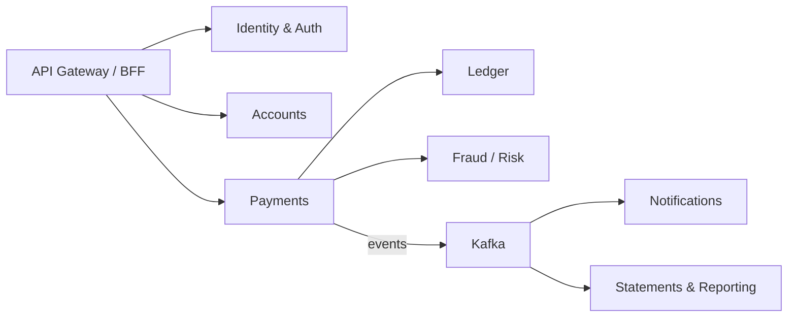
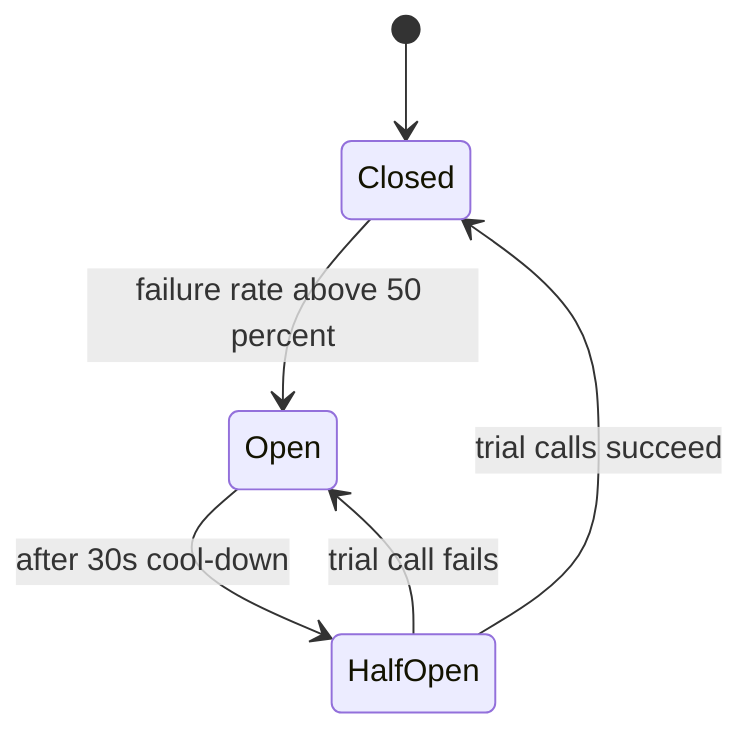
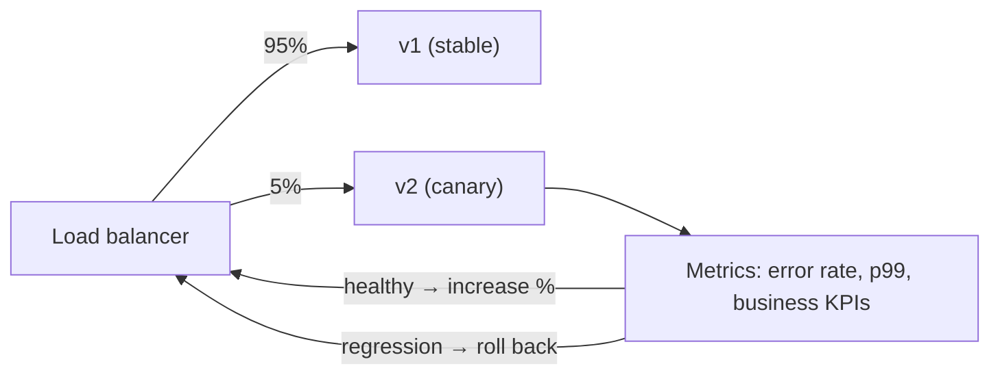

## TL;DR

- **Start with a (modular) monolith.** Split into microservices when **team size, independent deployability or very different scaling needs** demand it.
- Split by **business capability / bounded context** (Payments, Orders, Users), never by technical layer.
- **Database per service:** no other service touches your tables. Share data through **APIs or events**.
- **Sync (REST/gRPC)** for queries that need an answer now. **Async (events)** for side effects and decoupling.
- Every network hop adds latency and failure modes. You need tracing, retries, timeouts and circuit breakers (Day 31).

## Monolith vs microservices

| | Monolith | Microservices |
|---|---|---|
| Deploy | One unit | Each service independently |
| Scaling | Whole app | Per service (scale only the hot ones) |
| Data | One DB, easy joins and transactions | DB per service; sagas and eventual consistency |
| Team fit | Small teams (< ~20 engineers) | Many teams owning services end to end |
| Failure | One bug can take down everything | Isolated, but partial failures need handling |
| Ops | Simple | Needs CI/CD, observability, service mesh/discovery |
| Latency | In-process calls | Network calls |

> **Interview line:** "Given a team of ~10, I'd start with a modular monolith with clear module boundaries, and extract the Payment and Notification modules as services first, since they have distinct scaling and compliance needs."

## Finding boundaries — DDD in 3 ideas

1. **Bounded context:** a part of the domain with its own model and language. "Account" means different things in Payments (balance) and in Identity (login), so they're separate contexts.
2. **Aggregate:** a cluster of objects changed together in one transaction (an Order with its OrderLines). **Transactions shouldn't cross aggregates**, which keeps services independent.
3. **Context mapping:** how contexts talk (upstream/downstream, an anti-corruption layer when integrating a legacy core banking system).

Example for a bank:



## Communication styles

| | Synchronous (REST/gRPC) | Asynchronous (events/queues) |
|---|---|---|
| Coupling | Temporal coupling: both must be up | Decoupled in time |
| Latency | Adds to the caller's latency | Doesn't block the caller |
| Consistency | Immediate answer | Eventual |
| Use | "Is this card valid?", "Get user profile" | "Payment completed → send SMS, update rewards, analytics" |
| Danger | **Cascading failures**, long call chains | Harder debugging, duplicates, ordering |

Avoid **long synchronous chains** (A → B → C → D): availability multiplies (0.99⁴ ≈ 0.96) and latencies add up.

## Service discovery

How does the Payment service find the Ledger service's current IPs?
- **Server-side:** call a stable DNS name / load balancer (a Kubernetes Service, AWS ALB). This is the most common.
- **Client-side:** the client asks a registry (Eureka, Consul) and picks an instance itself (Spring Cloud / Netflix OSS style, which is still common in Java shops).
- **Service mesh** (Istio, Linkerd): a sidecar proxy next to each service handles discovery, mTLS, retries and metrics, with no library code needed.

## API gateway and BFF

- **API gateway:** a single entry point that handles auth, rate limiting and routing (Day 6).
- **BFF (Backend for Frontend):** a separate thin backend per client type (mobile BFF, web BFF) that aggregates and shapes data for that UI.

## Anti-patterns to name

- **Distributed monolith:** services that must be deployed together, or share a DB. You get all the pain and none of the benefit.
- **Chatty services:** 50 calls per page load. Aggregate, batch or cache instead.
- **Shared database** across services: hidden coupling.
- **Nano-services:** a service per function. Too much overhead.

## Self-check

<details>
<summary>Why should each microservice own its own database?</summary>

So services can change their schemas, scale and deploy independently without breaking others. A shared DB creates hidden coupling and turns the system into a distributed monolith.
</details>

<details>
<summary>When would you choose async events over a sync call between services?</summary>

When the caller doesn't need the result immediately (side effects like notifications, analytics, rewards), when you want resilience if the downstream is down, or when you need to fan out to many consumers.
</details>

<details>
<summary>What is a distributed monolith?</summary>

A system split into services that are still tightly coupled (shared DB, lock-step deployments, synchronous chains), so you pay the costs of distribution without the independence benefits.
</details>
---
id: resilience
title: Resilience — timeouts, retries, circuit breakers, rate limiting
module: micro
day: 31
minutes: 40
tags: star, timeout, retry, exponential backoff, jitter, circuit breaker, bulkhead, rate limiting, load shedding
summary: How to stop one slow dependency from taking down everything. Timeouts, retries with exponential backoff and jitter, circuit breakers, bulkheads, rate limiting, load shedding and graceful degradation.
videos: ByteByteGo circuit breaker | Hussein Nasser retries exponential backoff | ByteByteGo rate limiting algorithms | Gaurav Sen rate limiting
read: Martin Fowler — Circuit Breaker => https://martinfowler.com/bliki/CircuitBreaker.html | AWS Builders' Library — Timeouts, retries & backoff with jitter => https://aws.amazon.com/builders-library/timeouts-retries-and-backoff-with-jitter/ | Resilience4j docs => https://resilience4j.readme.io/docs
---

## TL;DR

- **Timeouts everywhere.** A call without a timeout can hang a thread forever.
- **Retry only idempotent operations**, with **exponential backoff + jitter** and a cap. Retries without backoff become a self-inflicted DDoS.
- **Circuit breaker:** after repeated failures, **stop calling** the sick dependency for a while and fail fast or use a fallback.
- **Bulkhead:** separate thread or connection pools per dependency, so one slow service can't exhaust everything.
- **Rate limiting / load shedding:** protect yourself by rejecting excess traffic early (429/503) instead of collapsing.
- In Java: **Resilience4j** does all of these. Say its name.

## The cascading failure story

The Ledger service slows to 10 s per call. The Payment service's threads all wait on Ledger, so its thread pool is exhausted. Now the Payment service can't serve anything, including requests that don't need Ledger. The API gateway's threads then wait on Payment… **one slow service has taken down the whole site.** Every pattern below breaks part of that chain.

## Timeouts

- Set **connect** and **read** timeouts on every HTTP/gRPC/DB call.
- Base them on the dependency's **p99 latency** plus some margin, not on "30 seconds by default".
- **Deadline propagation:** if the user request has 2 s total, pass the remaining budget downstream (gRPC deadlines) so you don't do work nobody will wait for.

## Retries done right

```
delay = min(cap, base × 2^attempt)  →  sleep(random(0, delay))   // "full jitter"
```

- **Exponential backoff** gives the dependency room to recover.
- **Jitter** stops thousands of clients retrying in sync (a thundering herd).
- **Retry budget:** e.g. retries ≤ 10% of requests, so retries never multiply load during an outage.
- **Retry only on retryable errors** (timeouts, 503, connection reset), never on 400 or 422.
- **Only idempotent operations**, or ones that carry an idempotency key (Day 4).
- Retry at **one layer only**. If 3 layers each retry 3×, you get 27× load.

## Circuit breaker



- **Closed:** calls flow normally and failures are counted.
- **Open:** calls fail **immediately** (or return a fallback) without touching the dependency. It gets time to recover, and your threads stay free.
- **Half-open:** let a few trial calls through. Success closes the circuit, failure re-opens it.
- **Fallbacks:** cached data, a default response, "try again later", or queuing the request for later.

## Bulkheads

Like a ship's watertight compartments: give each dependency **its own bounded thread pool, connection pool or semaphore**. If the Recommendation service hangs, only its 20 threads are stuck. Checkout keeps working.

## Rate limiting (protecting your service)

| Algorithm | How | ✅ / ❌ |
|---|---|---|
| **Token bucket** ⭐ | Bucket of N tokens refilled at rate R; each request takes one | Allows short bursts; the most common choice (AWS, Stripe) |
| Leaky bucket | Requests drain from a queue at a fixed rate | Smooth output; bursts get queued or dropped |
| Fixed window counter | Count per minute window | Simple; allows 2× bursts at window edges |
| Sliding window log | Store a timestamp per request | Accurate; memory heavy |
| **Sliding window counter** | Weighted current + previous window counts | Accurate enough, cheap |

Distributed rate limiting usually uses **Redis** (atomic `INCR` + `EXPIRE`, or a Lua script for the token bucket). Full design: the [rate limiter case study](#/item/rate-limiter).

## Load shedding and graceful degradation

- **Load shedding:** when overloaded, reject low-priority requests early (503) to keep the critical ones fast. E.g. keep "pay" working and shed "recommendations".
- **Graceful degradation:** turn off non-essential features (personalisation, reviews) via **feature flags** during incidents or peaks.
- **Queue-based levelling:** accept writes into a queue during spikes and process them steadily.

## Self-check

<details>
<summary>Why add jitter to exponential backoff?</summary>

Without jitter, all clients that failed at the same moment retry at the same moments (1 s, 2 s, 4 s…), creating synchronised spikes. Random jitter spreads the retries out.
</details>

<details>
<summary>Describe the three circuit-breaker states.</summary>

**Closed** (normal, counting failures) → **Open** (fail fast for a cool-down period after the failure threshold) → **Half-open** (allow a few trial calls: success → Closed, failure → Open).
</details>

<details>
<summary>What is a bulkhead and what failure does it prevent?</summary>

Isolated resource pools (threads/connections) per dependency. It stops one slow dependency from exhausting shared resources and taking down unrelated functionality.
</details>

<details>
<summary>Why are retries at multiple layers dangerous?</summary>

They multiply: 3 retries at each of 3 layers means up to 27 calls to the bottom service during an outage, which amplifies load exactly when it's struggling.
</details>

<details>
<summary>Which rate-limiting algorithm allows short bursts and why is it popular?</summary>

The token bucket. Tokens accumulate up to the bucket size, so a client can burst, while the refill rate enforces the long-run average. It's simple, cheap (two numbers per key) and intuitive.
</details>
---
id: deployments
title: Safe deployments — blue-green, canary, feature flags & DB migrations
module: micro
day: 32
minutes: 25
tags: blue-green, canary, rolling deployment, feature flags, expand-contract, migration
summary: How to ship changes to production without downtime or drama. Rolling, blue-green and canary deployments, feature flags, and the expand-contract pattern for schema changes.
videos: ByteByteGo deployment strategies | TechWorld with Nana blue green canary deployment | ByteByteGo feature flags
read: Martin Fowler — Blue-Green deployment => https://martinfowler.com/bliki/BlueGreenDeployment.html | Martin Fowler — Feature toggles => https://martinfowler.com/articles/feature-toggles.html
---

## TL;DR

- **Rolling:** replace instances a few at a time (the Kubernetes default).
- **Blue-green:** run old (blue) and new (green) side by side, flip all traffic at once, and keep blue for instant rollback.
- **Canary:** send 1% → 5% → 25% → 100% of traffic to the new version while watching metrics, and roll back automatically if they get worse.
- **Feature flags:** deploy code dark, then turn features on for some users. This **decouples deploy from release**.
- **Schema changes:** **expand → migrate → contract**, so old and new code both work during the rollout.

## Strategies compared

| Strategy | Rollback speed | Extra cost | Risk exposure | Notes |
|---|---|---|---|---|
| Recreate (stop all, start new) | slow | none | 100% + downtime | Avoid |
| **Rolling** | medium | small | grows gradually | Old and new run at the same time, so they must be compatible |
| **Blue-green** | **instant** (flip back) | 2× infra during deploy | 100% at the flip | Great for critical services |
| **Canary** | fast | small | **1–5% first** | Needs good metrics and automated analysis |
| Shadow / dark launch | n/a | extra compute | none (responses discarded) | Test the new version on mirrored real traffic |



## Feature flags

- `if (flags.isOn("new-checkout", user))`, toggled at runtime via LaunchDarkly, Unleash, or a config service.
- Uses: gradual rollout, A/B tests, kill switches during incidents, enabling per bank or partner.
- Hygiene: **remove old flags**, because flag debt makes code unreadable.

## Zero-downtime DB migrations: expand-contract

Renaming `users.name` to `full_name` with no downtime:
1. **Expand:** add `full_name` (nullable). Deploy code that **writes both** columns.
2. **Migrate:** backfill `full_name` from `name` in batches.
3. Switch reads to `full_name`.
4. **Contract:** stop writing `name`, then drop it in a later release.

Never ship a DB change that breaks the **currently running** code version. Tools: Flyway and Liquibase (standard in Java/Spring shops), plus gh-ost or pt-online-schema-change for large MySQL tables.

## Self-check

<details>
<summary>Canary vs blue-green: which limits blast radius, and which gives the fastest rollback?</summary>

Canary limits blast radius (only a small % of users sees the new version first). Blue-green gives the fastest full rollback (just flip traffic back to the old environment).
</details>

<details>
<summary>How do you rename a column without downtime?</summary>

Expand-contract: add the new column, dual-write, backfill, switch reads, stop writing the old column, and drop it later. Each step stays compatible with the code version running alongside it.
</details>

<details>
<summary>What does "decouple deploy from release" mean?</summary>

Code ships to production turned off behind a feature flag (deploy), and the feature is enabled later for chosen users (release). Risk goes down and rollbacks become a flag flip.
</details>
