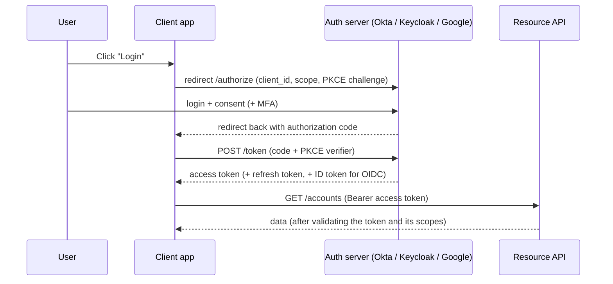
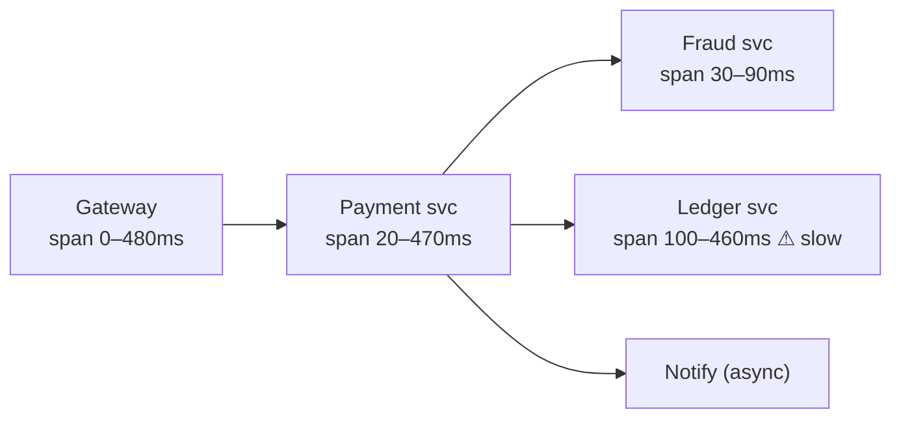

## TL;DR

- **Authentication (AuthN)** = who are you? **Authorization (AuthZ)** = what are you allowed to do?
- **Sessions:** the server stores state and the client holds a session ID cookie. Easy to revoke. **JWT:** a self-contained signed token, stateless to verify, hard to revoke, so keep it short-lived and add refresh tokens.
- **OAuth 2.0** = delegated **authorization** ("let this app access my data"). **OIDC** adds **identity** (login) on top.
- Encrypt **in transit** (TLS/mTLS) and **at rest** (AES-256, keys in a **KMS/HSM**). Never store card numbers or passwords in plain text.
- Banks and payment companies: **PCI-DSS**, **tokenization**, **audit logs**, **data residency** (RBI requires Indian payment data to be stored in India).

## Sessions vs JWT

| | Server session | JWT (access token) |
|---|---|---|
| Stored | Server (Redis) + cookie with an ID | Client; server just verifies the signature |
| Scale | Needs a shared session store | Stateless, so any server can verify |
| Revocation | Delete the session, instantly | Hard. Short expiry (5–15 min) + refresh token + denylist |
| Size | Tiny cookie | Bigger (claims) |
| Best for | Traditional web apps, banking portals | APIs, mobile, microservices |

**JWT structure:** `header.payload.signature` (base64url). The payload is **readable by anyone**, so never put secrets in it. Sign with RS256/ES256 (asymmetric) so services can verify using the public key.

**Storage on the web:** an `HttpOnly; Secure; SameSite` cookie protects against XSS token theft. Add CSRF protection with cookies.

## OAuth 2.0 / OIDC — the Authorization Code + PKCE flow

| Grant | Use |
|---|---|
| **Authorization Code + PKCE** | Web, mobile and SPA user login, the modern default |
| **Client Credentials** | Service-to-service (no user), e.g. a batch job calling an API |
| Refresh token | Get new access tokens without logging in again |
| ~~Implicit, Password~~ | Deprecated |

## Authorization models

- **RBAC:** roles → permissions (`TELLER` can view accounts, `MANAGER` can approve).
- **ABAC:** rules over attributes (`user.branch == account.branch AND amount < limit`).
- **ReBAC:** relationship-based (Google Zanzibar style: "editor of this doc's folder").
- Enforce authz **in each service** (defence in depth), not only at the gateway.

## Service-to-service security

- **mTLS** (often via a service mesh) so services prove identity to each other.
- **Client credentials OAuth / signed JWTs** with scopes per service.
- **Zero trust:** don't trust the internal network by default.

## Encryption and secrets

- **In transit:** TLS 1.2+ everywhere, mTLS internally for sensitive systems.
- **At rest:** disk/DB encryption, plus **field-level encryption** for PII (Aadhaar, PAN, card data).
- **Envelope encryption:** data is encrypted with a data key, and the data key is encrypted with a master key held in a **KMS/HSM**, so you can rotate master keys without re-encrypting everything.
- **Passwords:** never encrypt them. **Hash** with bcrypt, scrypt or Argon2 (salted, slow).
- **Secrets:** Vault, AWS Secrets Manager, Kubernetes Secrets (encrypted). Never commit them to Git.

## Payments-specific security (Visa / JPM / MS will love this)

- **PCI-DSS:** a standard for handling card data. Minimise **scope**: fewer systems that touch raw card numbers (PANs) means less audit burden.
- **Tokenization:** replace the PAN with a token (a random surrogate) stored in a secure vault. Most services only ever see tokens. **Network tokens** (Visa Token Service) replace card numbers in wallets and merchants.
- **3-D Secure / OTP, MFA** for strong customer authentication.
- **HSMs** for cryptographic keys and PIN operations.
- **Audit logs:** immutable, tamper-evident (append-only, hash-chained) records of who did what.
- **Fraud and risk checks** in the payment path (velocity rules, ML scoring).

## OWASP top risks to mention quickly

Broken access control (IDOR: changing `/accounts/123` to `/124`), injection (use parameterised queries), XSS, SSRF, security misconfiguration, vulnerable dependencies (scan with Snyk/Dependabot), and lack of rate limiting on login (brute force).

## Self-check

Why are JWTs hard to revoke and how do you mitigate it?

They're validated without a server lookup, so a stolen token works until it expires. Mitigate with short-lived access tokens (5–15 min), refresh-token rotation, and a denylist (by `jti`) for emergencies.

OAuth vs OIDC?

OAuth 2.0 is delegated **authorization** (access tokens for APIs). OIDC is an identity layer on top that adds **authentication**: an ID token with user identity claims and a userinfo endpoint.

What is tokenization and why does it reduce PCI-DSS scope?

Replacing the card number with a meaningless token, with the real PAN kept only in a hardened vault. Systems handling only tokens don't store cardholder data, so far fewer systems fall under PCI audit.

How should passwords be stored?

Hashed with a slow, salted algorithm (bcrypt, scrypt or Argon2), never encrypted or plain-hashed with SHA-256.

What is envelope encryption?

Data is encrypted with a data key, and the data key is encrypted by a master key in a KMS/HSM. Master keys never leave the KMS, and rotation only re-wraps data keys.

---
id: observability-reliability
title: Observability, SLOs & disaster recovery
module: ops
day: 34
minutes: 35
tags: observability, logs, metrics, tracing, sli, slo, sla, error budget, rpo, rto, multi-region, disaster recovery
summary: Logs, metrics and traces (and what each is for), RED/USE/golden signals, SLI/SLO/SLA and error budgets, alerting on symptoms, and disaster recovery with RPO/RTO and multi-region setups.
videos: ByteByteGo logging tracing metrics | ByteByteGo SLA SLO SLI | Hussein Nasser distributed tracing | ByteByteGo disaster recovery
read: Google SRE book (free) => https://sre.google/sre-book/table-of-contents/ | OpenTelemetry docs => https://opentelemetry.io/docs/
---

## TL;DR

- **Metrics** tell you **that** something is wrong (dashboards, alerts). **Logs** tell you **what** happened. **Traces** tell you **where** in the call chain it happened.
- Monitor the **4 golden signals**: latency, traffic, errors, saturation.
- **SLI** = the measurement (p99 latency), **SLO** = the target (99.9% of requests < 300 ms), **SLA** = the contract with penalties. The **error budget** = 100% − SLO.
- **Alert on user-facing symptoms** (error rate, latency), not on every CPU spike.
- **DR:** RPO = how much data you can lose, RTO = how fast you must recover. They drive backups, replication and multi-region design.

## The three pillars

| Pillar | What | Tools | Example question it answers |
|---|---|---|---|
| **Metrics** | Numeric time series (counters, gauges, histograms) | Prometheus + Grafana, Datadog, CloudWatch | "Is p99 latency of /pay above 500 ms?" |
| **Logs** | Timestamped events, **structured JSON** with a correlation ID | ELK/OpenSearch, Splunk (very common in banks), Loki | "Why did payment abc123 fail?" |
| **Traces** | One request's path across services, with timing per span | OpenTelemetry → Jaeger, Tempo, Zipkin | "Which service makes checkout slow?" |

**Correlation ID / trace ID:** generated at the edge and passed through every service and log line, so you can follow one request everywhere.

## What to measure

- **Golden signals** (Google SRE): **Latency** (p50/p95/p99, never just the average), **Traffic** (RPS), **Errors** (5xx rate), **Saturation** (CPU, memory, queue depth, connection pool usage).
- **RED** for services: Rate, Errors, Duration.
- **USE** for resources: Utilisation, Saturation, Errors.
- **Business metrics:** payments per minute, success rate per bank or issuer, orders per minute. Often the first sign of trouble.

> Why p99 and not the average? An average of 100 ms can hide 1% of users waiting 5 s, and at 10M requests/day that's 100K frustrated users.

## SLI / SLO / SLA and error budgets

- **SLI:** "the proportion of payment requests that succeed in < 1 s".
- **SLO:** "99.95% over a rolling 30 days".
- **SLA:** "99.9% or the customer gets credits". The SLA is always looser than the internal SLO.
- **Error budget:** 99.95% leaves 0.05% ≈ 21.6 min of failure a month. When the budget is spent, **freeze risky launches** and work on reliability.

## Availability maths

- **Serial dependencies multiply:** if the gateway (99.99%) calls a service (99.9%) that calls a DB (99.95%), you get ≈ **99.84%**.
- **Redundancy adds nines:** two independent 99% replicas give 1 − 0.01² = **99.99%**.
- So: avoid long synchronous chains, and make every tier redundant (no SPOFs).

## Disaster recovery

| Term | Meaning | Example target |
|---|---|---|
| **RPO** (Recovery Point Objective) | Max data loss, measured in time | Payments: ~0 (sync replication); analytics: 24 h |
| **RTO** (Recovery Time Objective) | Max downtime to recover | Core payments: minutes; internal reports: hours |

| DR strategy | RTO / RPO | Cost |
|---|---|---|
| Backup & restore | hours / hours | 💲 |
| Pilot light (minimal standby infra) | 10s of minutes | 💲💲 |
| Warm standby (scaled-down copy running) | minutes | 💲💲💲 |
| **Active-active multi-region** | ~0 / ~0 | 💲💲💲💲 + complexity (conflicts, data sync) |

- **Test backups**: restore them regularly. A backup you've never restored is just a hope.
- **Chaos engineering:** deliberately kill instances or zones (Netflix's Chaos Monkey) to prove resilience.
- Banks also run regulator-mandated **DR drills** and keep primary/DR data centres in different seismic zones.

## Self-check

Metrics vs logs vs traces: which do you use to find which microservice is slow?

**Traces.** They show per-span timing across services for a request. Metrics tell you latency is high overall, and logs give the details of specific events.

SLO is 99.9% monthly. What's the error budget in minutes?

0.1% of ~43,200 minutes ≈ **43 minutes** per month.

Three services in series, each 99.9% available. Overall?

0.999³ ≈ **99.7%** (about 2.2 hours of downtime a month).

RPO vs RTO?

RPO = how much data (in time) you can afford to lose. RTO = how long you can afford to be down while recovering.

Why alert on symptoms rather than causes?

Users feel symptoms (errors, latency). Cause-based alerts (CPU 80%) are noisy and often harmless, which leads to alert fatigue. Use cause metrics for diagnosis on dashboards.

