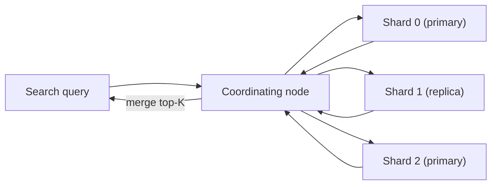
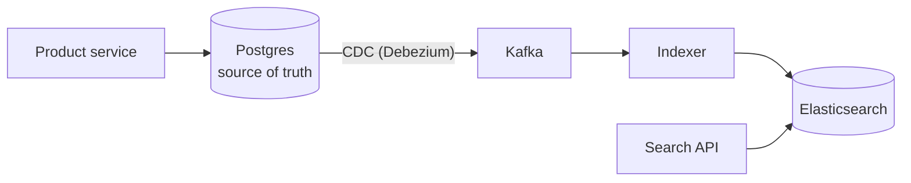
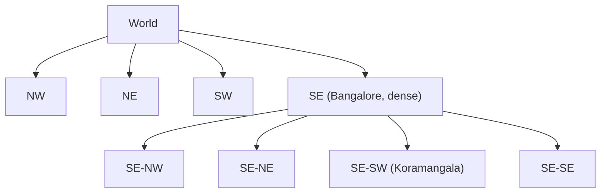
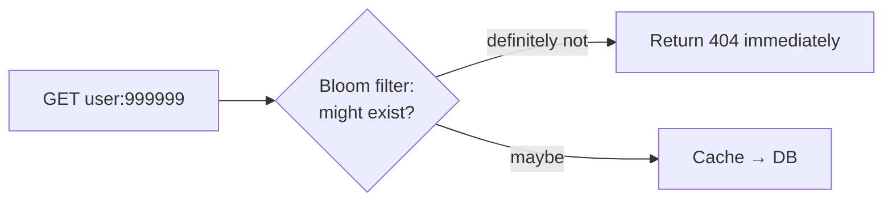
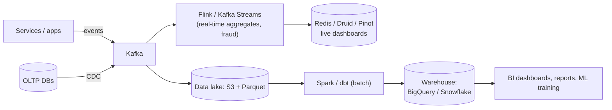

## TL;DR

- `LIKE '%shoe%'` can't use a normal index and scans everything. Search needs an **inverted index**: **term → list of documents containing it**.
- Text goes through an **analyzer**: tokenize → lowercase → remove stop words → stem ("running" → "run").
- Ranking: **TF-IDF / BM25** (rare words matter more), plus business signals (popularity, recency, personalisation).
- **Elasticsearch/OpenSearch** = a distributed inverted index: an index is split into **shards** with **replicas**, and new documents become searchable within ~1 s (**near-real-time**).
- **Elasticsearch is a secondary index, not the source of truth.** Feed it from the DB via **CDC/Kafka**.

## Inverted index

```
Doc1: "Red running shoes"      Doc2: "Blue shoes for kids"      Doc3: "Red kids jacket"

after analysis →
  red     → [Doc1, Doc3]
  run     → [Doc1]
  shoe    → [Doc1, Doc2]
  blue    → [Doc2]
  kid     → [Doc2, Doc3]
  jacket  → [Doc3]

query "red shoes" → intersect/union posting lists → Doc1 ranks highest (matches both)
```

## Ranking in one paragraph

**TF** (term frequency: how often the term appears in the document) × **IDF** (inverse document frequency: rarer terms across the corpus count more). **BM25** improves on TF-IDF by saturating TF (the 10th "shoe" adds little) and normalising for document length. Real products then **re-rank** with signals like sales, rating, CTR, freshness, personalisation, and often an ML model (learning to rank).

## Elasticsearch architecture



- An **index** is split into **primary shards** (fixed at creation, so choose carefully) with **replicas** for HA and read throughput.
- Query = **scatter-gather**: each shard returns its top K, and the coordinator merges them.
- Each shard is a **Lucene** index made of immutable **segments**. A refresh (~1 s) makes new docs searchable, and segments are merged in the background.
- Use **index aliases** for zero-downtime reindexing (build `products_v2`, then switch the alias).

## Keeping search in sync



- Idempotent upserts keyed by document ID, so replays are safe.
- Accept a short lag (seconds). That's normal for search.

## Features beyond basic search

- **Autocomplete:** edge n-grams or completion suggesters (see the [typeahead case](#/item/typeahead)).
- **Fuzzy matching / typos:** edit distance ("iphnoe" → "iphone").
- **Facets/aggregations:** "Brand: Nike (120), Puma (80)".
- **Geo queries:** "within 5 km".
- **Vector / semantic search:** embeddings + ANN indexes (HNSW) in Elasticsearch, OpenSearch, pgvector or Pinecone. Often **hybrid**: BM25 + vectors.

## Self-check

<details>
<summary>Why can't a normal B-tree index serve LIKE '%term%' efficiently?</summary>

A B-tree is sorted by the full value's prefix, and a leading wildcard means any position could match, so the DB must scan every row. An inverted index maps each term to its documents directly.
</details>

<details>
<summary>What does IDF capture?</summary>

How rare a term is across all documents. Rare terms ("biryani") are more discriminating than common ones ("the", "food"), so they contribute more to relevance.
</details>

<details>
<summary>Why shouldn't Elasticsearch be your source of truth?</summary>

It's eventually consistent (refresh interval), lacks multi-document transactions, and historically has had weaker durability guarantees. Keep the truth in a DB and build the search index from it (CDC), so it can always be rebuilt.
</details>
---
id: geo
title: Geospatial indexing — geohash, quadtree, S2/H3
module: special
day: 37
minutes: 30
tags: geohash, quadtree, s2, h3, proximity, location, redis geo, uber
summary: How "find drivers near me" works at scale. Why lat/long ranges don't index well, and how geohash, quadtrees and S2/H3 cells turn 2-D proximity into fast 1-D lookups.
videos: ByteByteGo proximity service | Gaurav Sen quadtree | Hello Interview Yelp | codeKarle Uber system design
read: Uber H3 => https://h3geo.org/ | Google S2 geometry => https://s2geometry.io/ | Geohash (Wikipedia) => https://en.wikipedia.org/wiki/Geohash
---

## TL;DR

- `WHERE lat BETWEEN … AND lng BETWEEN …` uses at most one index dimension well, so it's slow at scale.
- **Geohash:** encode lat/lng into a string where **a shared prefix means nearby** (`tdr1v…` is Bangalore). Search your cell plus its **8 neighbours**.
- **Quadtree:** recursively split the map into 4 until each cell has ≤ N points. Dense cities get small cells, empty areas big ones.
- **S2 (Google) / H3 (Uber):** hierarchical cells on a sphere (squares / hexagons). The production-grade choice.
- **Redis GEO** (`GEOADD`, `GEOSEARCH`) uses geohash internally. That's a quick win for live driver locations.

## Geohash

- Interleave the bits of latitude and longitude, then base32-encode the result. Each extra character means a **smaller cell**.

| Length | Cell size (approx.) |
|---|---|
| 4 | ~39 km × 20 km |
| 5 | ~5 km × 5 km |
| 6 | ~1.2 km × 0.6 km |
| 7 | ~150 m × 150 m |

- **Store** `geohash6` as an indexed column, or as a key prefix in Redis/Cassandra.
- **Query** "drivers within 1 km": compute the user's geohash6 → fetch points in that cell **plus the 8 neighbouring cells** (two nearby points can sit on opposite sides of a cell border) → compute exact distances → sort.
- ✅ Simple, works in any DB. ❌ Fixed cell sizes don't adapt to density, and there are edge effects near the poles.

## Quadtree



- Split a cell into 4 when it exceeds, say, 100 businesses. Usually **built in memory** on each server (~a few GB for hundreds of millions of points).
- Good for **mostly static** data (restaurants, shops, i.e. Yelp). Rebuild periodically or update incrementally.
- Less ideal for **highly dynamic** points (drivers moving every 4 s). There, geohash/H3 cells in Redis are simpler.

## S2 and H3

- **S2:** projects the sphere onto a cube and uses a Hilbert curve, giving 64-bit cell IDs at 30 levels. Region covering ("all cells within this circle") is built in.
- **H3 (Uber):** hexagonal cells. All neighbours are equidistant, which is great for **surge pricing zones, supply/demand heatmaps and ETA models**.
- Interview line: "I'll index driver locations by H3 cell at resolution ~8–9 in Redis, query the user's cell plus its ring of neighbours, then rank by ETA."

## Dynamic location updates (Uber-style)

- Drivers send a GPS ping every ~4 s. With 1M active drivers that's **250K writes/s**, so **don't write every ping to a SQL DB**.
- Keep the latest location in **Redis GEO / an in-memory cell index** (with a TTL so offline drivers vanish).
- Stream pings to **Kafka** for trip history, analytics and ETA model training.
- Partition the geo index by city/region.

## Self-check

<details>
<summary>Why do you search the 8 neighbouring geohash cells too?</summary>

A nearby point may sit just across a cell boundary, with a different prefix, while being metres away. Searching neighbours avoids missing it.
</details>

<details>
<summary>Quadtree vs geohash for Uber drivers vs Yelp restaurants?</summary>

Restaurants (static, uneven density): a quadtree adapts cell size to density and is built in memory. Drivers (constantly moving): geohash/H3 cells in Redis, where updates are a cheap key change.
</details>

<details>
<summary>Why not write every driver GPS ping to Postgres?</summary>

~250K writes/s of short-lived data would overwhelm a relational DB. Keep the latest position in memory (Redis GEO) and stream history to Kafka/cheap storage.
</details>
---
id: probabilistic
title: Probabilistic data structures & other system tricks
module: special
day: 38
minutes: 25
tags: bloom filter, count-min sketch, hyperloglog, top-k, merkle tree, skip list
summary: Bloom filters, Count-Min Sketch, HyperLogLog and Merkle trees. Tiny-memory structures that trade a little accuracy for huge savings, and exactly where each appears in system design answers.
videos: ByteByteGo bloom filter | Hussein Nasser bloom filters | ByteByteGo HyperLogLog | Gaurav Sen count-min sketch top k
read: Bloom filter (Wikipedia) => https://en.wikipedia.org/wiki/Bloom_filter | Cloudflare — Counting things at scale => https://blog.cloudflare.com/counting-things-a-lot-of-different-things/
---

## TL;DR

| Structure | Answers | Error type | Used in |
|---|---|---|---|
| **Bloom filter** | "Have I seen X?" | False positives only ("maybe"), **never false negatives** | Skip DB/disk lookups (Cassandra SSTables), web crawler URL dedupe, cache penetration, "username taken?" |
| **Count-Min Sketch** | "How many times has X appeared?" | Over-counts slightly | Heavy hitters / top-K (trending hashtags), rate limiting |
| **HyperLogLog** | "How many **distinct** X?" | ~0.8% error in ~12 KB | Unique visitors, distinct users per day (Redis `PFCOUNT`) |
| **Merkle tree** | "Which parts of two datasets differ?" | Exact | Replica anti-entropy (Cassandra, Dynamo), Git, blockchains, file sync |

## Bloom filter

- A bit array of m bits plus k hash functions.
- **Add X:** set the k bits at `hash_i(X)`.
- **Check X:** if **any** of those bits is 0, X is **definitely not** present. If all are 1, it's **maybe** present.
- Can't delete (use a **counting Bloom filter** if you need to).
- ~10 bits per element gives ~1% false positives. **1 billion URLs ≈ 1.2 GB**, compared with ~100 GB for storing the URLs themselves.



## Count-Min Sketch (top-K)

- A d × w grid of counters with d hash functions. To increment X, add 1 to one cell per row. To estimate X, take the **minimum** of its d cells (collisions only ever inflate counts).
- Combine with a **min-heap of size K** to track the current top-K: trending hashtags, most-played songs, hot keys in a cache.
- Usually done in **time windows** (per minute), with windows merged for "last hour".

## HyperLogLog

- Hashes each item and tracks the **maximum number of leading zeros** seen across buckets. Rare long zero runs suggest many distinct items.
- Fixed ~12 KB, mergeable (union of days → weekly uniques).
- "Unique visitors per page per day" for millions of pages fits cheaply in Redis.

## Merkle tree

- Leaves = hashes of data blocks. Each parent = the hash of its children. The root summarises everything.
- Two replicas compare roots. If they differ, walk down only the branches that differ, which finds mismatched ranges in O(log n) comparisons instead of shipping all the data.

## Skip list (bonus)

A sorted linked list with "express lanes", giving O(log n) search, insert and delete. It's how **Redis sorted sets** are implemented, and it's used in some memtables. Mention it when explaining why leaderboards are fast.

## Self-check

<details>
<summary>A Bloom filter says an item is present. Is it definitely present?</summary>

No, it's **maybe** present (a false positive is possible). If it says absent, the item is **definitely** absent.
</details>

<details>
<summary>How would you find the top 10 trending hashtags in the last 5 minutes over millions of tweets per minute?</summary>

Stream hashtags through Kafka → per-minute Count-Min Sketch + min-heap of size K per window (Flink/Kafka Streams, or a sharded aggregator) → merge the last 5 windows → cache the result. Exact counting for the final candidates can correct the CMS over-counting.
</details>

<details>
<summary>How do Cassandra replicas find which data differs without sending everything?</summary>

They build Merkle trees over token ranges, compare roots, and recurse only into subtrees whose hashes differ, then stream just those ranges (anti-entropy repair).
</details>
---
id: data-pipelines
title: Data pipelines — batch vs stream, warehouses & counting at scale
module: special
day: 39
minutes: 30
tags: batch, streaming, spark, flink, data warehouse, data lake, lambda architecture, kappa, analytics, etl
summary: How companies process events for analytics and real-time features. Batch vs streaming, Spark and Flink, data lakes vs warehouses, Lambda vs Kappa architectures, and counting things at huge scale.
videos: ByteByteGo batch vs stream processing | Hello Interview ad click aggregator | ByteByteGo data warehouse vs data lake | Confluent Kafka Streams Flink explained
read: Hello Interview — Ad click aggregator => https://www.hellointerview.com/learn/system-design/problem-breakdowns/ad-click-aggregator | Apache Flink => https://flink.apache.org
---

## TL;DR

- **Batch:** process big bounded datasets periodically (nightly). High throughput, high latency. **Spark**, Hadoop, dbt on a warehouse.
- **Stream:** process events continuously as they arrive. Seconds of latency. **Flink**, Kafka Streams, Spark Structured Streaming.
- **Data lake** (S3 + Parquet/Iceberg): cheap raw storage of everything. **Warehouse** (BigQuery, Snowflake, Redshift): structured, fast SQL analytics.
- **Lambda** = batch layer + speed layer (two codebases). **Kappa** = streaming only, replaying Kafka for reprocessing (simpler).
- **Never run analytics queries on your production OLTP database.** Ship events to a separate system.

## Typical modern pipeline



## Batch vs stream

| | Batch | Stream |
|---|---|---|
| Latency | minutes to hours | ms to seconds |
| Data | Bounded (yesterday's files) | Unbounded (continuous) |
| Correctness | Easy to recompute | Harder: late events, out-of-order data, exactly-once |
| Use | Daily reports, billing, reconciliation, ML training | Fraud detection, live dashboards, alerts, trending |

**Streaming concepts to name:**
- **Windows:** tumbling (fixed 1 min), sliding, session.
- **Event time vs processing time.**
- **Watermarks** (how long to wait for late events).
- **Checkpointing** for exactly-once state.

## Counting at scale (views, clicks, likes)

- Don't run `UPDATE videos SET views = views + 1` per view at 100K/s. That's a hot row.
- **Option 1:** increment in **Redis** (sharded counters), then periodically flush aggregates to the DB.
- **Option 2:** log events to **Kafka**, and have a stream job aggregate per (video, minute) and write the totals.
- Accept **approximate, slightly delayed** counts for display. Use **exact, reconciled** counts for anything billed (ad clicks are billed, so they get dedupe and reconciliation).

## OLTP vs OLAP

| | OLTP | OLAP |
|---|---|---|
| Workload | Many small reads/writes | Few huge scans and aggregations |
| Storage | Row-oriented | **Column-oriented** (read only the needed columns, compresses well) |
| Examples | Postgres, MySQL, Oracle | BigQuery, Snowflake, ClickHouse, Redshift, Druid, Pinot |

## Self-check

<details>
<summary>Why are columnar databases faster for analytics?</summary>

Analytics queries read a few columns across billions of rows. Columnar storage reads only those columns, compresses similar values extremely well, and supports vectorised processing.
</details>

<details>
<summary>Lambda vs Kappa architecture?</summary>

Lambda runs a batch layer (accurate, slow) and a speed layer (fast, approximate) and merges them, which means two codebases. Kappa uses a single streaming pipeline, and reprocessing means replaying the retained log (e.g. Kafka) through it.
</details>

<details>
<summary>How would you count YouTube views at 100K/s?</summary>

Don't update a DB row per view. Buffer in Redis sharded counters or aggregate Kafka events in a stream job per video per time window, then write periodic totals to the DB. Display counts may lag slightly. Dedupe bots and fraud for monetised counts.
</details>
