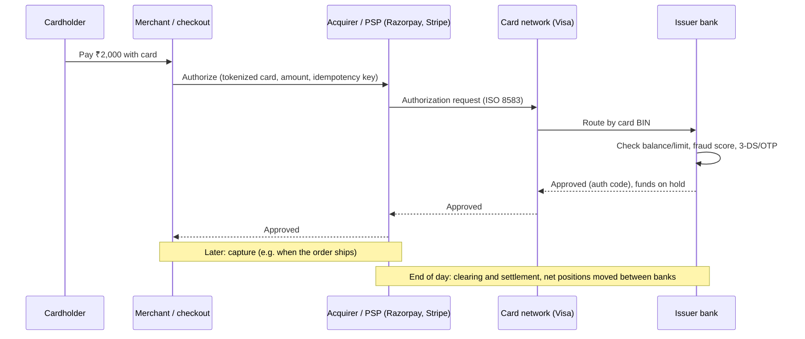
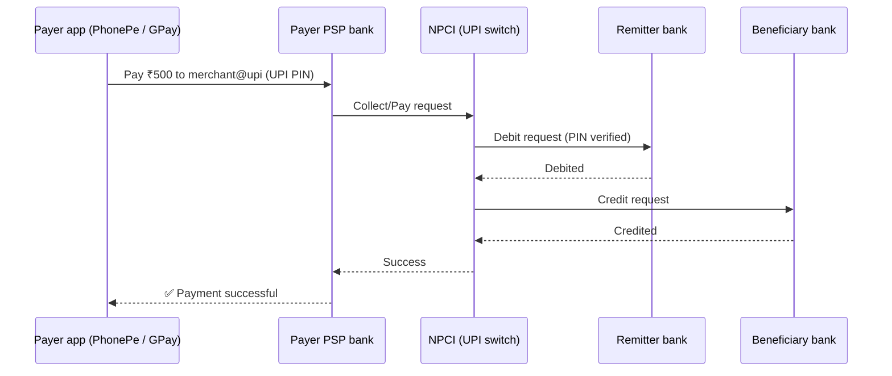
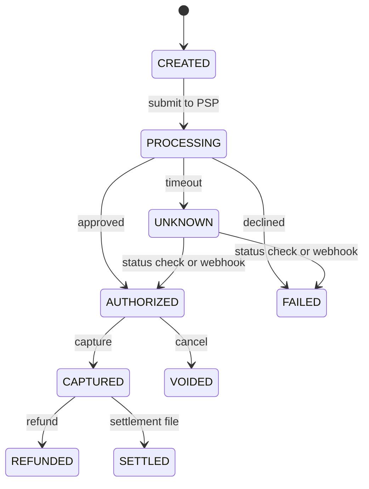
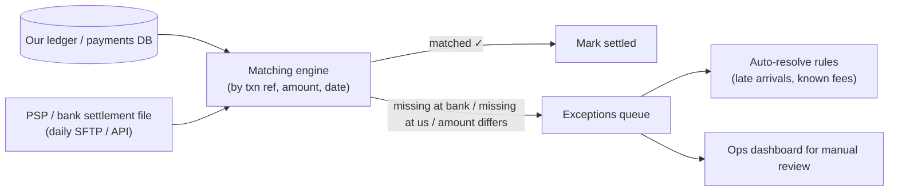
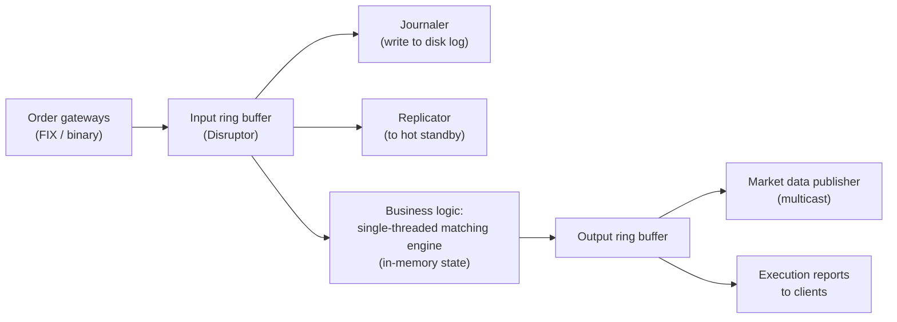

## TL;DR

- Card payments involve **5 parties**: **cardholder**, **merchant**, **acquirer** (merchant's bank / PSP), **card network** (Visa, Mastercard, RuPay), and **issuer** (cardholder's bank).
- Two phases: **authorization** (real-time: "is there money, is it fraud?", hold the funds) and **clearing & settlement** (batch, later: actually move the money between banks).
- **Auth → capture → settle → (refund / chargeback)**. Hotels and cabs **authorize first, capture later**.
- **UPI:** the payer's PSP app → NPCI → the banks. It's real-time and account-to-account, with no card network involved.
- Every step can time out, so you need **idempotency**, a **state machine**, **webhooks** and **reconciliation**.

## The card payment flow



### Key terms

| Term | Meaning |
|---|---|
| **Authorization** | The issuer approves and **holds** the amount (it isn't transferred yet). Seconds, real-time |
| **Capture** | The merchant confirms it wants the held money (immediately or later; partial capture is possible) |
| **Clearing** | Transactions exchanged between acquirer and issuer through the network (batch files) |
| **Settlement** | Actual money movement between banks, usually **T+1 / T+2**, then payout to the merchant |
| **Void / reversal** | Cancel an authorization before capture |
| **Refund** | Return money after capture (a new transaction) |
| **Chargeback** | The cardholder disputes with the issuer, and money is pulled back from the merchant |
| **PSP / payment gateway** | Razorpay, Stripe, PayU, Cashfree: merchant-facing APIs, often acting as the acquirer or connected to one |
| **BIN** | First 6–8 digits of the card number, identifying the issuer |
| **ISO 8583** | The message standard for card transactions between banks and networks |
| **Interchange / MDR** | Fees: the merchant pays MDR, part of which goes to the issuer as interchange |

> **What Visa actually is:** a **network** (VisaNet) that routes authorizations, runs clearing and settlement, and provides risk scoring and tokenization. It doesn't lend money or hold cardholder accounts; issuers do. Its scale is often quoted as tens of thousands of transactions per second at peak, with very high availability.

## UPI flow (India)



- **Pending / deemed-success states** are common when a bank times out. The system must **check status** and **auto-reverse** failed debits within the regulated time. That's why "money debited but payment failed" reconciliations exist.
- Real-time, 24×7, and very high volume (India processes on the order of hundreds of millions of UPI transactions a day).

## Payment state machine (design this explicitly)



- **Never treat a timeout as a failure.** The bank may have approved it. Move to UNKNOWN, then resolve via a **status-check API, a webhook, or the reconciliation file**.
- Transitions are **conditional updates** (`UPDATE … SET status='CAPTURED' WHERE id=? AND status='AUTHORIZED'`) so they can't happen twice.

## The 6 non-negotiables for any payment design

1. **Idempotency keys** on every money-moving API (Day 4).
2. **Exact money representation:** integers in minor units (paise) or `DECIMAL`, **never floating point**.
3. **Double-entry ledger** as the source of truth for balances (Day 44).
4. **Reconciliation** with PSP/bank settlement files, daily (Day 44).
5. **Async + retries + webhooks** with signature verification, plus idempotent webhook handlers.
6. **Security & compliance:** tokenization (no raw card numbers), PCI-DSS, encryption, audit logs, fraud checks.

## Self-check

<details>
<summary>Name the 5 parties in a card payment and the role of each.</summary>

Cardholder (pays), merchant (sells), acquirer/PSP (the merchant's bank/processor that sends the transaction), card network (Visa/Mastercard: routes, clears, settles), issuer (the cardholder's bank: approves and debits).
</details>

<details>
<summary>Authorization vs capture vs settlement?</summary>

Authorization = real-time approval and hold of funds. Capture = the merchant claims the held amount. Settlement = the actual interbank money movement later (batch, T+1/T+2), followed by payout to the merchant.
</details>

<details>
<summary>The call to the bank times out. Do you mark the payment failed?</summary>

No. Mark it **UNKNOWN/PENDING**, then resolve via a status-check API, a webhook, or the reconciliation file. Retry only with the **same idempotency key**, so a duplicate debit is impossible.
</details>

<details>
<summary>Why never use float/double for money?</summary>

Binary floating point can't represent most decimals exactly (0.1 + 0.2 ≠ 0.3), so rounding errors accumulate. Use integer minor units (paise/cents) or a fixed-precision DECIMAL / BigDecimal.
</details>
---
id: ledger-reconciliation
title: Ledgers, double-entry accounting & reconciliation
module: fintech
day: 44
minutes: 35
tags: star, ledger, double-entry, reconciliation, wallet, balance, audit, immutability
summary: How banks and fintechs store money correctly. The double-entry ledger, immutable journal entries, computing balances safely under concurrency, and daily reconciliation with external parties.
videos: ByteByteGo digital wallet design | Modern Treasury accounting for developers | ByteByteGo reconciliation payment system | Arpit Bhayani ledger design
read: Modern Treasury — Accounting for developers => https://www.moderntreasury.com/journal/accounting-for-developers-part-i | Martin Fowler — Accounting patterns => https://martinfowler.com/eaaDev/AccountingNarrative.html
---

## TL;DR

- **Double-entry:** every money movement creates **≥2 entries that sum to zero**: a debit on one account and a credit on another. Money is never created or destroyed by accident.
- The ledger is **append-only and immutable**. Mistakes are fixed with **new reversing entries**, never UPDATE/DELETE.
- **Balance** = the sum of entries. Cache it in a `balance` column updated **in the same transaction** as the entries, with a lock or version check.
- **Reconciliation:** regularly match your records against the bank's or PSP's settlement files and investigate mismatches. Every serious payment system has a recon pipeline.

## Double-entry in practice

A customer pays ₹1,000 to a merchant through your wallet, and you take a ₹20 fee:

| Journal entry `txn_789` | Account | Debit | Credit |
|---|---|---|---|
| | customer_wallet:42 | 1,000 | |
| | merchant_wallet:7 | | 980 |
| | platform_fee_revenue | | 20 |
| **Total** | | **1,000** | **1,000** ✅ balanced |

**Invariant:** for every transaction, Σ debits = Σ credits. You can check it with a DB constraint or by verifying at write time, and audit it continuously.

## Schema sketch

```sql
CREATE TABLE accounts (
  id BIGINT PRIMARY KEY, owner_id BIGINT, currency CHAR(3),
  type TEXT,                      -- ASSET / LIABILITY / REVENUE …
  balance_minor BIGINT NOT NULL DEFAULT 0,   -- cached, paise
  version BIGINT NOT NULL DEFAULT 0
);

CREATE TABLE ledger_transactions (
  id BIGINT PRIMARY KEY, idempotency_key TEXT UNIQUE,
  type TEXT, created_at TIMESTAMPTZ DEFAULT now()
);

CREATE TABLE ledger_entries (       -- append-only: no UPDATE/DELETE grants
  id BIGINT PRIMARY KEY,
  txn_id BIGINT REFERENCES ledger_transactions(id),
  account_id BIGINT REFERENCES accounts(id),
  direction CHAR(1) CHECK (direction IN ('D','C')),
  amount_minor BIGINT CHECK (amount_minor > 0),
  created_at TIMESTAMPTZ DEFAULT now()
);
```

## Posting a transfer safely

```sql
BEGIN;
-- lock both accounts in a consistent order (lower id first) to avoid deadlocks
SELECT id, balance_minor FROM accounts WHERE id IN (7, 42) ORDER BY id FOR UPDATE;
-- check: customer balance >= 1000 (else ROLLBACK → insufficient funds)
INSERT INTO ledger_transactions (id, idempotency_key, type) VALUES (789, 'abc-123', 'P2M');
INSERT INTO ledger_entries VALUES (…789, 42, 'D', 1000…), (…789, 7, 'C', 980…), (…789, 99, 'C', 20…);
UPDATE accounts SET balance_minor = balance_minor - 1000 WHERE id = 42;
UPDATE accounts SET balance_minor = balance_minor + 980  WHERE id = 7;
UPDATE accounts SET balance_minor = balance_minor + 20   WHERE id = 99;
COMMIT;
```

- A **unique idempotency key** makes retries safe.
- The **cached balance** is updated in the same ACID transaction, so it always equals Σ entries (verify that nightly).
- **Hot accounts** (the platform fee account, which gets thousands of writes/s) become a lock bottleneck. Fixes: **sub-accounts** (fee_account_0…15, summed for reporting), or **batch/async posting** for non-customer accounts.

## Scaling a ledger

- **Shard by account_id.** But a transfer between accounts on two shards isn't a single transaction any more, so use a **saga** with a clearing/suspense account: debit A → credit suspense → credit B, each step idempotent.
- Or use a distributed SQL DB (Spanner, CockroachDB, YugabyteDB) that handles cross-shard ACID internally.
- Specialised ledger DBs exist (TigerBeetle). Name-dropping them shows awareness.
- **Archive** old entries to cold storage but keep them queryable for audits (regulators often require 7–10 years).

## Reconciliation



- **Three-way recon** is common: internal ledger ↔ PSP report ↔ bank statement.
- Typical breaks: our status FAILED but the bank debited (refund or credit it), timing differences (T+1), fees, currency rounding, duplicates.
- Run it as a **batch job** (Spark or plain SQL) daily, plus near-real-time checks for high-value flows.

## Self-check

<details>
<summary>What is the double-entry invariant and why is it useful?</summary>

For every transaction, total debits equal total credits (entries sum to zero). Money can't appear or vanish by bug, the books always balance, and errors are detectable by audit.
</details>

<details>
<summary>A ledger entry was posted with the wrong amount. How do you fix it?</summary>

Never UPDATE or DELETE. Post a **reversing transaction** that cancels the wrong entries, then post the correct transaction. Both remain in the history for audit.
</details>

<details>
<summary>How do you prevent overspending when two withdrawals hit the same wallet at once?</summary>

In one DB transaction: `SELECT … FOR UPDATE` the account row (or use a conditional update `WHERE balance >= amount`, or a version check), verify funds, insert the entries and update the balance. The second transaction waits and then sees the reduced balance.
</details>

<details>
<summary>What is reconciliation, and give two typical mismatches.</summary>

Matching internal records against external statements (PSP/bank) to find discrepancies. Examples: the bank debited the customer but our system marked the payment failed. A settlement amount differs because of fees or rounding. A transaction appears on only one side because of timing.
</details>
---
id: low-latency-trading
title: Low-latency & trading systems (for investment banks)
module: fintech
day: 46
minutes: 30
tags: trading, low latency, order book, matching engine, lmax, disruptor, market data, morgan stanley, jp morgan
summary: What makes trading systems different. Latency budgets, the single-threaded matching engine, LMAX Disruptor, market data fan-out, event sourcing for replay, and the Java tuning words investment banks use.
videos: ByteByteGo stock exchange design | Martin Thompson mechanical sympathy LMAX | ByteByteGo how stock exchanges work | Jane Street low latency talk
read: Martin Fowler — The LMAX architecture => https://martinfowler.com/articles/lmax.html | LMAX Disruptor => https://lmax-exchange.github.io/disruptor/ | Hello Interview — Robinhood => https://www.hellointerview.com/learn/system-design/problem-breakdowns/robinhood
---

## TL;DR

- Trading systems optimise for **predictable low latency** (microseconds) and **determinism**, not only throughput.
- The core **matching engine** is often **single-threaded** per instrument: no locks, cache-friendly, and deterministic, so it can be **replayed**.
- **LMAX Disruptor:** a lock-free **ring buffer** for passing events between threads at millions of operations per second.
- **Event sourcing / journaling:** every input order is written to a sequenced log, so state can be rebuilt by replay, and a hot standby replays the same log.
- Market data goes out over **multicast/UDP** to many subscribers.
- Banks like JPMorgan, Morgan Stanley and Goldman have many teams building **order management, risk, market data and post-trade** systems. You don't need HFT knowledge, but these ideas impress.

## Where latency goes

| Layer | Typical cost | Fix |
|---|---|---|
| Network across a city | ~ms | Colocation in the exchange data centre |
| Kernel network stack | ~10s of µs | Kernel bypass (DPDK, Solarflare/OpenOnload) |
| Locks / context switches | µs | Single-threaded design, busy-spin, CPU pinning |
| GC pauses (Java) | ms (can spike) | Allocation-free hot paths, object pools, low-pause GCs (ZGC/Shenandoah), off-heap memory |
| Cache misses | ~100 ns each | Contiguous arrays, avoid pointer chasing ("mechanical sympathy") |
| Serialization | µs | Binary formats (SBE, FlatBuffers), no JSON on the hot path |

## Order book and matching (brief; full design in the case study)

- Each instrument (e.g. RELIANCE) has a **buy side** (bids, highest first) and a **sell side** (asks, lowest first).
- **Price-time priority:** the best price matches first, and at the same price the earliest order goes first.
- Data structure: a sorted map of price levels (TreeMap or arrays indexed by tick), each level a **FIFO queue** of orders, plus a `HashMap<orderId, Order>` for O(1) cancels.

## LMAX-style architecture



- Inputs are **sequenced** once. Journaling and replication happen **in parallel** with processing.
- All state lives **in memory**, and recovery = snapshot + replay of the journal.
- A single thread processing ~millions of events/s beats a multi-threaded design full of lock contention.

## Other investment-bank system topics to recognise

- **OMS (Order Management System):** order lifecycle, routing to exchanges, FIX protocol.
- **Risk systems:** pre-trade risk checks (limits, exposure) **in the order path** with microsecond budgets, plus end-of-day risk batch jobs (VaR on large grids).
- **Market data:** normalise feeds from many exchanges, conflate updates for slow consumers.
- **Post-trade:** confirmation, clearing, settlement, reconciliation, regulatory reporting (big batch and ETL workloads, often Java + Kafka + Oracle/Sybase/kdb+).

## Self-check

<details>
<summary>Why are matching engines often single-threaded?</summary>

They avoid locks and context switches, keep data hot in CPU caches, and are **deterministic**: the same input sequence always gives the same output, which enables replay-based recovery and hot standbys.
</details>

<details>
<summary>What is the LMAX Disruptor?</summary>

A lock-free, pre-allocated ring buffer for inter-thread messaging using sequence counters instead of locks, giving very low-latency, high-throughput event passing (e.g. gateway → journal → engine).
</details>

<details>
<summary>How do you reduce GC impact in a low-latency Java service?</summary>

Avoid allocations on the hot path (reuse objects, use primitive collections, object pools), use off-heap buffers, size the heap well, and use low-pause collectors like ZGC or Shenandoah. Measure p99.9 latency.
</details>
