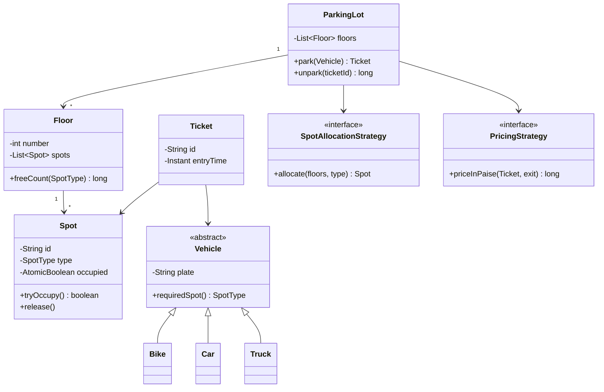
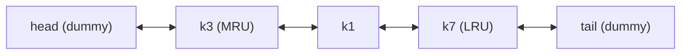
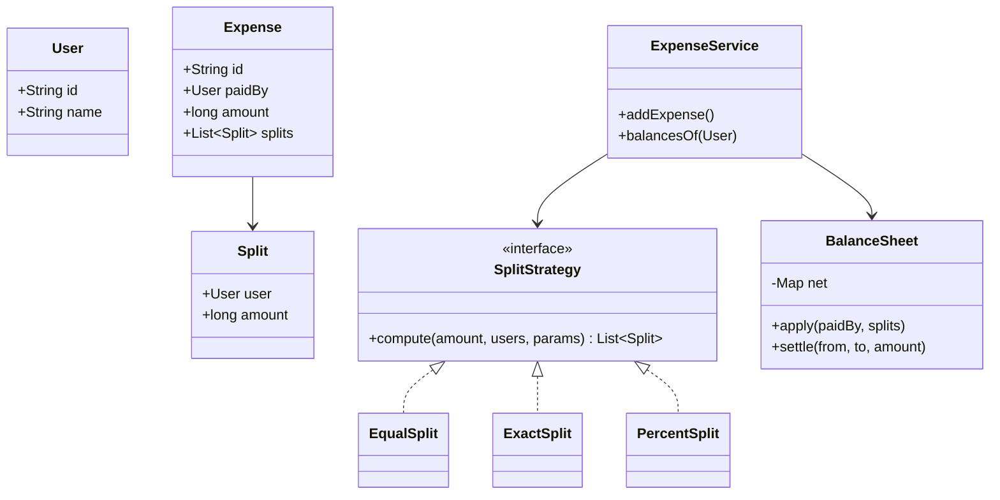
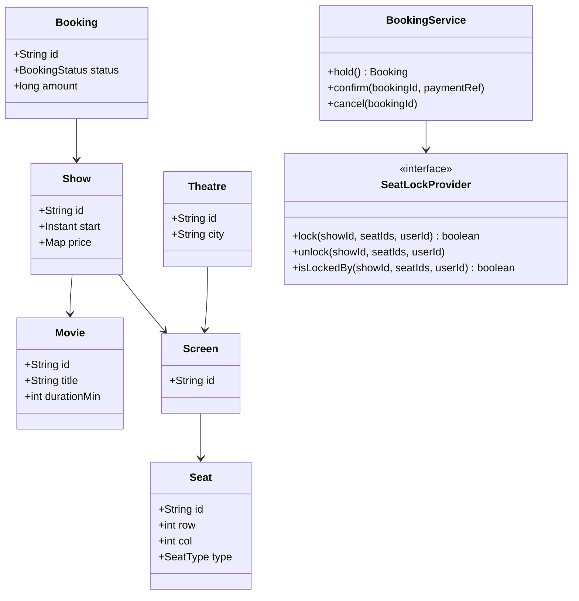
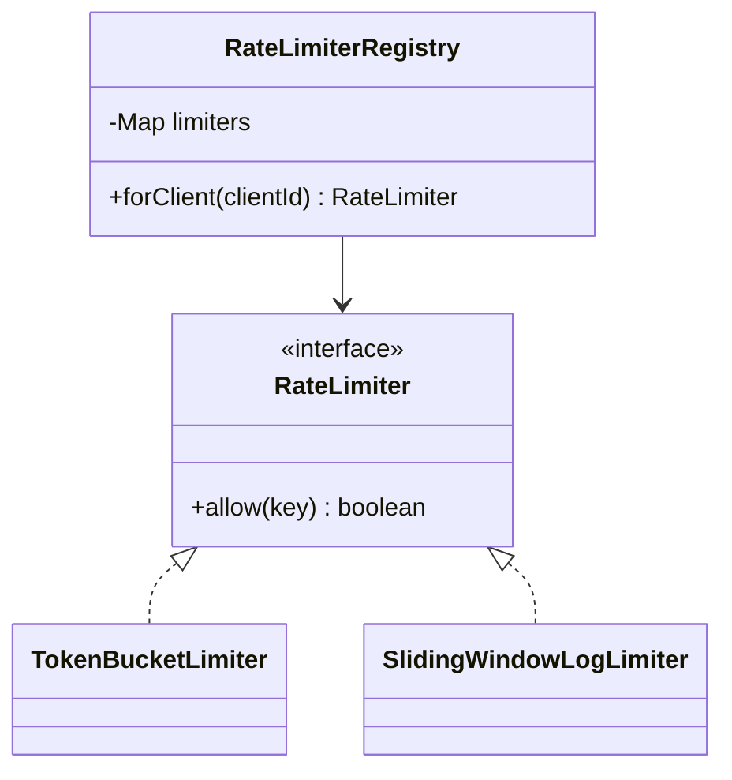
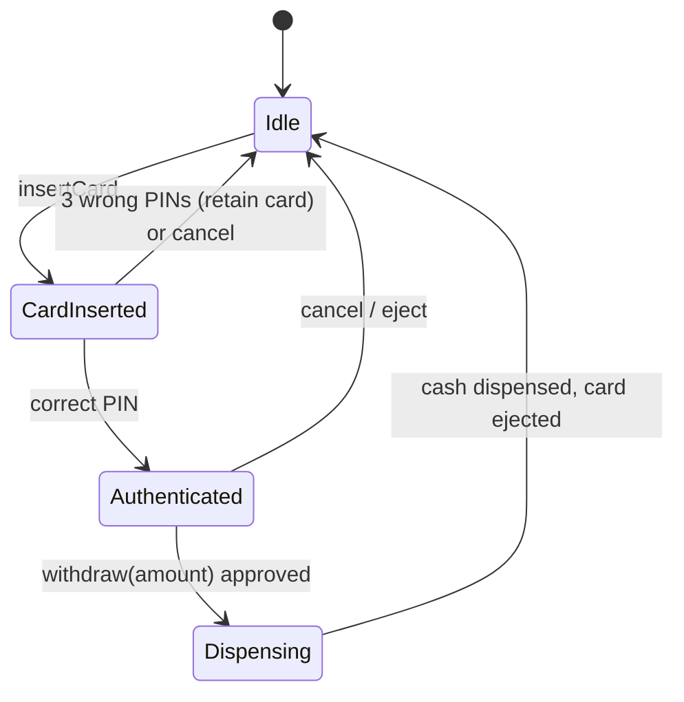

## Requirements (agree on these first)

- Multiple **floors**. Each has spots of types **SMALL (bike), MEDIUM (car), LARGE (truck/bus)**, plus EV charging if asked.
- **Entry:** assign the nearest suitable free spot and issue a **ticket**. **Exit:** compute the fee, take payment, free the spot.
- Pricing **per hour by vehicle type** (it should be swappable).
- A display of free spots per floor and type.
- **Concurrent** entries at multiple gates must never assign the same spot.
- Out of scope: reservations, a membership system.

## Class diagram



## Core code

```java
enum SpotType { SMALL, MEDIUM, LARGE }

abstract class Vehicle {
    private final String plate;
    protected Vehicle(String plate) { this.plate = plate; }
    public String plate() { return plate; }
    public abstract SpotType requiredSpot();
}
class Bike extends Vehicle  { Bike(String p)  { super(p); } public SpotType requiredSpot() { return SpotType.SMALL; } }
class Car extends Vehicle   { Car(String p)   { super(p); } public SpotType requiredSpot() { return SpotType.MEDIUM; } }
class Truck extends Vehicle { Truck(String p) { super(p); } public SpotType requiredSpot() { return SpotType.LARGE; } }

class Spot {
    private final String id; private final SpotType type;
    private final AtomicBoolean occupied = new AtomicBoolean(false);
    Spot(String id, SpotType type) { this.id = id; this.type = type; }
    boolean tryOccupy() { return occupied.compareAndSet(false, true); }   // atomic: one winner
    void release()      { occupied.set(false); }
    boolean isFree()    { return !occupied.get(); }
    SpotType type()     { return type; }
    String id()         { return id; }
}

record Floor(int number, List<Spot> spots) {
    long freeCount(SpotType t) { return spots.stream().filter(s -> s.type() == t && s.isFree()).count(); }
}

record Ticket(String id, Vehicle vehicle, Spot spot, Instant entryTime) {}

interface SpotAllocationStrategy { Optional<Spot> allocate(List<Floor> floors, SpotType type); }

class NearestFirstStrategy implements SpotAllocationStrategy {
    public Optional<Spot> allocate(List<Floor> floors, SpotType type) {
        for (Floor f : floors)                       // floors sorted by distance from the entrance
            for (Spot s : f.spots())
                if (s.type() == type && s.tryOccupy()) return Optional.of(s);
        return Optional.empty();
    }
}

interface PricingStrategy { long priceInPaise(Ticket t, Instant exit); }

class HourlyPricing implements PricingStrategy {
    private final Map<SpotType, Long> ratePerHour = Map.of(SpotType.SMALL, 2_000L, SpotType.MEDIUM, 5_000L, SpotType.LARGE, 10_000L);
    public long priceInPaise(Ticket t, Instant exit) {
        long hours = Math.max(1, (Duration.between(t.entryTime(), exit).toMinutes() + 59) / 60);   // round up, min 1h
        return hours * ratePerHour.get(t.spot().type());
    }
}

class ParkingLot {
    private final List<Floor> floors;
    private final SpotAllocationStrategy allocator;
    private final PricingStrategy pricing;
    private final Map<String, Ticket> active = new ConcurrentHashMap<>();

    ParkingLot(List<Floor> floors, SpotAllocationStrategy a, PricingStrategy p) { this.floors = floors; this.allocator = a; this.pricing = p; }

    public Ticket park(Vehicle v) {
        Spot spot = allocator.allocate(floors, v.requiredSpot())
                             .orElseThrow(() -> new IllegalStateException("No " + v.requiredSpot() + " spot free"));
        Ticket t = new Ticket(UUID.randomUUID().toString(), v, spot, Instant.now());
        active.put(t.id(), t);
        return t;
    }

    public long unpark(String ticketId) {
        Ticket t = active.remove(ticketId);                 // remove first, so a double exit is impossible
        if (t == null) throw new IllegalArgumentException("Invalid or used ticket");
        long fee = pricing.priceInPaise(t, Instant.now());
        t.spot().release();
        return fee;
    }
}
```

## Discussion points the interviewer will push on

- **Concurrency:** `compareAndSet` per spot means two gates can't take the same spot, and there's no global lock. `ConcurrentHashMap.remove` makes a double exit impossible.
- **Extensibility:** a new vehicle type is a new subclass. A new allocation rule (EV first, by floor preference) is a new Strategy. Weekend pricing is a new PricingStrategy.
- **Performance:** scanning all spots is O(N). Improve it with a **free-spot queue per (floor, type)**: `ConcurrentLinkedQueue<Spot>`, where `poll()` gives a free spot in O(1) and `release()` offers it back.
- **Singleton?** You could make ParkingLot a singleton, but prefer DI for testability.
- **Persistence/scale:** with multiple gates as separate machines, move state to a DB with `UPDATE spots SET occupied=true WHERE id=? AND occupied=false`.
- **Display board:** Observer. Spots publish occupancy changes to board listeners.

## Self-check

<details>
<summary>How do you make spot allocation O(1) instead of scanning every spot?</summary>

Keep a concurrent queue of free spots per (floor, spot type). Allocation polls from the queue (nearest floor first) and release offers the spot back.
</details>

<details>
<summary>What prevents two exit gates from processing the same ticket twice?</summary>

`ConcurrentHashMap.remove(ticketId)` is atomic. Only the first caller gets the ticket, and the second gets null and is rejected.
</details>
---
id: lld-lru-cache
title: LLD — LRU Cache (and thread-safe version)
day: 54
minutes: 30
tags: lld, lru, cache, hashmap, doubly linked list, concurrency
summary: Design an O(1) get/put LRU cache with a HashMap plus a doubly linked list, then make it thread-safe and discuss TTL and LFU extensions. Asked in both DSA and LLD rounds.
videos: NeetCode LRU cache | Concept && Coding LRU cache design | Back To Back SWE LRU cache
read: LeetCode 146 — LRU Cache => https://leetcode.com/problems/lru-cache/
---

## Requirements

- `get(key)` returns the value (or -1/null) and marks it **most recently used**.
- `put(key, value)` inserts or updates. When over **capacity**, evict the **least recently used** entry.
- Both in **O(1)**. Then: thread-safety, TTL, eviction listener, generic types.

## Idea

- **HashMap<K, Node>** finds a node in O(1).
- A **doubly linked list** keeps recency order: the most recent at the head and the LRU at the tail. Moving or removing a node is O(1) when you hold a reference to it.



## Code

```java
public class LRUCache<K, V> {
    private final class Node { K key; V val; Node prev, next; Node(K k, V v) { key = k; val = v; } }

    private final int capacity;
    private final Map<K, Node> map = new HashMap<>();
    private final Node head = new Node(null, null), tail = new Node(null, null);

    public LRUCache(int capacity) {
        if (capacity <= 0) throw new IllegalArgumentException("capacity must be > 0");
        this.capacity = capacity; head.next = tail; tail.prev = head;
    }

    public synchronized V get(K key) {
        Node n = map.get(key);
        if (n == null) return null;
        moveToFront(n);
        return n.val;
    }

    public synchronized void put(K key, V val) {
        Node n = map.get(key);
        if (n != null) { n.val = val; moveToFront(n); return; }
        if (map.size() == capacity) { Node lru = tail.prev; unlink(lru); map.remove(lru.key); }
        n = new Node(key, val); map.put(key, n); addFront(n);
    }

    private void moveToFront(Node n) { unlink(n); addFront(n); }
    private void unlink(Node n) { n.prev.next = n.next; n.next.prev = n.prev; }
    private void addFront(Node n) { n.next = head.next; n.prev = head; head.next.prev = n; head.next = n; }
}
```

**Shortcut worth mentioning:** `LinkedHashMap` with `accessOrder=true` and an overridden `removeEldestEntry` gives you an LRU in about 5 lines. Interviewers usually want the manual version first, then appreciate you knowing this.

```java
class LruMap<K,V> extends LinkedHashMap<K,V> {
    private final int cap; LruMap(int cap) { super(16, 0.75f, true); this.cap = cap; }
    @Override protected boolean removeEldestEntry(Map.Entry<K,V> e) { return size() > cap; }
}
```

## Thread safety options

| Option | Pros | Cons |
|---|---|---|
| `synchronized` methods (above) | Simple, correct | One lock means contention under heavy load |
| `ReentrantLock` | Same, with tryLock/timeouts | Same contention |
| **Segmented / striped** (N independent LRUs by key hash) | Scales across cores | LRU is per segment (approximate globally) |
| Use **Caffeine** | Production-grade (W-TinyLFU, async) | It's a library, so not what they want you to code |

Note: even `get` mutates the list, so a read-write lock **doesn't** help a plain LRU.

## Extensions

- **TTL:** store `expiresAt` in the Node, treat expired entries as misses on `get`, and run a background sweeper (`ScheduledExecutorService`).
- **LFU:** a frequency → doubly-linked-list map plus a `minFreq` pointer gives O(1) (LeetCode 460).
- **Eviction listener:** Observer callback `onEvict(key, value)`.
- **Distributed:** this is what each Redis/Memcached node does internally. Across nodes, use consistent hashing (Day 13).

## Self-check

<details>
<summary>Why a doubly linked list rather than a singly linked one?</summary>

To remove an arbitrary node in O(1) you need its predecessor. A doubly linked list gives `prev` directly, and the map gives you the node.
</details>

<details>
<summary>Why doesn't a ReadWriteLock help a standard LRU cache?</summary>

`get` also modifies the recency list (moves the node to the front), so every operation is a write.
</details>
---
id: lld-splitwise
title: LLD — Splitwise (expense sharing)
day: 55
minutes: 40
tags: lld, splitwise, strategy, balance sheet, debt simplification
summary: Users, groups, expenses with equal/exact/percent splits (Strategy pattern), a balance sheet, and simplifying debts with a greedy heap algorithm. Uses paise to avoid rounding errors.
videos: Concept && Coding splitwise low level design | Udit Agarwal splitwise machine coding | Gaurav Sen splitwise debt simplification
read: Awesome LLD — Splitwise => https://github.com/ashishps1/awesome-low-level-design
---

## Requirements

- Users and groups. Add an expense: **who paid, amount, participants, split type** (EQUAL, EXACT, PERCENT).
- Show **balances**: who owes whom, per user and per group.
- **Settle up** (record a payment between two users).
- Bonus: **simplify debts** (minimise the number of transactions).
- Money in **paise (long)**. Splits must add up exactly, with any leftover paisa assigned deterministically.

## Classes



## Core code

```java
record User(String id, String name) {}
record Split(User user, long amountPaise) {}

interface SplitStrategy { List<Split> compute(long amount, List<User> users, List<Double> params); }

class EqualSplit implements SplitStrategy {
    public List<Split> compute(long amount, List<User> users, List<Double> ignored) {
        long base = amount / users.size(), rem = amount % users.size();
        List<Split> out = new ArrayList<>();
        for (int i = 0; i < users.size(); i++) out.add(new Split(users.get(i), base + (i < rem ? 1 : 0)));  // spread leftover paise
        return out;
    }
}

class PercentSplit implements SplitStrategy {
    public List<Split> compute(long amount, List<User> users, List<Double> pct) {
        if (Math.abs(pct.stream().mapToDouble(Double::doubleValue).sum() - 100.0) > 1e-9) throw new IllegalArgumentException("Percents must sum to 100");
        List<Split> out = new ArrayList<>(); long assigned = 0;
        for (int i = 0; i < users.size(); i++) {
            long share = (i == users.size() - 1) ? amount - assigned : Math.round(amount * pct.get(i) / 100.0);
            assigned += share; out.add(new Split(users.get(i), share));
        }
        return out;
    }
}

class ExactSplit implements SplitStrategy {
    public List<Split> compute(long amount, List<User> users, List<Double> exact) {
        long sum = exact.stream().mapToLong(Double::longValue).sum();
        if (sum != amount) throw new IllegalArgumentException("Exact amounts must add up to total");
        List<Split> out = new ArrayList<>();
        for (int i = 0; i < users.size(); i++) out.add(new Split(users.get(i), exact.get(i).longValue()));
        return out;
    }
}

class BalanceSheet {
    // net.get(a).get(b) > 0  ⇒ b owes a that much
    private final Map<String, Map<String, Long>> net = new ConcurrentHashMap<>();

    synchronized void apply(User paidBy, List<Split> splits) {
        for (Split s : splits) {
            if (s.user().id().equals(paidBy.id())) continue;
            add(paidBy.id(), s.user().id(), s.amountPaise());
        }
    }
    synchronized void settle(User from, User to, long amt) { add(from.id(), to.id(), amt); }  // from paid to
    private void add(String creditor, String debtor, long amt) {
        net.computeIfAbsent(creditor, k -> new HashMap<>()).merge(debtor, amt, Long::sum);
        net.computeIfAbsent(debtor, k -> new HashMap<>()).merge(creditor, -amt, Long::sum);
    }
    Map<String, Long> of(String userId) { return net.getOrDefault(userId, Map.of()); }
}
```

## Simplify debts (greedy)

1. Compute each user's **net balance** (total owed to them − total they owe).
2. Put creditors in a **max-heap** and debtors in a max-heap by absolute value.
3. Repeatedly match the largest debtor with the largest creditor: transfer `min(|d|, c)`, then push back any remainder.

This produces at most N−1 transactions. (Finding the true minimum is NP-hard, so mention that the greedy approach is the practical answer.)

```java
List<String> simplify(Map<String, Long> netBalance) {
    PriorityQueue<Map.Entry<String, Long>> cred = new PriorityQueue<>((a, b) -> Long.compare(b.getValue(), a.getValue()));
    PriorityQueue<Map.Entry<String, Long>> debt = new PriorityQueue<>((a, b) -> Long.compare(a.getValue(), b.getValue()));
    netBalance.forEach((u, v) -> { if (v > 0) cred.add(Map.entry(u, v)); else if (v < 0) debt.add(Map.entry(u, v)); });
    List<String> txns = new ArrayList<>();
    while (!cred.isEmpty() && !debt.isEmpty()) {
        var c = cred.poll(); var d = debt.poll();
        long amt = Math.min(c.getValue(), -d.getValue());
        txns.add(d.getKey() + " pays " + c.getKey() + " ₹" + amt / 100.0);
        if (c.getValue() - amt > 0) cred.add(Map.entry(c.getKey(), c.getValue() - amt));
        if (d.getValue() + amt < 0) debt.add(Map.entry(d.getKey(), d.getValue() + amt));
    }
    return txns;
}
```

## Self-check

<details>
<summary>₹100 split equally among 3 people. How do you avoid losing a paisa?</summary>

Work in paise: 10,000 / 3 = 3,333 remainder 1. Give the extra paisa to the first person (3,334, 3,333, 3,333) so the splits sum exactly to the total.
</details>

<details>
<summary>Which pattern handles EQUAL / EXACT / PERCENT splits and why?</summary>

**Strategy.** Each split type is an interchangeable algorithm behind `SplitStrategy`, so adding a SHARES split doesn't touch existing code (Open/Closed).
</details>
---
id: lld-movie-booking
title: LLD — Movie Ticket Booking (BookMyShow)
day: 56
minutes: 40
tags: lld, bookmyshow, booking, seat lock, concurrency, state
summary: Cities, theatres, screens, shows, seats, temporary seat holds with expiry, booking and payment states, and the concurrency of two users picking the same seat.
videos: Concept && Coding BookMyShow low level design | Sudocode BookMyShow LLD | codeKarle BookMyShow system design
read: Awesome LLD — Movie booking => https://github.com/ashishps1/awesome-low-level-design
---

## Requirements

- Browse movies by city → theatres → shows.
- Choose seats → **hold them for ~5–10 minutes** → pay → **confirm**. If payment fails or times out, release them.
- **Two users must never book the same seat.**
- Seat types (SILVER, GOLD, RECLINER) with different prices.

## Classes



`BookingStatus`: `PENDING → CONFIRMED | EXPIRED | CANCELLED`

## Seat holding with expiry (in-memory version)

```java
class InMemorySeatLockProvider implements SeatLockProvider {
    private record Lock(String userId, Instant expiresAt) {}
    private final Duration ttl;
    private final Map<String, Map<String, Lock>> locks = new ConcurrentHashMap<>();   // showId → seatId → lock

    InMemorySeatLockProvider(Duration ttl) { this.ttl = ttl; }

    public synchronized boolean lock(String showId, List<String> seatIds, String userId) {
        Map<String, Lock> m = locks.computeIfAbsent(showId, k -> new HashMap<>());
        Instant now = Instant.now();
        for (String s : seatIds) {                                // all-or-nothing check
            Lock l = m.get(s);
            if (l != null && l.expiresAt().isAfter(now) && !l.userId().equals(userId)) return false;
        }
        for (String s : seatIds) m.put(s, new Lock(userId, now.plus(ttl)));
        return true;
    }

    public synchronized boolean isLockedBy(String showId, List<String> seatIds, String userId) {
        Map<String, Lock> m = locks.getOrDefault(showId, Map.of()); Instant now = Instant.now();
        return seatIds.stream().allMatch(s -> { Lock l = m.get(s); return l != null && l.userId().equals(userId) && l.expiresAt().isAfter(now); });
    }

    public synchronized void unlock(String showId, List<String> seatIds, String userId) {
        Map<String, Lock> m = locks.getOrDefault(showId, new HashMap<>());
        seatIds.forEach(s -> { Lock l = m.get(s); if (l != null && l.userId().equals(userId)) m.remove(s); });
    }
}
```

Booking confirmation:
1. `confirm(bookingId, paymentRef)`: verify that `isLockedBy(user)` is still true (the hold hasn't expired).
2. Mark the seats **booked** permanently (a `bookedSeats` set per show) and set the booking to CONFIRMED.
3. If payment succeeded but the hold had expired, **refund automatically**. That's a real edge case worth mentioning.

## Scaling it beyond one JVM

- **Seat holds in Redis:** `SET hold:{show}:{seat} user NX EX 600` per seat (or a Lua script for all-or-nothing across seats).
- **Final booking in the DB:** a `UNIQUE(show_id, seat_id)` constraint on `booked_seats` as the last line of defence, or a conditional update `UPDATE show_seats SET status='BOOKED' WHERE show_id=? AND seat_id IN (...) AND status='HELD' AND held_by=?`.
- The HLD version is in the [ticket booking case study](#/item/ticket-booking).

## Self-check

<details>
<summary>Why hold seats temporarily instead of booking immediately on selection?</summary>

Payment takes time and can fail. A temporary hold with expiry blocks others from the seat during payment without permanently losing inventory if the user abandons.
</details>

<details>
<summary>Payment succeeded, but the seat hold expired and someone else booked the seat. What now?</summary>

Detect it at confirmation (the hold check fails or the unique constraint is violated), mark the booking FAILED and trigger an automatic refund (idempotent). Optionally offer alternative seats. Short holds plus payment timeouts make this rare.
</details>
---
id: lld-rate-limiter
title: LLD — Rate Limiter (token bucket & sliding window)
day: 57
minutes: 35
tags: lld, rate limiter, token bucket, sliding window, strategy, concurrency
summary: An in-process, thread-safe rate limiter library with pluggable algorithms (token bucket, sliding window log/counter), per-client limits, and how it would evolve into a distributed Redis-backed design.
videos: Concept && Coding rate limiter low level design | ByteByteGo rate limiter | Gaurav Sen rate limiting algorithms
read: Stripe — Scaling your API with rate limiters => https://stripe.com/blog/rate-limiters
---

## Requirements

- `boolean allow(String clientId)`, called on every request.
- Configurable limits per client or tier (e.g. FREE: 10 req/s, PRO: 100 req/s).
- **Pluggable algorithm** (Strategy). Thread-safe. Low overhead.

## Design



## Token bucket (lazy refill, no background thread)

```java
class TokenBucketLimiter implements RateLimiter {
    private final long capacity; private final double refillPerNano;
    private final ConcurrentHashMap<String, Bucket> buckets = new ConcurrentHashMap<>();

    TokenBucketLimiter(long capacity, long refillPerSecond) {
        this.capacity = capacity; this.refillPerNano = refillPerSecond / 1e9;
    }

    private final class Bucket {
        double tokens = capacity; long last = System.nanoTime();
        synchronized boolean tryConsume() {
            long now = System.nanoTime();
            tokens = Math.min(capacity, tokens + (now - last) * refillPerNano);   // refill based on elapsed time
            last = now;
            if (tokens >= 1) { tokens -= 1; return true; }
            return false;
        }
    }

    public boolean allow(String key) { return buckets.computeIfAbsent(key, k -> new Bucket()).tryConsume(); }
}
```

- Per-key `synchronized` means **no global lock**, so different clients never contend.
- **Memory:** evict idle buckets (Caffeine with `expireAfterAccess`, or a periodic sweep).

## Sliding window log

```java
class SlidingWindowLogLimiter implements RateLimiter {
    private final int limit; private final long windowNanos;
    private final ConcurrentHashMap<String, Deque<Long>> logs = new ConcurrentHashMap<>();
    SlidingWindowLogLimiter(int limit, Duration window) { this.limit = limit; this.windowNanos = window.toNanos(); }

    public boolean allow(String key) {
        Deque<Long> q = logs.computeIfAbsent(key, k -> new ArrayDeque<>());
        synchronized (q) {
            long now = System.nanoTime();
            while (!q.isEmpty() && now - q.peekFirst() >= windowNanos) q.pollFirst();
            if (q.size() < limit) { q.addLast(now); return true; }
            return false;
        }
    }
}
```

Exact, but it stores one timestamp per request. The **sliding window counter** (current + previous window counts, weighted) is the cheap approximation.

## Going distributed

Multiple API servers each counting locally would allow N× the limit. Options:
- **Redis + Lua script** implementing the token bucket atomically per key (the most common answer).
- `INCR key; EXPIRE key 1` for a fixed window (simple).
- **Sliding window with a Redis ZSET:** `ZREMRANGEBYSCORE` old entries, `ZCARD`, `ZADD`.
- Full HLD in the [rate limiter case study](#/item/rate-limiter).

## Self-check

<details>
<summary>How does the token bucket refill without a background thread?</summary>

Lazily: on each request, add `elapsed time × refill rate` tokens (capped at capacity) based on the timestamp of the last refill, then try to consume.
</details>

<details>
<summary>Why per-key locks instead of one synchronized allow()?</summary>

One global lock serialises all clients and becomes a bottleneck. Per-key locks only serialise requests for the same client, which is all that correctness requires.
</details>
---
id: lld-atm
title: LLD — ATM machine (State + Chain of Responsibility)
day: 58
minutes: 35
tags: lld, atm, state pattern, chain of responsibility, banking
summary: A favourite at banks. ATM states (idle, card inserted, authenticated, dispensing), cash dispensing by denomination with Chain of Responsibility, and talking to the bank safely with idempotent debit and reversal.
videos: Concept && Coding ATM low level design | Sudocode ATM machine LLD | Christopher Okhravi state pattern
read: Refactoring.Guru — State => https://refactoring.guru/design-patterns/state | Refactoring.Guru — Chain of Responsibility => https://refactoring.guru/design-patterns/chain-of-responsibility
---

## Requirements

- Insert card → enter PIN (max 3 attempts) → choose an operation: **balance enquiry, withdraw cash**, (deposit, PIN change: optional).
- Dispense cash in available denominations (₹2000/₹500/₹200/₹100), using the fewest notes.
- Talk to the **bank backend** to authorise and debit.
- Handle failures: insufficient funds, ATM out of cash, **dispense failure after debit** (must reverse).

## States



## Code sketch

```java
class Atm {
    private AtmState state = new IdleState();
    private Card card; private int pinAttempts;
    private final BankClient bank; private final CashDispenser dispenser; private final CashInventory inventory;
    Atm(BankClient b, CashDispenser d, CashInventory i) { bank = b; dispenser = d; inventory = i; }

    // delegates: behaviour depends on the current state
    public void insertCard(Card c)   { state.insertCard(this, c); }
    public void enterPin(String pin) { state.enterPin(this, pin); }
    public void withdraw(int amount) { state.withdraw(this, amount); }
    public void cancel()             { state.cancel(this); }
    void setState(AtmState s) { state = s; }
    // getters for card, bank, dispenser, inventory, pinAttempts…
}

class AuthenticatedState implements AtmState {
    public void withdraw(Atm atm, int amount) {
        if (amount % 100 != 0) throw new IllegalArgumentException("Multiples of ₹100 only");
        if (!atm.inventory().canDispense(amount)) throw new IllegalStateException("ATM cannot dispense this amount");
        String txnId = UUID.randomUUID().toString();                    // idempotency key for the bank
        DebitResult r = atm.bank().debit(atm.card(), amount, txnId);
        if (!r.approved()) { atm.display(r.reason()); return; }
        atm.setState(new DispensingState());
        try {
            atm.dispenser().dispense(amount);                            // chain of responsibility
            atm.inventory().deduct(amount);
        } catch (DispenseException e) {
            atm.bank().reverse(txnId);                                    // ⚠ debit done but no cash, so reverse (idempotent)
        } finally {
            atm.ejectCard(); atm.setState(new IdleState());
        }
    }
    public void cancel(Atm atm) { atm.ejectCard(); atm.setState(new IdleState()); }
}
```

The `CashDispenser` is the **Chain of Responsibility** from Day 51: `2000 → 500 → 200 → 100`, where each handler dispenses what it can and passes the remainder along. For correctness with limited note counts, check feasibility **before** debiting (`inventory.canDispense`), using a greedy pass over the available counts.

## Discussion points

- **Why State?** Every operation's legality depends on the state, so the alternative is a big switch in every method.
- **Money safety:** debit with an **idempotency key (txnId)**. If dispensing fails, issue a **reversal**. If the ATM crashes mid-way, the bank's **reconciliation** with the ATM's journal (electronic journal logs) triggers auto-reversal. That's exactly how real "debited but cash not dispensed" complaints get resolved (RBI mandates auto-reversal timelines).
- **Security:** the PIN is never stored. It's encrypted in the PIN pad (an HSM at the bank verifies it). Card retained after 3 failures.
- **Concurrency:** one customer at a time per ATM, so it's mostly single-threaded. The bank side must handle concurrent debits on the same account (row lock / conditional update).

## Self-check

<details>
<summary>Cash dispensing failed after the bank debited the account. What should the ATM do?</summary>

Send an idempotent **reversal** using the same transaction ID, log it to the electronic journal, and show a message. If the reversal can't be sent (offline), reconciliation of the ATM journal against the bank later triggers the auto-reversal.
</details>

<details>
<summary>Which two patterns make the ATM design clean?</summary>

**State** (the ATM's lifecycle: Idle, CardInserted, Authenticated, Dispensing) and **Chain of Responsibility** (dispensing denominations ₹2000 → ₹500 → ₹200 → ₹100).
</details>
